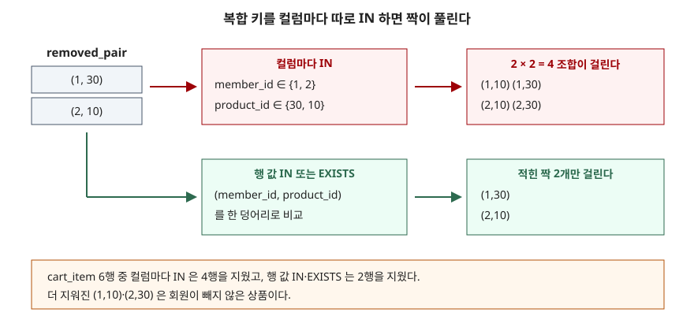

## 들어가며

쇼핑몰 장바구니 표를 정리하다 보면 "단종된 상품을 담은 행은 지워 달라"는 요청을 받는다. 단종 목록은 다른 표에 있으니, 다른 DB에서 쓰던 `DELETE c FROM cart_item c JOIN discontinued d ...` 를 그대로 쳐 본다. SQLite 는 `syntax error` 를 돌려준다. 그러면 많은 사람이 단종 상품 번호를 먼저 `SELECT` 해서 눈으로 복사한 뒤 `DELETE ... WHERE product_id = 20` 을 번호마다 한 번씩 돌린다. 단종 상품이 40개면 40번이고, 그 사이 목록이 바뀌면 복사해 둔 번호가 틀린다. 다른 표를 읽는 일을 DELETE 문 안에서 한 번에 시키는 방법이 따로 있다.

## 개념

**DELETE** 는 `WHERE` 조건이 참인 행을 지운다. 조건에는 상수만 쓸 수 있는 것이 아니라 **부질의**(괄호 안에 넣은 다른 SELECT)도 쓸 수 있다. 다른 표를 기준으로 지울 때는 이 부질의를 쓴다.

- **`IN (SELECT ...)`** — 이 행의 값이 부질의 결과 목록 안에 있으면 참이다
- **`EXISTS (SELECT ...)`** — 부질의가 한 행이라도 돌려주면 참이다. 부질의 안에서 바깥 행의 컬럼(`cart_item.product_id`)을 쓰므로 행마다 따로 돈다. 이런 부질의를 **상관 부질의**라고 부른다
- **행 값 `IN`** — `(member_id, product_id) IN (SELECT ...)` 처럼 컬럼 여러 개를 한 덩어리로 비교한다. 키가 컬럼 둘 이상으로 이뤄진 **복합 키**일 때 쓴다

SQLite 의 DELETE 문법에는 다른 표를 붙이는 `JOIN`·`FROM`·`USING` 자리가 없다. 다른 표는 `WHERE` 안의 부질의로만 들어온다.

## 구조

복합 키를 지울 때 가장 많이 틀리는 자리를 그렸다. "회원 1 은 상품 30 을, 회원 2 는 상품 10 을 뺐다"는 두 짝을 지우려는 상황이다.



> **출처**: [SQLite — Row Values §2.1 Row Value Comparisons](https://www.sqlite.org/rowvalue.html#row_value_comparisons), [SQLite — SQL Language Expressions §The IN and NOT IN operators](https://www.sqlite.org/lang_expr.html#the_in_and_not_in_operators)

## 동작 원리

`member_id IN (SELECT member_id FROM removed_pair) AND product_id IN (SELECT product_id FROM removed_pair)` 는 두 조건을 **따로** 검사한다. 앞 조건은 "회원 번호가 1 또는 2 인가", 뒤 조건은 "상품 번호가 30 또는 10 인가"만 본다. 어느 회원이 어느 상품을 뺐는지라는 짝 정보는 이 시점에 사라진다. 그래서 회원 1·2 와 상품 10·30 의 조합 네 개가 전부 걸린다.

행 값 `IN` 은 `(1, 30)` 처럼 두 값을 묶은 덩어리끼리 비교한다. SQLite 문서는 행 값 비교가 컬럼을 왼쪽부터 짝지어 견주는 것이라고 정한다. `EXISTS` 는 부질의 안에 `r.member_id = cart_item.member_id AND r.product_id = cart_item.product_id` 를 같이 적으므로 같은 짝을 찾는다.

DELETE 가 행을 하나씩 지우는 동안 부질의가 같은 표를 다시 읽으면 무슨 값을 보는지도 궁금해진다. SQLite 의 DELETE 문서에는 이 내용이 없어서 직접 돌려 봤다(실습 4번).

## 실습 예제

전체 소스: [`code/delete_other_table.py`](code/delete_other_table.py) · 수행 기록: [`code/output.txt`](code/output.txt)

장바구니 6행, 단종 상품 2개(20 과 40, 40 은 아무도 안 담았다), 회원이 직접 뺀 짝 2개를 넣었다. 실험마다 `BEGIN` 안에서 지우고 `ROLLBACK` 해서 매번 같은 6행에서 시작한다.

```text
[cart_item]  6행
  member_id | product_id | qty
  ----------+------------+----
          1 |         10 |   2
          1 |         20 |   1
          1 |         30 |   5
          2 |         10 |   1
          2 |         30 |   3
          3 |         20 |   4

[discontinued]  2행        [removed_pair]  2행
  product_id                 member_id | product_id
          20                         1 |         30
          40                         2 |         10
```

**① 다른 DB 의 문법은 전부 막힌다.**

```text
  sql> DELETE c FROM cart_item c JOIN discontinued d ON d.product_id = c.product_id
  -> OperationalError: near "c": syntax error
  sql> DELETE FROM cart_item USING discontinued d WHERE d.product_id = cart_item.product_id
  -> OperationalError: near "USING": syntax error
  sql> DELETE FROM cart_item WHERE qty > 1 LIMIT 1
  -> OperationalError: near "LIMIT": syntax error
```

`DELETE ... LIMIT` 은 SQLite 가 `SQLITE_ENABLE_UPDATE_DELETE_LIMIT` 옵션으로 빌드됐을 때만 된다. 파이썬에 들어 있는 SQLite 에서 `pragma_compile_options` 를 조회하니 이 옵션이 없었다(`limit_option 0`).

**② 단일 키 — IN 과 EXISTS 는 같은 행을 지운다.**

```text
  sql> DELETE FROM cart_item WHERE product_id IN (SELECT product_id FROM discontinued)
  지운 행 2
  남은 행 (1,10) (1,30) (2,10) (2,30)
```

`EXISTS` 로 쓴 문장도 지운 행 2, 남은 행이 똑같았다. 상품 20 을 담은 두 행이 지워졌고, 40 은 담은 사람이 없으니 아무 일도 없다.

**③ 복합 키 — 컬럼마다 IN 은 더 지운다.**

| 쓴 조건 | 지운 행 | 남은 행 |
|---|---|---|
| 컬럼마다 `IN` 두 개를 `AND` | 4 | (1,20) (3,20) |
| `EXISTS` (두 컬럼을 같이 비교) | 2 | (1,10) (1,20) (2,30) (3,20) |
| 행 값 `(member_id, product_id) IN` | 2 | (1,10) (1,20) (2,30) (3,20) |

컬럼마다 `IN` 은 회원이 빼지 않은 (1,10) 과 (2,30) 까지 지웠다. 위 도식의 2 × 2 조합 그대로다. 테스트 데이터에 짝이 한 개뿐이면 조합도 하나라서 이 문제가 드러나지 않는다. **이번 실습에서 가장 위험해 보인 자리다.**

**④ 같은 표를 부질의에서 다시 읽으면 — 지우기 전 값으로 평가된다.**

"상품을 두 개 이상 담은 회원의 행을 전부 지운다"를 같은 표를 다시 세는 부질의로 썼다.

```sql
DELETE FROM cart_item
WHERE (SELECT COUNT(*) FROM cart_item AS c2
       WHERE c2.member_id = cart_item.member_id) >= 2;
```

```text
  지운 행 5
  남은 행 (3,20)
```

행을 지울 때마다 다시 센다면 회원 1 의 마지막 행에서는 개수가 1 이 되어 그 행이 남아야 한다. 결과는 회원 1 의 세 행과 회원 2 의 두 행이 모두 지워졌다. "평균보다 적게 담은 행 지우기"도 같았다. 지우기 전 평균은 2.67 이고, 이보다 작은 qty 2·1·1 인 세 행이 지워져 qty 5·3·4 가 남았다. 지울 때마다 평균을 다시 냈다면 기준이 올라가 qty 3 행도 지워졌을 것이다. SQLite 3.49.1 에서는 **조건 판단이 지우기 전 상태를 기준으로 이뤄졌다.**

**⑤ 지우기 전에 같은 조건으로 센다.** `DELETE` 를 `SELECT COUNT(*)` 로 바꾸기만 하면 지울 행 수가 먼저 나온다. 이번에는 `will_delete 2` 였고, 실제 `DELETE` 의 지운 행도 2 였다.

**⑥ 실행계획.** IN 과 EXISTS 는 결과는 같아도 계획 모양이 다르다.

```text
QUERY PLAN
|--SCAN cart_item
`--USING ROWID SEARCH ON TABLE discontinued FOR IN-OPERATOR
```

```text
QUERY PLAN
|--SCAN cart_item
`--CORRELATED SCALAR SUBQUERY 1
   `--SEARCH d USING INTEGER PRIMARY KEY (rowid=?)
```

위가 `IN`, 아래가 `EXISTS` 다. `discontinued.product_id` 가 `INTEGER PRIMARY KEY` 라서, `IN` 쪽은 목록을 따로 만들지 않고 `discontinued` 의 rowid 로 바로 찾는다. `EXISTS` 쪽은 장바구니 행마다 상관 부질의를 한 번씩 돌리되, 그 안에서 같은 기본 키로 찾는다. 둘 다 `cart_item` 은 처음부터 끝까지 훑는다(`SCAN`). 지울 대상을 고르는 조건이 `cart_item` 의 인덱스 앞 컬럼에 걸리지 않기 때문이다.

## 다른 환경에서는

아래 내용은 각 제품의 공식 매뉴얼을 근거로 정리했다. MySQL·PostgreSQL 은 이 글에서 실행하지 않았다.

| | SQLite 3.49.1 | MySQL 8.0 | PostgreSQL 16 |
|---|---|---|---|
| 다른 표를 붙이는 문법 | 없음 (부질의만) | `DELETE t1 FROM t1 JOIN t2 ...` 다중 표 문법 | `DELETE FROM t USING t2 WHERE ...` |
| `DELETE ... LIMIT` | 빌드 옵션이 있을 때만 | 단일 표 DELETE 에서 된다. 다중 표 DELETE 에서는 안 된다 | DELETE 문법에 LIMIT 자리가 없다 |
| 지우는 표를 부질의에서 다시 읽기 | 이 글에서 실행해 보니 된다 | "같은 표를 부질의에서 SELECT 할 수 없다"고 정한다. 파생 테이블로 한 번 감싸 임시 표로 만들면 피할 수 있다 | DELETE 매뉴얼에 이에 관한 언급이 없다 |

PostgreSQL 매뉴얼은 `USING` 을 표준이 아닌 문법이라고 밝히고, 부질의를 쓰는 방식을 더 표준에 가까운 방법으로 함께 보여 준다. 어느 쪽이 나은지는 상황에 따라 다르다고 적는다. 부질의로 쓴 DELETE 는 세 제품에서 모두 통하므로, 여러 DB 를 오가는 코드라면 이쪽이 옮기기 쉽다. 다만 MySQL 에서는 ④처럼 같은 표를 다시 읽는 형태가 막힌다.

## 실무에서 주의할 점

1. **복합 키는 컬럼마다 IN 으로 나누지 않는다.** ③에서 6행 중 2행만 지워야 할 것이 4행 지워졌다. 행 값 `IN` 이나 두 컬럼을 같이 비교하는 `EXISTS` 를 쓴다. 테스트 데이터에 짝이 하나뿐이면 틀린 문장도 맞게 동작하므로 짝을 둘 이상 넣어 확인한다.
2. **같은 조건의 SELECT 로 먼저 센다.** `DELETE` 를 `SELECT COUNT(*)` 로 바꾸기만 하면 지울 행 수가 나온다. 이 수와 실제 지운 행 수(`changes()`, 파이썬에서는 `cursor.rowcount`)를 비교하면 조건이 의도대로 걸렸는지 확인할 수 있다.
3. **되돌릴 가능성이 있으면 `BEGIN` 안에서 지운다.** 이 글의 실험이 전부 그렇게 돌았다. 지운 뒤 남은 행을 보고 이상하면 `ROLLBACK`, 맞으면 `COMMIT` 한다.
4. **`NOT IN` 으로 "목록에 없는 행"을 지울 때는 부질의 쪽에 NULL 이 없는지 본다.** 부질의 결과에 NULL 이 하나라도 섞이면 `NOT IN` 은 참이 되지 못해 한 행도 지워지지 않는다. 이 동작은 [IN·EXISTS·NOT IN 글](../2026-09-28-in-exists-not-in-null/index.md)에서 실행해 확인했다. 지울 때는 `NOT EXISTS` 쪽이 안전하다.
5. **같은 표를 다시 읽는 DELETE 는 제품을 옮기면 깨질 수 있다.** SQLite 에서는 ④처럼 동작했지만 MySQL 매뉴얼은 이 형태를 금지한다.

## 정리

- SQLite 의 DELETE 에는 `JOIN`·`USING`·(기본 빌드에서) `LIMIT` 이 없다. 다른 표는 `WHERE` 의 부질의로만 읽는다
- 단일 키는 `IN` 과 `EXISTS` 가 같은 행을 지운다. 계획은 다르게 나온다
- 복합 키를 컬럼마다 `IN` 으로 나누면 짝이 풀려 더 많은 행이 지워진다. 행 값 `IN` 이나 `EXISTS` 를 쓴다
- SQLite 3.49.1 에서 지우는 표를 다시 읽는 부질의는 지우기 전 상태로 평가됐다
- 지우기 전에 같은 조건으로 세고, `BEGIN` 안에서 지운다

## 참고 자료

- [SQLite — DELETE §Overview](https://www.sqlite.org/lang_delete.html#overview) — DELETE 문법(JOIN·USING 자리가 없음)
- [SQLite — DELETE §Optional LIMIT and ORDER BY clauses](https://www.sqlite.org/lang_delete.html#optional_limit_and_order_by_clauses) — `SQLITE_ENABLE_UPDATE_DELETE_LIMIT` 로 빌드했을 때만 LIMIT 이 된다는 규칙
- [SQLite — Row Values §2.1 Row Value Comparisons](https://www.sqlite.org/rowvalue.html#row_value_comparisons) — 행 값 비교 규칙
- [SQLite — SQL Language Expressions §The IN and NOT IN operators](https://www.sqlite.org/lang_expr.html#the_in_and_not_in_operators) — IN 의 결과 규칙
- [SQLite — EXPLAIN QUERY PLAN](https://www.sqlite.org/eqp.html) — `CORRELATED SCALAR SUBQUERY` 표기
- [MySQL 8.0 Reference Manual — DELETE Statement](https://dev.mysql.com/doc/refman/8.0/en/delete.html) — 다중 표 DELETE 문법, 다중 표에서 LIMIT 불가, 같은 표 부질의 금지
- [MySQL 8.0 Reference Manual — Restrictions on Subqueries](https://dev.mysql.com/doc/refman/8.0/en/subquery-restrictions.html) — 파생 테이블을 임시 표로 만들어 같은 표 제한을 피하는 예
- [PostgreSQL 16 — DELETE](https://www.postgresql.org/docs/16/sql-delete.html) — `USING` 절과 부질의 방식의 비교
