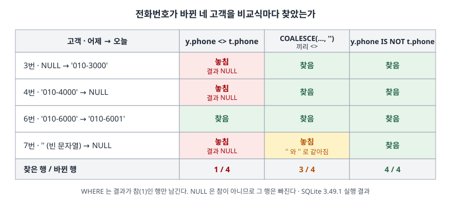

## 들어가며

회원 정보를 매일 밤 통째로 복사해 두는 시스템이 있다고 하자. 어느 날 "어제와 오늘 사이에 연락처가 바뀐 회원만 뽑아 달라"는 요청이 온다. 두 표를 회원 번호로 잇고 `WHERE 어제.phone <> 오늘.phone` 을 쓰면 끝날 것 같다. 결과는 몇 건 나오고, 아무도 이상하다고 느끼지 않는다. 그런데 전화번호를 **처음 등록한** 회원과 **지운** 회원은 그 결과에 하나도 없다. 이 예제에서는 바뀐 4명 중 1명만 나왔다. 빠진 3명을 찾으려고 회원을 한 명씩 열어 보면 회원 수만큼 손이 간다. 비교식 하나만 바꾸면 되는 일이다.

## 개념

**NULL** 은 "값이 없다" 또는 "모른다"를 뜻하는 표시다. SQL 에서 NULL 을 `=`·`<>` 같은 비교 연산자에 넣으면 결과가 참(1)도 거짓(0)도 아닌 **NULL** 이 된다. 모르는 값과 비교했으니 결과도 모른다는 뜻이다. 이렇게 참·거짓·모름 세 가지로 따지는 방식을 **3값 논리**라고 부른다.

`WHERE` 절은 조건이 **참인 행만** 남긴다. 결과가 NULL 이면 거짓과 똑같이 버려진다. 그래서 한쪽이 NULL 인 행은 `<>` 로 "다르다"고 판정될 수가 없다.

SQLite 는 NULL 을 하나의 값처럼 취급해 비교하는 연산자를 따로 둔다.

| 연산자 | 뜻 | NULL 을 만나면 |
|---|---|---|
| `a IS b` | 같은가 | 둘 다 NULL 이면 1, 한쪽만 NULL 이면 0 |
| `a IS NOT b` | 다른가 | 둘 다 NULL 이면 0, 한쪽만 NULL 이면 1 |
| `a IS NOT DISTINCT FROM b` | `IS` 의 다른 표기 | 같다 |
| `a IS DISTINCT FROM b` | `IS NOT` 의 다른 표기 | 같다 |

SQLite 문서는 IS 나 IS NOT 식은 **NULL 이 될 수 없다**고 적는다. 결과가 늘 1 아니면 0 이다. 같은 문서는 짧은 `IS`·`IS NOT` 표기를 표준 SQL 이 지원하지 않으며, 다른 엔진에서는 대개 `IS DISTINCT FROM` 표기가 필요하다고 밝힌다. 이렇게 NULL 끼리도 값처럼 비교하는 것을 흔히 **NULL 안전 비교**라고 부른다.

## 구조

어제·오늘 스냅숏에서 전화번호가 실제로 바뀐 고객은 4명이다. 비교식 세 가지가 각각 몇 명을 찾았는지를 그렸다.



> **출처**: [SQLite — SQL Language Expressions §IS and IS NOT](https://www.sqlite.org/lang_expr.html#isisnot), [SQLite — SQL Language Expressions §IS DISTINCT FROM](https://www.sqlite.org/lang_expr.html#isdf). 칸 안의 결과는 이 글의 실습 [2]·[3]을 SQLite 3.49.1 에서 돌린 것이다.

## 동작 원리

`y.phone <> t.phone` 은 행마다 계산된다. 3번 고객은 `NULL <> '010-3000'` 이고 결과는 NULL 이다. `WHERE` 는 참이 아니니 버린다. 4번은 반대 방향이라 역시 NULL, 7번은 `'' <> NULL` 이라 역시 NULL 이다. 끝까지 남는 것은 양쪽에 값이 있는 6번뿐이다.

`IS NOT` 은 NULL 을 "아직 정해지지 않은 값"이 아니라 **NULL 이라는 값 하나**로 본다. `NULL IS NOT '010-3000'` 은 "NULL 과 '010-3000' 은 다른 값인가"를 묻는 셈이고, 답은 1 이다. 5번 고객처럼 어제도 오늘도 NULL 이면 `NULL IS NOT NULL` 은 0 이라서, 바뀌지 않은 행은 그대로 걸러진다.

`COALESCE(a, '')` 는 NULL 을 빈 문자열로 바꿔 주는 함수다. NULL 이 사라지니 `<>` 가 제대로 동작할 것 같지만, 원래 빈 문자열이던 값과 NULL 이 **같은 값으로 합쳐진다**. 7번 고객은 어제 `''`, 오늘 NULL 이었는데 둘 다 `''` 로 바뀌어 "그대로"로 판정됐다. 대체값으로 무엇을 고르든 그 값이 실제 데이터에 한 번이라도 나오면 같은 일이 생긴다.

## 실습 예제

전체 소스: [`code/null_safe_compare.py`](code/null_safe_compare.py) · 수행 기록: [`code/output.txt`](code/output.txt)

어제와 오늘 고객 표를 7행씩 만들었다. 1·5번은 그대로, 2번은 이메일만, 3·4·6·7번은 전화번호가 바뀌었다.

```text
[customer_yesterday]                  [customer_today]
  customer_id | email  | phone          customer_id | email   | phone
            1 | a@x.kr | 010-1000                 1 | a@x.kr  | 010-1000
            2 | b@x.kr | NULL                     2 | b2@x.kr | NULL
            3 | c@x.kr | NULL                     3 | c@x.kr  | 010-3000
            4 | d@x.kr | 010-4000                 4 | d@x.kr  | NULL
            5 | NULL   | NULL                     5 | NULL    | NULL
            6 | f@x.kr | 010-6000                 6 | f@x.kr  | 010-6001
            7 | g@x.kr |                          7 | g@x.kr  | NULL
```

수행 기록에는 두 표가 따로 찍혀 있다. 여기서는 나란히 보이려고 옮겨 놓았다. 7번 어제 칸의 빈자리가 빈 문자열 `''` 이다.

**[1] 진리표부터 본다.**

```text
  a | b | eq | ne | not_eq | is_ | is_not | distinct_from | not_distinct_from
  1 | 1 | 1 | 0 | 0 | 1 | 0 | 0 | 1
  1 | 2 | 0 | 1 | 1 | 0 | 1 | 1 | 0
  1 | NULL | NULL | NULL | NULL | 0 | 1 | 1 | 0
  NULL | NULL | NULL | NULL | NULL | 1 | 0 | 0 | 1
```

`=` 와 `<>` 는 NULL 이 하나라도 끼면 NULL 을 돌려준다. `not_eq` 열은 `NOT (a = b)` 인데, 부정을 씌워도 NULL 은 NULL 로 남았다. `IS` 계열 네 칸에는 NULL 이 하나도 없다. `IS NOT` 과 `IS DISTINCT FROM` 의 열이 같고, `IS` 와 `IS NOT DISTINCT FROM` 의 열이 같다.

**[2] 전화번호가 바뀐 고객.**

| 비교식 | 찾은 고객 |
|---|---|
| `y.phone <> t.phone` | 6 |
| `y.phone IS NOT t.phone` | 3, 4, 6, 7 |
| `y.phone IS DISTINCT FROM t.phone` | 3, 4, 6, 7 |

`<>` 는 4명 중 1명만 찾았다. 전화번호를 새로 등록했거나 지운 고객은 전부 빠졌다.

**[3] COALESCE 우회.**

```text
  sql> ... WHERE COALESCE(y.phone, '') <> COALESCE(t.phone, '')
  customer_id | before | after
  3 | NULL | '010-3000'
  4 | '010-4000' | NULL
  6 | '010-6000' | '010-6001'
  (3행)
```

3번과 4번은 찾았지만 7번이 빠졌다. **이번 실습에서 가장 눈여겨볼 결과다.** `<>` 의 문제를 알고 고친 사람이 쓰는 형태라서, 고친 뒤에도 빠지는 행이 있다는 것을 알아채기 어렵다.

**[4] 여러 컬럼을 한 번에 비교.** 이메일이나 전화가 바뀐 고객을 찾는다.

| 비교식 | 찾은 고객 |
|---|---|
| `y.email IS NOT t.email OR y.phone IS NOT t.phone` | 2, 3, 4, 6, 7 |
| `(y.email, y.phone) IS NOT (t.email, t.phone)` | 2, 3, 4, 6, 7 |
| `y.email <> t.email OR y.phone <> t.phone` | 2, 6 |
| `오늘 EXCEPT 어제` | 2, 3, 4, 6, 7 |

괄호로 묶은 **행 값**에도 `IS NOT` 을 쓸 수 있고, 컬럼마다 `IS NOT` 을 `OR` 로 이은 것과 같은 5명이 나왔다. 컬럼이 많으면 이쪽이 짧다. `EXCEPT` 는 "오늘 표에는 있고 어제 표에는 없는 행"을 돌려주는 집합 연산이다. SQLite 문서는 UNION·EXCEPT 같은 복합 SELECT 가 중복을 가릴 때 **NULL 끼리 같은 값으로 본다**고 정한다. 그래서 `EXCEPT` 도 5명을 정확히 찾았다. 다만 바뀌기 전 값은 보여 주지 않는다.

**[5] NULL 이 있는 컬럼으로 조인하면.** 전화번호를 열쇠로 두 표를 이었다.

```text
  sql> SELECT COUNT(*) AS matched_by_eq FROM customer_yesterday AS y JOIN customer_today AS t ON y.phone = t.phone
  matched_by_eq
  1

  sql> SELECT COUNT(*) AS matched_by_is FROM customer_yesterday AS y JOIN customer_today AS t ON y.phone IS t.phone
  matched_by_is
  13
```

`=` 로는 `'010-1000'` 한 쌍만 이어졌다. `IS` 로 바꾸자 13쌍이 됐다. 늘어난 12쌍은 어제 전화가 NULL 인 3명(2·3·5번)과 오늘 전화가 NULL 인 4명(2·4·5·7번)이 **모든 조합으로** 짝지어진 것이다(3 × 4 = 12). NULL 을 같은 값으로 본다는 것은 "전화번호 없음"끼리 전부 같은 사람으로 본다는 뜻이기도 하다.

**[6] 실행계획.** `phone` 에 인덱스를 만들고 다섯 가지 조건의 계획을 봤다.

```text
  sql> SELECT customer_id FROM customer_today WHERE phone IS '010-3000'
  QUERY PLAN
  `--SEARCH customer_today USING COVERING INDEX ix_customer_today_phone (phone=?)
```

| 조건 | `EXPLAIN QUERY PLAN` 의 `detail` 원문 |
|---|---|
| `phone = '010-3000'` | `SEARCH customer_today USING COVERING INDEX ix_customer_today_phone (phone=?)` |
| `phone IS '010-3000'` | `SEARCH customer_today USING COVERING INDEX ix_customer_today_phone (phone=?)` |
| `phone IS NULL` | `SEARCH customer_today USING COVERING INDEX ix_customer_today_phone (phone=?)` |
| `phone IS NOT DISTINCT FROM '010-3000'` | `SEARCH customer_today USING COVERING INDEX ix_customer_today_phone (phone=?)` |
| `phone IS NOT NULL` | `SEARCH customer_today USING COVERING INDEX ix_customer_today_phone (phone>?)` |

`IS` 로 바꿔도 인덱스 탐색(`SEARCH`)은 그대로였다. 계획에는 `=` 와 똑같이 `phone=?` 로 적힌다. `IS NOT NULL` 은 범위 탐색 `phone>?` 로 나왔다.

## 실무에서 주의할 점

1. **바뀐 행을 찾을 때 NULL 이 들어갈 수 있는 컬럼에는 `<>` 를 쓰지 않는다.** [2]에서 바뀐 4행 중 3행이 빠졌고 오류도 경고도 없었다. 컬럼 정의에 `NOT NULL` 이 없으면 `IS NOT` 이나 `IS DISTINCT FROM` 을 쓴다.
2. **COALESCE 로 NULL 을 덮는 우회는 대체값이 실제 데이터와 겹치면 틀린다.** [3]에서 빈 문자열이던 값이 NULL 로 바뀐 행을 놓쳤다. 빈 문자열·0·`'-'` 처럼 대체값으로 흔히 고르는 값은 실제 데이터에도 흔하다.
3. **조인 조건을 `IS` 로 바꾸기 전에 NULL 행 수를 센다.** [5]에서 NULL 이 3행·4행이었을 뿐인데 12쌍이 생겼다. 조인 열쇠가 NULL 인 행은 짝이 없는 것이 맞는 경우가 많다. NULL 끼리 이어야 하는 경우(복합 키의 일부가 비어 있는 코드 표 등)에만 쓴다.
4. **다른 DB 로 옮길 코드라면 `IS DISTINCT FROM` 표기를 쓴다.** SQLite 문서가 밝히듯 짧은 `IS`·`IS NOT` 비교는 표준 SQL 표기가 아니다. 같은 뜻이므로 결과는 [1]처럼 똑같다.
5. **`WHERE NOT (a = b)` 도 NULL 을 걸러 낸다.** [1]의 `not_eq` 열처럼 `a = b` 가 NULL 이면 부정한 결과도 NULL 이다. `<>` 를 `NOT (=)` 로 바꿔 써도 빠지는 행은 같다.

## 정리

- `=`·`<>` 는 한쪽이라도 NULL 이면 NULL 을 돌려주고, `WHERE` 는 그 행을 버린다
- `IS`·`IS NOT` 과 `IS NOT DISTINCT FROM`·`IS DISTINCT FROM` 은 NULL 을 값처럼 비교해 늘 1 이나 0 을 돌려준다
- 스냅숏 비교에서 `<>` 는 바뀐 4행 중 1행, COALESCE 우회는 3행, `IS NOT` 은 4행을 찾았다
- 행 값 `IS NOT` 과 `EXCEPT` 로 여러 컬럼을 한 번에 비교할 수 있다
- `IS` 조인은 NULL 끼리 모든 조합으로 짝짓는다. 인덱스는 `=` 와 같이 탄다

## 참고 자료

- [SQLite — SQL Language Expressions §IS and IS NOT](https://www.sqlite.org/lang_expr.html#isisnot) — NULL 피연산자에 대한 IS·IS NOT 의 결과, IS 식은 NULL 이 될 수 없다는 규칙, 짧은 표기가 표준이 아니라는 설명
- [SQLite — SQL Language Expressions §IS DISTINCT FROM](https://www.sqlite.org/lang_expr.html#isdf) — `IS NOT DISTINCT FROM`·`IS DISTINCT FROM` 이 각각 `IS`·`IS NOT` 의 다른 표기라는 설명
- [SQLite — Row Values §2 Syntax](https://www.sqlite.org/rowvalue.html#syntax) — 행 값에 쓸 수 있는 비교 연산자 목록(IS·IS NOT 포함)
- [SQLite — SELECT §Compound Select Statements](https://www.sqlite.org/lang_select.html#compound_select_statements) — 복합 SELECT 가 중복을 가릴 때 NULL 끼리 같다고 보는 규칙
- [SQLite — Built-In Scalar SQL Functions §coalesce](https://www.sqlite.org/lang_corefunc.html#coalesce) — COALESCE 의 정의
- [NULL 비교와 3값 논리](../2026-10-02-null-comparison-three-valued-logic/index.md) — 같은 저장소에서 3값 논리를 처음부터 다룬 글
