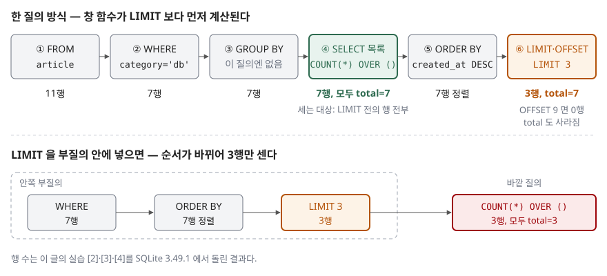

## 들어가며

게시판 목록 화면을 만들면 한 쪽에 글 몇 개와 함께 "전체 7건"처럼 건수를 같이 보여 달라는 요청이 꼭 따라온다. 처음에는 쪽 질의 하나와 `COUNT(*)` 질의 하나, 두 번 DB 에 다녀온다. 그러다 "같은 조건을 두 번 적는 게 번거롭다"며 두 질의를 하나로 합치는 방법을 찾게 되고, 검색하면 `COUNT(*) OVER ()` 가 나온다. 써 보면 정말 3행마다 7이 붙어 나온다. 그런데 왜 LIMIT 3 을 걸었는데 3이 아니라 7인지, 그리고 이 합친 질의가 두 질의보다 정말 싼지는 따져 보지 않고 넘어가기 쉽다. 이 글의 실습에서 합친 질의는 두 질의를 더한 것보다 **약 12배** 많은 일을 했다.

## 개념

**창 함수**(window function)는 행을 줄이지 않고 각 행 옆에 계산 결과를 붙이는 함수다. `COUNT(*)` 를 그냥 쓰면 행 전체가 1행으로 줄지만, 뒤에 `OVER (...)` 를 붙이면 행은 그대로 두고 각 행에 개수를 적는다. 괄호 안이 비어 있는 `OVER ()` 는 묶음을 나누지 않는다는 뜻이다. SQLite 문서는 `PARTITION BY` 가 없으면 질의 결과 집합 전체가 **하나의 묶음**(파티션)이 된다고 적는다. 그래서 모든 행에 같은 전체 개수가 붙는다.

**LIMIT·OFFSET** 은 결과에서 앞의 M행(OFFSET)을 건너뛰고 다음 N행(LIMIT)만 돌려준다. SQLite 문서는 LIMIT 을 SELECT 문 **전체가** 돌려주는 행 수의 상한이라고 정의한다.

핵심은 두 가지가 **계산되는 순서**다. 창 함수가 먼저 계산되면 LIMIT 전의 행을 세고, 나중이면 LIMIT 뒤의 행을 센다.

## 구조



> **출처**: [PostgreSQL 16 — SELECT, Description](https://www.postgresql.org/docs/16/sql-select.html#SQL-SELECT-LIST), [PostgreSQL 16 — 7.2.5 Window Function Processing](https://www.postgresql.org/docs/16/queries-table-expressions.html#QUERIES-WINDOW), [SQLite — SELECT §The LIMIT clause](https://www.sqlite.org/lang_select.html#limitoffset). 행 수는 이 글의 실습 [2]·[3]·[4]를 SQLite 3.49.1 에서 돌린 결과다.

## 동작 원리

PostgreSQL 16 의 SELECT 문서는 처리 과정을 번호로 나눠 적는다. FROM → WHERE → GROUP BY·HAVING → SELECT 목록의 출력 행 계산 → DISTINCT → 집합 연산 → ORDER BY → LIMIT·OFFSET 순서다. 창 함수 처리 절은 창 함수가 그룹 묶기·집계·HAVING 이 **끝난 뒤** 계산된다고 적는다. 창 함수는 SELECT 목록 안에 있으니, ORDER BY 와 LIMIT 보다 앞선다.

SQLite 창 함수 문서에서는 이 순서를 적은 문장을 찾지 못했다. 그래서 실습 [2]와 [4]로 직접 확인했다. LIMIT 3 을 건 같은 질의에서 `total` 은 7이었다. 같은 LIMIT 을 부질의 안에 넣고 바깥에서 세면 3이었다. 창 함수가 보는 행은 **그 SELECT 의 WHERE 를 통과한 행 전부**이고, LIMIT 은 그 뒤에 잘라 낸다.

이 순서는 비용으로도 이어진다. LIMIT 3 만 있는 쪽 질의는 인덱스를 정렬 순서대로 따라가다 3행을 채우면 멈출 수 있다. 그런데 `COUNT(*) OVER ()` 를 붙이면 LIMIT 전에 행 전부를 세야 하므로 멈출 수가 없다.

## 실습 예제

전체 소스: [`code/count_over_paging.py`](code/count_over_paging.py) · 수행 기록: [`code/output.txt`](code/output.txt)

글 11개 중 `category = 'db'` 인 글이 7개다.

```text
  article_id | category | title         | created_at
  -----------+----------+---------------+-----------
           1 | db       | 인덱스 기초   | 2026-11-01
           2 | web      | HTTP 캐시     | 2026-11-02
           3 | db       | 조인 순서     | 2026-11-03
           4 | db       | 실행계획 읽기 | 2026-11-04
           5 | linux    | grep 옵션     | 2026-11-05
           6 | db       | 트랜잭션      | 2026-11-06
           7 | web      | 쿠키와 세션   | 2026-11-07
           8 | db       | 창 함수       | 2026-11-08
           9 | db       | NULL 비교     | 2026-11-09
          10 | linux    | tar 묶기      | 2026-11-10
          11 | db       | 페이징        | 2026-11-11
```

**[2] 한 질의로 받기.**

```sql
SELECT article_id, title, created_at,
       COUNT(*) OVER () AS total
FROM article
WHERE category = 'db'
ORDER BY created_at DESC
LIMIT 3 OFFSET 0;
```

```text
  article_id | title | created_at | total
  11 | 페이징 | 2026-11-11 | 7
  9 | NULL 비교 | 2026-11-09 | 7
  8 | 창 함수 | 2026-11-08 | 7
  (3행)
```

3행에 모두 7이 붙었다. 마지막 쪽(OFFSET 6)에서는 1행이 나오고 거기에도 7이 붙었다.

**[3] 범위 밖 쪽.** OFFSET 9 로 7건을 넘어선 쪽을 요청했다.

| 방식 | 결과 |
|---|---|
| 두 질의 — 쪽 질의 | 0행 |
| 두 질의 — `COUNT(*)` 질의 | `total` 7 |
| 한 질의 — `COUNT(*) OVER ()` | 0행, `total` 없음 |

건수는 행 옆에 붙는 칸이라서 행이 없으면 건수도 없다.

**[4] LIMIT 을 부질의 안에 넣으면.** 같은 3행이 나왔지만 `total` 은 3이었다. 바깥 SELECT 의 창 함수는 부질의가 LIMIT 으로 잘라 넘긴 3행만 본다.

**[5] 일량.** 20만 행 표(`db` 5만 행)에 `(category, created_at)` 인덱스를 두고 1쪽 3행을 받았다. 질의가 끝날 때까지 실행한 VDBE(SQLite 가상 머신) 명령 수를 셌다.

```text
    질의                       | VDBE 명령 수 | 반환 행
    ---------------------------+--------------+--------
    쪽 질의만                  |           40 |       3
    COUNT(*) 질의만            |      150,011 |       1
    한 질의 (COUNT(*) OVER ()) |    1,800,047 |       3
```

두 질의를 더하면 약 15만인데, 합친 질의는 180만이었다. **예상과 달랐던 점이다.** 같은 조건을 한 번만 읽으니 더 쌀 것으로 예상했지만 12배 비쌌다. 실행계획에서 이유가 보인다.

```text
  QUERY PLAN
  |--CO-ROUTINE (subquery-2)
     `--SEARCH article USING INDEX ix_article_category_created_at (category=?)
  |--SCAN (subquery-2)
  `--USE TEMP B-TREE FOR ORDER BY
```

쪽 질의만 보낼 때는 `SEARCH ... USING INDEX` 한 줄로 끝나 인덱스 순서대로 3행만 읽었다. `COUNT(*)` 질의는 표에 가지 않고 인덱스만 읽는 `COVERING INDEX` 였다. 합친 질의는 창 함수를 계산하려고 5만 행을 모두 표에서 꺼내 부질의로 만들었고, 그 5만 행을 **임시 B-Tree 로 다시 정렬**(`USE TEMP B-TREE FOR ORDER BY`)한 뒤 3행을 잘랐다.

## 실무에서 주의할 점

1. **범위 밖 쪽에서 건수가 사라진다.** [3]처럼 마지막 쪽 뒤를 요청하면 0행이 오고 건수 칸도 없다. 화면 코드가 첫 행의 `total` 을 읽는다면 빈 결과를 따로 처리해야 한다. 글이 지워져 쪽 수가 줄어든 직후에 자주 생긴다.
2. **합친 질의가 더 싸다고 가정하지 않는다.** [5]에서 한 번 다녀오는 대신 일량이 12배가 됐다. 왕복 비용이 큰 원격 DB 라면 계산이 달라질 수 있으니, 바꾸기 전에 실행계획부터 본다.
3. **LIMIT 의 위치를 바꾸면 뜻이 바뀐다.** 질의를 부질의로 감싸거나 뷰로 옮기다가 LIMIT 이 안쪽으로 들어가면 [4]처럼 `total` 이 쪽 크기로 바뀐다. 오류 없이 숫자만 틀린다.
4. **전체 쪽 수가 꼭 필요한지 먼저 묻는다.** "다음 쪽 있음"만 보여 줘도 되면 LIMIT 을 쪽 크기 + 1 로 받아 한 행이 더 오는지만 본다. 이러면 건수를 세지 않아도 된다([LIMIT·OFFSET 페이징](../2026-11-05-limit-offset-pagination/index.md)).

## 정리

- `COUNT(*) OVER ()` 는 행을 줄이지 않고 각 행에 전체 개수를 붙인다
- 창 함수는 LIMIT·OFFSET 보다 먼저 계산되므로 LIMIT 전의 행을 센다. 부질의 안에 LIMIT 을 넣으면 잘린 행만 센다
- 범위 밖 쪽에서는 행이 없어 건수도 함께 사라진다
- 20만 행 표에서 합친 질의는 두 질의를 더한 것보다 VDBE 명령이 약 12배 많았다. 인덱스에서 3행만 읽고 멈추던 쪽 질의가 5만 행을 읽고 다시 정렬했기 때문이다

## 참고 자료

- [SQLite — Window Functions §2.1 The PARTITION BY Clause](https://www.sqlite.org/windowfunctions.html#the_partition_by_clause) — PARTITION BY 가 없으면 결과 집합 전체가 한 파티션이라는 규칙
- [SQLite — SELECT §The LIMIT clause](https://www.sqlite.org/lang_select.html#limitoffset) — LIMIT 이 SELECT 문 전체가 돌려주는 행 수의 상한이고, OFFSET 만큼 앞 행을 빼고 돌려준다는 정의
- [PostgreSQL 16 — SELECT, Description](https://www.postgresql.org/docs/16/sql-select.html#SQL-SELECT-LIST) — SELECT 처리 과정을 번호로 나눈 목록(출력 행 계산 → ORDER BY → LIMIT)
- [PostgreSQL 16 — 7.2.5 Window Function Processing](https://www.postgresql.org/docs/16/queries-table-expressions.html#QUERIES-WINDOW) — 창 함수가 그룹 묶기·집계·HAVING 뒤에 계산된다는 설명
- [PostgreSQL 16 — 7.6 LIMIT and OFFSET](https://www.postgresql.org/docs/16/queries-limit.html) — OFFSET 으로 건너뛴 행도 서버 안에서는 계산된다는 설명
- [LIMIT·OFFSET 페이징](../2026-11-05-limit-offset-pagination/index.md) — 같은 저장소에서 OFFSET 비용과 "다음 쪽 있음" 방식을 다룬 글
