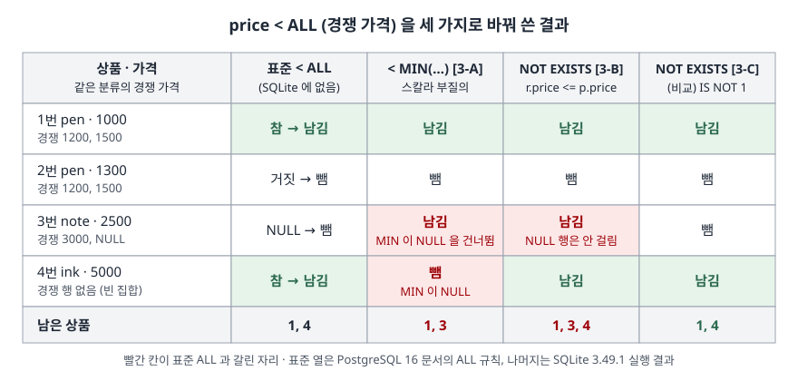

## 들어가며

다른 DB 에서 쓰던 질의를 SQLite 로 옮기다 보면 `WHERE price < ALL (SELECT …)` 같은 줄에서 문법 오류가 난다. "경쟁사 가격 전부보다 싼 상품"을 뽑는 흔한 질의다. 대부분은 검색해서 나온 대체 형태, `price < (SELECT MIN(…))` 로 바꾸고 결과가 나오면 넘어간다. 그런데 결과 행 수가 원래 DB 와 맞는지는 잘 확인하지 않는다. 이 글의 예제에서는 상품 4개 중 2개가 바뀐 질의에서 다르게 판정됐다. 경쟁 가격이 하나도 없는 분류와, 가격이 비어 있는 경쟁 행이 있는 분류다. 이 둘을 찾으려고 분류마다 손으로 비교하면 분류 수만큼 일이 늘어난다.

## 개념

**부질의**(subquery)는 다른 질의 안에 괄호로 넣은 `SELECT` 다. 부질의가 여러 행을 돌려줄 때 그 값들과 한꺼번에 비교하는 표준 SQL 문법이 **ALL** 과 **ANY**(같은 뜻으로 SOME)다.

| 문법 | 뜻 |
|---|---|
| `x < ALL (부질의)` | 부질의의 **모든** 값보다 작은가 |
| `x > ANY (부질의)` | 부질의의 값 중 **하나라도** 보다 큰가 |

SQLite 는 이 문법을 지원하지 않는다. SQLite 의 식 문서에는 ALL·ANY 비교 형태가 없고, 실습 [1]처럼 쓰면 문법 오류가 난다. 그래서 같은 뜻을 다른 문법으로 바꿔 써야 한다. 자주 쓰는 대체는 두 가지다.

| 원래 문법 | 집계로 바꾸기 | EXISTS 로 바꾸기 |
|---|---|---|
| `x < ALL (…)` | `x < (SELECT MIN(…))` | `NOT EXISTS (… WHERE 값 <= x)` |
| `x > ALL (…)` | `x > (SELECT MAX(…))` | `NOT EXISTS (… WHERE 값 >= x)` |
| `x > ANY (…)` | `x > (SELECT MIN(…))` | `EXISTS (… WHERE x > 값)` |
| `x < ANY (…)` | `x < (SELECT MAX(…))` | `EXISTS (… WHERE x < 값)` |

부질의에 값이 하나 이상 있고 NULL 이 없으면 세 형태는 같은 답을 낸다. 갈리는 것은 그 두 조건이 깨질 때다.

## 구조

표준 ALL 의 규칙은 PostgreSQL 문서가 정리해 둔 것을 따랐다. 모든 비교가 참이면 참이고, **부질의가 행을 하나도 돌려주지 않아도 참**이다. 거짓인 비교가 하나라도 있으면 거짓이다. 거짓은 없는데 NULL 인 비교가 하나라도 있으면 결과는 NULL 이다. 이 규칙으로 계산한 열과 SQLite 에서 돌린 대체 세 가지를 나란히 놓았다.



> **출처**: 표준 열은 [PostgreSQL 16 — Subquery Expressions §9.23.5 ALL](https://www.postgresql.org/docs/16/functions-subquery.html#FUNCTIONS-SUBQUERY-ALL) 의 결과 규칙으로 계산했다. MIN 의 NULL 처리는 [SQLite — Built-in Aggregate Functions §min(X)](https://www.sqlite.org/lang_aggfunc.html#min_agg), EXISTS 의 값은 [SQLite — SQL Language Expressions §The EXISTS operator](https://www.sqlite.org/lang_expr.html#the_exists_operator). 나머지 세 열은 실습 [3]을 SQLite 3.49.1 에서 돌린 결과다.

## 동작 원리

**MIN 비교가 갈리는 이유.** SQLite 문서는 `min(X)` 가 그룹에 NULL 이 아닌 값이 하나도 없을 때만 NULL 을 돌려준다고 정한다. 이 한 줄에서 두 가지가 나온다.

- note 분류의 경쟁 가격은 3000 과 NULL 이다. MIN 은 NULL 을 건너뛰고 3000 을 돌려준다. `2500 < 3000` 은 참이라 3번 상품이 남는다. 표준 ALL 은 `2500 < NULL` 이 NULL 이므로 결과가 NULL 이고, `WHERE` 가 버린다.
- ink 분류에는 경쟁 행이 없다. MIN 은 NULL 이고 `5000 < NULL` 은 NULL 이라 4번 상품이 빠진다. 표준 ALL 은 빈 집합이면 참이라 남긴다.

**NOT EXISTS 가 갈리는 이유.** `EXISTS` 는 부질의가 행을 하나라도 돌려주면 1, 아니면 0 이다. SQLite 문서는 EXISTS 의 결과가 늘 0 아니면 1 이라고 적는다. NULL 이 될 수 없다. `NOT EXISTS (… WHERE r.price <= p.price)` 는 "나보다 싸거나 같은 경쟁 가격이 있는가"를 묻는데, 가격이 NULL 인 행은 `NULL <= 2500` 이 NULL 이라 부질의 결과에 들어가지 않는다. 걸린 행이 없으니 3번 상품은 남는다. 빈 집합은 걸린 행이 없으므로 참이고, 이 점은 표준과 같다.

**표준과 맞추려면** 부질의 안에서 "참이 아닌 비교"를 전부 잡으면 된다. SQLite 에서 비교식은 1·0·NULL 중 하나를 돌려주므로 `(p.price < r.price) IS NOT 1` 은 거짓과 NULL 을 둘 다 잡는다. 그런 행이 하나도 없을 때만 남기면 표준 ALL 의 `WHERE` 결과와 같아진다. `IS NOT` 은 NULL 도 하나의 값처럼 비교하는 연산자다.

## 실습 예제

전체 소스: [`code/all_any_rewrite.py`](code/all_any_rewrite.py) · 수행 기록: [`code/output.txt`](code/output.txt)

상품 표와 경쟁사 가격 표를 4행씩 만들었다. pen 분류는 값이 다 있고, note 는 NULL 이 섞이고, ink 는 경쟁 행이 없다.

```text
[product]                        [rival_offer]
  product_id | category | price    offer_id | category | price
           1 | pen      |  1000           1 | pen      |  1200
           2 | pen      |  1300           2 | pen      |  1500
           3 | note     |  2500           3 | note     |  3000
           4 | ink      |  5000           4 | note     |  NULL
```

수행 기록에는 두 표가 따로 찍혀 있다. 여기서는 나란히 보이려고 옮겨 놓았다.

**[1] 문법을 그대로 쓰면 오류가 난다.**

```text
  sql> SELECT product_id FROM product AS p WHERE p.price < ALL (SELECT r.price FROM rival_offer AS r WHERE r.category = p.category)
  OperationalError: near "ALL": syntax error

  sql> SELECT product_id FROM product AS p WHERE p.price > ANY (SELECT r.price FROM rival_offer AS r WHERE r.category = p.category)
  OperationalError: near "SELECT": syntax error
```

오류가 난 위치가 다르다. `ALL` 은 SQLite 키워드 목록에 있고(`UNION ALL` 의 ALL) `ANY` 는 없다. 그래서 `ANY (` 는 **함수 호출**로 읽히고, 괄호 안의 `SELECT` 에서 막혔다. 같은 기록에서 `SELECT 1 AS any` 는 컬럼 이름으로 통과했고, `SELECT 1 AS all` 은 `near "all": syntax error`, `SELECT any(1)` 은 `no such function: any` 였다. 부질의 대신 값 하나를 넣으면 문법 오류가 아니라 "그런 함수가 없다"는 오류가 나는 셈이다.

**[2] 분류별로 MIN 이 무엇을 돌려주는가.**

```text
  category | offer_rows | priced_rows | min_price
  ink | 0 | 0 | NULL
  note | 2 | 1 | 3000
  pen | 2 | 2 | 1200
```

note 는 행이 2개인데 가격이 있는 행은 1개고, MIN 은 3000 이다. ink 는 행이 없어 MIN 이 NULL 이다.

**[3] `< ALL` 을 세 가지로 바꿔 쓴 결과.**

| 형태 | 남은 상품 |
|---|---|
| [3-A] `p.price < (SELECT MIN(r.price) …)` | 1, 3 |
| [3-B] `NOT EXISTS (… AND r.price <= p.price)` | 1, 3, 4 |
| [3-C] `NOT EXISTS (… AND (p.price < r.price) IS NOT 1)` | 1, 4 |

[3-C]만 표준 ALL 의 결과(1, 4)와 같다. [5]에서 상품마다 판정값을 찍어 보면 차이가 어디서 나는지 보인다.

```text
  product_id | category | price | by_min | by_not_exists | by_strict
  1 | pen | 1000 | 1 | 1 | 1
  2 | pen | 1300 | 0 | 0 | 0
  3 | note | 2500 | 1 | 1 | 0
  4 | ink | 5000 | NULL | 1 | 1
```

`by_min` 의 4번은 0 이 아니라 NULL 이다. 거짓이라서가 아니라 "모름"이라서 빠진 것이다.

**[4] ANY 쪽은 `WHERE` 에서는 같고, NOT 을 씌우면 갈린다.**

| 형태 | 남은 상품 |
|---|---|
| [4-A] `p.price > (SELECT MIN(…))` | 2 |
| [4-B] `EXISTS (… AND p.price > r.price)` | 2 |
| [4-C] `NOT (p.price > (SELECT MIN(…)))` | 1, 3 |
| [4-D] `NOT EXISTS (… AND p.price > r.price)` | 1, 3, 4 |

`> ANY` 는 하나라도 참이면 참이라서, 빈 집합이나 NULL 이 만드는 것은 "거짓"이나 "모름"뿐이다. `WHERE` 는 둘 다 버리므로 [4-A]와 [4-B]가 같다. 그러나 앞에 `NOT` 을 붙이면 4번 상품에서 갈린다. `NOT (5000 > NULL)` 은 여전히 NULL 이라 빠지고, `NOT EXISTS` 는 0 을 뒤집어 1 이 되어 남는다.

## 실무에서 주의할 점

1. **`< ALL` 을 MIN 비교로 바꾸면 빈 집합을 놓친다.** [3-A]에서 경쟁 행이 없는 ink 상품이 빠졌다. "비교 대상이 없으면 통과"가 맞는 질문인지, "비교 대상이 없으면 제외"가 맞는 질문인지를 먼저 정한다. 앞쪽이면 NOT EXISTS 형태를 쓴다.
2. **비교 대상 컬럼에 NULL 이 들어갈 수 있으면 [3-B]도 표준과 다르다.** 가격이 NULL 인 경쟁 행은 아무것도 막지 못했다. `NOT NULL` 제약이 있는 컬럼이면 [3-B]로 충분하고, 없으면 [3-C]처럼 `IS NOT 1` 로 NULL 까지 잡는다. NULL 을 "아직 모르는 가격"으로 볼지, "없는 가격"으로 볼지가 결정 기준이다.
3. **NOT 을 씌울 질의는 EXISTS 형태로 쓴다.** [4-C]와 [4-D]처럼 집계 비교는 NULL 을 뒤집어도 NULL 이라, 부정한 질의의 결과가 원래 질의의 나머지가 되지 않는다. 4개 상품이 [4-A]에 1개, [4-C]에 2개 들어가 1개가 양쪽 어디에도 없다.
4. **옮겨 온 질의는 행 수를 원래 DB 와 맞춰 본다.** 세 형태 모두 오류 없이 돌았고 결과만 달랐다. 빈 그룹과 NULL 이 있는 테스트 데이터를 일부러 넣어 두지 않으면 차이가 드러나지 않는다.
5. **`IN` 과 `NOT IN` 도 같은 계열이다.** PostgreSQL 문서는 `IN` 이 `= ANY` 와, `NOT IN` 이 `<> ALL` 과 같다고 적는다. `NOT IN` 이 부질의의 NULL 하나에 결과 전체를 잃는 것도 [3]과 같은 이유다. 이 저장소의 [IN·EXISTS·NOT IN 글](../2026-09-28-in-exists-not-in-null/index.md)에서 따로 다뤘다.

## 정리

- SQLite 3.49.1 은 `ALL`·`ANY` 비교를 받지 않는다. `ALL` 은 키워드라 그 자리에서, `ANY` 는 함수 이름으로 읽혀 괄호 안에서 문법 오류가 난다
- 표준 ALL 은 빈 집합이면 참, NULL 이 섞이고 거짓이 없으면 NULL 이다
- MIN 비교는 NULL 을 건너뛰고 빈 집합에서 NULL 이 되어 두 경우 모두 표준과 다르다
- NOT EXISTS 는 빈 집합은 맞히지만 NULL 행을 무시한다. `(비교) IS NOT 1` 로 걸러야 표준과 같다
- ANY 의 두 대체는 `WHERE` 에서는 같고, `NOT` 을 씌우면 빈 집합에서 갈린다

## 참고 자료

- [PostgreSQL 16 — Subquery Expressions §9.23.5 ALL](https://www.postgresql.org/docs/16/functions-subquery.html#FUNCTIONS-SUBQUERY-ALL) — ALL 의 결과 규칙(빈 집합은 참, 거짓이 없고 NULL 이 있으면 NULL), `NOT IN` 과 `<> ALL` 의 관계
- [PostgreSQL 16 — Subquery Expressions §9.23.4 ANY/SOME](https://www.postgresql.org/docs/16/functions-subquery.html#FUNCTIONS-SUBQUERY-ANY-SOME) — ANY 의 결과 규칙, `IN` 과 `= ANY` 의 관계
- [SQLite — SQL Language Keywords](https://www.sqlite.org/lang_keywords.html) — SQLite 키워드 목록(ALL 은 있고 ANY 는 없다)
- [SQLite — Built-in Aggregate Functions §min(X)](https://www.sqlite.org/lang_aggfunc.html#min_agg) — NULL 이 아닌 값이 없을 때만 NULL 을 돌려준다는 규칙
- [SQLite — SQL Language Expressions §The EXISTS operator](https://www.sqlite.org/lang_expr.html#the_exists_operator) — EXISTS 가 늘 0 또는 1 이라는 규칙
- [IN, EXISTS, NOT IN — 결과가 갈리는 지점](../2026-09-28-in-exists-not-in-null/index.md) — 같은 저장소에서 IN·NOT IN 의 NULL 함정을 다룬 글
