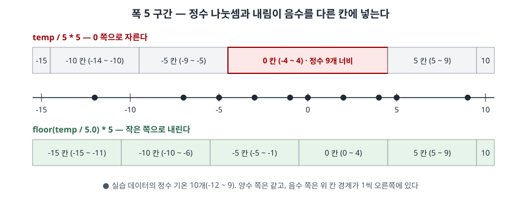

## 들어가며

센서 기록이나 주문 금액을 모아 두다 보면 "몇 도 구간에 몇 번 찍혔나" 같은 분포표가 필요해진다. 처음에는 `CASE WHEN temp BETWEEN 0 AND 5 … WHEN temp BETWEEN 5 AND 10 …` 처럼 구간을 하나씩 적는다. 구간이 10개를 넘으면 줄이 길어지니, 검색해서 나온 `(temp / 5) * 5` 한 줄로 바꾼다. 양수만 있는 데이터에서는 이 식이 잘 맞는다. 그런데 영하가 섞인 겨울 기록을 넣으면 0 칸의 개수가 이웃 칸보다 눈에 띄게 많아진다. 이 글의 예제 15행 중 5행이 0 칸에 몰렸고, 그중 2행은 영하였다.

## 개념

**구간 나누기**(bucketing)는 연속된 값을 일정한 폭의 칸으로 묶어 칸마다 개수를 세는 일이다. 칸별 개수를 막대로 그린 것을 **히스토그램**이라 한다. SQL 에서는 값마다 "어느 칸인가"를 계산하는 식을 만들고 그 식으로 `GROUP BY` 한다.

칸을 정하는 방법은 두 가지다.

| 방법 | 식 | 쓰는 때 |
|---|---|---|
| 구간을 직접 적기 | `CASE WHEN temp < 0 THEN … WHEN temp < 10 THEN …` | 칸 폭이 서로 다를 때 |
| 나눗셈으로 계산 | `(temp / 5) * 5` | 칸 폭이 모두 같을 때 |

두 번째 식은 "5로 나눈 몫에 다시 5를 곱하면 그 칸의 시작값이 나온다"는 생각에서 나왔다. 7 이면 몫 1, 시작값 5 다. 이 생각은 **몫이 내림(작은 쪽으로 버림)일 때만** 맞는다.

## 구조



> **출처**: 정수 나눗셈의 방향은 [SQLite — SQL Language Expressions §2 Operators, and Parse-Affecting Attributes](https://www.sqlite.org/lang_expr.html#operators_and_parse_affecting_attributes), `floor` 의 정의는 [SQLite — Built-In Mathematical SQL Functions §floor(X)](https://www.sqlite.org/lang_mathfunc.html#floor). 칸 경계와 점 위치는 실습 [2]·[4-A]를 SQLite 3.49.1 에서 돌린 결과로 맞췄다.

위쪽 줄이 `(temp / 5) * 5`, 아래쪽 줄이 `floor` 로 내린 경우다. 0 이상에서는 두 줄이 같다. 음수에서는 위쪽 칸의 경계가 1씩 오른쪽에 있고, -4 부터 4 까지가 한 칸이 된다.

## 동작 원리

SQLite 문서는 정수끼리 나누면 결과가 정수이고 **0 쪽으로 잘린다**고 적는다. 0 쪽으로 자르는 것은 양수에서는 내림과 같고, 음수에서는 올림과 같다. `-3 / 5` 는 -0.6 을 0 쪽으로 잘라 0 이 된다. 내림이었다면 -1 이다.

나머지 연산 `%` 도 같은 규칙을 따른다. 실습 [3-A]에서 `-3 % 5` 는 -3 이었다. 몫과 나머지는 늘 `(a / b) * b + a % b = a` 를 지키므로, 몫이 0 쪽으로 잘리면 나머지는 나누는 수(왼쪽 값)와 부호가 같아진다. 이 관계에서 고치는 방법이 나온다. **나머지가 음수이면 몫을 하나 줄인다.** SQLite 에서 비교식은 참이면 1, 거짓이면 0 이라서 `temp / 5 - (temp % 5 < 0)` 한 줄로 쓸 수 있다.

`floor()` 는 "X 보다 작거나 같은 정수 가운데 가장 큰 것"을 돌려준다. 음수에서는 0 에서 멀어지는 쪽으로 간다. 다만 SQLite 문서에 따르면 수학 함수는 `SQLITE_ENABLE_MATH_FUNCTIONS` 를 켜고 빌드했을 때만 있다. 이 글의 파이썬 내장 SQLite 3.49.1 에는 있었다.

## 실습 예제

전체 소스: [`code/bucket_histogram.py`](code/bucket_histogram.py) · 수행 기록: [`code/output.txt`](code/output.txt)

`reading` 표에 기온 15행을 넣었다. `temp` 는 정수, `temp_exact` 는 소수점까지 잰 값이다. 값은 -12, -7, -5, -3, -1, 0, 2, 4, 5, 9, 13, 18, 21, 22, 33 이다(수행 기록 앞부분에 표 정의와 행이 찍혀 있다).

**[1] `BETWEEN` 으로 구간을 적으면 경계값이 두 번 세진다.**

```text
  b_0_5 | b_5_10 | b_0_10
  4 | 2 | 5
```

0~5 에 4개, 5~10 에 2개인데 0~10 전체는 5개다. `BETWEEN` 은 양 끝을 포함하므로 5 가 두 칸에 다 들어갔다. 칸을 직접 적을 때는 `temp < 10` 처럼 아래 끝만 포함하는 꼴(반열린 구간)로 쓴다.

**[2] `(temp / 5) * 5` 의 결과.**

```text
  bucket_start | n | members
  -10 | 1 | -12
  -5 | 2 | -7,-5
  0 | 5 | -3,-1,0,2,4
  5 | 2 | 5,9
  ...
  20 | 2 | 21,22
  30 | 1 | 33
  (8행)
```

-12 가 -15 칸이 아니라 -10 칸에, -7 이 -5 칸에 들어갔다. 0 칸에는 영하 2개가 섞여 5개가 됐다. 25 칸은 값이 없어 결과에서 아예 빠졌다.

**[3] 음수의 몫과 나머지.**

```text
  temp | div | rem | restored
  -12 | -2 | -2 | -12
  -7 | -1 | -2 | -7
  -3 | 0 | -3 | -3
```

**[4] 고친 두 식.** `CAST(floor(temp * 1.0 / 5) AS INTEGER) * 5` 와 `(temp / 5 - (temp % 5 < 0)) * 5` 는 같은 9행을 냈다. -5 칸에 -5, -3, -1, 0 칸에 0, 2, 4 가 들어간다.

**[5] 빈 칸 채우기와 막대.** 재귀 CTE 로 -15 부터 30 까지 칸 시작값을 만들고 `LEFT JOIN` 한 뒤 `COUNT(t.temp)` 로 셌다. `COUNT(*)` 를 쓰면 짝이 없는 칸도 1 이 되므로 오른쪽 표의 컬럼을 센다. 예상과 달랐던 것은 막대 칸이다.

```text
  bucket_start | bucket_end | n | bar_printf | bar_substr
  20 | 24 | 2 | ## | ##
  25 | 29 | 0 | # | 
  30 | 34 | 1 | # | #
```

```text
  zero | one | three | minus_one
  [#] | [#] | [###] | [#]
```

`printf('%.*c', n, '#')` 은 n 이 0 이어도, -1 이어도 `#` 한 개를 냈다. SQLite 의 printf 문서는 정밀도 N 이 **1보다 클 때** 글자를 N 번 반복한다고만 적고, 0 일 때는 말하지 않는다. 개수가 0 인 칸이 1 인 칸과 똑같이 그려지므로, 막대는 `substr('##########', 1, n)` 처럼 0 이면 빈 문자열이 되는 식으로 그린다.

**[6] 소수 값도 같다.** `CAST(-3.2 / 5 AS INTEGER) * 5` 는 0, `CAST(floor(-3.2 / 5) AS INTEGER) * 5` 는 -5 였다. `CAST` 도 0 쪽으로 자른다.

## 실무에서 주의할 점

1. **음수가 들어올 수 있는 컬럼에 `/` 로 구간을 만들지 않는다.** 기온·잔액 증감·시차처럼 0 을 넘나드는 값이면 [2]처럼 0 칸만 두 배 가까이 넓어진다. 개수가 0 칸에 몰리면 이 식부터 의심한다.
2. **`floor()` 가 없는 SQLite 도 있다.** 수학 함수는 빌드 옵션이라 다른 프로그램에 들어간 SQLite 에서는 `no such function` 이 날 수 있다. 어디서나 돌아야 하면 [4-B]의 나머지 보정식을 쓴다.
3. **빈 칸은 `GROUP BY` 로 만들어지지 않는다.** 그래프의 가로축이 비어 있는 칸을 건너뛰면 분포가 실제보다 이어져 보인다. 칸 목록을 따로 만들어 `LEFT JOIN` 하고 `COUNT(컬럼)` 으로 센다.
4. **다른 DB 로 옮기면 나눗셈 규칙부터 확인한다.** 이 글의 결과는 SQLite 3.49.1 이 정수 나눗셈을 0 쪽으로 자르는 데서 나왔다. 정수끼리 나눈 결과가 정수인지, 어느 쪽으로 버리는지는 그 DB 의 연산자 문서에서 확인하고 [3]과 같은 음수 몇 개로 직접 돌려 본다.

## 정리

- 같은 폭의 칸은 `(값 / 폭) * 폭` 으로 시작값을 구해 묶는다. 이 식은 몫이 내림일 때만 맞다
- SQLite 의 정수 나눗셈과 `CAST` 는 0 쪽으로 잘라, 음수가 한 칸 위로 가고 0 칸이 정수 9개 너비가 된다
- `floor()` 또는 `몫 - (나머지 < 0)` 으로 고친다. `floor()` 는 빌드에 따라 없을 수 있다
- 빈 칸은 칸 목록을 만들어 `LEFT JOIN` 한다. 막대를 `printf('%.*c', n, …)` 로 그리면 0 인 칸에도 한 글자가 찍힌다

## 참고 자료

- [SQLite — SQL Language Expressions §2 Operators, and Parse-Affecting Attributes](https://www.sqlite.org/lang_expr.html#operators_and_parse_affecting_attributes) — 정수 나눗셈은 0 쪽으로 자른다는 규칙, `%` 가 두 피연산자를 정수로 바꾼 뒤 나머지를 구한다는 규칙
- [SQLite — Built-In Mathematical SQL Functions §floor(X)](https://www.sqlite.org/lang_mathfunc.html#floor) — `floor` 의 정의와, 수학 함수가 `SQLITE_ENABLE_MATH_FUNCTIONS` 빌드에서만 있다는 설명
- [SQLite — printf §2.4 The Optional Precision Field](https://www.sqlite.org/printf.html#the_optional_precision_field) — `%c` 에 1보다 큰 정밀도를 주면 글자를 반복한다는 SQLite 확장
- [SQLite — The WITH Clause §3 Recursive Common Table Expressions](https://www.sqlite.org/lang_with.html#recursive_common_table_expressions) — 칸 목록을 만든 재귀 CTE
- [SQLite — Built-in Aggregate Functions §count(X)](https://www.sqlite.org/lang_aggfunc.html#count) — `count(X)` 는 NULL 이 아닌 값만 센다
