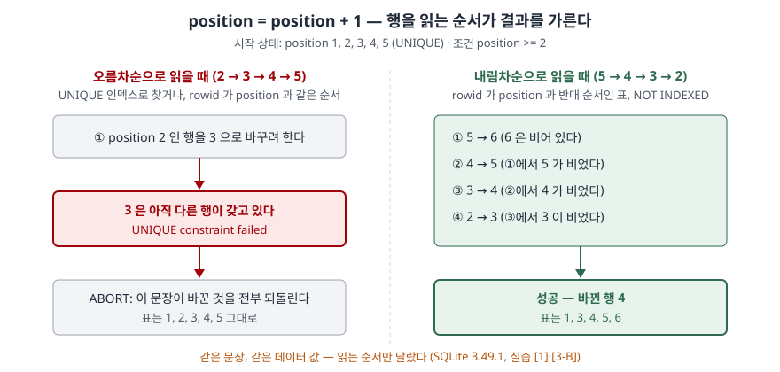

## 들어가며

할 일 목록이나 재생 목록처럼 사용자가 순서를 바꿀 수 있는 화면을 만들면, 표에 `position` 같은 순번 컬럼을 두고 같은 번호가 두 번 나오지 않게 `UNIQUE` 를 건다. 새 항목을 2번 자리에 끼워 넣으려면 2번부터 뒤를 한 칸씩 밀어야 하니 `UPDATE … SET position = position + 1 WHERE position >= 2` 를 쓴다. 그런데 이 한 줄이 `UNIQUE constraint failed` 로 실패한다. 결국 많은 사람이 애플리케이션에서 행을 하나씩 읽어 뒤에서부터 `UPDATE` 를 보낸다. 항목이 200개면 문장 200개가 오간다.

## 개념

**UNIQUE 제약**은 한 컬럼(또는 컬럼 묶음)에 같은 값이 두 행 이상 들어가지 못하게 막는 규칙이다. 문제는 "언제 검사하느냐"다. 문장 하나가 여러 행을 바꿀 때 검사 시점은 두 가지가 있을 수 있다.

| 검사 시점 | 뜻 | `position + 1` 의 결과 |
|---|---|---|
| 문장이 끝난 뒤 | 모든 행을 바꾼 최종 상태만 본다 | 최종 상태에 중복이 없으니 성공 |
| 행을 하나 바꿀 때마다 | 바꾸는 중간 상태를 본다 | 중간에 잠깐 겹치는 순간이 있으면 실패 |

SQLite 3.49.1 에서 돌려 보면 두 번째처럼 움직였다. 그래서 같은 문장이라도 **행을 어떤 순서로 읽느냐**에 따라 결과가 갈린다.

## 구조



> **출처**: 실패한 문장을 되돌리는 동작은 [SQLite — The ON CONFLICT Clause](https://www.sqlite.org/lang_conflict.html) 의 ABORT 설명. 행을 읽는 순서와 성공·실패는 실습 [1]·[3-B]를 SQLite 3.49.1 에서 돌린 결과다.

왼쪽은 2 를 3 으로 바꾸려는 순간 3 이 아직 남아 있어 멈춘다. 오른쪽은 5 를 6 으로 먼저 옮겨 자리를 비우고, 그 빈자리로 4 가 들어가는 식으로 이어진다.

## 동작 원리

SQLite 의 충돌 처리 방식 기본값은 **ABORT** 다. 문서는 ABORT 가 제약 위반을 만나면 그 문장을 멈추고, **그 문장이 이미 바꾼 것을 되돌린다**고 적는다. 앞서 실행된 다른 문장의 변경은 남는다. 그래서 실패한 `UPDATE` 뒤에 표를 보면 한 행도 바뀌어 있지 않다(실습 [2]).

행을 읽는 순서는 옵티마이저가 고른 경로를 따른다. `WHERE position >= 2` 는 `UNIQUE` 가 자동으로 만든 인덱스를 타고 작은 값부터 읽는다. 인덱스를 막으면(`NOT INDEXED`) 표를 rowid(행 번호) 순서로 훑는데, 데이터를 순번대로 넣었다면 이것도 오름차순이다. rowid 가 순번과 반대인 표에서만 성공했다. **데이터를 넣은 순서가 문장의 성공 여부를 정하는 것**이므로, 이 동작에 기대면 안 된다.

## 실습 예제

전체 소스: [`code/shift_position.py`](code/shift_position.py) · 수행 기록: [`code/output.txt`](code/output.txt)

`playlist_item` 표에 `position` 1~5 를 넣었다. `position` 에는 `UNIQUE` 가 걸려 있다(수행 기록의 표 정의 출력은 NOT NULL 까지만 찍고 UNIQUE 는 찍지 않는다).

**[1] 그대로 밀면 실패한다.**

```text
  plan> SEARCH playlist_item USING INDEX sqlite_autoindex_playlist_item_1 (position>?)
  읽는 순서(position): 2, 3, 4, 5
  sql> UPDATE playlist_item SET position = position + 1 WHERE position >= 2
  IntegrityError: UNIQUE constraint failed: playlist_item.position
```

계획의 `sqlite_autoindex_…` 가 `UNIQUE` 때문에 생긴 인덱스다. 조건은 `>=` 인데 계획에는 `>?` 로 찍혔다.

**[2] 실패한 뒤 표는 1, 2, 3, 4, 5 그대로다.** 일부만 밀린 행이 없다.

**[3] 읽는 순서만 바꾸면 결과가 갈린다.**

```text
[3-A] 인덱스를 쓰지 않게 하면 (rowid 순서로 읽는다)
  plan> SCAN playlist_item
  IntegrityError: UNIQUE constraint failed: playlist_item.position

[3-B] rowid 가 position 과 반대 순서인 표에서 같은 UPDATE
  읽는 순서(position): 5, 4, 3, 2
  성공, 바뀐 행 4
```

**[4] 순서를 문법으로 정할 수 없다.** `UPDATE … ORDER BY position DESC` 는 `near "ORDER": syntax error` 였다. SQLite 문서에 따르면 `UPDATE` 의 `ORDER BY`·`LIMIT` 은 `SQLITE_ENABLE_UPDATE_DELETE_LIMIT` 옵션으로 빌드했을 때만 있다.

**[5]·[6] 두 문장으로 나눠 중간 값을 겹치지 않는 곳에 둔다.**

```text
[5] 우회 1: 음수로 뒤집었다가 되돌린다
  sql> UPDATE playlist_item SET position = -(position + 1) WHERE position >= 2
  성공, 바뀐 행 4
  sql> UPDATE playlist_item SET position = -position WHERE position < 0
  성공, 바뀐 행 4
```

첫 문장은 -3, -4, -5, -6 을 만든다. 음수는 기존 양수와 겹치지 않으니 중간 상태에서도 충돌이 없다. 두 번째 문장이 부호를 되돌린다. [6]은 1000001 을 더했다가 1000000 을 빼는 같은 생각이다. 더하는 값이 표의 최대 순번보다 커야 한다. 둘 다 `BEGIN` … `COMMIT` 으로 묶어 다른 연결이 중간 상태를 보지 않게 했다.

**[7] 두 행 맞바꾸기도 같다.** `CASE` 로 2↔4 를 한 문장에 바꾸면 실패했고, 비어 있는 값 0 을 거쳐 세 문장으로 나누면 됐다.

## 실무에서 주의할 점

1. **어쩌다 성공한 문장을 믿지 않는다.** [3-B]처럼 데이터가 들어간 순서 덕에 개발 환경에서는 통과하고 운영에서 실패할 수 있다. 인덱스가 생겨 경로가 바뀌어도 읽는 순서가 달라진다. `INTEGER PRIMARY KEY` 가 없는 표는 `VACUUM` 이 rowid 를 바꿀 수 있다고 문서가 적는다.
2. **우회 값의 범위를 확인한다.** 음수 뒤집기는 순번이 원래 양수일 때만 맞다. 큰 수 더하기는 그 값이 실제 순번과 겹치지 않아야 한다. `CHECK (position > 0)` 같은 제약이 있으면 중간 상태가 그 제약에 걸린다.
3. **두 문장은 한 트랜잭션으로 묶는다.** 첫 문장만 반영된 상태에서 다른 연결이 목록을 읽으면 음수 순번이 화면에 보인다.
4. **DB 를 옮기면 검사 시점부터 확인한다.** PostgreSQL 문서도 미뤄 둘 수 없는(non-deferrable) UNIQUE 는 행을 넣거나 바꿀 때마다 바로 검사하며, 이것이 문장 끝에 검사하라는 SQL 표준과 다르다고 적는다. `DEFERRABLE` 로 선언하면 문장 끝으로 미룰 수 있다. 같은 문장이 DB 마다 다르게 동작할 수 있는 자리다.

## 정리

- SQLite 3.49.1 은 UNIQUE 를 행을 바꿀 때마다 검사해서, `position + 1` 처럼 중간에 값이 겹치는 문장은 읽는 순서에 따라 성공·실패가 갈린다
- 실패한 문장은 ABORT 규칙으로 자기가 바꾼 행을 전부 되돌린다
- 순서를 문법으로 정하는 `UPDATE … ORDER BY` 는 빌드 옵션이 있어야 한다
- 중간 값을 음수나 큰 수로 비켜 두는 두 문장을 한 트랜잭션에 넣어 우회한다

## 참고 자료

- [SQLite — The ON CONFLICT Clause](https://www.sqlite.org/lang_conflict.html) — 기본 충돌 처리 방식이 ABORT 이고, ABORT 는 현재 문장이 바꾼 것을 되돌린다는 설명
- [SQLite — UPDATE §2.3 Optional LIMIT and ORDER BY Clauses](https://www.sqlite.org/lang_update.html#optional_limit_and_order_by_clauses) — `UPDATE` 의 `ORDER BY`·`LIMIT` 은 `SQLITE_ENABLE_UPDATE_DELETE_LIMIT` 빌드 옵션이 필요하다
- [SQLite — VACUUM](https://www.sqlite.org/lang_vacuum.html) — 명시적 `INTEGER PRIMARY KEY` 가 없는 표는 VACUUM 이 rowid 를 바꿀 수 있다
- [SQLite — The INDEXED BY Clause](https://www.sqlite.org/lang_indexedby.html) — 실습 [3-A]의 `NOT INDEXED`
- [PostgreSQL 16 — CREATE TABLE, Compatibility](https://www.postgresql.org/docs/16/sql-createtable.html#SQL-CREATETABLE-COMPATIBILITY) — 미뤄 둘 수 없는 UNIQUE 를 행마다 검사하는 것이 SQL 표준과 다르다는 설명(Non-Deferred Uniqueness Constraints)
