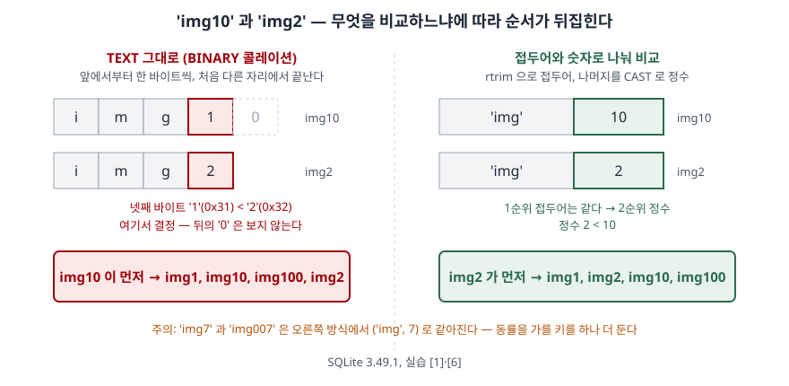

## 들어가며

스캔한 서류를 올리는 화면을 만들었다. 파일 이름은 `img1`, `img2`, … 처럼 번호가 붙어 들어오고, 목록은 `ORDER BY file_name` 으로 보여 준다. 처음 열 장까지는 문제가 없다가 열한 번째 장이 들어오자 목록이 `img1, img10, img11, img2, …` 로 섞인다. 흔히 택하는 방법은 DB 에서 다 읽어 와 애플리케이션에서 다시 정렬하는 것이다. 그러면 `LIMIT 20` 으로 한 쪽만 보여 주던 화면도 표 전체를 읽어야 하고, 1만 장이면 한 쪽을 그릴 때마다 1만 행이 오간다.

## 개념

**정렬(ORDER BY)** 은 값을 두 개씩 비교해 앞뒤를 정하는 일이다. 무엇을 비교하느냐가 값의 **타입**(값의 종류: 정수, 문자열 등)에 따라 다르다.

| 값 | 비교 방식 | `10` 과 `9` |
|---|---|---|
| 정수 `10`, `9` | 수의 크기 | 9 가 작다 |
| 문자열 `'10'`, `'9'` | 앞 글자부터 한 글자씩 | `'1'` 이 `'9'` 보다 작으니 `'10'` 이 작다 |

SQLite 문서는 문자열(TEXT) 비교에 **콜레이션**(collation, 문자열의 앞뒤를 정하는 규칙)을 쓰고, 기본값 `BINARY` 는 바이트를 그대로 `memcmp()` 로 비교한다고 적는다. 사람은 `img10` 안의 `10` 을 하나의 수로 읽지만, `BINARY` 는 `1`, `0` 두 글자로 본다. 사람이 읽는 방식대로 숫자 부분을 수로 비교하는 정렬을 흔히 **자연 정렬**(natural sort)이라 부른다. SQL 표준에도 SQLite 에도 자연 정렬 함수는 없어서, 비교할 값을 직접 만들어 줘야 한다.

## 구조



> **출처**: BINARY 콜레이션의 바이트 비교는 [SQLite — Datatypes In SQLite §7 Collating Sequences](https://www.sqlite.org/datatype3.html#collating_sequences), 문자열을 정수로 바꾸는 규칙은 [SQLite — SQL Language Expressions §13 CAST expressions](https://www.sqlite.org/lang_expr.html#cast_expressions). 비교 결과는 실습 [1]·[6]을 SQLite 3.49.1 에서 돌린 것이다.

왼쪽은 앞 세 글자가 같고 넷째 바이트에서 `'1'` 이 작아 바로 끝난다. 뒤에 `0` 이 더 있는지는 보지 않는다. 오른쪽은 비교할 값을 `('img', 10)` 과 `('img', 2)` 두 칸으로 바꿔, 둘째 칸을 정수로 비교한다.

## 동작 원리

`ORDER BY` 에 컬럼 대신 **식**을 쓸 수 있다. 식은 행마다 계산되고, 그 결과로 정렬한다. 자연 정렬은 이 성질을 쓴다.

1. **접두어**: `rtrim(file_name, '0123456789')` 는 오른쪽 끝에서 숫자 글자를 모두 걷어 낸다. `img10` → `img`
2. **숫자**: `substr()` 로 접두어 뒤를 잘라 `CAST(… AS INTEGER)` 로 정수를 만든다. `10` → 10
3. **정렬**: `ORDER BY 접두어, 숫자` — 접두어가 같을 때만 숫자를 본다

`CAST` 는 문자열 앞에서 정수로 읽히는 가장 긴 부분만 쓰고 나머지는 버린다. 정수로 읽히는 부분이 없으면 0 이 된다. 그래서 `'12A'` 는 12, `'A12'` 는 0, `'1.10.2'` 는 1 이다(실습 [4]). 이 규칙 덕에 버전 문자열의 첫 토막은 `CAST(version AS INTEGER)` 하나로 얻는다.

## 실습 예제

전체 소스: [`code/natural_sort.py`](code/natural_sort.py) · 수행 기록: [`code/output.txt`](code/output.txt)

표는 셋이다. `scan_file` 에 `img1`~`img100`, `doc3`, `doc12`, 그리고 숫자는 같고 모양만 다른 `img7`·`img007` 을 넣었다. `ticket` 에는 숫자만 든 번호, `app_release` 에는 버전 문자열을 넣었다.

**[1]·[2] 그대로 정렬하면 바이트 순서다.**

```text
  결과: doc12, doc3, img007, img1, img10, img100, img2, img20, img7, img9
  sql> SELECT '10' < '9', 10 < 9, typeof('10'), typeof(10)
    (1, 0, 'text', 'integer')
```

**[3]·[5] 숫자만 든 문자열.** `CAST` 로 정렬하면 `007, 9, 10, 12A, 25, 100` 이 된다. `length()` 를 먼저 두는 방법은 `9, 10, 25, 007, 100, 12A` 였다. 길이 3 인 `007` 이 25 뒤로 갔다. 이 방법은 앞자리 0 이 없고 숫자만 있을 때만 맞는다.

**[6] 접두어와 숫자를 떼어 정렬한다.**

```text
    ('img007', 'img', 7)
    ('img7', 'img', 7)
  결과: doc3, doc12, img1, img2, img007, img7, img9, img10, img20, img100
```

`img007` 과 `img7` 은 두 정렬 키가 모두 같다. SQLite 문서는 정렬 키가 같은 행끼리의 순서를 정하지 않는다. 이번에는 넣은 순서대로 나왔을 뿐이다. 세 번째 키로 `file_name` 을 붙이면 순서가 고정된다.

**[7] 버전 문자열.** 그대로 정렬하면 `1.10.0, 1.10.12, 1.10.2, 1.2.0, 1.9.3, 2.0.0` 이다. `instr()` 로 점의 위치를 찾아 세 토막을 정수로 만들면 `1.2.0, 1.9.3, 1.10.0, 1.10.2, 1.10.12, 2.0.0` 이 된다. 전체 질의는 소스의 `version_sql` 에 있다.

**[8] 식에 인덱스를 걸면 정렬 단계가 없어진다.**

```text
  plan> ... ORDER BY rtrim(file_name, '0123456789'), CAST(...)
    QUERY PLAN
    |--SCAN scan_file
    `--USE TEMP B-TREE FOR ORDER BY
  (같은 두 식으로 idx_scan_file_natural 생성 뒤)
    QUERY PLAN
    `--SCAN scan_file USING INDEX idx_scan_file_natural
  plan> ... ORDER BY rtrim(file_name, '9876543210'), CAST(...)
    QUERY PLAN
    |--SCAN scan_file
    `--USE TEMP B-TREE FOR ORDER BY
```

`USE TEMP B-TREE FOR ORDER BY` 는 결과를 임시 구조에 모아 따로 정렬한다는 뜻이다. 인덱스를 만든 뒤에는 이 줄이 사라졌다. 그런데 걷어 낼 글자를 `'9876543210'` 으로 순서만 바꾸자 같은 결과를 내는 식인데도 인덱스를 쓰지 않았다. 문서는 식 인덱스를 쓰려면 질의의 식이 `CREATE INDEX` 에 적은 것과 **똑같아야** 한다고 적는다.

## 실무에서 주의할 점

1. **동률을 가를 키를 끝에 둔다.** `img7` 과 `img007` 처럼 수로는 같은 값이 생긴다. 키를 하나 더 두지 않으면 같은 질의가 실행할 때마다 다른 순서를 줄 수 있고, 페이지를 넘길 때 행이 빠지거나 겹친다.
2. **접두어 정렬은 여전히 바이트 비교다.** `IMG5` 처럼 대문자가 섞이면 대문자가 소문자보다 앞에 온다. 대소문자를 무시하려면 접두어 식에 `COLLATE NOCASE` 를 붙인다. 문서에 따르면 NOCASE 는 ASCII 글자만 접는다.
3. **이 방법은 "문자 + 끝 숫자" 모양만 다룬다.** `v2-build10` 처럼 숫자가 가운데 끼면 `rtrim` 은 끝 숫자만 떼어 낸다. 모양이 여럿이면 저장할 때 접두어와 번호를 따로 컬럼에 담는 편이 낫다.
4. **식 인덱스를 쓰려면 정렬 식을 한 곳에 둔다.** 질의마다 손으로 적으면 글자 하나만 달라도 인덱스를 놓친다(실습 [8]). 뷰나 생성 컬럼으로 식을 한 번만 적는다.

## 정리

- TEXT 정렬은 `BINARY` 콜레이션의 바이트 비교라 `img10` 이 `img2` 앞에 온다
- 숫자만 든 문자열은 `CAST(… AS INTEGER)` 로 정렬하고, 앞자리 0 이 있으면 길이 먼저 정렬은 틀린다
- 문자와 숫자가 섞이면 `rtrim` 으로 접두어, `substr`·`CAST` 로 숫자를 만들어 두 키로 정렬한다
- 수로 같은 값이 생기므로 동률 키를 끝에 붙이고, 식 인덱스는 식을 글자까지 똑같이 써야 쓰인다

## 참고 자료

- [SQLite — Datatypes In SQLite §7 Collating Sequences](https://www.sqlite.org/datatype3.html#collating_sequences) — BINARY 콜레이션이 `memcmp()` 로 비교한다는 설명, NOCASE 는 ASCII 만 접는다
- [SQLite — SQL Language Expressions §13 CAST expressions](https://www.sqlite.org/lang_expr.html#cast_expressions) — TEXT 를 INTEGER 로 바꿀 때 가장 긴 정수 접두부만 쓰고, 없으면 0
- [SQLite — Core Functions](https://www.sqlite.org/lang_corefunc.html#rtrim) — `rtrim(X,Y)` 는 Y 에 든 글자를 X 의 오른쪽에서 모두 걷어 낸다. `substr()`, `instr()`, `length()` 도 같은 문서
- [SQLite — SELECT: The ORDER BY clause](https://www.sqlite.org/lang_select.html#orderby) — 정렬 키가 같은 행의 순서
- [SQLite — Indexes On Expressions](https://www.sqlite.org/expridx.html) — 질의의 식이 인덱스 정의와 똑같아야 쓰인다는 설명
