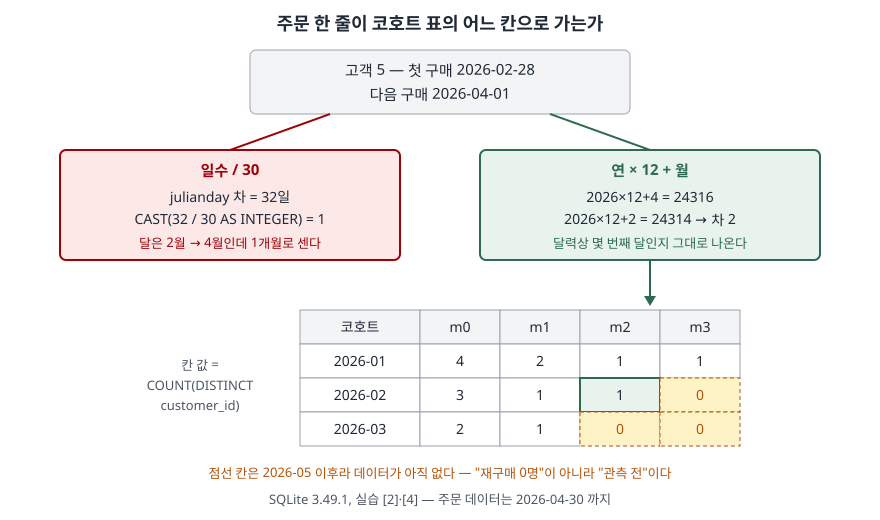

## 들어가며

쇼핑몰 운영 회의에서 "1월에 처음 산 고객 중 몇 명이 다음 달에 또 샀나"라는 질문이 나왔다. 흔히 택하는 방법은 주문 표를 통째로 엑셀로 내려받아 고객별로 정렬하고, 첫 주문 날짜를 눈으로 찾아 옆 칸에 적은 뒤 피벗을 돌리는 것이다. 고객이 수천 명이면 내려받는 데만 몇 분이 걸리고, 다음 달 회의에서 같은 질문이 나오면 이 일을 처음부터 다시 한다. SQL 한 문장으로 만들어 두면 다음 달에는 다시 실행만 하면 된다.

## 개념

**코호트**(cohort)는 같은 시기에 같은 일을 겪은 사람의 묶음이다. 여기서는 **첫 구매 월이 같은 고객**을 한 코호트로 본다. **코호트 표**는 행이 코호트, 열이 첫 구매 뒤 지난 달 수(경과 월)이고, 칸에는 그 달에 산 고객 수를 적는다.

| 필요한 값 | SQL 로 만드는 법 |
|---|---|
| 고객의 첫 구매일 | `MIN(order_date)` 를 고객별로 묶어 구한다 |
| 경과 월 | 주문 월과 첫 구매 월의 차 |
| 칸 값 | 그 칸에 해당하는 **서로 다른 고객 수** |

어려운 곳은 둘이다. 경과 월을 어떻게 셀지, 그리고 주문 줄을 셀지 고객을 셀지다.

## 구조



> **출처**: 날짜 함수 `strftime`·`julianday` 는 [SQLite — Date And Time Functions](https://www.sqlite.org/lang_datefunc.html), `COUNT(DISTINCT X)` 는 [SQLite — Built-in Aggregate Functions §count(X)](https://www.sqlite.org/lang_aggfunc.html#count). 표의 값은 실습 [2]·[4] 를 SQLite 3.49.1 에서 돌린 결과다.

## 동작 원리

경과 월은 **달력에서 몇 번째 달인지**를 정수 하나로 바꾸면 뺄셈 한 번으로 나온다. `strftime('%Y', d)` 는 연도, `strftime('%m', d)` 는 월을 문자열로 돌려주므로 정수로 바꿔 `연 × 12 + 월` 을 만든다. 2026년 2월은 24314, 4월은 24316 이고 차는 2 다. 날짜의 일(日)은 아예 보지 않으므로 2월 28일과 4월 1일도 2개월 차이로 계산된다.

일수로 세는 방법은 `julianday()` 로 두 날짜의 일 수 차를 구해 30 으로 나눈다. 달마다 길이가 28~31일로 다른데 30 으로 나누니, 달이 바뀌었어도 30일이 안 지났으면 0 이 된다.

칸 값은 `COUNT(DISTINCT customer_id)` 로 센다. 같은 달 두 번 산 고객의 주문 줄은 둘이지만 고객은 하나다. 가로 표는 열마다 `CASE WHEN 경과 월 = n THEN customer_id END` 를 두고 `COUNT(DISTINCT …)` 로 감싼다. 조건에 안 맞는 줄은 `NULL` 이 되고 `COUNT` 는 `NULL` 을 세지 않는다.

## 실습 예제

전체 소스: [`code/cohort.py`](code/cohort.py) · 수행 기록: [`code/output.txt`](code/output.txt)

주문 표 `customer_order` 하나에 고객 9명의 주문 18건을 넣었다. 기간은 2026-01-05 ~ 2026-04-30 이다.

**[2] 일수/30 과 달력 월 차이가 갈리는 주문.** 18건 중 4건이 갈렸고 모두 일수 쪽이 한 달 적었다.

```text
    ('customer_id', 'first_date', 'order_date', 'days', 'by_days', 'by_month')
    (1, '2026-01-05', '2026-02-03', 29.0, 0, 1)
    (2, '2026-01-31', '2026-02-01', 1.0, 0, 1)
    (4, '2026-02-10', '2026-03-09', 27.0, 0, 1)
    (5, '2026-02-28', '2026-04-01', 32.0, 1, 2)
```

고객 2는 1월 31일에 처음 사고 하루 뒤 2월 1일에 또 샀다. 달이 바뀌었으니 "다음 달 재구매"인데 일수로는 0개월이다.

**[3] 주문 줄과 고객 수.**

```text
    ('cohort', 'month_no', 'order_rows', 'customers')
    ('2026-01', 0, 5, 4)
    ('2026-02', 1, 2, 1)
```

2026-02 코호트의 m1 은 주문이 2줄인데 고객은 1명이다. 고객 4가 3월에 두 번 샀다. `COUNT(*)` 로 세면 재구매율이 두 배로 나온다.

**[4]·[5] 가로 표와 비율.**

```text
    ('cohort', 'm0', 'm1', 'm2', 'm3')
    ('2026-01', 4, 2, 1, 1)
    ('2026-02', 3, 1, 1, 0)
    ('2026-03', 2, 1, 0, 0)
    ('cohort', 'm0', 'm1', 'int_div', 'pct')
    ('2026-01', 4, 2, 0, 50.0)
```

`m1 / m0` 은 2/4 인데 0 이 나왔다. 정수끼리 나누면 SQLite 는 소수점 아래를 버린다. `100.0 * m1 / m0` 처럼 실수를 하나 섞어야 50.0 이 나온다.

**[6] 첫 구매일을 창 함수로.** `MIN(order_date) OVER (PARTITION BY customer_id)` 는 묶지 않고 행마다 그 고객의 최솟값을 붙인다. 하위 질의를 다시 조인하지 않아도 된다.

```text
    QUERY PLAN
    |--CO-ROUTINE (subquery-2)
    |  |--SCAN customer_order
    |  `--USE TEMP B-TREE FOR ORDER BY
    |--SCAN (subquery-2)
    `--USE TEMP B-TREE FOR ORDER BY
```

창 함수 쪽도 표를 한 번 훑고 고객별로 정렬하는 단계(`USE TEMP B-TREE`)가 들어간다. 조인 방식은 하위 질의 결과에 자동 인덱스(`AUTOMATIC COVERING INDEX`)를 만들어 찾았다. 어느 쪽이든 표를 한 번은 다 읽는다.

## 실무에서 주의할 점

1. **경과 월은 일수로 세지 않는다.** 30 이든 30.4 든 나누는 수를 바꿔도 월말·월초 주문은 어긋난다. "달이 몇 번 바뀌었나"를 원하면 `연 × 12 + 월` 의 차를 쓴다.
2. **칸은 고객으로 센다.** `COUNT(*)` 는 주문 줄을 세서 자주 사는 고객이 많은 코호트를 부풀린다. 매출 합계를 낼 때만 줄 단위로 더한다.
3. **오른쪽 아래 0 은 "관측 전"일 수 있다.** 2026-03 코호트의 m2 는 2026년 5월인데 데이터가 4월에서 끝난다. 이 칸의 0 은 재구매가 없었다는 뜻이 아니다. 비율을 평균 낼 때 이런 칸은 빼야 한다.
4. **비율은 실수로 나눈다.** 정수 나눗셈은 1 미만을 모두 0 으로 만든다(실습 [5]).

## 정리

- 코호트는 첫 구매 월로 묶고, 첫 구매일은 `MIN` 을 고객별로 구해 얻는다
- 경과 월은 `연 × 12 + 월` 의 차로 센다. 일수/30 은 18건 중 4건을 한 달 적게 셌다
- 칸 값은 `COUNT(DISTINCT customer_id)`, 가로 표는 `CASE` 를 열마다 하나씩 둔다
- 비율은 `100.0 *` 로 실수를 섞어 나누고, 데이터 기간이 끝난 뒤의 칸은 관측 전으로 본다

## 참고 자료

- [SQLite — Date And Time Functions](https://www.sqlite.org/lang_datefunc.html) — `strftime()` 의 `%Y`·`%m` 형식, `julianday()` 가 율리우스일 수를 실수로 돌려준다는 설명
- [SQLite — Built-in Aggregate Functions §count(X)](https://www.sqlite.org/lang_aggfunc.html#count) — `count(X)` 는 NULL 이 아닌 값만 세고, `DISTINCT` 를 붙이면 중복을 뺀다
- [SQLite — Window Functions](https://www.sqlite.org/windowfunctions.html) — 집계 함수를 `OVER (PARTITION BY …)` 와 함께 쓰는 창 함수
- [SQLite — SQL Language Expressions](https://www.sqlite.org/lang_expr.html) — 두 정수의 `/` 연산 결과가 정수라는 연산자 설명
