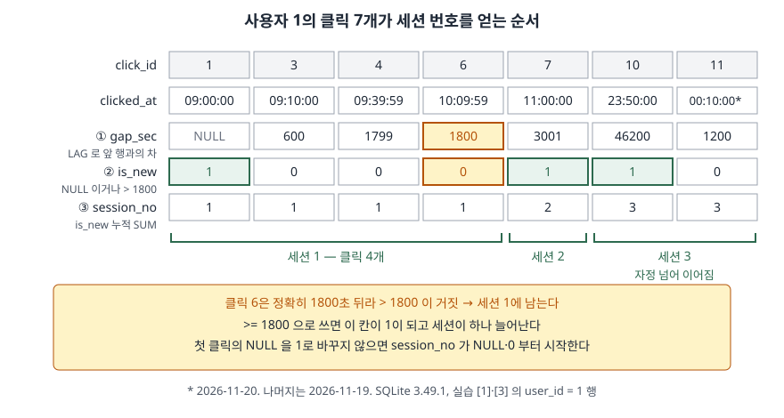

## 들어가며

사이드 프로젝트로 만든 서비스에 방문 기록을 쌓기 시작하면 곧 "한 번 들어와서 몇 페이지를 보고 나가나"가 궁금해진다. 그런데 표에 있는 것은 클릭 한 줄 한 줄뿐이고 "방문"이라는 단위는 없다. 흔히 하는 방법은 사용자별·시각순으로 정렬해 내려받은 뒤, 스프레드시트에서 윗줄과의 시간 차를 빼는 수식을 넣고 30분이 넘는 줄마다 손으로 방문 번호를 바꿔 적는 것이다. 클릭이 만 줄이면 번호를 바꿔 적는 줄만 수백 개가 되고, 내일 기록이 쌓이면 또 처음부터 해야 한다. SQL 한 문장이면 이 번호를 매번 다시 계산할 수 있다.

## 개념

**세션**(session)은 한 사용자가 쉬지 않고 이어서 한 행동의 묶음이다. 웹 분석에서는 보통 **일정 시간 넘게 아무 행동이 없으면 그 세션이 끝났다**고 본다. 여기서는 그 기준을 30분(1800초)으로 둔다.

클릭 로그에 세션 번호를 붙이려면 세 가지가 필요하다.

| 필요한 값 | SQL 로 만드는 법 |
|---|---|
| 앞 클릭과의 간격 | `LAG(clicked_at)` 로 같은 사용자의 바로 앞 행 값을 가져와 뺀다 |
| 새 세션이 시작되는가 | 간격이 없거나(첫 클릭) 1800초를 넘으면 1, 아니면 0 |
| 세션 번호 | 위 0·1 을 처음부터 그 행까지 더한 값(누적 합) |

`LAG` 는 **창 함수**(window function, 행을 하나로 묶지 않고 다른 행의 값을 옆에 붙여 주는 함수)다. 그룹으로 묶어 버리는 `GROUP BY` 와 달리 행 수가 그대로 남는다.

## 구조



> **출처**: `lag()` 와 누적 합의 창 틀은 [SQLite — Window Functions §Built-in Window Functions](https://www.sqlite.org/windowfunctions.html#builtins), 초 단위 변환 `unixepoch()` 는 [SQLite — Date And Time Functions](https://www.sqlite.org/lang_datefunc.html). 칸의 값은 실습 [1]·[3] 을 SQLite 3.49.1 에서 돌린 결과다.

## 동작 원리

**① 간격.** `LAG(clicked_at) OVER (PARTITION BY user_id ORDER BY clicked_at, click_id)` 는 같은 사용자 안에서 시각순으로 줄을 세운 뒤, 한 줄 위의 `clicked_at` 을 가져온다. 사용자의 첫 클릭에는 위 줄이 없으므로 `NULL` 이다. 시각은 `'2026-11-19 09:00:00'` 같은 글자라 그대로는 뺄 수 없다. `unixepoch()` 로 1970-01-01 부터의 초로 바꾼 뒤 뺀다.

**② 끊는 표시.** `CASE WHEN gap_sec IS NULL OR gap_sec > 1800 THEN 1 ELSE 0 END` 다. 첫 클릭도 새 세션의 시작이므로 `NULL` 을 1 로 바꾼다.

**③ 누적 합.** `SUM(is_new) OVER (… ROWS UNBOUNDED PRECEDING)` 은 그 사용자의 첫 줄부터 지금 줄까지 `is_new` 를 더한다. 새 세션이 시작될 때마다 1 씩 커지므로 그 값이 곧 세션 번호다. 끊는 자리만 표시해 두고 번호는 덧셈으로 얻는 것이 이 방법의 요점이다.

정렬 키에 `click_id` 를 붙인 이유는 클릭 9와 12처럼 **시각이 같은 줄**이 있어서다. 시각만으로 정렬하면 둘의 순서는 엔진이 정하고, 실행할 때마다 `LAG` 결과가 바뀔 수 있다.

## 실습 예제

전체 소스: [`code/session.py`](code/session.py) · 수행 기록: [`code/output.txt`](code/output.txt)

표 `click_log` 에 사용자 2명의 클릭 12줄을 넣었다. 정의와 전체 행은 수행 기록 맨 앞에 있다.

**[3] 간격·표시·세션 번호.** 사용자 1은 세션 3개, 사용자 2는 2개로 나뉘었다.

```text
    ('click_id', 'user_id', 'clicked_at', 'gap_sec', 'is_new', 'session_no')
    (1, 1, '2026-11-19 09:00:00', None, 1, 1)
    (3, 1, '2026-11-19 09:10:00', 600, 0, 1)
    (4, 1, '2026-11-19 09:39:59', 1799, 0, 1)
    (6, 1, '2026-11-19 10:09:59', 1800, 0, 1)
    (7, 1, '2026-11-19 11:00:00', 3001, 1, 2)
    (10, 1, '2026-11-19 23:50:00', 46200, 1, 3)
    (11, 1, '2026-11-20 00:10:00', 1200, 0, 3)
```

클릭 10과 11은 날짜가 바뀌었지만 20분 차이라 같은 세션이다. 날짜로 자르면 둘로 갈라진다.

**[4] 세션마다 묶기.** 세션 번호가 생기면 나머지는 평범한 `GROUP BY` 다.

```text
    ('user_id', 'session_no', 'started_at', 'ended_at', 'clicks', 'length_sec')
    (1, 1, '2026-11-19 09:00:00', '2026-11-19 10:09:59', 4, 4199)
    (1, 2, '2026-11-19 11:00:00', '2026-11-19 11:00:00', 1, 0)
    (2, 2, '2026-11-19 10:30:00', '2026-11-19 10:45:00', 3, 900)
```

(위는 수행 기록의 5줄 중 3줄이다.) 클릭이 하나뿐인 세션은 길이가 0초로 나온다.

**[5-1] 경계.** 클릭 6은 앞 클릭과 정확히 1800초 차이다. `> 1800` 이면 0, `>= 1800` 이면 1 이다.

```text
    ('click_id', 'user_id', 'gap_sec', 'gt', 'ge')
    (4, 1, 1799, 0, 0)
    (6, 1, 1800, 0, 1)
```

**[5-2] 첫 줄의 NULL 을 그대로 두면.** `gap_sec > 1800` 만 쓰면 첫 줄은 `NULL > 1800`, 곧 `NULL` 이다. `SUM` 은 `NULL` 을 건너뛰므로 첫 줄의 세션 번호가 `NULL`, 그다음 줄이 0 이 된다.

```text
    ('click_id', 'user_id', 'gap_sec', 'is_new', 'session_no')
    (2, 2, None, None, None)
    (5, 2, 900, 0, 0)
    (8, 2, 4200, 1, 1)
```

**[5-3] PARTITION BY 를 빠뜨리면.** 두 사용자의 클릭이 한 줄로 섞여 서로의 간격을 잰다. 세션이 5개에서 2개로 줄었다. 사용자 1이 쉬는 동안 사용자 2가 클릭해서 간격이 짧아 보였기 때문이다.

**[5-4] 시각 문자열을 그대로 빼면.** 30분 차이인데 0 이 나왔다.

```text
    ('text_minus', 'unixepoch_minus', 'type')
    (0, 1800, 'integer')
```

SQLite 는 글자를 숫자로 바꿀 때 **앞에서부터 숫자로 읽히는 데까지만** 쓴다. `'2026-11-19 10:09:59'` 는 `2026` 이 되고, 두 값 모두 `2026` 이라 차가 0 이다. 에러가 나지 않으므로 알아채기 어렵다.

**[6] 인덱스와 실행계획.** `(user_id, clicked_at, click_id)` 인덱스를 만들면 가장 안쪽의 `USE TEMP B-TREE FOR ORDER BY` 가 사라지고 인덱스 순서로 읽는다.

```text
    QUERY PLAN
    |--CO-ROUTINE (subquery-4)
    |  |--CO-ROUTINE (subquery-1)
    |  |  |--CO-ROUTINE (subquery-5)
    |  |  |  `--SCAN click_log USING COVERING INDEX ix_click_log_user_id_clicked_at
    |  |  `--SCAN (subquery-5)
    |  |--SCAN (subquery-1)
    |  `--USE TEMP B-TREE FOR ORDER BY
    `--SCAN (subquery-4)
```

다만 바깥의 누적 `SUM` 쪽 정렬은 남았다. 하위 질의의 결과가 이미 정렬돼 있다는 사실을 바깥 단계가 이용하지 못한 것이다. 인덱스가 정렬을 전부 없애 주지는 않는다.

## 실무에서 주의할 점

1. **경계를 `>` 로 할지 `>=` 로 할지 먼저 정한다.** 정확히 30분인 행은 실제 로그에서 드물지 않다(초 단위로 잘린 시각이면 더 그렇다). 다른 팀의 세션 수와 비교할 때 이 기호 하나로 숫자가 어긋난다.
2. **첫 줄의 `NULL` 을 1 로 바꾼다.** 빠뜨리면 첫 세션 번호가 `NULL`, 둘째가 0 이 되어 세션 수가 하나 적게 보인다.
3. **`PARTITION BY` 로 사용자를 나눈다.** 빠뜨려도 에러가 없고 숫자만 줄어든다. 사용자가 많을수록 간격이 짧아 보여 세션이 크게 합쳐진다.
4. **시각은 숫자로 바꿔서 뺀다.** `TEXT` 끼리 빼면 연도만 남아 0 이 나온다. `unixepoch()` 는 SQLite 의 함수라 다른 DB 로 옮기면 그 DB 의 초 변환 함수로 바꿔야 한다.
5. **정렬 키를 유일하게 만든다.** 시각이 같은 줄이 있으면 `click_id` 같은 키를 두 번째로 붙인다.

## 정리

- 앞 클릭과의 간격은 `LAG` 로 가져와 `unixepoch()` 로 초를 만든 뒤 뺀다
- 첫 줄이거나 간격이 기준을 넘으면 1 인 표시를 두고, 그 표시를 누적 `SUM` 하면 세션 번호가 된다
- 정확히 1800초인 줄은 `>` 와 `>=` 에서 갈렸고, `PARTITION BY` 를 빼면 세션 5개가 2개로 줄었다
- 시각 문자열을 그대로 빼면 에러 없이 0 이 나온다

연속된 날짜를 묶는 문제는 [연속 구간 찾기](../2026-11-07-sql-gaps-and-islands-consecutive-days/index.md)에서 다른 방법(날짜에서 행 번호를 빼는 방법)으로 풀었다. 간격 기준이 "하루"로 고정이면 그쪽이, 기준이 시간이면 이 글의 방법이 맞다.

## 참고 자료

- [SQLite — Window Functions](https://www.sqlite.org/windowfunctions.html) — `lag(expr)` 가 앞 행이 없으면 `NULL` 을 돌려준다는 설명, `ROWS UNBOUNDED PRECEDING` 창 틀
- [SQLite — Date And Time Functions](https://www.sqlite.org/lang_datefunc.html) — `unixepoch()` 가 유닉스 시각(1970-01-01 부터의 초)을 돌려준다는 설명
- [SQLite — SQL Language Expressions §CAST expressions](https://www.sqlite.org/lang_expr.html#castexpr) — 글자를 숫자로 바꿀 때 앞부분의 숫자로 읽히는 부분만 쓴다는 규칙
- [SQLite — Built-in Aggregate Functions](https://www.sqlite.org/lang_aggfunc.html) — `sum()` 이 `NULL` 이 아닌 값만 더한다는 설명
