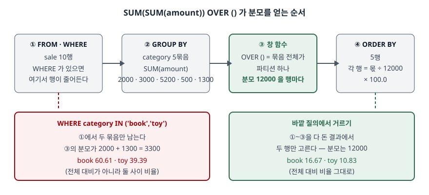

## 들어가며

쇼핑몰을 운영하는 친구가 "카테고리별 매출이 전체에서 몇 %인지 원그래프로 보고 싶다"고 하면, 보통은 카테고리별 합계를 뽑아 스프레드시트에 붙이고 맨 아래에 총합 칸을 만든 뒤 칸마다 나누는 수식을 넣는다. 다음 달이 되면 다시 뽑아 붙이고 수식 범위를 고친다. 그렇게 만든 표를 소수점 없이 반올림해 보여 주면 이번에는 "다 더했는데 왜 99%냐"는 질문이 돌아온다. 질의 한 문장이 합계와 비율을 같이 내게 만들면 붙여 넣는 일이 없어지고, 99%가 나오는 이유도 SQL 안에서 고칠 수 있다.

## 개념

**구성비**(전체 대비 비율, percent of total)는 한 묶음의 값을 전체 합으로 나눈 값이다. 계산 자체는 나눗셈 한 번이지만, SQL 에서는 **한 행에 "내 값"과 "전체 합"이 같이 있어야** 나눌 수 있다는 점이 문제다. `GROUP BY category` 로 묶으면 각 행에는 그 카테고리의 합만 남고 전체 합은 없다.

전체 합을 각 행 옆에 붙이는 방법은 세 가지다.

| 방법 | 모양 | 특징 |
|---|---|---|
| 스칼라 부질의 | `amount / (SELECT SUM(amount) FROM sale)` | 가장 읽기 쉽다. 표를 한 번 더 읽는다 |
| CROSS JOIN | `… CROSS JOIN (SELECT SUM(amount) AS total FROM sale)` | 합계가 한 행짜리 표가 되어 모든 행에 붙는다 |
| 창 함수 | `SUM(SUM(amount)) OVER ()` | 묶은 결과 위에서 전체 합을 다시 구한다 |

**창 함수**(window function)는 행을 하나로 줄이지 않고, 다른 행들의 값을 계산해 각 행 옆에 붙여 주는 함수다. `OVER ()` 처럼 괄호 안이 비어 있으면 결과 전체가 하나의 묶음(파티션)이 된다.

## 구조



> **출처**: `PARTITION BY` 가 없으면 결과 전체가 한 파티션이라는 규칙은 [SQLite — Window Functions §The PARTITION BY Clause](https://www.sqlite.org/windowfunctions.html#the_partition_by_clause). 창 함수가 WHERE·GROUP BY 뒤의 행에 적용된다는 순서와 칸의 숫자는 실습 [2-3]·[6-1]·[6-2] 를 SQLite 3.49.1 에서 돌린 결과다.

## 동작 원리

`SUM(SUM(amount)) OVER ()` 는 함수가 두 겹이라 처음에는 낯설다. 안쪽과 바깥쪽이 서로 다른 단계에서 계산된다.

1. **안쪽 `SUM(amount)`** 는 평범한 집계 함수다. `GROUP BY category` 가 행을 다섯 묶음으로 나누고 묶음마다 합을 낸다. 여기서 행이 10개에서 5개로 줄어든다.
2. **바깥쪽 `SUM(…) OVER ()`** 는 창 함수다. 1단계가 만든 5행을 받아, 그 5개의 합을 모두 더한 12000 을 각 행 옆에 붙인다. 행 수는 그대로 5다.
3. 그러면 한 행 안에 "내 합(2000)"과 "전체 합(12000)"이 같이 있으므로 나눌 수 있다.

순서가 이렇다 보니 **WHERE 로 행을 거르면 분모도 함께 줄어든다.** 창 함수는 걸러지고 묶인 뒤의 행만 보기 때문이다. 전체 대비 비율을 유지한 채 일부 카테고리만 보고 싶으면, 비율을 먼저 다 계산하고 바깥 질의에서 거른다.

나눗셈에는 하나 더 볼 것이 있다. SQLite 는 **정수끼리 나누면 정수로 자른다**(소수점 아래를 버린다). 금액 컬럼이 `INTEGER` 이면 `2000 / 12000` 은 0 이다. 나누기 전에 한쪽을 실수로 만들어야 하므로 `100` 대신 `100.0` 을 곱한다.

## 실습 예제

전체 소스: [`code/share.py`](code/share.py) · 수행 기록: [`code/output.txt`](code/output.txt)

표 `sale` 에 두 지역(seoul·busan), 다섯 카테고리의 매출 10행을 넣었다. 금액은 정수다. 정의와 전체 행은 수행 기록 맨 앞에 있다.

**[1] 정수끼리 나누면.** 100 을 어디서 곱하느냐에 따라 결과가 셋으로 갈렸다.

```text
    ('category', 'amount', 'div_then_mul', 'mul_then_div', 'real_pct')
    ('book', 2000, 0, 16, 16.666666666666668)
    ('clothes', 3000, 0, 25, 25.0)
    ('food', 5200, 0, 43, 43.333333333333336)
    ('stationery', 500, 0, 4, 4.166666666666667)
    ('toy', 1300, 0, 10, 10.833333333333334)
```

먼저 나누고 100 을 곱하면(`div_then_mul`) 나눗셈 결과가 이미 0 이라 전부 0 이다. 100 을 먼저 곱하면(`mul_then_div`) 소수점 아래만 잘린다. 에러가 나지 않으므로 숫자가 이상하다는 것을 눈으로 알아채야 한다.

**[2] 전체 합을 붙이는 세 방법.** 결과는 셋 다 같았다(book 16.67, clothes 25.0, food 43.33, stationery 4.17, toy 10.83). 차이는 실행계획에 있다.

```text
[8-1] 실행계획 — 스칼라 부질의
    QUERY PLAN
    |--CO-ROUTINE (subquery-2)
    |  |--SCAN sale
    |  `--USE TEMP B-TREE FOR GROUP BY
    |--SCAN (subquery-2)
    |--SCALAR SUBQUERY 1
    |  `--SCAN sale
    `--USE TEMP B-TREE FOR ORDER BY

[8-3] 실행계획 — SUM(SUM(amount)) OVER ()
    QUERY PLAN
    |--CO-ROUTINE (subquery-2)
    |  |--SCAN sale
    |  `--USE TEMP B-TREE FOR GROUP BY
    |--SCAN (subquery-2)
    `--USE TEMP B-TREE FOR ORDER BY
```

스칼라 부질의는 `SCAN sale` 이 두 번이다. 한 번은 묶기 위해, 한 번은 전체 합을 구하기 위해서다. CROSS JOIN 도 `MATERIALIZE t` 아래에서 `sale` 을 한 번 더 읽는다. 창 함수 쪽만 `sale` 을 한 번 읽는다. 표가 크거나 조건이 복잡해 부질의와 바깥 질의에 같은 `WHERE` 를 두 번 써야 하는 경우라면 이 차이가 커진다.

**[3] 지역 안에서의 비율.** `OVER (PARTITION BY region)` 으로 바꾸면 분모가 지역 합이 된다.

```text
    ('region', 'category', 'amount', 'pct_in_region', 'pct_of_all')
    ('busan', 'food', 1400, 33.33, 11.67)
    ('seoul', 'food', 3800, 48.72, 31.67)
```

(수행 기록 9행 중 2행이다.) 같은 food 라도 부산 안에서는 33%, 전체에서는 12% 다. 보고서에 "%"만 적으면 어느 쪽인지 알 수 없다.

**[4] 반올림한 비율을 더하면.** 이 데이터에서는 정수로 반올림한 합이 우연히 100 이었다(17 + 25 + 43 + 4 + 11). 몫이 똑같은 세 칸과, 정확히 12.5 인 칸이 둘인 경우를 따로 돌렸다.

```text
[4-2] 세 몫이 똑같을 때 (1:1:1)
    ('category', 'pct_exact', 'pct_round0')
    ('a', 33.333333333333336, 33.0)
    ('b', 33.333333333333336, 33.0)
    ('c', 33.333333333333336, 33.0)
    ('sum_round0',)
    (99.0,)

[4-3] .5 가 둘 있을 때 (125:125:750)
    ('category', 'pct_exact', 'pct_round0')
    ('a', 12.5, 13.0)
    ('b', 12.5, 13.0)
    ('c', 75.0, 75.0)
    ('sum_round0',)
    (101.0,)
```

(수행 기록에서 `sql>` 줄만 뺐다.)

세 칸이 똑같이 0.333 씩 버려서 1 이 모자랐고, 두 칸이 똑같이 0.5 씩 올려서 1 이 넘쳤다. SQLite 의 `round()` 는 12.5 를 13 으로 올렸다. 공식 문서는 정확히 반인 값을 어느 쪽으로 보내는지 적지 않으므로, 다른 DB 에서는 12 가 나올 수 있다.

**[5] 최대 나머지 방식으로 100 에 맞추기.** 각 비율을 내림한 뒤, 100 에 모자란 만큼 **버려진 소수 부분이 큰 칸부터** 1 씩 더한다. 질의는 세 단계다.

```sql
floor_pct = CAST(exact_pct AS INTEGER)            -- 내림 (양수일 때)
seats_left = 100 - SUM(floor_pct) OVER ()         -- 모자란 만큼
ROW_NUMBER() OVER (ORDER BY remainder DESC, category) <= seats_left  -- 이면 +1
```

```text
[5-1] sale 표
    ('category', 'exact_pct', 'floor_pct', 'remainder', 'remainder_rank', 'final_pct')
    ('book', 16.6667, 16, 0.6667, 2, 17)
    ('clothes', 25.0, 25, 0.0, 5, 25)
    ('food', 43.3333, 43, 0.3333, 3, 43)
    ('stationery', 4.1667, 4, 0.1667, 4, 4)
    ('toy', 10.8333, 10, 0.8333, 1, 11)
```

내림한 합은 98 이라 두 칸이 1 을 받는다. 나머지가 가장 큰 toy(0.83)와 book(0.67)이다. 1:1:1 에서는 34·33·33, 125:125:750 에서는 13·12·75 가 되어 세 경우 모두 합이 100 이었다. 나머지가 같은 칸끼리는 `category` 이름순으로 정했다. 이 두 번째 정렬 키가 없으면 누가 1 을 받을지 엔진이 정한다.

**[6] WHERE 가 분모를 바꾼다.** book 과 toy 만 남기고 같은 식을 쓰면 60.61·39.39 가 나왔다. 둘 사이의 비율이다. 비율을 먼저 계산한 질의를 감싸고 바깥에서 거르면 16.67·10.83 으로 전체 대비가 유지된다.

**[7] 합이 0 이면.** `1200 * 100.0 / 0` 은 에러 없이 `NULL` 이었다. SQLite 3.49.1 의 동작이며, 0 으로 나누면 에러를 내는 DB 도 있으므로 옮길 때는 분모를 `NULLIF(합, 0)` 으로 감싸 두는 편이 안전하다.

## 실무에서 주의할 점

1. **나누기 전에 실수로 바꾼다.** 금액·수량 컬럼은 대개 정수다. `* 100` 을 `* 100.0` 으로 쓰는 것만으로 [1] 의 0 과 잘린 값이 사라진다. 나눗셈 앞에 곱해야 한다는 순서도 같이 지킨다.
2. **분모가 무엇인지 이름에 남긴다.** `pct_in_region` 과 `pct_of_all` 처럼 컬럼 이름에 분모를 넣는다. `PARTITION BY` 하나로 숫자가 33% 에서 12% 로 바뀌는데 둘 다 "%"로만 보인다.
3. **거르기는 비율 계산 뒤에.** "상위 3개 카테고리의 비율"을 구할 때 `WHERE` 나 `LIMIT` 를 같은 질의에 넣으면 분모가 그 3개의 합으로 바뀐다. 비율을 낸 질의를 감싸고 바깥에서 고른다.
4. **반올림 합이 100 이어야 하면 표시 단계에서 맞춘다.** 계산과 저장은 정확한 값으로 두고, 화면에 정수로 보일 때만 최대 나머지 방식을 쓴다. 맞춘 값으로 다시 계산하면 오차가 쌓인다.
5. **같은 나머지끼리의 순서를 정해 둔다.** [5] 의 `category` 처럼 두 번째 정렬 키가 없으면 실행할 때마다 다른 칸이 1 을 받을 수 있다.

## 정리

- 구성비는 한 행에 "내 값"과 "전체 합"을 같이 두고 나누는 일이고, `SUM(SUM(amount)) OVER ()` 가 묶은 결과 위에서 전체 합을 붙인다
- 세 방법의 결과는 같았고, 실행계획에서 `sale` 을 한 번 읽는 것은 창 함수뿐이었다
- 정수끼리 나누면 0 이나 잘린 값이 나오므로 `100.0` 을 먼저 곱한다
- 반올림한 % 의 합은 1:1:1 에서 99, 12.5 가 둘이면 101 이었고, 최대 나머지 방식으로 셋 다 100 이 됐다
- 창 함수는 WHERE 뒤의 행을 보므로, 거르기는 비율을 낸 뒤 바깥에서 한다

창 함수의 틀(누적 합·이동 합)은 [SUM OVER 와 프레임](../2026-10-06-sum-over-frame-rows-range/index.md), 순위로 상위 몇 % 를 구하는 방법은 [PERCENT_RANK와 CUME_DIST](../2026-11-06-percent-rank-cume-dist/index.md)에서 다뤘다.

## 참고 자료

- [SQLite — Window Functions](https://www.sqlite.org/windowfunctions.html) — 창 함수가 결과 집합과 ORDER BY 에만 올 수 있다는 규칙, `PARTITION BY` 가 없으면 결과 전체가 한 파티션이라는 설명(§The PARTITION BY Clause), `row_number()`
- [SQLite — SQL Language Expressions §Operators](https://www.sqlite.org/lang_expr.html#operators_and_parse_affecting_attributes) — 정수끼리 나누면 0 쪽으로 잘린 정수가 나온다는 규칙
- [SQLite — Built-in Scalar SQL Functions §round](https://www.sqlite.org/lang_corefunc.html#round) — `round(X,Y)` 의 정의. 정확히 반인 값의 처리 방향은 적혀 있지 않다
- [SQLite — Built-in Aggregate Functions](https://www.sqlite.org/lang_aggfunc.html) — `sum()`
