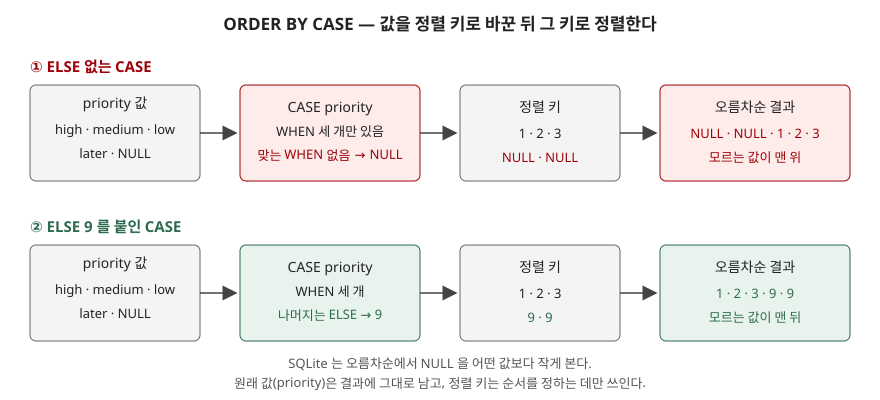

## 들어가며

사내 문의 게시판이나 개인 할 일 앱을 만들다 보면 우선순위 칸을 `high`·`medium`·`low` 같은 글자로 두게 된다. 목록 화면에서 "급한 것부터" 보여 달라는 요청이 오면 `ORDER BY priority` 를 붙여 보는데, 결과는 high 다음에 low 가 오고 medium 이 맨 뒤다. 그러면 흔히 쓰는 방법은 우선순위별로 질의를 세 번 날려 화면에서 이어 붙이거나, 결과를 전부 받아 애플리케이션 코드에서 다시 정렬하는 것이다. 질의 세 번은 페이지를 넘길 때마다 세 번이 되고, 코드에서 정렬하면 `LIMIT 20` 을 걸 수 없어 전체 행을 받아야 한다. SQL 안에서 순서를 매기면 질의 한 번으로 끝난다.

## 개념

`ORDER BY` 는 컬럼 이름만 받는 것이 아니라 **식**(값을 계산해 내는 표현)도 받는다. 그래서 `CASE` 로 글자를 숫자로 바꾼 뒤 그 숫자로 정렬할 수 있다.

```sql
ORDER BY CASE priority
           WHEN 'high'   THEN 1
           WHEN 'medium' THEN 2
           WHEN 'low'    THEN 3
           ELSE 9
         END,
         created_at
```

`CASE` 는 위에서부터 `WHEN` 을 차례로 맞춰 보고, 처음 맞은 자리의 `THEN` 값을 낸다. 이렇게 순서를 정하는 데만 쓰는 값을 **정렬 키**라 부르자. 정렬 키는 결과에 나오지 않고, 화면에는 원래 값 `high` 가 그대로 찍힌다.

같은 일을 하는 방법은 세 가지다.

| 방법 | 순서를 어디에 두나 | 순서가 바뀌면 |
|---|---|---|
| `ORDER BY CASE` | 질의 안 | 질의를 고친다 |
| 순서 표 조인 | `priority_rank` 같은 표의 행 | 표의 값만 고친다 |
| `instr()` | `',high,medium,low,'` 같은 문자열 | 문자열을 고친다 |

## 구조



> **출처**: 맞는 `WHEN` 이 없고 `ELSE` 도 없으면 결과가 NULL 이라는 규칙은 [SQLite — SQL Language Expressions §The CASE expression](https://www.sqlite.org/lang_expr.html#the_case_expression), 오름차순에서 NULL 이 가장 작은 값으로 취급된다는 규칙은 [SQLite — SELECT §The ORDER BY clause](https://www.sqlite.org/lang_select.html#the_order_by_clause). 칸의 값은 실습 [3-1]·[3-2] 를 SQLite 3.49.1 에서 돌린 결과다.

## 동작 원리

정렬은 두 단계로 일어난다. 먼저 각 행마다 `CASE` 를 계산해 정렬 키를 만든다. 그다음 그 키를 비교해 행을 줄 세운다. 키가 같은 행끼리는 두 번째 정렬 기준(`created_at`)으로 다시 비교한다.

함정은 첫 단계에 있다. `WHEN` 목록에 없는 값이 들어오면 `ELSE` 가 없을 때 키가 **NULL** 이 된다. SQLite 는 오름차순 정렬에서 NULL 을 어떤 값보다 작게 보므로, 아무도 모르는 값이 목록 **맨 위**에 올라간다. "급한 것부터"라는 화면에 오타 난 우선순위가 가장 급한 일처럼 찍히는 셈이다.

인덱스와의 관계도 이 두 단계에서 갈린다. `(priority, created_at)` 인덱스는 글자 순서로 정렬돼 있으므로 `ORDER BY priority` 는 인덱스를 앞에서부터 읽기만 하면 된다. `CASE` 의 결과는 인덱스에 없는 값이라, 행을 다 읽어 키를 계산한 뒤 따로 정렬해야 한다. 실행계획의 `USE TEMP B-TREE FOR ORDER BY` 가 그 "따로 정렬"이다.

## 실습 예제

전체 소스: [`code/custom_sort.py`](code/custom_sort.py) · 수행 기록: [`code/output.txt`](code/output.txt)

표 `ticket` 에 8행을 넣었다. 우선순위가 정상인 6행에 더해, 목록에 없는 `'later'` 1행과 비어 있는 NULL 1행이 섞여 있다. 정의와 전체 행은 수행 기록 맨 앞에 있다.

**[1] 문자열 그대로 정렬.** 오름차순은 high·low·medium, 내림차순은 medium·low·high 였다. 어느 방향으로도 업무 순서가 나오지 않는다.

**[2] ORDER BY CASE.** high·medium·low 순이 되고, 같은 우선순위 안에서는 `created_at` 이 이른 것이 먼저 왔다(high 안에서 6번 11-02, 3번 11-03).

**[3] 목록에 없는 값과 NULL.** 이 글에서 가장 눈여겨볼 결과다.

```text
[3-1] 목록에 없는 값('later')과 NULL — ELSE 가 없으면
    ('ticket_id', 'priority', 'rank_value')
    (8, None, None)
    (7, 'later', None)
    (6, 'high', 1)
    ...
[3-2] ELSE 9 를 붙이면
    ...
    (5, 'low', 3)
    (8, None, 9)
    (7, 'later', 9)
```

(수행 기록에서 `sql>` 줄과 가운데 행을 줄였다.) `ELSE` 하나로 두 행이 맨 위에서 맨 뒤로 갔다. `CASE … END DESC` 로 뒤집으면([3-3]) 반대로 NULL 두 행이 맨 뒤에 붙는다. `DESC` 는 그 앞의 식 하나에만 걸리고, 뒤의 `ticket_id` 는 여전히 오름차순이다.

**[4] 순서 표 조인.** `priority_rank(priority, sort_rank)` 표를 만들고 조인했다. 그냥 `JOIN` 으로 붙이면 표에 없는 `'later'` 와 NULL 행이 **결과에서 사라져** 6행만 남았다. 정렬하려다 행을 잃은 것이다. `LEFT JOIN` 으로 붙이고 `COALESCE(r.sort_rank, 9)` 로 빈 키를 채우면 8행이 [3-2] 와 같은 순서로 나왔다.

**[5] instr().** 쉼표로 감싼 문자열 `',high,medium,low,'` 에서 값의 위치(1·6·13)를 키로 쓴다. 목록에 없는 `'later'` 는 0, NULL 은 `',' || NULL || ','` 가 NULL 이 되어 키도 NULL 이었고, 둘 다 맨 위로 갔다. 쉼표를 빼고 `'highmediumlow'` 에서 찾으면 `'ow'` 는 12, `'dium'` 은 7 처럼 다른 값의 일부에 맞아 엉뚱한 자리를 받는다.

**[6] 실행계획.** `(priority, created_at)` 인덱스를 만든 뒤 비교했다.

```text
[6-1] 실행계획 — 문자열 정렬은 인덱스 순서를 그대로 쓴다
    QUERY PLAN
    `--SCAN ticket USING COVERING INDEX ticket_priority_created

[6-2] 실행계획 — ORDER BY CASE
    QUERY PLAN
    |--SCAN ticket USING COVERING INDEX ticket_priority_created
    `--USE TEMP B-TREE FOR ORDER BY
```

순서 표 `LEFT JOIN` 도 `USE TEMP B-TREE FOR ORDER BY` 가 붙었다. `LIMIT 3` 을 걸어도 키를 전부 계산해 정렬해야 앞의 3행을 알 수 있다.

**[7] 식 인덱스.** 같은 `CASE` 식으로 인덱스를 만들면 임시 B-Tree 가 사라진다.

```text
[7-1] 실행계획 — 같은 CASE 식으로 식 인덱스를 만든 뒤
    QUERY PLAN
    `--SCAN ticket USING INDEX ticket_rank_created

[7-2] 실행계획 — WHEN 순서만 바꾼 같은 뜻의 CASE
    QUERY PLAN
    |--SCAN ticket USING COVERING INDEX ticket_priority_created
    `--USE TEMP B-TREE FOR ORDER BY
```

`WHEN` 의 순서만 바꿔 뜻이 똑같은 식을 썼더니 인덱스를 쓰지 못했다. SQLite 는 질의의 식과 인덱스 정의의 식이 **글자 그대로** 같은지를 본다(공백은 무시). 식 인덱스를 쓰려면 정렬 식을 한 곳에 두고 같은 문장을 재사용해야 한다.

## 실무에서 주의할 점

1. **`ELSE` 를 반드시 쓴다.** 빠뜨리면 목록 밖 값과 NULL 이 오름차순 맨 위에 온다. 맨 뒤로 보낼지 맨 앞으로 보낼지를 `ELSE` 값으로 정해 둔다.
2. **순서 표는 `LEFT JOIN` 으로 붙인다.** `JOIN` 은 표에 없는 값을 가진 행을 지운다. 정렬 때문에 목록에서 건수가 줄어드는 것은 알아채기 어렵다.
3. **값의 목록을 데이터에서 막는다.** 정렬 키를 아무리 잘 만들어도 `'later'` 같은 값이 들어오는 것은 막지 못한다. `CHECK (priority IN ('high','medium','low'))` 나 순서 표를 참조하는 외래 키로 입력을 막아 두면 [3] 의 문제가 처음부터 생기지 않는다.
4. **`instr()` 를 쓸 때는 구분자로 감싼다.** 구분자 없이 찾으면 다른 값의 일부에 맞는다.
5. **큰 표에서 자주 쓰면 식 인덱스를 검토한다.** 다만 질의의 식이 인덱스 정의와 글자까지 같아야 한다.

## 정리

- `ORDER BY` 는 식을 받으므로 `CASE` 로 글자를 정렬 키 숫자로 바꿔 업무 순서를 만든다
- `ELSE` 가 없으면 목록 밖 값과 NULL 의 키가 NULL 이 되어 오름차순 맨 위로 왔다
- 순서 표 조인은 순서를 데이터로 두지만, `JOIN` 이면 표에 없는 행이 사라졌다
- CASE 정렬은 임시 B-Tree 로 따로 정렬했고, 글자가 같은 식 인덱스가 있을 때만 인덱스 순서로 읽었다

NULL 의 정렬 자리는 [ORDER BY 와 NULL 의 위치](../2026-09-21-order-by-null-placement/index.md), `CASE` 의 다른 쓰임(조건부 집계·피벗)은 [CASE WHEN](../2026-09-28-case-when-conditional-pivot/index.md), 식 인덱스는 [함수를 씌운 컬럼과 식 인덱스](../2026-10-15-expression-index-function-on-column/index.md)에서 다뤘다.

## 참고 자료

- [SQLite — SQL Language Expressions §The CASE expression](https://www.sqlite.org/lang_expr.html#the_case_expression) — `WHEN` 을 차례로 맞춰 보고, 맞는 것이 없고 `ELSE` 도 없으면 NULL
- [SQLite — SELECT §The ORDER BY clause](https://www.sqlite.org/lang_select.html#the_order_by_clause) — ORDER BY 에 임의의 식을 쓸 수 있다는 것, NULL 의 정렬 위치, `NULLS FIRST`·`NULLS LAST`
- [SQLite — Indexes On Expressions](https://www.sqlite.org/expridx.html) — 식 인덱스는 질의의 식이 인덱스 정의와 정확히 같을 때만 쓰인다
- [SQLite — Built-in Scalar SQL Functions §instr](https://www.sqlite.org/lang_corefunc.html#instr) — 찾지 못하면 0, 인자가 NULL 이면 NULL
- [SQLite — EXPLAIN QUERY PLAN §Temporary Sorting B-Trees](https://www.sqlite.org/eqp.html#temporary_sorting_b_trees) — `USE TEMP B-TREE FOR ORDER BY` 의 뜻
