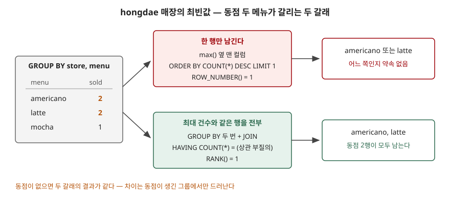

## 들어가며

카페 몇 곳의 주문 데이터를 받아 "매장별 인기 메뉴"를 대시보드에 띄워 달라는 요청을 받는 일이 있다. 처음에는 매장마다 `GROUP BY menu ORDER BY COUNT(*) DESC LIMIT 1` 질의를 한 번씩 돌리거나, 매장·메뉴별 건수를 전부 받아 코드에서 매장마다 최댓값을 찾는다. 매장이 40곳이면 질의가 40번이고, 코드로 옮기면 건수 표 전체를 매번 내려받는다. 더 큰 문제는 두 메뉴가 똑같이 팔린 매장에서 화면에 하나만 뜬다는 점인데, 이건 숫자가 아니라 **답이 틀린 것**이라 눈에 잘 띄지 않는다. 질의 하나로 모든 매장을, 동점까지 정확히 구하는 방법이 있다.

## 개념

**최빈값**(mode)은 가장 자주 나온 값이다. SQL 에는 평균을 내는 `avg()` 처럼 최빈값을 바로 주는 표준 집계 함수가 없어서, 두 단계로 나눠 구한다.

1. `GROUP BY store, menu` 로 매장·메뉴별 건수를 센다
2. 매장 안에서 건수가 가장 큰 메뉴를 고른다

어려운 쪽은 2단계다. 가장 큰 건수가 두 메뉴에서 같으면 최빈값은 **두 개**다. 이것을 **동점**이라 하자. 2단계를 어떻게 쓰느냐에 따라 동점을 모두 남기기도 하고, 하나만 남기기도 한다.

| 방법 | 동점 | 질의 모양 |
|---|---|---|
| `max()` 옆의 맨 컬럼 | 하나만 | 건수 결과를 `GROUP BY store` 로 한 번 더 묶는다 |
| 상관 부질의 + `LIMIT 1` | 하나만 | 매장마다 정렬해 첫 행을 고른다 |
| GROUP BY 두 번 + JOIN | 모두 | 매장별 최대 건수를 구해 건수 표에 다시 붙인다 |
| 상관 부질의 `HAVING` | 모두 | 그 매장의 최대 건수와 같은 묶음만 남긴다 |
| `RANK()` 창 함수 | 모두 | 매장 안에서 건수로 순위를 매기고 1위를 고른다 |

## 구조



> **출처**: 맨 컬럼이 최댓값이 같은 행 중 어느 것에서 오는지 정해지지 않는다는 규칙은 [SQLite — SELECT §Bare columns in an aggregate query](https://www.sqlite.org/lang_select.html#bare_columns_in_an_aggregate_query), `rank()` 가 같은 값에 같은 순위를 주고 `row_number()` 는 구분 없이 번호를 매긴다는 규칙은 [SQLite — Window Functions §Built-in Window Functions](https://www.sqlite.org/windowfunctions.html#built_in_window_functions). 칸의 값은 실습 [1] 을 SQLite 3.49.1 에서 돌린 결과다.

## 동작 원리

"한 행만 남기는" 방법은 전부 같은 일을 한다. 건수 순으로 줄을 세운 뒤 **맨 앞 한 칸**만 가져온다. 건수가 같은 두 행 중 어느 쪽이 맨 앞에 서는지는 질의가 정하지 않았으므로 엔진이 처리하는 순서에 달린다. SQLite 문서도 맨 컬럼에 대해, 최댓값이 여러 행에서 같으면 그중 어느 행의 값이 나올지 정하지 않는다고 적는다.

"모두 남기는" 방법은 줄을 세우지 않고 **값을 비교한다.** 매장의 최대 건수(hongdae 는 2)를 먼저 구하고, 건수가 그 값과 같은 묶음을 전부 고른다. 비교는 같으냐 다르냐만 보므로 동점 두 행이 함께 통과한다. `RANK()` 도 같은 원리다. 정렬 기준 값이 같은 행에 같은 순위를 주므로 americano 와 latte 가 둘 다 1위가 되고, 그다음 mocha 는 3위가 된다.

## 실습 예제

전체 소스: [`code/mode_per_group.py`](code/mode_per_group.py) · 수행 기록: [`code/output.txt`](code/output.txt)

표 `sale` 에 매장 4곳의 판매 18건을 넣었다. gangnam 은 latte 가 3건으로 확실한 1위, hongdae 는 americano·latte 가 2건씩 동점, jamsil 은 세 메뉴가 1건씩 모두 동점, sinchon 은 mocha 2건에 메뉴가 빠진 NULL 3건이 있다. 정의와 앞쪽 행은 수행 기록 맨 앞에 있다.

**[1] 건수부터.** `GROUP BY store, menu` 의 결과가 이후 모든 질의의 바탕이다. sinchon 에서 `(None, 3)` 이 `('mocha', 2)` 보다 위에 있다는 것을 기억해 두자.

**[2] 한 행만 남기는 두 방법.** 이 글에서 가장 눈여겨볼 결과다.

```text
[2-1] 맨 컬럼 — MAX(sold) 와 함께 menu 를 그냥 고른다
    ('hongdae', 'americano', 2)
    ('jamsil', 'americano', 1)
[2-2] 상관 부질의 + LIMIT 1
    ('hongdae', 'latte')
    ('jamsil', 'mocha')
```

(수행 기록에서 hongdae·jamsil 줄만 옮겼다.) 같은 데이터, 같은 SQLite 에서 두 방법이 **서로 다른 메뉴**를 골랐다. 어느 쪽도 틀린 동작이 아니다. 동점 중 하나를 고르라는 질의에 엔진이 각자의 처리 순서대로 답했을 뿐이다. 이 차이는 동점이 있는 매장에서만 생기므로, 테스트 데이터에 동점이 없으면 두 질의는 늘 같은 답을 내 보인다.

**[3]·[4]·[5-2] 동점을 모두 남기는 세 방법.** 세 질의의 결과가 7행으로 똑같았다.

```text
    ('gangnam', 'latte', 3)
    ('hongdae', 'americano', 2)
    ('hongdae', 'latte', 2)
    ('jamsil', 'americano', 1)
    ('jamsil', 'latte', 1)
    ('jamsil', 'mocha', 1)
    ('sinchon', None, 3)
```

[5-1] 에서 순위를 함께 찍어 보면 차이가 보인다. hongdae 의 `rnk` 는 1·1·3 인데 `ROW_NUMBER()` 의 `rn` 은 동점 둘에 1·2 를 나눠 줬다. 그 `rn = 1` 은 latte, jamsil 은 mocha 로 [2-2] 와 같은 쪽이었다. `ROW_NUMBER() = 1` 도 결국 한 행만 남기는 방법이다.

**[6] NULL 이 최빈값으로 올라온다.** sinchon 의 최빈값이 `None` 으로 나온 것은 `GROUP BY` 가 NULL 끼리를 같은 묶음으로 모으기 때문이다. [6-1] 에서 그 묶음의 `COUNT(*)` 는 3, `COUNT(menu)` 는 0 이었다. `COUNT(*)` 는 행을 세고 `COUNT(menu)` 는 NULL 이 아닌 값만 센다. "메뉴를 모르는 주문"이 인기 메뉴가 되면 안 되므로 [6-2] 처럼 `WHERE menu IS NOT NULL` 로 먼저 거르면 sinchon 은 mocha 2건이 된다.

**[7] 동점을 어떻게 보여 줄까.** 화면에 매장당 한 줄만 쓸 수 있다면 두 가지 선택이 있다.

```text
[7-1] 동점을 한 줄로 — group_concat 으로 묶고 몇 개인지 함께
    ('hongdae', 2, 2, 'americano,latte')
    ('jamsil', 1, 3, 'americano,latte,mocha')
[7-2] 규칙을 정해 하나만 — 동점이면 메뉴 이름순 첫 번째
    ('hongdae', 'americano', 2)
    ('jamsil', 'americano', 1)
```

[7-1] 은 `RANK()` 로 1위를 모두 남긴 뒤 `group_concat` 으로 묶었다. 함수 안의 `ORDER BY menu` 가 묶는 순서를 정한다. jamsil 처럼 모든 메뉴가 1건씩이면 `tied` 가 3 으로 찍히는데, 이건 "인기 메뉴가 없다"는 신호로 읽는 편이 맞다. [7-2] 는 `ROW_NUMBER()` 의 정렬에 `menu` 를 두 번째 기준으로 넣어 동점 중 무엇을 고를지 **질의가 정했다.** [2] 와 달리 몇 번을 돌려도 같은 답이 나온다.

## 실무에서 주의할 점

1. **동점이 있는 테스트 데이터를 만든다.** [2] 의 두 질의는 동점이 없으면 같은 답을 낸다. 동점·전부 동점·NULL 묶음이 섞인 데이터로 확인해야 차이가 드러난다.
2. **하나만 보여 줄 거라면 고르는 규칙을 질의에 쓴다.** `ORDER BY COUNT(*) DESC` 만으로는 동점 중 무엇이 나올지 정해지지 않는다. 메뉴 이름, 최근 판매 시각처럼 두 번째 기준을 붙인다.
3. **NULL 을 거를지 먼저 정한다.** `GROUP BY` 는 NULL 을 한 묶음으로 세므로, 빈 값이 많은 컬럼에서는 NULL 이 최빈값이 된다. 집계 전에 `WHERE ... IS NOT NULL` 을 둘지 업무 규칙으로 정한다.
4. **맨 컬럼은 SQLite 에서만 된다.** 다른 대부분의 엔진은 [2-1] 같은 질의를 오류로 거부한다. 옮겨 갈 가능성이 있으면 처음부터 `RANK()` 나 GROUP BY 두 번으로 쓴다.
5. **`group_concat(... ORDER BY ...)` 는 SQLite 3.44.0 부터다.** 그보다 낮은 판에서는 [7-1] 이 문법 오류를 낸다.

## 정리

- 최빈값은 건수를 센 뒤 그룹 안에서 최대 건수를 고르는 두 단계로 구한다
- 맨 컬럼·`LIMIT 1`·`ROW_NUMBER()` 는 동점이면 한 행만 남겼고, 같은 데이터에서 맨 컬럼과 `LIMIT 1` 이 서로 다른 메뉴를 골랐다
- GROUP BY 두 번·`HAVING`·`RANK()` 는 최대 건수와 값을 비교해 동점을 모두 남겼다
- `GROUP BY` 는 NULL 을 한 묶음으로 세어 NULL 3건이 최빈값이 됐다. 집계 전에 걸러야 한다

순위 함수의 차이는 [RANK 와 DENSE_RANK, 동점 처리](../2026-10-06-rank-dense-rank-ties/index.md), 맨 컬럼의 규칙은 [SQLite 의 맨 컬럼](../2026-11-08-sqlite-bare-column-group-by/index.md), 그룹별 상위 N 행은 [ROW_NUMBER 로 그룹별 상위 행 고르기](../2026-10-03-window-function-row-number-top-per-group/index.md), 중앙값은 [ROW_NUMBER 와 COUNT 로 중앙값 구하기](../2026-11-08-sql-median-row-number-count/index.md)에서 다뤘다.

## 참고 자료

- [SQLite — SELECT §Bare columns in an aggregate query](https://www.sqlite.org/lang_select.html#bare_columns_in_an_aggregate_query) — `min()`·`max()` 가 하나면 그 값이 나온 행에서 맨 컬럼을 가져오고, 그런 행이 여럿이면 어느 행인지 정하지 않는다
- [SQLite — SELECT §Generation of the set of result rows](https://www.sqlite.org/lang_select.html#generation_of_the_set_of_result_rows) — `GROUP BY` 에서 NULL 값끼리는 같은 묶음으로 본다
- [SQLite — Window Functions §Built-in Window Functions](https://www.sqlite.org/windowfunctions.html#built_in_window_functions) — `rank()`·`row_number()`·`dense_rank()` 의 정의
- [SQLite — Built-in Aggregate Functions §count](https://www.sqlite.org/lang_aggfunc.html#count) — `count(X)` 는 NULL 이 아닌 값만, `count(*)` 는 행을 센다
- [SQLite Release 3.44.0](https://www.sqlite.org/releaselog/3_44_0.html) — 집계 함수 인자 안의 `ORDER BY` 추가
