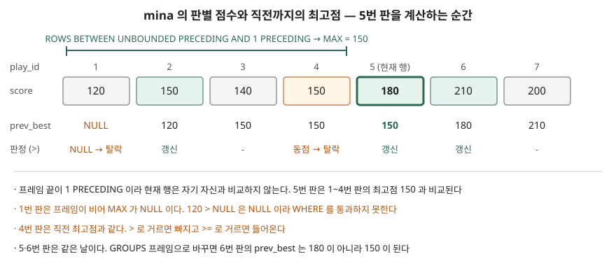

## 들어가며

운동 기록 앱이나 게임 점수판을 만들다 보면 "개인 최고 기록을 세운 날에만 배지를 달아 달라"는 요청이 온다. 처음에는 기록을 전부 내려받아 코드에서 한 줄씩 훑으며 지금까지의 최고값을 들고 다니거나, 판마다 "이전 기록 중 최고값"을 묻는 질의를 따로 날린다. 기록이 800판이면 질의도 800번이다. SQL 한 번으로 고를 수 있고, 그 과정에서 첫 판·동점·같은 날 두 판이라는 세 군데 함정을 만난다.

## 개념

**기록 갱신 행**은 같은 사람의 앞선 행들보다 값이 큰 행이다. 비교 대상은 "지금까지의 최고값"이 아니라 **"바로 앞 행까지의 최고값"**이어야 한다. 현재 행까지 넣으면 모든 행이 자기 자신과 같아서 `>` 가 늘 거짓이 된다.

창 함수(window function, 행을 줄이지 않고 주변 행을 모아 계산하는 함수)의 **프레임**(현재 행 기준으로 계산에 넣을 행의 범위)으로 이 범위를 정한다.

```sql
MAX(score) OVER (PARTITION BY player ORDER BY play_id
                 ROWS BETWEEN UNBOUNDED PRECEDING AND 1 PRECEDING)
```

`UNBOUNDED PRECEDING` 은 파티션의 첫 행, `1 PRECEDING` 은 현재 행 바로 앞 행이다.

## 구조



> **출처**: 프레임 경계 `UNBOUNDED PRECEDING`·`<expr> PRECEDING` 과 프레임 종류 `ROWS`·`GROUPS` 는 [SQLite — Window Functions §Frame Specifications](https://www.sqlite.org/windowfunctions.html#frame_specifications), 행이 없을 때 `max()` 가 NULL 을 낸다는 규칙은 [SQLite — Built-in Aggregate Functions §max](https://www.sqlite.org/lang_aggfunc.html#max_agg). 칸의 값은 실습 [1] 을 SQLite 3.49.1 에서 돌린 결과다.

## 동작 원리

판마다 프레임이 한 칸씩 늘어난다. 1번 판의 프레임은 비어 있어 `MAX` 가 NULL 이고, 2번 판은 1번 판만, 5번 판은 1~4번 판을 본다. 엔진은 파티션을 `ORDER BY` 순으로 정렬한 뒤 위에서부터 내려가며 이 값을 채운다.

거르는 단계에서 NULL 이 문제가 된다. `120 > NULL` 은 거짓이 아니라 NULL 이고, `WHERE` 는 참인 행만 통과시키므로 첫 판이 사라진다. 첫 판은 비교할 기록이 없으니 당연히 첫 기록인데도 그렇다.

## 실습 예제

전체 소스: [`code/record_breaking_rows.py`](code/record_breaking_rows.py) · 수행 기록: [`code/output.txt`](code/output.txt)

표 `play_log` 에 두 선수 mina·jun 의 12판을 넣었다. mina 의 4번 판은 직전 최고점과 같은 150 이고, 5·6번 판과 jun 의 10·11번 판은 같은 날 두 판이다.

**[2] 첫 판이 빠진다.** `score > prev_best` 로만 거르면 5행이 나오고 mina 의 1번 판, jun 의 8번 판이 없다. [2-1] 에서 `120 > NULL` 을 직접 찍으면 `None`, 즉 NULL 이다. [3-1] 처럼 `prev_best IS NULL OR` 를 앞에 붙이면 7행이 된다. [3-2] 의 `COALESCE(prev_best, -1)` 도 같은 7행이지만, 점수가 음수일 수 있는 데이터에서는 바닥값을 잘못 고르면 첫 판이 다시 빠진다.

**[4] 동점.** `>=` 로 바꾸면 mina 의 4번 판(150)이 끼어 8행이 된다. "타이 기록"도 배지를 줄지는 업무 규칙이므로 질의가 대신 정하지 않는다.

**[5] 같은 날 두 판.** 이 글에서 가장 눈여겨볼 결과다.

```text
[5-1] ROWS, ORDER BY played_on      [5-2] GROUPS, ORDER BY played_on
    (10, 'jun', '2026-11-03', 310, 300)      (10, 'jun', '2026-11-03', 310, 300)
    (11, 'jun', '2026-11-03', 305, 310)      (11, 'jun', '2026-11-03', 305, 300)
```

(수행 기록에서 jun 의 11-03 두 줄만 옮겨 나란히 놓았다.) `ROWS` 는 행 단위로 세므로 11번 판이 같은 날 10번 판의 310 을 본다. 그런데 날짜만으로 정렬했으니 두 판의 앞뒤는 질의가 정하지 않았고, 이번에 들어온 순서대로 나왔을 뿐이다. `GROUPS` 는 정렬 키가 같은 행을 한 묶음으로 세어 `1 PRECEDING` 이 "앞 날짜 묶음"이 된다. 그래서 11번 판도 전날까지의 최고점 300 과 비교되고, 305 는 "그날 기준 신기록"이 된다. "판 기준 기록"이면 `ORDER BY played_on, play_id` 로 순서를 정하고, "날 기준 기록"이면 `GROUPS` 를 쓴다.

**[6] 상관 부질의(바깥 행 값을 받아 행마다 다시 도는 부질의).** [6-1] 의 `> (SELECT MAX ...)` 는 [2] 와 똑같이 첫 판을 잃는다. [6-2] 의 `NOT EXISTS` 는 "앞선 판 중 점수가 같거나 높은 판이 없다"로 물으므로, 앞선 판이 하나도 없으면 참이 되어 첫 판이 저절로 들어온다.

**[7] 비용.** 실행계획은 이렇다.

```text
[7-1] 창 함수                            [7-2] NOT EXISTS
QUERY PLAN                               QUERY PLAN
|--CO-ROUTINE (subquery-1)               |--SCAN p
|  |--CO-ROUTINE (subquery-3)            `--CORRELATED SCALAR SUBQUERY 1
|  |  |--SCAN play_log                      `--SEARCH e USING INTEGER PRIMARY KEY (rowid<?)
|  |  `--USE TEMP B-TREE FOR ORDER BY
|  `--SCAN (subquery-3)
`--SCAN (subquery-1)
```

창 함수는 표를 한 번 읽고 정렬한다. `NOT EXISTS` 는 판마다 앞선 판을 다시 찾는다. 판 수를 늘려 실행한 VDBE 명령 수(SQLite 가상 머신이 실행한 명령 개수로, 시간과 달리 매번 같은 값이 나온다)는 예상과 달랐다.

| 점수열 | 판 수 | 기록 수 | 창 함수 | NOT EXISTS |
|---|---|---|---|---|
| 오르내림이 섞임 | 400 | 12 | 21,682 | 29,092 |
| 오르내림이 섞임 | 800 | 12 | 43,282 | 59,669 |
| 판마다 갱신 | 400 | 400 | 23,234 | 724,212 |
| 판마다 갱신 | 800 | 800 | 46,434 | 2,888,412 |

점수가 섞여 있으면 `NOT EXISTS` 도 거의 판 수에 비례했다. 앞선 판에서 더 높은 점수를 **하나만** 찾으면 바로 멈추기 때문이다. 매 판이 기록이면 그런 판이 없어 앞선 판을 끝까지 읽어야 하고, 판 수가 두 배가 될 때 명령 수가 네 배가 됐다. 800판에서 창 함수의 62배다.

## 실무에서 주의할 점

1. **첫 행을 따로 챙긴다.** 비교 대상이 비면 NULL 이고, NULL 비교는 `WHERE` 를 통과하지 못한다. `IS NULL OR` 를 붙이거나 `NOT EXISTS` 로 쓴다.
2. **정렬 키가 겹치지 않는지 본다.** 같은 날짜가 두 행이면 `ROWS` 결과는 그 둘의 순서에 달린다. 고유한 열을 두 번째 정렬 기준으로 넣거나 `GROUPS` 로 의미를 바꾼다.
3. **동점 규칙을 먼저 정한다.** `>` 와 `>=` 는 데이터에 동점이 있을 때만 갈리므로 테스트 데이터에 동점을 넣어 둔다.
4. **상관 부질의의 비용은 데이터 모양에 달린다.** 섞인 데이터로 잰 결과만 보고 괜찮다고 판단하면, 꾸준히 오르는 지표(누적 가입자, 최고 동시 접속)에서 제곱으로 느려진다.
5. **`GROUPS` 프레임은 SQLite 3.28.0 부터다.** 그보다 낮은 판에서는 [5-2] 가 문법 오류를 낸다.

## 정리

- 기록 갱신은 현재 행을 뺀 "직전까지의 최고값"과 비교한다. 프레임 끝을 `1 PRECEDING` 으로 둔다
- 첫 행은 비교 대상이 NULL 이라 `>` 로만 거르면 빠진다. `IS NULL OR` 나 `NOT EXISTS` 로 넣는다
- 동점은 `>` 와 `>=` 에서, 같은 날 두 판은 `ROWS` 와 `GROUPS` 에서 결과가 갈렸다
- `NOT EXISTS` 는 섞인 데이터에서는 빨랐지만 매 판이 기록이면 판 수의 제곱으로 늘었다

프레임 경계의 기본 규칙은 [SUM OVER 의 프레임 — ROWS 와 RANGE](../2026-10-06-sum-over-frame-rows-range/index.md), 프레임에서 현재 행을 빼는 다른 방법은 [윈도우 프레임 EXCLUDE 절](../2026-11-09-window-frame-exclude-clause/index.md), NULL 비교는 [NULL 비교와 3값 논리](../2026-10-02-null-comparison-three-valued-logic/index.md)에서 다뤘다.

## 참고 자료

- [SQLite — Window Functions §Frame Specifications](https://www.sqlite.org/windowfunctions.html#frame_specifications) — `ROWS`·`GROUPS`·`RANGE` 프레임 종류와 `UNBOUNDED PRECEDING`·`<expr> PRECEDING` 경계
- [SQLite — Built-in Aggregate Functions §max](https://www.sqlite.org/lang_aggfunc.html#max_agg) — 행이 없거나 NULL 뿐이면 NULL 을 낸다
- [SQLite — SQL Language Expressions §Operators](https://www.sqlite.org/lang_expr.html#binaryops) — 비교 연산자의 피연산자가 NULL 이면 결과가 NULL 이다
- [SQLite Release 3.28.0](https://www.sqlite.org/releaselog/3_28_0.html) — 창 함수에 `GROUPS` 프레임과 `EXCLUDE` 절 추가
