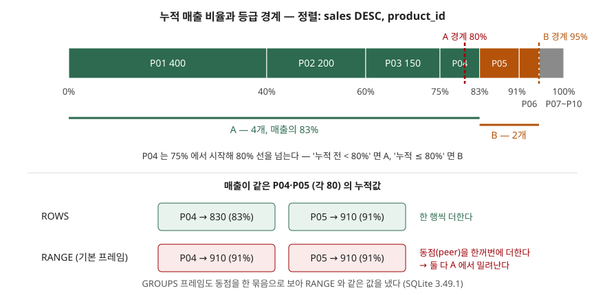

## 들어가며

쇼핑몰 관리 화면을 만들다 보면 "매출 상위 80%를 차지하는 상품은 A, 그다음 15%는 B, 나머지는 C로
나눠 달라"는 요청을 받는다. 재고를 어디에 집중할지 정하는 흔한 분류(ABC 분석)다. 처음에는 상품을
매출 순으로 엑셀에 붙여 넣고 누적 합 칸을 손으로 끌어 내린 뒤, 80%가 넘는 줄을 눈으로 찾는다.
상품이 수천 개고 매달 다시 해야 하면 이 작업이 매번 수천 줄짜리 손일이 된다. SQL 한 문장으로
옮기면 끝날 것 같지만, 막상 옮기면 **80% 선에 걸친 상품**과 **매출이 똑같은 상품**에서 결과가 흔들린다.

## 개념

누적 합(running total)은 정렬된 행을 위에서부터 차례로 더한 값이다. SQL에서는 창 함수(window function,
행을 줄이지 않고 옆 행들을 보며 계산하는 함수)로 구한다.

```sql
SUM(sales) OVER (ORDER BY sales DESC)   -- 매출 큰 순으로 쌓은 누적 합
SUM(sales) OVER ()                      -- 괄호가 비면 전체 합
```

누적 합을 전체 합으로 나누면 누적 비율이 되고, 그 비율로 등급을 가른다. 문제는 `OVER (...)` 안에
**프레임**(frame, 지금 행을 계산할 때 더할 행의 범위)을 적지 않았을 때 무엇이 기본인가다. SQLite
문서는 `ORDER BY`만 있으면 기본 프레임이 `RANGE BETWEEN UNBOUNDED PRECEDING AND CURRENT ROW`이고,
이것은 "처음부터 현재 행과 그 **동료 행**(peer)까지"라고 적는다. 동료 행은 `ORDER BY` 값이 같은 행이다.
한 행씩 더하려면 `ROWS`를 적어야 한다. 프레임 종류 자체는
[SUM OVER 프레임 글](../2026-10-06-sum-over-frame-rows-range/index.md)에서 다뤘고, 여기서는 그 차이가
등급 경계에서 어떻게 드러나는지를 본다.

## 구조



> **출처**: [SQLite Window Functions §2.2 Frame Specifications](https://www.sqlite.org/windowfunctions.html#frame_specifications), [§2.2.2 Frame Boundaries](https://www.sqlite.org/windowfunctions.html#frame_boundaries) — 기본 프레임과 동료 행 정의. 막대의 값은 예제 [6]의 출력

## 동작 원리

예제 표는 상품 10개, 매출 합 1,000이다. 매출이 같은 상품이 두 쌍 있는데, 경계에 걸리는 쪽은
`P04`·`P05`(각 80)다.

**동점에서 누적값이 갈린다.** [3]은 같은 합계를 세 프레임으로 구했다. `ROWS`는 `P04`에 830,
`P05`에 910을 줬다. `RANGE`와 `GROUPS`는 둘 다에 910을 줬다. 매출 80인 두 행이 서로의 동료 행이라
한꺼번에 더해진 것이다. `GROUPS`는 동료 행을 한 묶음으로 세는 프레임이라 같은 결과가 나왔다.

```text
('product_id', 'sales', 'cum_range', 'cum_rows', 'cum_groups')
('P03', 150, 750, 750, 750)
('P04', 80, 910, 830, 910)
('P05', 80, 910, 910, 910)
```

**경계 행을 어디에 넣을지는 규칙으로 정한다.** `P04`는 누적 75%에서 시작해 83%에서 끝난다.
"누적이 80% 이하인 상품"을 A로 치면 `P04`는 B다([4-1], A 매출 75%). "그 상품을 더하기 **전** 누적이
80% 미만인 상품"을 A로 치면 `P04`가 A다([4-2], A 매출 83%). 두 번째 규칙은 A가 매출의 80% 이상을
반드시 덮는다. 첫 번째는 80%를 넘지 않는 대신 모자랄 수 있다. 어느 쪽도 틀린 것은 아니고,
보고서에 어느 규칙을 썼는지 적는 것이 중요하다.

**두 함정이 겹치면 둘 다 밀려난다.** 기본 프레임으로 "누적 전"을 `cum - sales`로 구하면 [5]처럼
`P04`의 누적 전이 750이 아니라 830이 된다. 80% 이상이므로 `P04`와 `P05`가 **함께** A에서 빠진다.

```text
('P04', 80, 830, 910, '-')
('P05', 80, 830, 910, '-')
```

**`ROWS`만 적어도 끝이 아니다.** 매출이 같은 두 행 중 누가 먼저인지는 질의가 정하지 않았다.
[6-1]에서 같은 데이터를 거꾸로 넣은 표로 돌리자 `P05`가 830, `P04`가 910을 받아 A가 바뀌었다.
정렬 키에 `product_id`를 덧붙여야 결과가 하나로 정해진다.

## 실습 예제

전체 소스: [`code/`](code/) · 실행 기록: [`code/output.txt`](code/output.txt)

최종 질의다. 비율은 실수로 나누지 않고 `cum * 100 < 80 * total`처럼 정수로 비교했다. 정수끼리
나누면 `400 / 1000`이 0이 되고([1]), 실수로 나누면 경계값 비교가 반올림에 기대게 된다.

```sql
SELECT product_id, sales, cum, prev_cum, total,
       CASE WHEN prev_cum * 100 < 80 * total THEN 'A'
            WHEN prev_cum * 100 < 95 * total THEN 'B'
            ELSE 'C' END AS grade
FROM (SELECT product_id, sales,
             SUM(sales) OVER w         AS cum,
             SUM(sales) OVER w - sales AS prev_cum,
             SUM(sales) OVER ()        AS total
      FROM product_sales
      WINDOW w AS (ORDER BY sales DESC, product_id
                   ROWS BETWEEN UNBOUNDED PRECEDING AND CURRENT ROW))
ORDER BY cum;
```

예제 파일은 창 정의를 문자열로 두 번 붙였고, 위는 같은 뜻을 `WINDOW` 절로 묶어 보인 것이다.
`WINDOW` 절 형태는 [8]에서 실제로 돌렸다.

```text
('product_id', 'sales', 'cum', 'prev_cum', 'total', 'grade')
('P03', 150, 750, 600, 1000, 'A')
('P04', 80, 830, 750, 1000, 'A')
('P05', 80, 910, 830, 1000, 'B')
('P06', 40, 950, 910, 1000, 'B')
('P07', 20, 970, 950, 1000, 'C')
```

등급별로 묶으면 A 4개가 매출의 83.0%, B 2개가 12.0%, C 4개가 5.0%였다([7]). 분류마다 따로
매기려면 창 정의에 `PARTITION BY category`를 넣고 전체 합도 `SUM(sales) OVER (PARTITION BY category)`로
바꾼다([8]). 식품 분류에서는 `P05`가 B, 생활 분류에서는 `P04`가 A로 나왔다.

## 실무에서 주의할 점

- **누적 합에는 `ROWS`를 적는다.** 프레임을 생략하면 `RANGE`라서 매출이 같은 행이 같은 누적값을
  받는다. 데이터에 동점이 없을 때는 차이가 안 보이다가, 동점이 생긴 달에만 등급이 어긋난다.
- **정렬 키 끝에 유일한 열을 붙인다.** `ORDER BY sales DESC`만으로는 동점 순서가 저장 순서에 기댄다.
  [6-1]처럼 같은 데이터가 다른 등급을 낼 수 있다.
- **경계 규칙을 하나로 정하고 이름을 붙인다.** "누적 ≤ 80%"와 "누적 전 < 80%"는 경계 상품 하나가
  다르다. 같은 화면에서 두 규칙이 섞이면 A 개수가 맞지 않는 보고서가 나온다.
- **비율은 정수로 비교한다.** `cum * 1.0 / total <= 0.8`은 누적이 정확히 80%인 행에서 실수 표현에
  기댄다. 곱해서 정수끼리 비교하면 그런 걱정이 없다.
- **`GROUPS` 프레임은 SQLite 3.28.0부터다.** 동점을 의도적으로 한 묶음으로 다루고 싶으면 쓸 수
  있지만, 그보다 낮은 판에서는 문법 오류가 난다.

## 정리

- 누적 비율은 `SUM() OVER (ORDER BY ...)`를 `SUM() OVER ()`로 나눠 구한다.
- 프레임을 생략하면 `RANGE`라서 동점 행이 같은 누적값을 받는다. 한 행씩 더하려면 `ROWS`를 적는다.
- 정렬 키 끝에 유일한 열을 붙여야 동점의 순서와 등급이 고정된다.
- 경계 행은 "누적 전 비율"로 판정할지 "누적 비율"로 판정할지를 정하고 그 규칙을 밝힌다.

## 참고 자료

- [SQLite Window Functions §2.2 Frame Specifications](https://www.sqlite.org/windowfunctions.html#frame_specifications) — `ORDER BY`만 있을 때의 기본 프레임, 동료 행 정의
- [SQLite Window Functions §2.2.2 Frame Boundaries](https://www.sqlite.org/windowfunctions.html#frame_boundaries) — `RANGE`·`GROUPS`에서 `CURRENT ROW`가 동료 행을 포함하는 규칙
- [SQLite Window Functions §6 History](https://www.sqlite.org/windowfunctions.html#history) — 창 함수 3.25.0, `GROUPS`·`EXCLUDE` 3.28.0
