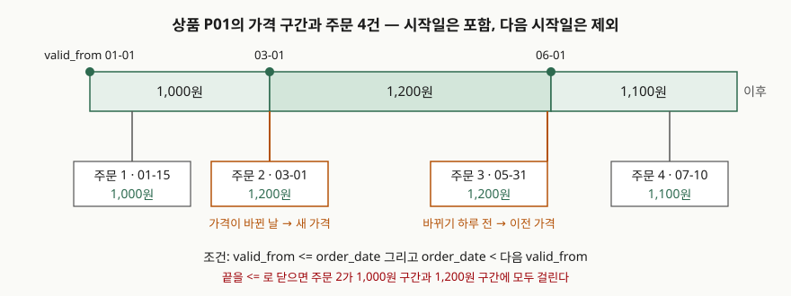

## 들어가며

쇼핑몰 매출 보고서를 만들다 보면 주문 표에는 수량만 있고 가격은 상품 표에 있는 경우를 만난다.
처음에는 주문에 상품 가격을 조인해 곱하면 끝난다. 그러다 가격을 한 번 올리고 나면 지난달 매출이
갑자기 달라진다. 과거 주문에도 지금 가격이 곱해졌기 때문이다. 그래서 가격이 바뀔 때마다 한 줄씩
쌓는 이력 표를 만드는데, 이번에는 "이 주문 날짜에 적용되던 가격"을 고르는 질의가 필요해진다.
급한 대로 상품마다 날짜를 눈으로 맞춰 엑셀에 가격을 적어 넣으면, 주문이 2만 건일 때 2만 번을 맞춰야 한다.

## 개념

가격 이력 표는 보통 **적용 시작일**만 저장한다. 끝 날짜는 다음 줄의 시작일이 알려 주므로 따로
두지 않는다. 끝 날짜까지 저장하면 가격을 바꿀 때마다 앞 줄도 고쳐야 하고, 두 값이 어긋날 수 있다.

이 표에서 어느 날짜의 값을 찾는 일을 시점 조회(as-of lookup)라고 부른다. 규칙은 한 줄이다.
**주문일보다 늦지 않은 시작일 가운데 가장 늦은 줄**을 고른다. SQL로 옮기는 방법은 세 가지가 흔하다.

| 방법 | 쓰는 문법 | 한 줄 설명 |
|---|---|---|
| A | 상관 부질의(바깥 행의 값을 안에서 쓰는 부질의) | 주문마다 `ORDER BY valid_from DESC LIMIT 1` |
| B | `LEAD` 창 함수 + 조인 | 다음 줄의 시작일을 끝 날짜로 삼아 구간에 넣는다 |
| C | 조인 + `ROW_NUMBER` | 주문일 이전 가격을 전부 붙이고 최신 1건만 남긴다 |

## 구조



> **출처**: [SQLite Window Functions §3 Built-in Window Functions](https://www.sqlite.org/windowfunctions.html#builtins) — `lead(expr)`가 파티션 안 다음 행의 값을, 다음 행이 없으면 NULL을 돌려주는 규칙. 구간과 주문별 가격은 예제 [3]·[3-1]의 출력

구간은 **시작일을 포함하고 다음 시작일을 포함하지 않는다.** 3월 1일에 가격이 바뀌었으면 그날 주문은
새 가격을 받고, 5월 31일 주문은 6월 1일에 시작하는 가격을 받지 않는다.

## 동작 원리

**지금 가격을 곱하면 과거가 바뀐다.** [1]은 상품별 최신 가격을 모든 주문에 붙였다. 1월 15일 주문은
1,000원이어야 하는데 1,100원이 붙었고, P02 이력이 시작되기 전인 주문 5에도 5,500원이 붙었다.

**방법 A는 주문마다 인덱스를 한 번 탄다.** 기본키가 `(product_id, valid_from)`이라 상품 안에서
시작일 순으로 정렬돼 있다. 부질의는 그 순서를 거꾸로 읽어 첫 줄에서 멈춘다. 실행계획에 정렬 단계가 없다.

```text
QUERY PLAN
|--SCAN o
`--CORRELATED SCALAR SUBQUERY 1
   `--SEARCH p USING PRIMARY KEY (product_id=? AND valid_from<?)
```

**방법 B는 끝 날짜를 만들어 쓴다.** `LEAD(valid_from)`은 같은 상품의 다음 줄 시작일을 가져온다([3]).
마지막 줄은 다음 줄이 없어 NULL이므로 조인 조건에 `valid_to IS NULL OR`를 둬야 현재 가격이 잡힌다.
계획을 보면 창 함수로 만든 중간 결과에는 인덱스가 없어, SQLite가 `product_id`만으로 임시 인덱스
(`AUTOMATIC COVERING INDEX`)를 만들어 붙였다. 날짜 조건은 그 상품의 구간을 전부 읽으며 거른다.

**방법 C는 후보를 전부 만든 뒤 버린다.** 주문일 이전 가격을 모두 조인하고 주문별로 번호를 매겨
1번만 남긴다. 주문 4는 가격 세 줄이 전부 붙었다가 두 줄이 버려진다.

**이력이 없는 주문에서 결과 행 수가 갈린다.** 주문 5는 P02의 첫 가격보다 앞선다. A는 가격을 NULL로
둔 채 6행을 내고, B와 C는 내부 조인이라 그 주문을 빼고 5행을 낸다([5]). 매출 합계에서는 어느 쪽이든
그 주문이 빠지지만, 건수를 세면 A만 6건이다. B를 `LEFT JOIN`으로 바꾸면 A와 같아진다([5-1]).

## 실습 예제

전체 소스: [`code/`](code/) · 실행 기록: [`code/output.txt`](code/output.txt)

```sql
SELECT o.order_id, o.product_id, o.order_date, o.qty,
       (SELECT p.price FROM price_history p
        WHERE p.product_id = o.product_id
          AND p.valid_from <= o.order_date
        ORDER BY p.valid_from DESC LIMIT 1) AS price
FROM orders o ORDER BY o.order_id;
```

```text
('order_id', 'product_id', 'order_date', 'qty', 'price')
(1, 'P01', '2026-01-15', 2, 1000)
(2, 'P01', '2026-03-01', 1, 1200)
(3, 'P01', '2026-05-31', 3, 1200)
(4, 'P01', '2026-07-10', 1, 1100)
(5, 'P02', '2026-01-20', 1, None)
(6, 'P02', '2026-05-01', 2, 5500)
```

구간의 양 끝을 `BETWEEN`으로 닫으면 가격이 바뀐 날의 주문이 앞뒤 구간에 모두 걸린다([6]).
주문 2와 6이 두 줄씩 나왔다. 이 상태로 합계를 내면 그 주문의 매출이 두 가격으로 겹쳐 더해진다.

```text
(2, '2026-03-01', '2026-01-01', '2026-03-01', 1000)
(2, '2026-03-01', '2026-03-01', '2026-06-01', 1200)
```

상품 200개, 주문 20,000건으로 늘리고 상품당 가격 변경 횟수만 바꿔 가며 쟀다([8], 3회 중 가장 빠른 값).
세 방법의 결과는 매번 같았다.

| 상품당 가격 줄 수 | A 상관 부질의 | B 구간 조인 | C ROW_NUMBER |
|---|---|---|---|
| 5 | 0.019초 | 0.025초 | 0.048초 |
| 50 | 0.019초 | 0.087초 | 0.246초 |
| 300 | 0.022초 | 0.464초 | 1.349초 |

A는 이력이 60배 길어져도 시간이 거의 그대로였다. 주문마다 인덱스에서 한 줄만 읽기 때문이다.
B는 상품의 구간을 전부 훑고, C는 주문일 이전 줄을 전부 붙였다가 정렬하므로 이력 길이를 따라 늘었다.
창 함수 쪽이 더 빠를 것이라 짐작했는데 이 표 구조에서는 반대였다. 숫자는 환경에 따라 달라지지만,
A만 이력 길이에 묶이지 않는다는 점은 실행계획에서 그대로 읽힌다.

## 실무에서 주의할 점

- **구간은 한쪽만 닫는다.** `>= 시작 AND < 다음 시작`으로 쓴다. `BETWEEN`은 양 끝을 포함하므로
  경계 날짜의 행이 두 구간에 걸린다([6]).
- **이력에 없는 날짜를 어떻게 할지 정한다.** 내부 조인은 그 주문을 말없이 뺀다. 빠져도 되는지,
  NULL로 남겨 눈에 띄게 할지를 정하고 `LEFT JOIN`이나 부질의를 고른다.
- **`(상품, 시작일)` 인덱스가 있어야 방법 A가 빠르다.** 이 순서의 인덱스가 없으면 부질의가 주문마다
  이력 표 전체를 읽는다. 예제에서 기본키를 지우고 계획을 다시 보면 확인된다.
- **날짜를 TEXT로 두면 형식을 하나로 맞춘다.** 자릿수를 채우지 않은 `2026-9-1`은 문자열로 비교하면
  `2026-10-01`보다 뒤에 온다. `YYYY-MM-DD`로만 저장한다.
- **하루에 가격이 두 번 바뀌면 날짜 단위 키로는 못 담는다.** 예제의 기본키는 같은 상품·같은 날짜를
  한 줄만 허용한다. 그런 일이 있는 업무라면 시작 시각까지 저장하고 주문도 시각으로 비교한다.
- **[1]의 `MAX`와 함께 쓴 `price`는 SQLite 전용 동작이다.** 집계에 들어가지 않은 열이 최댓값 행의
  값을 따라오는 것은 [SQLite의 맨 컬럼 규칙](../2026-11-08-sqlite-bare-column-group-by/index.md)이고 다른 DB에서는 오류다.

## 정리

- 시작일만 있는 이력 표에서는 "주문일보다 늦지 않은 시작일 중 가장 늦은 줄"을 고른다.
- 상관 부질의, `LEAD` 구간 조인, `ROW_NUMBER` 세 가지가 같은 답을 내지만, 이력이 없는 주문을
  남기는지와 이력이 길 때 걸리는 시간이 다르다.
- 구간은 시작을 포함하고 끝을 제외한다. 양 끝을 닫으면 경계 날짜의 주문이 두 줄이 된다.
- `(상품, 시작일)` 인덱스가 있으면 상관 부질의는 주문마다 한 줄만 읽는다.

## 참고 자료

- [SQLite Window Functions §3 Built-in Window Functions](https://www.sqlite.org/windowfunctions.html#builtins) — `lead()`, `row_number()`의 정의
- [SQLite SELECT — The ORDER BY clause, The LIMIT clause](https://www.sqlite.org/lang_select.html#orderby) — 부질의의 `ORDER BY … LIMIT 1`
- [SQLite Query Optimizer Overview §12 Automatic Query-Time Indexes](https://www.sqlite.org/optoverview.html#autoindex) — 방법 B 계획에 나온 `AUTOMATIC COVERING INDEX`
- [SQLite EXPLAIN QUERY PLAN §1.3 Subqueries](https://www.sqlite.org/eqp.html#subqueries) — `CORRELATED SCALAR SUBQUERY`, `CO-ROUTINE` 줄을 읽는 법
