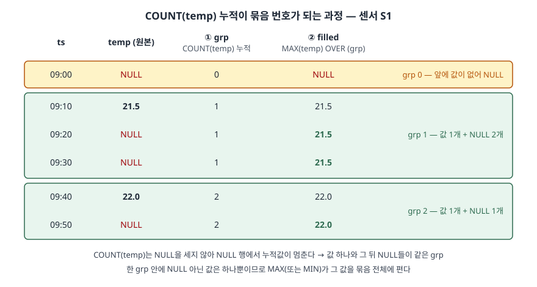

## 들어가며

온도 센서 기록을 차트로 그리려는데 10분마다 찍혀야 할 값이 군데군데 비어 있다. 통신이
끊긴 동안은 행만 있고 `temp`가 NULL이다. 차트 도구는 빈 칸에서 선을 끊어 버리니
"값이 없으면 바로 앞의 값을 그대로 쓴다"로 채우고 싶다. 대부분 먼저 `LAG`를 떠올려
`COALESCE(temp, LAG(temp))`를 쓰는데, 이 식은 앞 행 **하나만** 본다. 빈 칸이 두 개 이어지면
둘째 칸은 앞 행도 NULL이라 그대로 남는다. 빈 칸이 최대 몇 개 이어질지 모르니 `LAG`를
몇 겹으로 감쌀지도 정할 수 없다.

## 개념

이 작업을 흔히 **앞 값 채우기**(forward fill, LOCF — last observation carried forward)라고 한다.
"정렬된 순서에서 지금 행보다 앞에 있는 행 가운데 값이 NULL이 아닌 마지막 행의 값"을 찾는 일이다.

표준 SQL과 일부 상용 DB는 이것을 `LAST_VALUE(temp IGNORE NULLS) OVER (...)`로 한 번에 쓴다.
SQLite 문서의 윈도우 함수 페이지에는 `IGNORE NULLS`가 나오지 않고, 3.49.1에서 실제로 돌리면
구문 오류가 난다. 그래서 SQLite에서는 다른 길로 돌아가야 하고, 이 글은 그 세 가지를 비교한다.

| 방법 | 생각의 순서 |
|---|---|
| A. 상관 부질의 | 행마다 "앞쪽에서 NULL 아닌 마지막 값"을 따로 찾아온다 |
| B. COUNT 묶음 | NULL 아닌 값 하나와 그 뒤의 NULL들을 한 묶음으로 만들고, 묶음 안에 값을 편다 |
| C. 재귀 CTE | 첫 행부터 한 행씩 내려가며 "지금까지의 마지막 값"을 넘겨준다 |

## 구조

방법 B가 가장 낯설어서 그림으로 본다. 핵심은 `COUNT(temp)`가 **NULL을 세지 않는다**는 성질이다.



> **출처**: [SQLite — Built-in Aggregate Functions: count(X)](https://www.sqlite.org/lang_aggfunc.html#count), [SQLite — Window Functions §2.2 Frame Specifications](https://www.sqlite.org/windowfunctions.html#frame_specifications)

## 동작 원리

**① 묶음 번호.** `COUNT(temp) OVER (PARTITION BY sensor_id ORDER BY ts ROWS UNBOUNDED PRECEDING)`는
센서마다 시각 순으로 "지금까지 NULL 아닌 값이 몇 개였나"를 센다. SQLite 문서는 `count(X)`가
X가 NULL이 아닌 횟수를 센다고 적는다. 그래서 값이 있는 행에서 1 오르고 NULL 행에서는 멈춘다.
값 하나와 그 뒤에 이어지는 NULL들이 같은 번호를 받는다.

**② 펴기.** 같은 묶음 안에는 NULL 아닌 값이 정확히 하나다. 집계 함수는 NULL을 건너뛰므로
`MAX(temp) OVER (PARTITION BY sensor_id, grp)`가 그 값 하나를 묶음 전체에 돌려준다.
`MIN`을 써도 같다.

첫 값보다 앞에 있는 NULL은 묶음 번호가 0이고 그 묶음에는 값이 없으므로 NULL로 남는다.
"앞 값"이 없으니 이것이 맞는 답이다.

## 실습 예제

전체 소스: [`code/`](code/) · 실행 기록: [`code/output.txt`](code/output.txt)

```text
[reading]  11행
  sensor_id | ts    | temp
  ----------+-------+-----
  S1        | 09:00 | NULL
  S1        | 09:10 | 21.5
  S1        | 09:20 | NULL
  S1        | 09:30 | NULL
  S1        | 09:40 | 22.0
  S1        | 09:50 | NULL
  S2        | 09:00 | 30.1
  S2        | 09:10 | NULL
  S2        | 09:20 | NULL
  S2        | 09:30 | NULL
  S2        | 09:40 | 29.8
```

기본키는 `(sensor_id, ts)`다. 먼저 `LAG` 방식과 `IGNORE NULLS`를 돌렸다.

```text
[1] COALESCE(temp, LAG(temp)) — 빈 칸이 이어지면 둘째 칸부터 못 채운다
    ('S1', '09:20', None, 21.5)
    ('S1', '09:30', None, None)
    ('S2', '09:10', None, 30.1)
    ('S2', '09:20', None, None)
    ('S2', '09:30', None, None)

[2] LAST_VALUE(temp IGNORE NULLS)
  sqlite3.OperationalError: near "IGNORE": syntax error
```

방법 B의 질의와 결과다. `grp` 칸이 그림의 ①이다.

```sql
WITH grouped AS (
    SELECT sensor_id, ts, temp,
           COUNT(temp) OVER (PARTITION BY sensor_id ORDER BY ts
                             ROWS UNBOUNDED PRECEDING) AS grp
    FROM reading
)
SELECT sensor_id, ts, temp, grp,
       MAX(temp) OVER (PARTITION BY sensor_id, grp) AS filled
FROM grouped ORDER BY sensor_id, ts;
```

```text
    ('sensor_id', 'ts', 'temp', 'grp', 'filled')
    ('S1', '09:00', None, 0, None)
    ('S1', '09:10', 21.5, 1, 21.5)
    ('S1', '09:20', None, 1, 21.5)
    ('S1', '09:30', None, 1, 21.5)
    ('S1', '09:40', 22.0, 2, 22.0)
    ('S1', '09:50', None, 2, 22.0)
    ('S2', '09:00', 30.1, 1, 30.1)
    ('S2', '09:10', None, 1, 30.1)
    ('S2', '09:20', None, 1, 30.1)
    ('S2', '09:30', None, 1, 30.1)
    ('S2', '09:40', 29.8, 2, 29.8)
```

방법 A(`p.ts <= r.ts AND p.temp IS NOT NULL ORDER BY p.ts DESC LIMIT 1`)와 방법 C(재귀 CTE)도
11행 전부 같은 값을 냈다(`세 방법의 결과가 같은가: True`).

### 어느 쪽이 일을 적게 하는가

센서 20개에 빈 칸 30%를 섞어 행 수를 늘리고, 질의 하나가 끝날 때까지 실행한 VDBE 명령 수
(SQLite 가상 머신이 수행한 명령 개수)를 셌다. 시간보다 매번 같은 값이 나온다.

```text
[8] 센서 20개 x 행 수, 빈 칸 비율 30% — VDBE 명령 수
       행 수       A 상관 부질의     B COUNT 묶음       C 재귀 CTE  결과 일치
     1,000         29,811        116,362        102,470  True
     4,000        118,361        465,262        409,370  True
    16,000        472,925      1,860,871      1,636,969  True
```

행마다 부질의를 한 번씩 도는 방법 A가 가장 무거울 거라 예상했는데 반대였다. A가 B의 약 4분의 1이다.
실행계획을 보면 이유가 나온다.

```text
  [A 상관 부질의]
    QUERY PLAN
    |--SCAN r USING INDEX sqlite_autoindex_reading_1
    `--CORRELATED SCALAR SUBQUERY 1
       `--SEARCH p USING INDEX sqlite_autoindex_reading_1 (sensor_id=? AND ts<?)
```

기본키 인덱스가 `(sensor_id, ts)` 순으로 정렬돼 있어 부질의가 지금 행 위치로 바로 찾아가고,
거꾸로 몇 칸만 읽으면 NULL 아닌 값을 만난다. 반면 B는 창 함수 두 번에 정렬용 임시 B-Tree를 쓴다.

이 이점은 **인덱스와 짧은 빈 칸**이 있을 때만 성립한다. 빈 칸을 90%로 늘리면 A가 거꾸로 읽는 거리가
길어져 차이가 좁혀졌고, 기본키를 빼면 A는 행마다 표 전체를 훑었다.

```text
[9] 빈 칸이 길게 이어질 때 — 빈 칸 비율 90%, 16,000행
  A 상관 부질의 1,265,272   B COUNT 묶음 1,774,822

[10] (sensor_id, ts) 인덱스가 없는 표 — 빈 칸 비율 30%
   1,000행  A 상관 부질의    4,439,390   B COUNT 묶음    125,363
   4,000행  A 상관 부질의   70,772,132   B COUNT 묶음    501,263
```

행이 4배가 되자 A는 약 16배가 됐다(행 수의 제곱). B는 인덱스가 있든 없든 행 수에 비례했다.

## 실무에서 주의할 점

**① 프레임을 적지 않으면 같은 시각의 행이 미래 값을 받는다.** 창 함수에 프레임을 적지 않으면
SQLite 기본값은 `RANGE BETWEEN UNBOUNDED PRECEDING AND CURRENT ROW`이고, `ORDER BY` 값이 같은
행(동등 행)은 한꺼번에 프레임에 들어간다. 같은 `ts`에 행이 둘 있는 표에서 돌려 보았다.

```text
  (6-1) 프레임을 적지 않음 — 기본 RANGE 는 같은 ts 를 한 덩어리로 센다
    ('09:00', 1, 20.0, 1)
    ('09:10', 1, None, 2)
    ('09:10', 2, 25.0, 2)
  (6-2) ROWS UNBOUNDED PRECEDING, 정렬 키에 seq 까지
    ('09:10', 1, None, 1)
    ('09:10', 2, 25.0, 2)
```

(6-1)에서 09:10의 첫 행은 NULL인데 묶음 번호가 이미 2다. 같은 시각의 둘째 행 값 25.0까지
세어졌기 때문이고, 이대로 펴면 20.0이 아니라 25.0을 받는다. 정렬 키를 행 하나로 정해지게
만들고 `ROWS`를 명시한다.

**② 방법 A는 인덱스를 확인하고 쓴다.** `(그룹 컬럼, 정렬 컬럼)` 인덱스가 없으면 위처럼 행 수의
제곱으로 늘어난다. 인덱스를 붙일 수 없는 중간 결과(CTE·뷰 결과)에 대고 쓸 때도 마찬가지다.

**③ 채운 값은 측정값이 아니다.** 앞 값 채우기는 "그사이 값이 변하지 않았다"는 가정이다.
평균·합계를 낼 때 채운 행이 원래 값과 같은 무게로 들어가므로, 원본 컬럼을 남겨 두고
채운 값은 새 컬럼으로 만든다. 예제도 `temp`를 덮어쓰지 않고 `filled`를 따로 냈다.

**④ 재귀 CTE는 마지막 수단이다.** 방법 C는 결과는 맞지만 행 번호를 매긴 중간 결과를 만들고
(`MATERIALIZE numbered`), 한 단계마다 자동 인덱스로 다음 행을 찾는다. 창 함수가 없는 아주 오래된
엔진이 아니라면 A나 B로 충분하다.

## 정리

- `COALESCE(x, LAG(x))`는 앞 행 하나만 보므로 이어진 빈 칸을 채우지 못한다.
- SQLite 3.49.1에는 `IGNORE NULLS`가 없다. `COUNT(x)` 누적으로 묶음 번호를 만들고 묶음 안에서 `MAX(x)`를 펴면 같은 결과가 나온다.
- `(그룹, 정렬)` 인덱스가 있고 빈 칸이 짧으면 상관 부질의가 일을 가장 적게 했다. 인덱스가 없으면 행 수의 제곱이 된다.
- 창 함수에는 `ROWS`와 유일한 정렬 키를 명시해야 같은 시각의 행이 뒤의 값을 받지 않는다.

## 참고 자료

- [SQLite — Window Functions §2.2 Frame Specifications](https://www.sqlite.org/windowfunctions.html#frame_specifications) — 기본 프레임 `RANGE BETWEEN UNBOUNDED PRECEDING AND CURRENT ROW EXCLUDE NO OTHERS`, 동등 행(peers)의 정의
- [SQLite — Window Functions: Built-in Window Functions](https://www.sqlite.org/windowfunctions.html#built_in_window_functions) — `lag(expr, offset, default)`는 해당 행이 없을 때만 기본값을 돌려준다
- [SQLite — Built-in Aggregate Functions: count(X)](https://www.sqlite.org/lang_aggfunc.html#count) — X가 NULL이 아닌 횟수를 센다
- [SQLite — The SQLite Query Optimizer Overview](https://www.sqlite.org/optoverview.html) — 상관 부질의가 인덱스로 탐색 범위를 좁히는 방식
- 같은 저장소: [FIRST_VALUE와 LAST_VALUE — 구간의 처음과 끝](../2026-10-16-first-value-last-value-window-frame/index.md), [LAG와 LEAD — 앞뒤 행의 값을 같은 줄에 놓기](../2026-10-12-lag-lead-previous-next-row/index.md), [시간 간격으로 세션 나누기 — 누적 SUM으로 번호 붙이기](../2026-11-19-sql-sessionize-by-time-gap/index.md)(같은 "누적 집계로 묶음 번호" 기법을 세션 나누기에 쓴 글)
