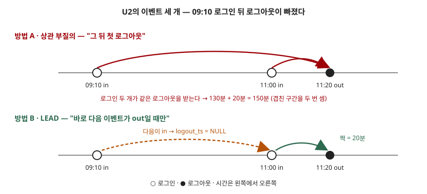

## 들어가며

사내 서비스의 접속 기록을 보고 "사용자별 하루 접속 시간"을 뽑아 달라는 요청을 받는다.
기록 표에는 로그인과 로그아웃이 각각 한 행씩 따로 찍혀 있다. 대부분 "로그인마다 그 뒤에 나온
첫 로그아웃을 찾아 붙인다"는 질의를 먼저 쓰고, 테스트 데이터에서 숫자가 맞으니 그대로 낸다.
그런데 브라우저를 그냥 닫아 로그아웃이 안 찍힌 세션이 하나만 섞여도, 그 로그인은 몇 시간 뒤
**다음 세션의 로그아웃**을 받아 간다. 이 예제에서는 실제 접속 20분짜리 사용자가 150분으로 집계됐다.

## 개념

시작과 종료가 따로 찍힌 로그를 **이벤트 로그**, 시작·종료를 한 행에 놓은 것을 **구간**이라고
부르자. 이벤트를 구간으로 바꾸는 일은 "시작 행마다 짝이 되는 종료 행을 찾는 것"이다.
짝을 찾는 방법은 두 가지가 흔하다.

| 방법 | 짝을 찾는 규칙 | 로그아웃이 빠지면 |
|---|---|---|
| A. 상관 부질의 | 로그인 시각보다 뒤에 있는 로그아웃 중 **가장 이른 것** | 다음 세션의 로그아웃을 가져온다 |
| B. `LEAD` | 같은 사용자의 **바로 다음 이벤트**가 로그아웃이면 그것 | 다음 이벤트가 로그인이므로 NULL |

**상관 부질의**는 바깥 질의의 행마다 한 번씩 다시 실행되는 부질의다. **`LEAD`** 는 정렬된 순서에서
현재 행 바로 다음 행의 값을 가져오는 창 함수(window function, 여러 행을 보고 행마다 값을 하나
돌려주는 함수)다. 두 규칙은 로그가 깨끗하면 같은 답을 주고, 빠진 기록이 있을 때 갈린다.

## 구조



> **출처**: [SQLite — Window Functions: Built-in Window Functions](https://www.sqlite.org/windowfunctions.html#built_in_window_functions) (`lead(expr)`가 파티션의 다음 행 값을, 다음 행이 없으면 NULL을 돌려준다)

방법 A는 "뒤에 있는 로그아웃"만 보므로 그 사이에 로그인이 하나 더 있어도 건너뛴다.
방법 B는 "바로 다음"만 보므로 사이에 로그인이 끼면 짝을 짓지 않는다.

## 동작 원리

방법 B의 질의는 두 단계다. 먼저 사용자별로 시각 순으로 줄을 세우고 다음 이벤트의 종류와
시각을 옆 칸에 붙인다. 그다음 로그인 행만 남기고, 다음 종류가 `out`일 때만 그 시각을 종료로 쓴다.

```sql
WITH ordered AS (
    SELECT user_id, ts, kind,
           LEAD(kind) OVER w AS next_kind,
           LEAD(ts)   OVER w AS next_ts
    FROM login_event
    WINDOW w AS (PARTITION BY user_id ORDER BY ts, event_id)
)
SELECT user_id, ts AS login_ts,
       CASE WHEN next_kind = 'out' THEN next_ts END AS logout_ts
FROM ordered
WHERE kind = 'in';
```

`PARTITION BY user_id`가 사용자마다 줄을 따로 세우므로, 한 사용자의 마지막 이벤트는 다음 사용자의
첫 이벤트를 보지 않고 NULL을 받는다. 정렬 키에 `event_id`를 붙인 것은 같은 분에 찍힌 두 이벤트의
순서를 하나로 정하기 위해서다. `LEAD` 두 개가 같은 창을 쓰므로 `WINDOW w`로 이름을 붙여 한 번만 적었다.

반대 방향도 같은 원리다. `LAG(kind)`로 **바로 앞** 이벤트를 보고, 앞이 로그인이 아닌 로그아웃을
고르면 짝 없는 로그아웃이 나온다.

## 실습 예제

전체 소스: [`code/`](code/) · 실행 기록: [`code/output.txt`](code/output.txt)

```text
[login_event]  9행
  event_id | user_id | ts               | kind
  ---------+---------+------------------+-----
         1 | U1      | 2026-11-28 09:00 | in
         2 | U1      | 2026-11-28 09:30 | out
         3 | U1      | 2026-11-28 10:00 | in
         4 | U1      | 2026-11-28 10:45 | out
         5 | U2      | 2026-11-28 09:10 | in
         6 | U2      | 2026-11-28 11:00 | in
         7 | U2      | 2026-11-28 11:20 | out
         8 | U3      | 2026-11-28 09:05 | out
         9 | U3      | 2026-11-28 09:40 | in
```

U1은 깨끗한 기록, U2는 09:10 로그인 뒤 로그아웃이 빠진 기록, U3은 수집 전에 시작된 세션의
로그아웃(09:05)과 아직 끝나지 않은 로그인(09:40)이다. `(user_id, ts)` 인덱스가 있다.

```text
[1] 방법 A — 상관 부질의: 로그인 뒤 첫 로그아웃
    ('U2', '2026-11-28 09:10', '2026-11-28 11:20')
    ('U2', '2026-11-28 11:00', '2026-11-28 11:20')

[2] 방법 B — LEAD: 바로 다음 이벤트가 로그아웃일 때만
    ('U2', '2026-11-28 09:10', None)
    ('U2', '2026-11-28 11:00', '2026-11-28 11:20')

[3] 짝 없는 로그아웃 — 바로 앞 이벤트가 로그인이 아닌 것
    ('U3', '2026-11-28 09:05', None)
```

U1과 U3의 로그인은 두 방법이 같았다. 갈린 것은 U2 하나다. 방법 A는 로그아웃 11:20을 두
로그인에 모두 붙였다. 구간 두 개가 11:00~11:20에서 겹치는데도 질의는 아무 경고를 내지 않는다.

이 차이가 합계에서 어떻게 드러나는지 사용자별 분을 더해 보았다.

```text
[4-1] 사용자별 접속 시간 — 방법 A 결과로
    ('U2', 2, 2, 150.0)
[4-2] 사용자별 접속 시간 — 방법 B 결과로 (끝나지 않은 세션은 NULL)
    ('U2', 2, 1, 20.0)
    ('U3', 1, 0, None)
[4-3] 방법 B, 끝나지 않은 세션은 집계 시각 12:00 까지로 친다
    ('U2', 2, 1, 190.0)
    ('U3', 1, 0, 140.0)
```

칸은 (사용자, 세션 수, 끝난 세션 수, 분)이다. 방법 A의 U2 150분은 첫 로그인부터 마지막
로그아웃까지인 130분보다도 길다. 겹친 20분을 두 번 셌기 때문이다.

## 실무에서 주의할 점

**① `SUM`은 끝나지 않은 세션을 조용히 뺀다.** [4-2]에서 U3은 분이 NULL이고 U2는 20분뿐이다.
집계 함수가 NULL을 건너뛰기 때문이다. 접속 중인 세션을 어떻게 칠지는 요구 사항이 정할 일이므로
[4-3]처럼 `COALESCE(logout_ts, 집계 시각)`로 명시하고, `COUNT(logout_ts)`로 끝난 세션 수를 함께 낸다.

**② 방법 A가 더 가볍다. 단, 인덱스가 있고 로그가 깨끗할 때만이다.** 로그아웃 누락이 없는 데이터를
늘려 질의 하나가 실행한 VDBE 명령 수(SQLite 가상 머신이 수행한 명령 개수)를 셌다.

```text
[6] 사용자 100명 x 세션 수 — VDBE 명령 수 (로그아웃 누락 없음)
     이벤트 수       A 상관 부질의       B LEAD  결과 일치
     2,000         33,021      126,842  True
    32,000        528,021    2,016,842  True

[7] (user_id, ts) 인덱스가 없는 표
     2,000  A 상관 부질의    8,113,515   B LEAD    148,843
     8,000  A 상관 부질의  129,474,015   B LEAD    592,843
```

인덱스가 있으면 방법 A의 부질의는 `SEARCH o USING INDEX idx_login_event_user_ts (user_id=? AND ts>?)`로
바로 찾아가 B의 약 4분의 1만 일했다. 인덱스를 빼자 부질의가 로그인마다 표 전체를 훑어
이벤트가 4배일 때 명령 수가 약 16배가 됐다. 방법 B는 두 경우 모두 이벤트 수에 비례했다.
그래도 방법 A를 고르려면 **누락이 없다는 보장**이 먼저다. 보장이 없으면 빠른 것이 이득이 아니다.

**③ 정렬 키가 하나로 정해져야 한다.** 같은 분에 로그아웃과 다음 로그인이 찍히면 `ORDER BY ts`만으로는
둘의 순서가 정해지지 않는다. 예제처럼 `event_id` 같은 단조 증가 키를 정렬 키에 붙인다.

**④ 짝 없는 행은 버리지 말고 따로 센다.** [3]의 U3 09:05 로그아웃은 방법 A·B 모두 결과에 안 나온다.
수집 시작 전의 세션이면 정상이지만, 많이 쌓인다면 로그 수집이 끊겼다는 신호이므로 숫자로 남겨 둔다.

## 정리

- 시작·종료 이벤트를 구간으로 묶을 때 "뒤에 있는 첫 종료"를 찾는 상관 부질의는 종료가 빠지면 다음 세션의 종료를 가져온다.
- `LEAD`로 바로 다음 이벤트만 보면 빠진 자리가 NULL로 드러나고, `LAG`로 짝 없는 종료를 찾을 수 있다.
- 끝나지 않은 세션은 `SUM`에서 빠지므로 `COALESCE`로 끝 시각을 명시하고 `COUNT(종료 컬럼)`을 함께 낸다.
- 인덱스가 있고 기록이 깨끗하면 상관 부질의가 일을 적게 했지만, 인덱스가 없으면 이벤트 수의 제곱으로 늘었다.

## 참고 자료

- [SQLite — Window Functions: Built-in Window Functions](https://www.sqlite.org/windowfunctions.html#built_in_window_functions) — `lead(expr, offset, default)`, `lag(expr, offset, default)`가 파티션 안의 다음·이전 행 값을 돌려주고 그 행이 없으면 NULL
- [SQLite — Built-in Aggregate Functions](https://www.sqlite.org/lang_aggfunc.html) — 집계 함수가 NULL 입력을 건너뛰는 규칙, `count(X)`
- [SQLite — Date And Time Functions](https://www.sqlite.org/lang_datefunc.html) — `julianday()`로 두 시각의 차이를 일 단위 실수로 구한다
- 같은 저장소: [LAG와 LEAD — 앞뒤 행의 값을 같은 줄에 놓기](../2026-10-12-lag-lead-previous-next-row/index.md), [시간 간격으로 세션 나누기 — LAG로 끊는 자리를 찾고 누적 SUM으로 번호 붙이기](../2026-11-19-sql-sessionize-by-time-gap/index.md)(종료 이벤트가 아예 없을 때 시간 간격으로 세션을 자르는 글)
