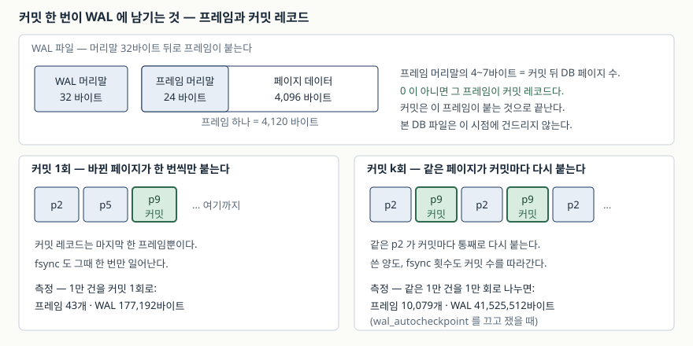

## 들어가며

CSV 한 뭉치를 데이터베이스에 밀어 넣는 스크립트를 짜 본 적이 있을 것이다. 개인
가계부든 업무용 적재 작업이든, 처음 쓰는 모양은 대개 이렇다. 파일을 한 줄씩 읽어
`INSERT` 를 날리고, 혹시 중간에 끊겼을 때 어디까지 들어갔는지 알고 싶어서 한 줄
넣을 때마다 `commit()` 을 부른다.

10만 줄짜리 파일에서 이게 30분을 먹는다. 이상해서 프로파일러를 붙여 보면 SQL
실행도, 파싱도 아니고 그냥 `commit` 에서 시간이 녹는다. 많이 하는 다음 선택이
"DB 가 느리다"고 결론 내고 벌크 로더나 다른 엔진을 찾아보는 것인데, 사실 고칠
것은 한 줄이다.

그 한 줄이 얼마를 줄이는지, 그리고 줄인 대신 무엇을 내놓는지를 재 봤다.

## 개념

`COMMIT` 은 "이 트랜잭션의 결과를 전원이 꺼져도 남는 곳에 올려놨다"를 선언하는
지점이다. 선언이 참이 되려면 디스크가 "정말 썼다"고 답할 때까지 기다려야 하고,
그 기다림이 **fsync** 다. 운영체제의 쓰기 버퍼에 넘기는 것만으로는 부족하다.

여기서 중요한 성질이 하나 있다. **fsync 비용은 쓴 데이터 양이 아니라 횟수에
붙는다.** 1만 건을 한 트랜잭션에 묶으면 fsync 는 한 번이고, 한 건씩 나누면 1만
번이다. 넣은 데이터는 같다.

SQLite 가 커밋을 기록하는 방식은 저널 모드에 따라 다르다. **WAL 모드**에서는 바뀐
페이지를 `-wal` 파일 끝에 **프레임**으로 덧붙이고, 마지막 프레임에 "커밋 뒤 DB
페이지 수"를 적어 두는 것으로 커밋이 끝난다. 본 DB 파일은 이 시점에 손대지 않는다.

## 구조



> **출처**: [SQLite — Database File Format §4.1 WAL File Format](https://www.sqlite.org/fileformat2.html#wal_file_format), [SQLite — Write-Ahead Logging §2 How WAL Works](https://www.sqlite.org/wal.html#how_wal_works)

프레임 하나는 머리말 24바이트에 페이지 한 장(이 환경에서 4,096바이트)을 붙인
4,120바이트다. 프레임 머리말의 4~7바이트에 들어가는 값이 핵심인데, 공식 포맷
문서는 "커밋 레코드에는 커밋 뒤 DB 파일의 페이지 수, 나머지 레코드에는 0"이라고
적는다. 즉 **커밋 레코드는 프레임 하나**이고, 커밋을 k번 하면 커밋 레코드도 k개다.

## 동작 원리

`-wal` 파일은 무한히 커지지 않는다. 공식 문서는 WAL 파일이 **1000 페이지**에
닿으면 자동으로 체크포인트가 돈다고 적는다. 체크포인트는 WAL 의 내용을 본 DB
파일로 옮기는 일이고, 끝나고 읽는 쪽이 없으면 "WAL 을 처음으로 되감는다".
이때 파일을 **자르지 않고 처음부터 덮어쓴다** — 새로 붙이는 것보다 이미 있는
파일을 덮는 쪽이 빠르기 때문이라고 문서가 밝힌다.

그래서 **디스크에 남은 WAL 파일 크기로는 얼마나 썼는지 알 수 없다.** 커밋을 1만
번 하든 1,001번 하든 파일은 1000 프레임 언저리에서 멈춘다. 쓴 양을 보려면
`PRAGMA wal_autocheckpoint = 0` 으로 되감기를 막고 재야 한다.

`synchronous` 는 그 커밋에서 fsync 를 할지를 정한다. WAL 모드에 한정해 문서는
이렇게 적는다 — `FULL` 이면 커밋마다 WAL 을 sync 하고, `NORMAL` 이면 그 sync 를
생략하며 체크포인트만이 I/O 장벽을 친다. 대신 전원이 끊기면 마지막 트랜잭션들이
되돌아갈 수 있다.

## 실습 예제

전체 소스: [`code/commit_batching.py`](code/commit_batching.py) ·
돌린 기록: [`code/output.txt`](code/output.txt)

측정마다 임시 폴더에 새 DB 파일을 만들고 1만 건을 넣었다. 시간은 디스크와 OS 캐시
상태를 타므로 절대값이 아니라 **배수**를 본다.

### 커밋 횟수만 바꿨을 때

```text
1. journal_mode=WAL · synchronous=FULL — 커밋 횟수만 바꾼다
  커밋 횟수                             소요    1회 대비          최종 WAL 파일        프레임
  1회 (10,000건마다)                0.010s    1.0x  WAL   177,192B  프레임    43
  10회 (1,000건마다)                0.012s    1.2x  WAL   288,432B  프레임    70
  100회 (100건마다)                 0.057s    5.7x  WAL   889,952B  프레임   216
  1,000회 (10건마다)                0.583s   58.7x  WAL 4,120,032B  프레임 1,000
  10,000회 (1건마다)                5.889s  592.4x  WAL 4,120,032B  프레임 1,000
```

1회와 1만 회 사이가 **592배**다. 넣은 행은 똑같이 1만 건이고, SQL 문도 같다.
커밋 횟수와 소요 시간이 거의 비례한다는 것도 그대로 보인다 — 100회에서 1,000회로
열 배 늘리자 시간도 열 배(0.057 → 0.583) 늘었다.

**예상과 달랐던 것은 WAL 파일 크기다.** 1,000회와 1만 회의 파일 크기가
4,120,032바이트로 똑같다. 1000 프레임 × 4,120바이트 + 머리말 32바이트, 정확히
자동 체크포인트 문턱이다. 커밋을 열 배 더 해도 파일은 거기서 멈춘다.

프레임 수를 보면 데이터 양 자체는 늘고 있다. 같은 1만 건인데 커밋 1회는 43
프레임, 100회는 216 프레임이다. **같은 페이지가 커밋마다 통째로 다시 붙기
때문**이다. 100건마다 커밋하면 그 100건이 걸친 페이지들이 100번 복사된다.

### synchronous 를 낮추면

```text
2. synchronous 를 낮추면 격차가 어떻게 달라지나 (WAL)
  [synchronous=FULL]
    1회                          0.011s    1.0x
    100회                        0.060s    5.6x
    10,000회                     5.991s  558.7x
  [synchronous=NORMAL]
    1회                          0.009s    1.0x
    100회                        0.011s    1.3x
    10,000회                     0.172s   19.3x
  [synchronous=OFF]
    1회                          0.009s    1.0x
    100회                        0.011s    1.2x
    10,000회                     0.124s   13.9x
```

1만 회 커밋이 5.991초에서 0.172초로, **35배** 줄었다. fsync 를 생략했기 때문이고,
남은 19배가 fsync 가 아닌 비용(프레임 쓰기, 트랜잭션 시작·종료)이다.

여기서 `NORMAL` 과 `OFF` 의 차이가 작다는 점(0.172 vs 0.124)이 눈에 띈다. WAL
모드에서 `NORMAL` 은 이미 커밋 fsync 를 하지 않으므로, 더 낮춰 봐야 체크포인트
쪽에서만 아낀다. **WAL 을 쓰면서 `OFF` 까지 내릴 이유는 별로 없다는 뜻이다.**

### 저널 모드를 바꾸면

```text
3. 같은 조건을 DELETE 저널로 (synchronous=FULL)
  1회 · delete                   0.011s    1.0x
  100회 · delete                 0.238s   21.2x
  10,000회 · delete             21.531s 1922.1x
```

같은 1만 회 커밋이 WAL 에서 5.9초, DELETE 저널에서 21.5초다. 롤백 저널 모드는
커밋마다 저널 파일을 만들고 지우는 과정이 끼기 때문에 횟수에 더 민감하다.
**커밋을 자주 할 수밖에 없는 작업이라면 저널 모드부터 보는 편이 낫다.**

### 되감기를 막고 재면

```text
4. wal_autocheckpoint 를 끄면 WAL 이 어디까지 커지나
  기본값 1000 — 켠 채로
  10,000회                       0.168s  WAL  4,120,032B  프레임  1,000
  wal_autocheckpoint=0 — 꺼 두고
  10,000회                       0.152s  WAL 41,525,512B  프레임 10,079
```

1만 회로 나누면 실제로는 **41.5MB** 를 썼다. 같은 1만 건을 커밋 1회로 넣었을 때의
177,192바이트와 비교하면 234배다. 기본 설정에서 파일이 4MB 에서 멈춰 보였던 것은 쓴 양이
적어서가 아니라 체크포인트가 계속 되감고 있었기 때문이다.

### executemany 는 무엇을 줄이나

```text
5. 한 번에 넣을 때 executemany 는 무엇을 줄이나
  executemany · 커밋 1회          0.005s
  execute 반복 · 커밋 1회         0.009s
```

한 트랜잭션 안이라면 `executemany` 와 `execute` 반복의 차이는 0.004초다.
`executemany` 가 줄이는 것은 **파이썬 쪽 호출 오버헤드**이지 커밋 비용이 아니다.
느린 적재를 만났을 때 먼저 볼 곳은 이쪽이 아니라 커밋 횟수다.

## 실무에서 주의할 점

**1. "중간에 끊기면 어디까지 들어갔는지 알고 싶다"는 요구를 커밋으로 풀지 않는다.**
한 건씩 커밋하는 코드는 대부분 이 이유로 쓰인다. 그런데 커밋을 1만 번 해도
"어디까지"는 결국 다시 세어 봐야 알고, 그동안 592배를 낸다. 적재 단위를 묶어
커밋하고(1천~1만 건), 묶음 번호를 따로 기록하는 쪽이 싸다.

**2. `synchronous=NORMAL` 은 공짜가 아니다.** 공식 문서가 밝히는 대가는
"전원 장애나 하드 리셋 뒤 트랜잭션이 되돌아갈 수 있다"는 것이다. 데이터베이스가
깨지는 것이 아니라 **최근 커밋 몇 개가 사라지는** 쪽이다. 다시 돌리면 되는 적재
작업에는 맞고, 사용자가 "저장됨"을 본 뒤 사라지면 안 되는 쓰기에는 맞지 않는다.

**3. 커밋을 너무 크게 묶는 것도 비용이 있다.** 한 트랜잭션이 길면 그동안 WAL 이
계속 자라고, 체크포인트는 읽는 쪽이 끝날 때까지 미뤄진다. 되돌릴 때 버리는 일의
양도 그만큼 커진다. 1만 건 단위면 대개 충분하고, 그 위로는 이 측정에서도 더 빨라지지
않았다(1회 0.010초 vs 10회 0.012초).

**4. 남아 있는 WAL 파일 크기로 쓰기 양을 판단하지 않는다.** 위에서 본 대로 자동
체크포인트가 파일을 되감는다. 운영 중에 `-wal` 이 비정상적으로 크다면 그건 쓰기가
많아서가 아니라 **오래 열려 있는 읽기 트랜잭션이 체크포인트를 막고 있는** 쪽을
먼저 의심한다.

**5. 이 숫자를 다른 환경에 그대로 옮기지 않는다.** fsync 비용은 저장 장치와 파일
시스템이 정한다. 여기서 쓴 값은 Windows 11 로컬 디스크 기준이고, 네트워크 파일
시스템이나 회전 디스크에서는 격차가 훨씬 커진다. 볼 것은 숫자가 아니라 **커밋
횟수에 비례한다**는 모양이다.

## 정리

- 커밋 비용은 데이터 양이 아니라 **횟수**에 붙는다. 같은 1만 건을 1회와 1만 회로
  나눴을 때 592배가 났다
- WAL 모드에서 `synchronous=NORMAL` 은 커밋 fsync 를 생략한다. 1만 회 커밋이
  35배 빨라졌고, 대가는 전원 장애 때 최근 커밋이 되돌아갈 수 있다는 것이다
- 커밋 횟수에 민감하기로는 DELETE 저널이 WAL 보다 심하다(21.5초 vs 5.9초)
- **WAL 파일 크기는 커밋 수에 비례하지 않는다.** 1000 페이지에서 자동 체크포인트가
  되감기 때문이다. 쓴 양을 보려면 되감기를 꺼야 한다
- `executemany` 가 줄이는 것은 파이썬 호출 오버헤드다. 커밋 횟수를 줄이는 것과
  다른 일이다

## 참고 자료

- [SQLite — Write-Ahead Logging](https://www.sqlite.org/wal.html)
- [SQLite — Write-Ahead Logging §2.1 Checkpointing](https://www.sqlite.org/wal.html#ckpt)
- [SQLite — Write-Ahead Logging §6 Avoiding Excessively Large WAL Files](https://www.sqlite.org/wal.html#avoiding_excessively_large_wal_files)
- [SQLite — Database File Format §4.1 WAL File Format](https://www.sqlite.org/fileformat2.html#wal_file_format)
- [SQLite — PRAGMA synchronous](https://www.sqlite.org/pragma.html#pragma_synchronous)
- [SQLite — PRAGMA wal_autocheckpoint](https://www.sqlite.org/pragma.html#pragma_wal_autocheckpoint)
