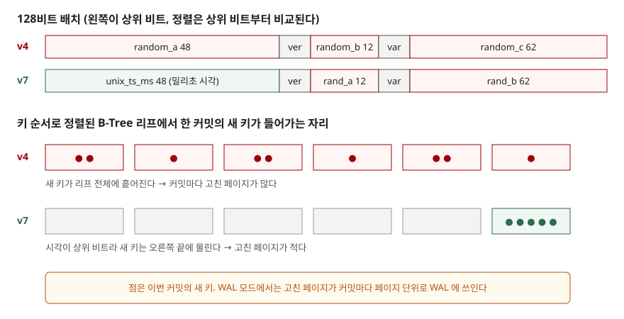

## 들어가며

여러 서버가 각자 ID 를 만들어야 하거나, URL 에 순번을 드러내고 싶지 않아서 기본키를 UUID 로 바꾸는 일이 흔하다. `uuid.uuid4()` 한 줄이면 충돌 걱정 없는 키가 나오니 그대로 쓴다. 그러다 행이 쌓이면 "UUID v4 는 무작위라 B-Tree 페이지를 쪼개서 반쯤 빈 페이지가 생긴다, 그래서 v7 을 써야 한다"는 이야기를 듣는다. 그 말이 맞는지 확인하려고 키만 바꿔 10만 행을 넣고 파일을 직접 열어 페이지를 셌다. 공간 이야기는 예상과 반대로 나왔고, 실제 차이는 다른 곳에 있었다.

## 개념

UUID 는 128비트 식별자다. 2024년 5월 발행된 RFC 9562 가 기존 RFC 4122 를 대체하며 버전 6·7·8 을 새로 정의했다.

- **v4**: 버전·변형 표시 6비트를 뺀 122비트가 전부 난수다. 만든 순서와 값의 크기 사이에 아무 관계가 없다
- **v7**: 상위 48비트에 유닉스 시각(밀리초)을 넣고 나머지를 난수로 채운다. 늦게 만든 키가 대체로 더 크다

데이터베이스에서 이 차이가 중요한 이유는 기본키가 **정렬된 B-Tree** 로 저장되기 때문이다. 키를 비교하면 상위 바이트부터 보므로, v7 은 새 키가 거의 항상 트리의 오른쪽 끝에 들어가고 v4 는 아무 데나 들어간다.

## 구조



> **출처**: [RFC 9562 §5.4 UUID Version 4](https://www.rfc-editor.org/rfc/rfc9562.html#section-5.4) · [RFC 9562 §5.7 UUID Version 7](https://www.rfc-editor.org/rfc/rfc9562.html#section-5.7) · [SQLite Database File Format §1.6 B-tree Pages](https://www.sqlite.org/fileformat2.html#b_tree_pages)

## 동작 원리

SQLite 에서 기본키를 `BLOB PRIMARY KEY` 로 선언한 일반 표는 B-Tree 가 둘이다. 행 자체는 rowid(내부 정수 번호) 순서의 표 B-Tree 에, UUID 는 `sqlite_autoindex_t_1` 이라는 인덱스 B-Tree 에 들어간다. `WITHOUT ROWID` 로 선언하면 rowid 가 없어지고 행이 UUID 순서의 B-Tree 하나에 저장된다.

삽입 때 리프 페이지가 넘치면 SQLite 는 페이지를 재배치한다. `btree.c` 의 `balance_nonroot()` 는 넘친 페이지와 양옆 형제까지 **최대 3페이지**(`NB 3`)의 셀을 다시 나누고, 주석은 그 목적을 모든 페이지의 빈 공간을 비슷하게 맞추는 것으로 적는다. 오른쪽 끝에 붙이는 경우만 따로 처리하는 `balance_quick()` 은 호출 조건 첫 줄이 `pPage->intKeyLeaf` 라서 **표 B-Tree 의 리프에만** 쓰인다. 인덱스와 `WITHOUT ROWID` 표는 키가 순서대로 들어와도 일반 재배치를 거친다. 이 두 가지는 GitHub 미러의 현재(master) 소스로 확인했고, 3.49.1 판 소스와 줄 단위로 대조하지는 않았다.

파이썬에 내장된 이 SQLite 는 dbstat 가상 테이블이 없는 빌드라서, 파일 포맷 명세의 페이지 헤더(셀 수, 셀 내용 시작 위치, 빈 블록 목록, 조각 바이트)를 직접 읽어 리프마다 빈 바이트를 셌다. 쓴 페이지 수는 WAL 모드에서 체크포인트를 끄고 WAL 파일 크기로 셌다. WAL 은 커밋마다 바뀐 페이지를 프레임(페이지 + 24바이트 머리)으로 덧붙이므로 `(크기 − 32) ÷ (4096 + 24)` 가 쓴 페이지 수다.

## 실습 예제

전체 소스: [`code/`](code/) · 수행 기록: [`code/output.txt`](code/output.txt)

10만 행을 1,000행씩 100번 커밋했다. v7 의 시각 필드는 1밀리초에 8행이 들어오는 것으로 흉내 냈다. 파이썬 3.13 의 `uuid` 모듈에는 `uuid7()` 이 없어 RFC 비트 배치대로 직접 만들었다. 결과의 핵심만 옮기면 다음과 같다.

```text
[v4-rowid]  삽입 0.78초 · 파일 1629페이지 (6.4 MB) · WAL 프레임 31780 (커밋당 317.8)
  table t                         958        4      104.4    99.2%
  index sqlite_autoindex_t_1      660        6      150.5    90.9%

[v7-rowid]  삽입 0.19초 · 파일 1655페이지 (6.5 MB) · WAL 프레임 2410 (커밋당 24.1)
  table t                         958        4      104.4    99.2%
  index sqlite_autoindex_t_1      685        7      145.0    87.5%

[v4-without-rowid]  삽입 1.05초 · 파일 985페이지 (3.8 MB) · WAL 프레임 41440 (커밋당 414.4)
  table t                         973       11      101.8    89.6%

[v7-without-rowid]  삽입 0.16초 · 파일 1013페이지 (4.0 MB) · WAL 프레임 1617 (커밋당 16.2)
  table t                        1000       12       99.0    87.2%
```

열은 차례로 리프 수, 내부 노드 수, 리프당 셀 수, 리프 채움률이다. 정수 키 표는 리프 561개, 채움률 99.6%, 커밋당 8.6페이지였다.

**공간은 예상과 반대였다.** v4 인덱스의 리프 채움률은 90.9%로 v7 의 87.5%보다 높았고, 파일도 v4 쪽이 조금 작았다. 넘친 페이지를 형제 셋에 나눠 담는 재배치 덕분에 무작위 삽입이어도 "반쯤 빈 페이지"가 쌓이지 않았다. 반대로 v7 은 오른쪽 끝에만 붙는데도 `balance_quick()` 대상이 아니라서 같은 표 B-Tree 의 99.2% 까지 차지 못했다.

**차이는 쓴 페이지 수에서 났다.** v4 는 커밋 한 번에 318페이지(rowid 표), 414페이지(`WITHOUT ROWID`)를 WAL 에 썼고 v7 은 24페이지, 16페이지였다. 13배, 26배다. 1,000개의 새 키가 v4 에서는 수백 개 리프에 흩어져 내려앉고, v7 에서는 오른쪽 끝 몇 페이지에 모인다. 삽입 시간도 이 기록에서 v4 가 4~7배 길었다. 시간은 디스크와 캐시에 따라 흔들리지만 프레임 수는 시드가 같으면 같은 값이 나온다.

## 실무에서 주의할 점

**첫째, v4 의 비용은 공간보다 쓰기 증폭이다.** 페이지 하나에 키 하나만 바뀌어도 페이지 전체를 다시 써야 한다. 표가 메모리 캐시보다 커지면 흩어진 리프를 읽어 오는 비용까지 더해진다. 이 실험은 4MB 남짓이라 전부 캐시에 들어갔으므로 읽기 쪽 차이는 재지 못했다.

**둘째, 일반 표에 UUID 기본키를 걸면 키가 두 번 저장된다.** rowid 표 + 자동 인덱스 구성은 6.4MB, `WITHOUT ROWID` 는 3.8MB 였다. UUID 로 조회하는 일이 대부분이라면 `WITHOUT ROWID` 가 맞다. 다만 이 경우 행 전체가 UUID 순서 트리에 들어가므로 v4 의 쓰기 증폭이 더 커졌다(커밋당 318 → 414페이지).

**셋째, v7 은 만든 시각을 드러낸다.** 상위 48비트가 밀리초 시각이므로 키만 보고 언제 생성됐는지 알 수 있다. RFC 9562 의 보안 고려사항(§8)도 내장된 시각이 작은 공격 표면이 되고 생성 순서를 드러낸다고 적는다. 외부에 노출되는 ID 에서 생성 시각이 민감하다면 v4 를 쓰거나, 내부 키(v7)와 외부 노출용 키를 나눈다.

**넷째, 같은 밀리초 안에서는 v7 도 무작위다.** 이 실험은 1밀리초에 8행으로 흉내 냈다. 한 밀리초에 수천 행이 들어오는 시스템이면 그 안의 순서가 난수로 정해진다. RFC 는 같은 밀리초 안의 단조 증가를 선택 사항(MAY)으로 두고, 전용 카운터·단조 난수·시각 정밀도 확장 세 가지 방법을 제시한다(§6.2).

## 정리

- v4 는 122비트가 난수라 새 키가 B-Tree 리프 전체에 흩어지고, v7 은 상위 48비트가 시각이라 오른쪽 끝에 모인다
- SQLite 3.49.1 에서 리프 채움률은 v4 인덱스 90.9%, v7 인덱스 87.5% 로 v4 가 오히려 높았다. 형제 3페이지에 걸친 재배치 때문이다
- 실제 차이는 커밋당 쓴 페이지 수였다. v4 가 13~26배 많이 썼고 삽입 시간도 4~7배 길었다
- v7 은 생성 시각을 드러내므로 외부 노출 ID 로 쓸 때는 그 점을 따진다

## 참고 자료

- [RFC 9562 — Universally Unique IDentifiers (UUIDs)](https://www.rfc-editor.org/rfc/rfc9562.html) — [§5.4 UUID Version 4](https://www.rfc-editor.org/rfc/rfc9562.html#section-5.4), [§5.7 UUID Version 7](https://www.rfc-editor.org/rfc/rfc9562.html#section-5.7), [§6.2 Monotonicity and Counters](https://www.rfc-editor.org/rfc/rfc9562.html#section-6.2), [§8 Security Considerations](https://www.rfc-editor.org/rfc/rfc9562.html#section-8)
- [SQLite Database File Format §1.6 B-tree Pages](https://www.sqlite.org/fileformat2.html#b_tree_pages)
- [SQLite Database File Format — The Write-Ahead Log](https://www.sqlite.org/fileformat2.html#the_write_ahead_log)
- [SQLite — Clustered Indexes and the WITHOUT ROWID Optimization](https://www.sqlite.org/withoutrowid.html)
- [SQLite 소스 btree.c — balance_quick·balance_nonroot (GitHub 미러, master)](https://github.com/sqlite/sqlite/blob/master/src/btree.c)
- 같은 저장소: [WITHOUT ROWID 표](../../sql-basics/2026-10-23-without-rowid-table/index.md)
