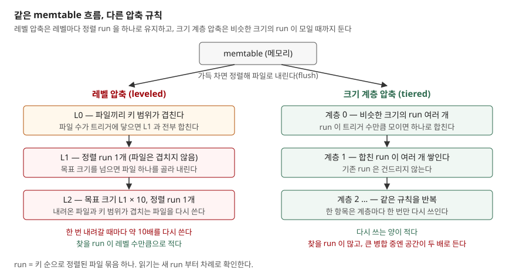

## 들어가며

쓰기가 많은 서비스에 RocksDB 계열 저장소를 붙이면, 애플리케이션이 초당 10MB 를 쓰는데 디스크 모니터에는 수십 MB 가 찍히는 장면을 보게 된다. SSD 수명 경고가 생각보다 빨리 오고, 원인을 찾으려고 압축(compaction) 옵션 문서를 펴면 레벨 압축과 크기 계층 압축 중 무엇이 맞는지부터 막힌다. 보통은 블로그의 비교표를 보고 "쓰기가 많으면 크기 계층"으로 고르는데, 그 표는 얼마나 차이 나는지도, 어떤 데이터 흐름에서 뒤집히는지도 말해 주지 않는다. 이 글은 두 방식을 최소한으로 구현해 같은 쓰기를 넣고 증폭 세 가지를 직접 세었다.

## 개념

**LSM 트리**(Log-Structured Merge-tree)는 O'Neil 등이 1996 년에 제안한 디스크 색인 구조다. 원 논문은 색인 변경을 바로 디스크에 반영하지 않고 **모았다가 한꺼번에** 메모리 구성요소에서 디스크 구성요소로 흘려 보내며, 그 방식이 병합 정렬과 닮았다고 적는다. B-트리가 쓰기마다 디스크의 제자리를 고치는 것과 달리, LSM 트리는 정렬된 파일을 새로 쓰고 오래된 파일을 나중에 합친다. 이 "나중에 합치기"가 **압축**이다.

압축은 공짜가 아니다. RocksDB 튜닝 가이드는 비용을 세 가지 증폭으로 나눈다.

| 증폭 | 정의 | 무엇이 커지나 |
|---|---|---|
| 쓰기 증폭 | 저장 장치에 쓴 바이트 ÷ DB 에 쓴 바이트 | SSD 마모, 쓰기 대역폭 |
| 읽기 증폭 | 질의 하나에 필요한 디스크 읽기 수 | 조회 지연 |
| 공간 증폭 | 디스크의 DB 파일 크기 ÷ 실제 데이터 크기 | 디스크 용량 |

가이드는 압축 방식이 이 셋 사이의 맞바꿈을 정한다고 적는다. 한쪽을 줄이면 다른 쪽이 는다.

## 구조



> **출처**: [RocksDB wiki — Leveled Compaction, "Structure of the files" 절](https://github.com/facebook/rocksdb/wiki/Leveled-Compaction) · [RocksDB wiki — Universal Compaction, "Conceptual Basis" 절](https://github.com/facebook/rocksdb/wiki/Universal-Compaction) · [O'Neil et al. 1996, §2 The Two Component LSM-Tree Algorithm](https://www.cs.umb.edu/~poneil/lsmtree.pdf)

## 동작 원리

**레벨 압축**에서 L0 는 memtable 을 그대로 내린 파일이라 서로 키 범위가 겹친다. L1 부터는 레벨 하나가 **정렬 run 하나**이고, 그 안의 파일은 키 범위로 나뉘어 겹치지 않는다. 레벨마다 목표 크기가 있고 보통 10 배씩 커진다. 목표를 넘은 레벨에서 파일 하나를 골라 아래 레벨의 겹치는 파일과 합쳐 다시 쓴다. 아래 레벨이 10 배 크면 겹치는 파일도 대략 10 개라, 항목 하나가 한 레벨 내려갈 때마다 약 10 배를 다시 쓰게 된다. 튜닝 가이드가 든 계산 예시도 레벨마다 10 을 더해 전체를 약 33 으로 잡는다.

**크기 계층 압축**은 RocksDB 에서 Universal 이라 부르는 계열이다. 비슷한 크기의 run 이 정해진 수만큼 모이면 그 run 들만 합쳐 다음 계층에 둔다. 이미 있는 큰 run 은 건드리지 않으므로 항목 하나는 계층마다 한 번만 다시 쓰인다. 대신 run 이 여러 개 공존하니 조회는 더 많은 run 을 뒤지고, 큰 run 끼리 합치는 동안은 입력과 출력이 디스크에 함께 있다. Universal 문서도 쓰기 증폭이 훨씬 낫지만 읽기 증폭이 나빠지고 run 수의 최악값이 레벨보다 훨씬 많다고 적는다.

## 실습 예제

전체 소스: [`code/`](code/) · 수행 기록: [`code/output.txt`](code/output.txt)

크기는 바이트 대신 항목(키-값 한 쌍) 수로 셌다. memtable 과 파일은 1,000 항목, L0 트리거 4, L1 목표 4,000, 배수 10, 크기 계층 트리거 4 다. 블룸 필터와 캐시는 없다. RocksDB 의 실제 파일 선택 규칙 대신 라운드 로빈으로 골랐으니, 숫자는 RocksDB 측정값이 아니라 이 모형의 값이다. 쓰기 40만 건을 두 흐름으로 넣었다.

```text
== 갱신 위주(같은 키를 여러 번 쓴다): 쓰기 400,000건, 키 공간 50,000 ==
  방식      | 쓰기증폭 | 공간(끝) | 공간(최대) | run 수 | 평균 탐색 run | 압축 횟수
  레벨        |   7.64 |     1.75 |     1.97 |     4 |      3.14 |    546
  크기 계층     |   3.45 |     2.68 |     4.03 |     7 |      4.83 |    130

== 삽입 위주(대부분 새 키): 쓰기 400,000건, 키 공간 10,000,000 ==
  레벨        |  11.02 |     1.00 |     1.33 |     3 |      2.88 |    852
  크기 계층     |   4.59 |     1.01 |     2.01 |     4 |      3.39 |    132
```

쓰기 증폭은 예상대로 레벨이 2.2~2.4 배 컸다. 크기 계층 4.59 는 run 400 개(40만 ÷ 1,000)를 4 개씩 묶는 단계 수 log₄400 ≈ 4.3 에 flush 1 회를 더한 값과 가깝다. 갱신 위주 흐름에서 둘 다 쓰기 증폭이 낮은 것은 합칠 때 같은 키의 옛 값이 떨어져 나가 출력이 작아지기 때문이다.

삽입 위주에서 크기 계층의 공간(최대)이 2.01 인 것은 마지막에 큰 run 넷을 합칠 때 입력과 출력이 동시에 디스크에 있었기 때문이다. 레벨은 파일 하나씩 내리므로 1.33 에 그쳤다.

**예상과 달랐던 결과는 갱신 위주 흐름의 레벨 공간 증폭 1.75 다.** 레벨 압축은 공간 증폭이 작다고 알려져 있는데 여기서는 데이터의 1.75 배를 차지했다. 끝난 뒤 레벨별 크기를 찍어 보면 이유가 보인다.

```text
  L1 파일   4개,   3,565 항목 (목표 4,000)
  L2 파일  42개,  39,540 항목 (목표 40,000)
  L3 파일  52개,  44,235 항목 (목표 400,000)
```

살아 있는 키가 5만 개뿐이라 마지막 레벨 L3 가 목표의 1/9 에 머물렀고, 바로 위 L2 가 거의 같은 크기로 옛 값을 쥐고 있다. 공간 증폭이 작다는 것은 **마지막 레벨이 바로 위 레벨보다 10 배 클 때** 성립하는 이야기다. RocksDB 가 8.4 부터 `level_compaction_dynamic_level_bytes` 를 기본으로 켜고 레벨 목표를 마지막 레벨의 실제 크기에서 거꾸로 나눠 정하는 이유가 이것이다. 문서는 그 결과 데이터의 90% 가 마지막 레벨에 놓인다고 적는다.

## 실무에서 주의할 점

**첫째, 쓰기 증폭은 데이터 흐름에 따라 달라진다.** 같은 설정에서 갱신 위주 7.64, 삽입 위주 11.02 였다. 부하 시험은 실제 키 분포로 해야 하고, 순차 키처럼 겹침이 없는 흐름은 또 다르게 나온다.

**둘째, 크기 계층은 디스크를 두 배 비워 둬야 한다.** 가장 큰 run 들을 합치는 순간 공간이 거의 두 배가 된다. Universal 문서도 이것을 "Double Size Issue"라는 제한으로 따로 적는다. 디스크를 절반 넘게 채워 운영하면 큰 병합 때 자리가 모자랄 수 있다.

**셋째, run 수 차이는 범위 조회에서 그대로 남는다.** 이 모형은 블룸 필터 없이 셌기 때문에 run 수가 곧 읽기 비용이다. 실제 엔진은 점 조회에서 필터로 run 을 건너뛸 수 있어 차이가 줄 수 있지만, 이 글에서는 재지 않았다. 범위 조회는 그 범위가 걸치는 run 을 모두 열어야 하므로 run 수(4 대 7)가 그대로 읽기 비용이 된다.

**넷째, 레벨 목표가 고정이면 데이터 크기에 맞춰 다시 본다.** 위 결과처럼 데이터가 목표 구조보다 작으면 공간 증폭이 커진다. RocksDB 8.4 이전 버전을 쓰거나 옵션을 꺼 두었다면 레벨별 크기를 주기적으로 확인한다.

## 정리

- LSM 트리는 쓰기를 모아 정렬 파일로 내리고 나중에 합친다. 합치는 비용이 쓰기·읽기·공간 증폭으로 나타난다
- 레벨 압축은 레벨마다 run 하나를 유지해 읽기·공간을 아끼고, 대신 레벨마다 약 10 배를 다시 쓴다
- 크기 계층 압축은 계층마다 한 번만 다시 써서 쓰기 증폭이 낮고, run 이 많고 큰 병합 때 공간이 두 배로 든다
- 이 모형에서 쓰기 증폭은 레벨 7.64~11.02, 크기 계층 3.45~4.59 였다
- 레벨 압축의 공간 이점은 마지막 레벨이 충분히 클 때만 성립했다

## 참고 자료

- [O'Neil, Cheng, Gawlick, O'Neil, The Log-Structured Merge-Tree (LSM-Tree), Acta Informatica, 1996](https://www.cs.umb.edu/~poneil/lsmtree.pdf) — 초록(색인 변경을 모아 미루기), §2 C0·C1 두 구성요소
- [RocksDB wiki — RocksDB Tuning Guide](https://github.com/facebook/rocksdb/wiki/RocksDB-Tuning-Guide) — "Amplification factors" 절(세 증폭의 정의), 레벨 방식 쓰기 증폭 계산 예
- [RocksDB wiki — Leveled Compaction](https://github.com/facebook/rocksdb/wiki/Leveled-Compaction) — "Structure of the files"·"Compactions" 절(L0 와 나머지 레벨, 목표 크기 배수, 파일 선택과 병합), "level_compaction_dynamic_level_bytes is true" 절(8.4 부터 기본값, 마지막 레벨 90%)
- [RocksDB wiki — Universal Compaction](https://github.com/facebook/rocksdb/wiki/Universal-Compaction) — "Conceptual Basis" 절(크기 계층 계열, 쓰기·읽기·공간 맞바꿈), "Double Size Issue" 절
