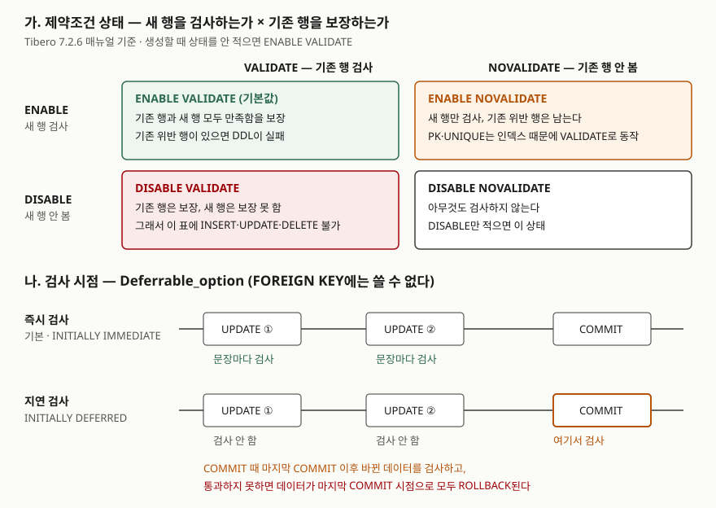

<!-- related:start -->
> **같은 기능을 다른 환경에서 다룬 글** (`constraints`)
> - [CREATE TABLE — 타입과 기본 제약조건](../../sql-basics/2026-09-29-create-table-constraints-when-checked/index.md) — SQLite 3.49.1, Python 3.13.5, Windows 11
<!-- related:end -->

> **실행 검증 없음.** 이 글은 **Tibero 7.2.6 공개 매뉴얼**의 설명만 근거로 정리했다.
> 글을 쓴 시점에 검증용 Tibero 인스턴스에 접속할 수 없었다(`TBR-2131`).
> Tibero의 출력이나 에러 메시지는 싣지 않았다. 돌려 볼 스크립트는 [`code/`](code/)에 두었다.

## 들어가며

오래된 표에 "급여는 1,000 이상" 같은 CHECK 제약을 새로 걸려는 일이 생긴다. `ALTER TABLE … ADD CONSTRAINT`를
실행하면 몇 년 전에 들어간 위반 행 몇 건 때문에 문장이 실패한다. 보통은 위반 행을 찾아 하나씩 고치고 다시
시도하는데, 행이 수천만 건이면 고칠 대상을 찾는 조회만 해도 전체를 읽어야 하고, 그동안 새 위반 행은 계속 들어온다.
반대로 일괄 적재 때 제약을 꺼 두었다가 다시 켤 때도 같은 일이 생긴다. 이 문제를 푸는 열쇠는 제약조건이
**언제, 어떤 행을** 검사하는지 정하는 상태 값에 있다.

## 개념

Tibero 7.2.6 관리자 안내서는 제약조건을 **5가지**로 나눈다.

| 제약조건 | 막는 것 | 매뉴얼에 적힌 특징 |
|---|---|---|
| 기본 키 (PRIMARY KEY) | 중복 값, NULL | 유일 키 제약에 NULL 불가를 더한 것. 기본 키 컬럼은 NULL을 가질 수 없다 |
| 유일 키 (UNIQUE) | 중복 값 | NULL은 여러 행에 넣을 수 있다 |
| 참조 무결성 (FOREIGN KEY) | 부모 표에 없는 값 | 부모 쪽은 기본 키나 유일 키여야 한다 |
| NOT NULL | NULL | 테이블 레벨로는 선언할 수 없다 |
| CHECK | 조건을 만족하지 않는 값 | 컬럼 하나에 여러 개를 걸 수 있다 |

각 제약조건에는 **상태**가 붙는다. 상태는 두 축의 조합이다.

- `ENABLE` / `DISABLE` — **앞으로 들어올** 데이터에 제약을 적용하는가
- `VALIDATE` / `NOVALIDATE` — **이미 들어 있는** 데이터가 제약을 만족하는지 검사하는가

여기에 **검사 시점**을 정하는 `Deferrable_option`이 따로 있다. 기본은 DML 문장마다 검사하고,
`DEFERRABLE INITIALLY DEFERRED`면 `COMMIT` 때 한꺼번에 검사한다.

## 구조



> **출처**: [Tibero 7.2.6 SQL 참조 안내서 — 공통 문법 요소](https://docs.tibero.com/tibero-manuals/7.2.6.manuals/sql-reference-guide/data-definition-language/common-syntax-elements.md)의
> Constraint_state 표(ENABLE·DISABLE·VALIDATE·NOVALIDATE)와 Deferrable_option 절,
> [Tibero 7.2.6 관리자 안내서 — 스키마 객체 관리](https://docs.tibero.com/tibero-manuals/7.2.6.manuals/administrator-guide/schema-object-management.md)의 제약조건 상태 절(기본 키·유일 키의 NOVALIDATE, DISABLE의 기본 옵션),
> [Tibero 7.2.6 SQL 참조 안내서 — CREATE TABLE](https://docs.tibero.com/tibero-manuals/7.2.6.manuals/sql-reference-guide/data-definition-language/create-table.md)(생성 시 기본값 ENABLE VALIDATE).

## 동작 원리

### 네 가지 상태

| 상태 | 새 행 | 기존 행 | 매뉴얼의 설명 |
|---|---|---|---|
| `ENABLE VALIDATE` | 검사 | 검사 | 생성할 때 상태를 안 적으면 이 값. 기존 데이터가 위반하면 에러를 내고 DDL이 실패 |
| `ENABLE NOVALIDATE` | 검사 | 검사 안 함 | 기존 행이 제약을 만족하지 않아도 되는 경우에 쓴다 |
| `DISABLE VALIDATE` | 검사 안 함 | 보장 | 이후 데이터를 보장할 수 없으므로 표에 삽입·삭제·갱신을 할 수 없다 |
| `DISABLE NOVALIDATE` | 검사 안 함 | 검사 안 함 | `DISABLE`만 적으면 이 옵션이 붙는다 |

`DISABLE VALIDATE`가 DML을 막는 이유가 매뉴얼 문장에 그대로 있다. 기존 데이터는 제약을 만족한다고 보장한
상태인데 새 데이터는 검사하지 않으므로, 데이터가 바뀌는 순간 그 보장이 깨진다. 그래서 바뀌는 것 자체를 막는다.
관리자 안내서는 이 상태에 대해 "제약조건에 걸려 있는 인덱스를 드롭하고 해당 제약조건 컬럼을 변경할 수 없음"이라고
적는다. 인덱스를 지운다는 뜻인지, 인덱스 삭제와 컬럼 변경을 둘 다 못 한다는 뜻인지 문장만으로는 갈리지 않는다.
스크립트 5-A가 UNIQUE 제약을 이 상태로 바꾼 뒤 `USER_CONSTRAINTS.INDEX_NAME`과 `USER_INDEXES`로 확인한다.

### NOVALIDATE가 통하지 않는 제약

관리자 안내서는 **기본 키와 유일 키는 내부 인덱스의 특성상 NOVALIDATE를 줘도 무조건 VALIDATE로 동작한다**고 적는다.
두 제약은 유일 인덱스로 중복을 막는다. 공통 문법 요소 페이지도 이 두 제약에 `ENABLE`을 적용하면 이미 있는 UNIQUE
인덱스를 쓰고, 없으면 새로 만든다고 적는다. 중복 행이 남아 있으면 유일 인덱스를 만들 수 없으니, 기존 행 검사를
건너뛸 방법이 없는 셈이다. 따라서 "중복 행은 나중에 정리하고 제약부터 켠다"는 계획은 CHECK·FOREIGN KEY에서만 성립한다.

### DISABLE과 인덱스

`UNIQUE`·`PRIMARY KEY`·`FOREIGN KEY`를 `DISABLE`로 바꾸면 관련 인덱스를 지운다. 제약을 만들 때 함께 생긴 인덱스가
아니라 기존 인덱스를 쓰고 있었다면 지우지 않는다. 그리고 **`DISABLE` 상태인 기본 키·유일 키를 참조하는 FOREIGN KEY는
`ENABLE`할 수 없다.** 참조되는 기본 키를 끄려면 `CASCADE`를 붙여 그 FOREIGN KEY까지 함께 꺼야 한다.

### 지연 검사 — Deferrable_option

공통 문법 요소 페이지가 적는 동작은 세 문장이다.

1. 제약을 DML마다 검사하지 않고, `COMMIT` 시점에 **마지막 COMMIT 이후 바뀐 데이터**를 검사한다.
2. `COMMIT` 때 검사를 통과하지 못하면 데이터는 **마지막 COMMIT 시점으로 모두 ROLLBACK**된다.
3. **FOREIGN KEY를 제외한** 제약조건에서 쓸 수 있다.

| 옵션 | 검사 시점 |
|---|---|
| `DEFERRABLE` / `DEFERRABLE INITIALLY IMMEDIATE` | 지연 기능을 켜되 DML마다 검사. `INITIALLY`·`IMMEDIATE`는 생략해도 뜻이 같다 |
| `DEFERRABLE INITIALLY DEFERRED` | `COMMIT` 때 검사. `INITIALLY DEFERRED DEFERRABLE` 순서로도 쓴다 |

지연 검사가 필요한 대표적인 경우는 두 행의 유일 값을 맞바꾸는 일이다. 즉시 검사면 첫 `UPDATE`에서 이미 중복이 되어
실패한다. 지연 검사면 두 번째 `UPDATE`까지 끝난 상태를 `COMMIT` 때 보므로 통과한다.

2번 문장에는 주의할 점이 있다. 실패한 `COMMIT`이 되돌리는 범위는 위반을 만든 문장 하나가 아니라 **트랜잭션 전체**다.
같은 트랜잭션에서 한 정상 작업도 함께 사라진다.

7.2.6 SQL 참조 안내서의 트랜잭션 제어 문장 목록에서 `SET CONSTRAINTS`(세션 중에 지연 여부를 바꾸는 문장)는 찾지 못했다.
그래서 이 글은 제약을 만들 때 정한 검사 시점만 다룬다.

### 상태를 보는 곳

관리자 안내서는 제약 정보를 보는 정적 뷰로 `DBA_`·`USER_`·`ALL_` 접두사가 붙은 `CONSTRAINTS`·`CONS_COLUMNS` **6개**를 든다.
7.2.6 참조 안내서의 `USER_CONSTRAINTS`에는 상태 축마다 컬럼이 있다.

| 컬럼 | 뜻 (매뉴얼 설명) |
|---|---|
| `STATUS` | 현재 상태 — `ENABLED`, `DISABLED` |
| `VALIDATED` | 제약 데이터의 검증 여부 |
| `DEFERRABLE` | 제약을 지연할 수 있는지 여부 |
| `DEFERRED` | 제약 검사가 지연되는지 즉시 수행되는지 여부 |
| `GENERATED` | 제약 이름이 사용자 지정인지 시스템 생성인지 |
| `INDEX_NAME` | 제약에 사용된 인덱스 이름 |

## 실습 예제

전체 스크립트: [`code/constraint_states.sql`](code/constraint_states.sql). **아직 실행하지 않았다.**

상태를 바꾸는 문법은 관리자 안내서 예제의 형태를 따랐다.

```sql
ALTER TABLE cs_emp MODIFY CONSTRAINT cs_emp_salary_ck DISABLE;
ALTER TABLE cs_emp MODIFY CONSTRAINT cs_emp_salary_ck ENABLE NOVALIDATE;
ALTER TABLE cs_emp MODIFY CONSTRAINT cs_emp_salary_ck ENABLE VALIDATE;
```

스크립트는 부서·사원 표에 다섯 제약을 건 뒤 `USER_CONSTRAINTS`로 생성 직후 상태를 찍고(1번), 위반 INSERT가
문장 단위로 거부되는지(2번), CHECK를 끄고 위반 행을 넣은 뒤 `ENABLE VALIDATE`·`ENABLE NOVALIDATE`가 어떻게
갈리는지(3번), 중복이 남은 UNIQUE에 `ENABLE NOVALIDATE`를 주면 무엇이 되는지(4번), `DISABLE VALIDATE`에서 DML이
막히는지(5번), 참조되는 기본 키를 `CASCADE` 없이 끄면 어떻게 되는지(6번)를 본다. 좌석 번호 표 두 개로 즉시 검사와
지연 검사의 맞바꾸기를 비교하고, 위반을 남긴 `COMMIT`이 같은 트랜잭션의 정상 INSERT까지 되돌리는지 본다(7번).
FOREIGN KEY에 `DEFERRABLE`을 주는 문장(8번)도 넣었다. 마지막에 표를 지우고 `user_objects`가 0개인지 찍는다.

매뉴얼만으로 답이 갈리는 항목은 [`code/README.md`](code/README.md)에 적었다. 하나는 FOREIGN KEY의 인덱스다.
공통 문법 요소 페이지에는 "FOREIGN KEY는 비유일 인덱스에 대해 같은 동작을 수행"한다는 문장과 "Tibero는 FOREIGN KEY
제약조건이 지정된 컬럼에 인덱스를 생성하지 않는다"는 문장이 함께 있다. 스크립트 1-B가 `USER_INDEXES`로 확인한다.

## 어느 상황에 무엇을 쓰는가

| 상황 | 상태 | 이유 |
|---|---|---|
| 새 표, 보통의 운영 | `ENABLE VALIDATE` (기본값) | 모든 행이 제약을 만족한다 |
| 위반 행이 남은 오래된 표에 CHECK·FK를 새로 건다 | `ENABLE NOVALIDATE` | 새 위반은 지금부터 막고, 기존 행은 따로 정리한다. 정리가 끝나면 `ENABLE VALIDATE`로 올린다 |
| 대량 적재 동안 검사 비용을 없앤다 | `DISABLE` → 적재 → `ENABLE VALIDATE` | 마지막 VALIDATE가 적재분을 한 번에 검사한다 |
| 데이터를 바꾸지 않는 보관용 표 | `DISABLE VALIDATE` | 기존 데이터가 제약을 만족한다는 보장을 남긴 채 DML을 막는다 |
| 유일 값 맞바꾸기, 순번 재배열 | `DEFERRABLE INITIALLY DEFERRED` | 중간 상태의 중복을 허용하고 `COMMIT` 때 본다 |

## 다른 환경에서는

같은 `constraints` 키로 [CREATE TABLE — 타입과 기본 제약조건](../../sql-basics/2026-09-29-create-table-constraints-when-checked/index.md)을
SQLite 3.49.1에서 썼다. 그 글은 두 행의 `UNIQUE` 값을 한 문장으로 맞바꾸면 끝 상태가 문제없어도 실패한다는 것을 확인했다.
지연 검사 부분은 이번에 SQLite 3.49.1에서 따로 돌려 봤다.

| | Tibero 7.2.6 (매뉴얼) | SQLite 3.49.1 (실행 확인) |
|---|---|---|
| 제약 상태 전환 | `MODIFY CONSTRAINT … ENABLE/DISABLE [NO]VALIDATE` | 없다. 문서의 ALTER TABLE은 이름 바꾸기·컬럼 추가·삭제만 다룬다 |
| 기존 행을 두고 새 행만 검사 | `ENABLE NOVALIDATE` (PK·UNIQUE 제외) | 없다 |
| 지연 검사를 쓸 수 있는 제약 | FOREIGN KEY를 **제외한** 제약 | FOREIGN KEY |
| 테이블 레벨 `UNIQUE (…) DEFERRABLE …` | 지연 가능 | `near "DEFERRABLE": syntax error` |
| 컬럼 레벨 `UNIQUE DEFERRABLE INITIALLY DEFERRED` | 지연 가능 | 표는 만들어지지만, 맞바꾸기 첫 `UPDATE`에서 `UNIQUE constraint failed` |

지연 검사를 허용하는 제약이 두 제품에서 정반대다. SQLite 3.49.1은 컬럼 레벨 `UNIQUE` 뒤의 `DEFERRABLE INITIALLY DEFERRED`를
문법 오류 없이 받아들였지만 검사는 즉시 일어났다. 에러가 나지 않으니 지연 검사가 걸린 줄 알기 쉽다.
SQLite에서 FOREIGN KEY를 미뤄 `COMMIT` 때 검사한 결과는 [외래 키 — 참조 무결성과 ON DELETE](../../sql-basics/2026-10-01-sqlite-foreign-key-on-delete/index.md)에 있다.
두 제품을 함께 지원하는 코드라면 지연 검사에 기대는 로직(값 맞바꾸기, 부모·자식 순서를 가리지 않는 적재)을
임시 값을 거치는 순서 있는 DML로 바꿔 두는 편이 옮기기 쉽다.

## 실무에서 주의할 점

- **NOVALIDATE로 켠 제약은 "모든 행이 만족한다"는 뜻이 아니다.** `STATUS`가 `ENABLED`여도 `VALIDATED`를 같이 봐야 한다.
  그 제약을 믿고 데이터를 읽는 코드가 생기기 전에 VALIDATE로 올린다.
- **PK·UNIQUE에는 NOVALIDATE 우회가 없다.** 매뉴얼은 NOVALIDATE를 줘도 VALIDATE로 동작한다고 적는다. 중복 정리가 먼저다.
- **`DISABLE VALIDATE`는 표를 읽기 전용으로 만든다.** 적재 중 검사를 끄려고 이 상태를 고르면 적재 자체가 막힌다.
  적재용은 `DISABLE`(= `DISABLE NOVALIDATE`)이다.
- **지연 검사의 실패는 트랜잭션 전체를 되돌린다.** 위반이 날 수 있는 작업과 다른 작업을 한 트랜잭션에 섞지 않는다.
  배치라면 커밋 단위를 작게 나눠 되돌아가는 범위를 줄인다.
- **FOREIGN KEY는 지연할 수 없다.** 부모·자식 표를 순서 없이 적재하는 작업은 부모를 먼저 넣거나, FK를 `DISABLE`한 뒤
  적재하고 `ENABLE VALIDATE`로 검사한다.
- **참조되는 기본 키는 `CASCADE` 없이 끌 수 없다.** 다시 켤 때는 부모 키를 먼저 켠다. DISABLE 상태의 부모 키를
  참조하는 FK는 켤 수 없다고 매뉴얼이 적는다.

## 정리

- 제약조건은 5가지(기본 키·유일 키·참조 무결성·NOT NULL·CHECK)이고, 상태는 ENABLE/DISABLE × VALIDATE/NOVALIDATE 네 조합이다.
- 생성 시 기본값은 `ENABLE VALIDATE`, `DISABLE`만 적으면 `DISABLE NOVALIDATE`다.
- `ENABLE NOVALIDATE`는 기존 위반 행을 둔 채 새 행만 막는다. 기본 키·유일 키에는 통하지 않는다.
- `DISABLE VALIDATE`는 기존 데이터를 보장하는 대신 표의 DML을 막는다.
- `DEFERRABLE INITIALLY DEFERRED`는 `COMMIT` 때 검사하고 실패하면 트랜잭션 전체를 되돌린다. FOREIGN KEY에는 쓸 수 없다.

## 참고 자료

- [Tibero 7.2.6 SQL 참조 안내서 — 공통 문법 요소](https://docs.tibero.com/tibero-manuals/7.2.6.manuals/sql-reference-guide/data-definition-language/common-syntax-elements.md) — 제약 조건 5종, Constraint_state, Deferrable_option, FOREIGN KEY 인덱스
- [Tibero 7.2.6 관리자 안내서 — 스키마 객체 관리](https://docs.tibero.com/tibero-manuals/7.2.6.manuals/administrator-guide/schema-object-management.md) — 제약조건 종류 표, 제약조건 상태, 상태 변경 예제, 정보 조회 뷰
- [Tibero 7.2.6 SQL 참조 안내서 — CREATE TABLE](https://docs.tibero.com/tibero-manuals/7.2.6.manuals/sql-reference-guide/data-definition-language/create-table.md) — 생성 시 기본 상태 ENABLE VALIDATE
- [Tibero 7.2.6 SQL 참조 안내서 — ALTER TABLE](https://docs.tibero.com/tibero-manuals/7.2.6.manuals/sql-reference-guide/data-definition-language/alter-table.md) — MODIFY로 상태 변경, CASCADE, `ENABLE NOVALIDATE PRIMARY KEY` 예제
- [Tibero 7.2.6 참조 안내서 — USER_CONSTRAINTS](https://docs.tibero.com/tibero-manuals/7.2.6.manuals/reference-guide/static-views/user_constraints.md) — STATUS·VALIDATED·DEFERRABLE·DEFERRED 컬럼
- [SQLite — CREATE TABLE: UNIQUE constraints](https://www.sqlite.org/lang_createtable.html#unique_constraints) — 비교 절의 SQLite 동작
- [SQLite — ALTER TABLE](https://www.sqlite.org/lang_altertable.html) — 지원하는 변경 종류
- [SQLite — Foreign Key Support: Deferred Foreign Key Constraints](https://www.sqlite.org/foreignkeys.html#fk_deferred) — SQLite에서 지연 검사를 쓰는 제약
