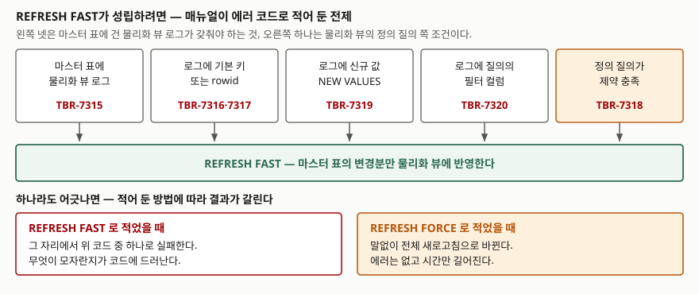

> **실행 검증 없음.** 이 글은 **Tibero 7.2.6 공개 매뉴얼**의 설명만 근거로 정리했다.
> 글을 쓴 환경에 `tbsql`이 없어 Tibero에 접속할 수 없었다.
> Tibero의 출력이나 측정값은 싣지 않았고, 매뉴얼에 적힌 문법과 에러 코드만 옮겼다.
> 돌려 볼 스크립트는 [`code/`](code/)에 두었다.

## 들어가며

부서별 인원과 급여 합계를 보여 주는 대시보드가 있다. 처음에는 사원 표에 `GROUP BY`를 걸어 그때그때 세는
질의였는데, 사원이 수백만 행이 되면서 화면 하나 뜨는 데 몇 초가 걸린다. 결과를 미리 계산해 두면 되겠다 싶어
머티리얼라이즈드 뷰(물리화 뷰)를 만든다. 화면은 즉시 떴고, 일단 문제가 해결된 것처럼 보인다.

그런데 이번에는 **언제 다시 계산할 것인가**가 남는다. 밤마다 한 번 돌리자니 낮에 들어온 입사자가 안 보이고,
커밋마다 돌리자니 입력 화면이 느려진다. 중간을 찾으려고 `REFRESH FAST`라고 적어 보면 뷰가 아예 만들어지지
않으면서 보도 못한 에러 코드가 뜬다. `REFRESH FORCE`로 바꾸면 에러는 사라지는데, 새벽 배치 시간은 그대로다.

이 세 가지가 전부 `REFRESH` 절 한 줄에서 갈린다. 그 한 줄이 무엇을 정하는지를 매뉴얼 기준으로 정리한다.

## 개념

물리화 뷰는 질의 결과를 **실제 표에 담아 두는** 스키마 객체다. 일반 뷰가 질의에 이름만 붙여 두는 것과
반대다. 결과를 담아 두었으니 원본(마스터 표)이 바뀌면 뷰가 낡는다. 그래서 물리화 뷰를 쓴다는 것은
**새로고침 정책을 하나 고른다**는 뜻이다.

`CREATE MATERIALIZED VIEW`의 `REFRESH` 절은 독립적인 두 축을 한 줄에 적는다.

| 축 | 묻는 것 | 값 |
|---|---|---|
| 방법 | 무엇을 다시 계산하는가 | `COMPLETE`(기본) · `FAST` · `FORCE` · `NEVER REFRESH` |
| 시점 | 언제 계산하는가 | `ON DEMAND`(기본) · `ON COMMIT` · `START WITH` / `NEXT` |

방법 쪽 네 값의 뜻은 이렇다.

| 값 | 매뉴얼의 설명 |
|---|---|
| `COMPLETE` | 정의 질의를 다시 수행한다. 빠른 새로고침이 가능한 경우에도 이 방법을 쓴다 |
| `FAST` | 마스터 표의 변경분만 반영한다 |
| `FORCE` | 빠른 새로고침이 가능하면 그것을, 아니면 전체 새로고침을 한다 |
| `NEVER REFRESH` | 자동 새로고침을 하지 않는다 |

`COMPLETE`가 기본값이라는 점이 먼저 눈에 들어와야 한다. `REFRESH` 절을 아예 적지 않으면
`REFRESH COMPLETE ON DEMAND`를 적은 것과 같고, 이건 **아무도 부르지 않으면 영원히 낡은 채로 있는**
뷰라는 뜻이다. `ON DEMAND`는 `DBMS_MVIEW.REFRESH`를 호출할 때만 새로고침한다.

## 구조



> **출처**: [Tibero 7.2.6 tbPSM Reference Guide — DBMS_MVIEW](https://docs.tibero.com/tibero-manuals/7.2.6.manuals/tbpsm-reference-guide/dbms_mview.md)(빠른 새로고침이 실패하는 경우로 TBR-7315·7316·7317·7318·7319·7320을 묶어 적는다),
> [Tibero 7.2.6 Error Reference Guide — 7000번대 DDL 에러](https://docs.tibero.com/tibero-manuals/7.2.6.manuals/error-reference-guide/chapter-7000.ddl.error.md)(각 코드의 원인과 조치),
> [Tibero 7.2.6 SQL Reference Guide — CREATE MATERIALIZED VIEW](https://docs.tibero.com/tibero-manuals/7.2.6.manuals/sql-reference-guide/data-definition-language/create-materialized-view.md)(`FORCE`는 가능하면 FAST, 아니면 COMPLETE).

## 동작 원리

### FAST는 로그 위에서만 성립한다

빠른 새로고침은 "무엇이 바뀌었는지"를 알아야 한다. 그 기록을 담는 것이 마스터 표에 거는
**물리화 뷰 로그**(`CREATE MATERIALIZED VIEW LOG ON <표>`)다. 로그는 마스터 표에 붙는
after-row 트리거가 채우고, `USER_MVIEW_LOGS`의 `LOG_TRIGGER` 컬럼에 그 트리거 이름이 보인다.

로그에 무엇을 담을지는 `WITH` 절이 정한다.

| `WITH` 항목 | 담는 것 |
|---|---|
| `PRIMARY KEY` | 바뀐 행의 기본 키 |
| `ROWID` | 바뀐 행의 rowid |
| `SEQUENCE` | 행이 바뀐 순서 |
| `(컬럼 목록)` | 지정한 마스터 표 컬럼 — 이른바 필터 컬럼 |
| `INCLUDING NEW VALUES` | 바뀌기 전 값과 바뀐 뒤 값을 둘 다. 기본값은 `EXCLUDING NEW VALUES`로 이전 값만 |

여기서 틀리기 쉬운 자리가 **기본값이 `EXCLUDING NEW VALUES`**라는 점이다. 집계를 담은 물리화 뷰는
합계를 고쳐 쓰려면 바뀐 뒤 값이 필요한데, 로그를 만들 때 아무 말도 하지 않으면 그 값이 들어가지 않는다.

도식의 다섯 관문이 어긋나면 매뉴얼이 각각 다른 코드를 준다. 어느 코드가 나왔는지로
**무엇이 빠졌는지가 바로 읽힌다.**

| 코드 | 매뉴얼이 적은 원인 | 조치 |
|---|---|---|
| `TBR-7315` | 마스터 표에 물리화 뷰 로그가 없다 | 마스터 표에 로그를 만든다 |
| `TBR-7316` | 로그가 기본 키를 기록하지 않는다 | 기본 키를 포함해 로그를 만든다 |
| `TBR-7317` | 로그에서 rowid 컬럼을 쓸 수 없다 | rowid를 포함해 로그를 만든다 |
| `TBR-7319` | 로그에 신규 값이 없다 | `INCLUDING NEW VALUES`로 로그를 만든다 |
| `TBR-7320` | 로그가 뷰에 필요한 필터 컬럼을 기록하지 않는다 | 필터 컬럼을 로그에 추가한다 |
| `TBR-7318` | 복잡한 질의로는 빠른 새로고침 뷰를 만들 수 없다 | `REFRESH FORCE` 또는 `REFRESH COMPLETE`로 다시 시도한다 |

필터 컬럼에는 따로 거는 규칙이 하나 더 있다. 기본 키 컬럼을 필터 컬럼으로 적으면
`TBR-7293`으로 막힌다 — 기본 키는 이미 `WITH PRIMARY KEY`가 담고 있기 때문이다.

### FORCE가 편하면서 위험한 이유

`FORCE`는 위 관문을 하나라도 못 넘으면 **에러 없이 전체 새로고침으로 바꾼다.** 뷰는 만들어지고
데이터도 맞다. 틀린 것이 없으니 아무도 보지 않는다.

문제는 뷰를 만든 사람이 기대한 비용이 아니라는 점이다. 로그 설정 한 줄이 빠진 채로 `FORCE`를 쓰면
정의 질의가 매번 통째로 다시 돈다. 그러면 애초에 물리화 뷰로 줄이려던 비용이 새로고침 시각으로
옮겨 간 것뿐이다. `FORCE`로 만들었다면 `USER_MVIEWS`를 봐서 실제로 어느 쪽이 돌았는지 확인해야 한다.

| 컬럼 | 보는 것 | 매뉴얼이 적은 값 |
|---|---|---|
| `REFRESH_MODE` | 시점 | `Commit` · `Demand` |
| `REFRESH_METHOD` | 적어 둔 방법 | `C` · `F` · `?`(FORCE) · `N` |
| `LAST_REFRESH_TYPE` | **실제로 돌아간 방법** | `FAST` 또는 `COMPLETE` |
| `FAST_REFRESHABLE` | 빠른 새로고침이 되는 뷰인지 | (값 목록은 매뉴얼에 없다) |
| `STALENESS` | 뷰가 낡았는지 | (값 목록은 매뉴얼에 없다) |
| `BUILD_MODE` | 처음 채운 방식 | `Immediate` · `Deferred` · `Prebuilt` |

`REFRESH_METHOD`가 `?`인데 `LAST_REFRESH_TYPE`이 매번 `COMPLETE`면, `FORCE`가 조용히 전체
새로고침으로 떨어지고 있다는 뜻이다. 이 두 컬럼을 나란히 보는 것이 `FORCE`를 쓸 때의 유일한 안전장치다.

### 시점 — ON DEMAND, ON COMMIT, 그리고 주기

`ON DEMAND`가 기본이고, `DBMS_MVIEW.REFRESH`를 불러야 돈다. 호출 모양은 이렇다.

```sql
DBMS_MVIEW.REFRESH(qualified_obj IN VARCHAR2, refresh_method IN VARCHAR2 DEFAULT '?')
```

두 번째 인자가 그 호출에 한해 방법을 덮어쓴다.

| 값 | 뜻 |
|---|---|
| `'C'` | 전체 새로고침 |
| `'F'` | 빠른 새로고침. **불가능하면 에러를 낸다** |
| `'X'` | 컨테이너 표를 truncate 하고 다시 채우는 전체 새로고침 |
| `'?'`(기본) | 가능하면 FAST, 아니면 COMPLETE |

`'F'`가 쓸모 있는 자리가 여기다. 배치 스크립트에 `'?'`를 적어 두면 빠른 새로고침이 깨져도 모르고
지나가지만, `'F'`를 적어 두면 깨지는 즉시 코드로 드러난다. 운영 중에 로그가 지워지거나
정의를 고쳐 FAST가 성립하지 않게 된 경우를 잡아낸다.

한 가지 더. `DBMS_MVIEW.REFRESH`는 **시작할 때와 끝날 때 COMMIT을 한다.** 그래서 롤백할 수 없고,
호출을 다른 트랜잭션 가운데 끼워 넣으면 그 트랜잭션이 거기서 끊긴다. 매뉴얼은 또 이 프로시저가
호출자의 권한을 확인하지 않으며 `EXECUTE` 권한이 기본으로 PUBLIC에 부여돼 있다고 적는다.
권한을 좁혀야 하면 회수해야 한다.

`ON COMMIT`은 마스터 표에 커밋이 일어날 때마다 새로고침한다. 뷰가 항상 최신이라는 뜻이고,
그 비용은 **마스터 표에 쓰는 쪽**이 낸다. 입력이 잦은 표에 거는 선택이 아니다.

주기 실행은 `START WITH`와 `NEXT`다. `START WITH`는 첫 번째 자동 새로고침 시각이고 미래여야 한다.
`NEXT`는 다음 시각을 계산하는 식이다. 둘의 조합에 규칙이 있다.

- `START WITH`만 적으면 **한 번만** 새로고침하고 끝난다
- `NEXT`만 적으면 그 식을 계산해 첫 시각을 정한다
- `ON COMMIT`과 `START WITH`·`NEXT`는 **함께 쓸 수 없다**
- `ON COMMIT`과 `ON DEMAND`도 함께 쓸 수 없다

### BUILD — 언제 처음 채울 것인가

`BUILD IMMEDIATE`가 기본으로, 뷰를 만들 때 데이터를 채운다. 원본이 큰 표면 `CREATE` 문이 그만큼
오래 걸린다. `BUILD DEFERRED`로 적으면 생성 시점에는 비워 두고 **첫 새로고침 때** 채우며,
그 첫 새로고침은 전체 새로고침이다. 그때부터 질의 재작성에 쓰일 수 있다.

업무 시간에 뷰를 만들어 두고 채우는 일은 밤에 돌리고 싶을 때 쓰는 선택지다.
다만 채우기 전까지 뷰를 조회하면 빈 결과가 나오므로, 읽는 쪽이 먼저 붙으면 안 된다.

### 질의 재작성은 기본으로 켜져 있다

`ENABLE QUERY REWRITE`가 기본값이다. 옵티마이저가 집계 질의를 보고 "이 물리화 뷰로 답할 수 있다"고
판단하면 뷰를 대신 읽는다. 원래 질의를 고치지 않아도 빨라지는 것이 이 기능의 값이다.

왜 재작성이 안 되는지를 보려면 `DBMS_MVIEW.EXPLAIN_REWRITE`를 쓴다. 질의를 실행하지 않고
판정 과정만 `REWRITE_TABLE`에 적는다. 이 표는 `$TB_HOME/scripts/rewrite_table.sql`로 만들어야 하고,
결과는 세션 트랜잭션에 속하므로 남기려면 커밋해야 한다. `MESSAGE` 컬럼의 코드로 이유가 나뉜다 —
`000`은 전체가 재작성된 경우, `002`는 쓸 만한 물리화 뷰를 못 찾은 경우, `020`은 뷰의 질의 재작성이
꺼져 있는 경우다.

## 어느 상황에 무엇을 쓰는가

| 상황 | 방법 | 시점 | 이유 |
|---|---|---|---|
| 밤마다 한 번 집계하는 보고서 | `COMPLETE` | `START WITH`/`NEXT` | 로그 유지 비용 없이 주기만 정하면 된다 |
| 입력이 잦고 집계를 자주 읽는 화면 | `FAST` | `ON DEMAND` + 배치에서 `'F'` 호출 | 쓰는 쪽에 비용을 얹지 않으면서 변경분만 반영한다 |
| 뷰가 항상 최신이어야 하는 소량 마스터 | `FAST` | `ON COMMIT` | 쓰기 비용을 감수하고 지연을 없앤다 |
| 한 번 만들어 두고 고정해 쓰는 스냅숏 | `NEVER REFRESH` | — | 자동 새로고침을 끈다. 명시 호출도 `TBR-7329`로 막힌다 |
| 빠른 새로고침이 되는지 아직 모를 때 | `FORCE` | `ON DEMAND` | 일단 만들고 `LAST_REFRESH_TYPE`으로 확인한 뒤 `FAST`로 조인다 |

## 어디서 틀리기 쉬운가

- **`REFRESH` 절을 안 적으면 아무도 새로고침하지 않는다.** 기본값이 `COMPLETE ON DEMAND`라
  뷰는 만들어진 그 순간 값으로 멈춘다. 에러도 경고도 없다.
- **로그의 `INCLUDING NEW VALUES`를 빠뜨린다.** 기본값이 `EXCLUDING NEW VALUES`이므로
  집계 뷰를 `FAST`로 만들려다 `TBR-7319`를 만난다.
- **기본 키 컬럼을 필터 컬럼에 적는다.** `TBR-7293`으로 막힌다. 필터 컬럼에는 기본 키가 아닌
  컬럼만 적는다.
- **`FORCE`로 만들어 놓고 확인하지 않는다.** `LAST_REFRESH_TYPE`이 매번 `COMPLETE`면
  빠른 새로고침이 한 번도 안 돈 것이다. `REFRESH_METHOD`와 나란히 본다.
- **`DBMS_MVIEW.REFRESH`를 트랜잭션 가운데서 부른다.** 시작과 끝에서 COMMIT이 일어나 묶어 두려던
  작업이 거기서 끊긴다. 롤백도 안 된다.
- **`ON COMMIT`을 입력이 잦은 표에 건다.** 새로고침 비용을 읽는 쪽이 아니라 쓰는 쪽이 낸다.
  입력 화면이 느려졌다는 민원은 뷰를 만든 사람에게 오지 않는다.
- **마지막 새로고침보다 로그가 최신이면** `TBR-7330`이 나온다. 전체 새로고침으로 한 번 맞춘 뒤
  다시 빠른 새로고침으로 돌아간다. 뷰가 `INVALID` 상태가 된 경우(`TBR-7327`)도 조치가 같다.

## 정리

- `REFRESH` 절은 방법(`COMPLETE`·`FAST`·`FORCE`·`NEVER`)과 시점(`ON DEMAND`·`ON COMMIT`·주기)
  두 축을 한 줄에 적는다. 적지 않으면 `COMPLETE ON DEMAND`다.
- `FAST`는 마스터 표의 물리화 뷰 로그 위에서만 성립한다. 로그가 기본 키·rowid·신규 값·필터 컬럼 중
  무엇을 빠뜨렸는지는 `TBR-7315`부터 `TBR-7320`까지의 코드가 가리킨다.
- `FORCE`는 전제가 어긋나도 에러 대신 전체 새로고침으로 바꾼다. `LAST_REFRESH_TYPE`으로 확인하지
  않으면 느려진 것을 모른다.
- `ON COMMIT`의 비용은 읽는 쪽이 아니라 마스터 표에 쓰는 쪽이 낸다. `START WITH`·`NEXT`와 함께 쓸 수 없다.
- `DBMS_MVIEW.REFRESH`는 시작과 끝에 COMMIT을 하므로 다른 트랜잭션 안에 끼워 넣지 않는다.

## 참고 자료

- [Tibero 7.2.6 SQL Reference Guide — CREATE MATERIALIZED VIEW](https://docs.tibero.com/tibero-manuals/7.2.6.manuals/sql-reference-guide/data-definition-language/create-materialized-view.md) — `BUILD`·`REFRESH`·`QUERY REWRITE` 절의 값과 `ON COMMIT` 제약
- [Tibero 7.2.6 SQL Reference Guide — CREATE MATERIALIZED VIEW LOG](https://docs.tibero.com/tibero-manuals/7.2.6.manuals/sql-reference-guide/data-definition-language/create-materialized-view-log.md) — `WITH` 항목과 `INCLUDING`/`EXCLUDING NEW VALUES`의 기본값
- [Tibero 7.2.6 tbPSM Reference Guide — DBMS_MVIEW](https://docs.tibero.com/tibero-manuals/7.2.6.manuals/tbpsm-reference-guide/dbms_mview.md) — `REFRESH`의 방법 코드, COMMIT 동작, 빠른 새로고침 실패 코드, `EXPLAIN_REWRITE`
- [Tibero 7.2.6 Error Reference Guide — 7000번대 DDL 에러](https://docs.tibero.com/tibero-manuals/7.2.6.manuals/error-reference-guide/chapter-7000.ddl.error.md) — `TBR-7293`·`TBR-7315`~`TBR-7320`·`TBR-7327`·`TBR-7329`·`TBR-7330`의 원인과 조치
- [Tibero 7.2.6 Reference Guide — DBA_MVIEWS](https://docs.tibero.com/tibero-manuals/7.2.6.manuals/reference-guide/static-views/dba_mviews.md) — `REFRESH_MODE`·`REFRESH_METHOD`·`LAST_REFRESH_TYPE`·`BUILD_MODE` 컬럼
- [Tibero 7.2.6 Reference Guide — DBA_MVIEW_LOGS](https://docs.tibero.com/tibero-manuals/7.2.6.manuals/reference-guide/static-views/dba_mview_logs.md) — 로그가 무엇을 담고 있는지 확인하는 컬럼
