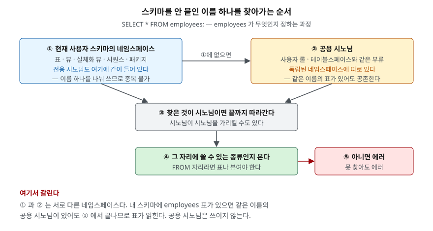

> **실행 검증 없음.** 이 글은 **Tibero 7.2.6 공개 매뉴얼**을 근거로 정리했다.
> 이 환경에 `tbsql`이 없어 예제를 돌리지 못했으므로 **출력·결과표·측정값을 싣지
> 않는다.** 문법과 매뉴얼에 적힌 동작만 적었고, 매뉴얼에서 근거를 찾지 못한 동작은
> 쓰지 않았다. 나중에 실행 환경에서 돌려 출력을 채우면 `executed`로 올린다.

## 들어가며

운영 DB에 접속해 평소대로 `SELECT * FROM orders` 를 쳤는데, 동료가 "그거 우리
스키마 표 아니고 공용 시노님이야"라고 한다. 그런데 다른 날 같은 문장을 다른 계정으로
치면 전혀 다른 데이터가 나온다.

이때 보통은 `SELECT * FROM 스키마명.orders` 로 스키마를 전부 붙여 쓰는 쪽으로
도망친다. 틀린 선택은 아니지만, 그러면 애초에 시노님을 쓸 이유가 사라진다.
스키마 이름이 배포 환경마다 다르다는 문제가 그대로 돌아오고, 쿼리 수백 개에
스키마명이 하드코딩된다. 운영 스키마 이름이 한 번 바뀌면 전부 고쳐야 한다.

갈리는 지점은 **스키마를 안 붙인 이름 하나를 엔진이 어떤 순서로 찾는가**다.
전용 시노님과 공용 시노님은 그 순서에서 서 있는 자리가 다르다.

## 개념 — 시노님은 별칭이다

시노님(synonym)은 **스키마 객체 하나에 붙이는 별칭**이다. 매뉴얼이 분명히 적는
성질이 두 가지 있다.

- **시노님 자체에는 권한이 없다.** 가리키는 대상 객체에 권한이 있으면 시노님으로도
  쓸 수 있고, 없으면 못 쓴다. 공용 시노님을 만들었다고 해서 대상 객체에 접근 권한이
  생기지 않는다.
- **시노님을 바꾸는 별도의 SQL 문이 없다.** `ALTER SYNONYM`이 없으므로
  `CREATE OR REPLACE SYNONYM`으로 덮어쓰거나 지웠다 다시 만든다.

가리킬 수 있는 대상은 **6가지**다. 표, 뷰, 시퀀스, PSM 함수, PSM 프로시저,
그리고 다른 시노님이다.

## 구조 — 이름을 찾아가는 순서



> **출처**: [Tibero 7.2.6 SQL 참조 안내서 — SQL 문장의 구성요소 / 스키마 객체(객체의 종류·이름 규칙·탐색 과정)](https://docs.tibero.com/tibero-manuals/7.2.6.manuals/sql-reference-guide/sql-elements/schema-objects.md)

매뉴얼은 `SELECT * FROM employees;` 를 예로 들어 탐색 과정을 이렇게 적는다.
현재 사용자 스키마에서 `employees`를 찾고, 없으면 같은 이름의 공용 시노님을 찾고,
시노님이면 최종 객체까지 따라간 뒤, 그 자리(`FROM`)에 허용되는 종류인지 확인한다.
아니면 에러다.

여기서 **전용 시노님은 별도의 단계로 나오지 않는다.** 빠진 것이 아니라 ① 단계에
이미 들어 있기 때문이다. 매뉴얼의 네임스페이스 규정을 보면 이유가 보인다.

| 네임스페이스 | 들어 있는 것 |
|---|---|
| 스키마 객체가 **공유** | 표, 뷰, 실체화 뷰, 시퀀스, **시노님**, 패키지, 패키지 밖 함수·프로시저 |
| 각자 **독립** | 인덱스, 트리거, LOB 데이터 타입 |
| 일반 객체가 **독립** | 사용자 롤, **공용 시노님**, 테이블스페이스 |

전용 시노님은 표·뷰와 **같은 네임스페이스를 나눠 쓴다.** 그래서 내 스키마에
`orders` 표가 있으면 `orders` 라는 전용 시노님을 만들 수 없다. 이름이 겹치기
때문이다. 반대로 겹치지 않는 이름이면 ① 단계에서 바로 걸린다.

공용 시노님은 **독립된 네임스페이스**에 있다. 그래서 `orders` 표와 `orders` 공용
시노님은 **같이 존재할 수 있다.** 그리고 탐색 순서가 ① 다음에 ②이므로,
그 사용자에게는 표가 읽히고 공용 시노님은 쓰이지 않는다.

## 문법

```sql
-- 전용 시노님
CREATE OR REPLACE SYNONYM orders FOR sales_app.orders;

-- 공용 시노님
CREATE PUBLIC SYNONYM orders FOR sales_app.orders;

-- DB 링크 너머의 객체
CREATE SYNONYM remote_orders FOR sales_app.orders@prod_link;

DROP SYNONYM orders;
DROP SYNONYM IF EXISTS orders;
DROP PUBLIC SYNONYM orders;
```

각 요소가 하는 일은 이렇다.

| 요소 | 뜻 |
|---|---|
| `OR REPLACE` | 같은 이름이 있으면 교체한다. 지웠다 다시 만드는 것과 달리 **기존 권한과 참조가 유지된다** |
| `PUBLIC` | 모든 사용자가 접근할 수 있는 공용 시노님. 대상 객체 권한은 별도로 필요하다 |
| `[schema.]시노님이름` | 시노님을 둘 스키마. 생략하면 현재 사용자 스키마 |
| `FOR [schema.]객체이름` | 대상. 스키마를 생략하면 DB 링크가 있을 때는 링크 접속 사용자, 없으면 현재 사용자 스키마 |
| `@dblink` | DB 링크 너머의 객체를 가리킨다. 링크 이름 앞에 `@`를 붙인다 |
| `IF EXISTS` | `DROP` 에서, 없어도 에러 없이 넘어간다 |

필요한 권한은 **만들 때 3가지, 지울 때 2가지**다.

| 하는 일 | 필요한 권한 |
|---|---|
| 내 스키마에 시노님 생성 | `CREATE SYNONYM` |
| 다른 사용자 스키마에 시노님 생성 | `CREATE ANY SYNONYM` |
| 공용 시노님 생성 | `CREATE PUBLIC SYNONYM` |
| 다른 사용자 스키마의 시노님 삭제 | `DROP ANY SYNONYM` |
| 공용 시노님 삭제 | `DROP PUBLIC SYNONYM` |

내 스키마의 시노님을 지우는 데는 별도 권한이 필요 없다.

## 어느 상황에 무엇을 쓰는가

- **배포 환경마다 스키마 이름이 다르면 전용 시노님.** 개발은 `dev_app`, 운영은
  `prod_app` 처럼 스키마가 갈릴 때, 애플리케이션 계정에 전용 시노님을 깔아 두면
  쿼리는 스키마 없이 `orders` 하나로 통일된다. 환경별로 시노님이 가리키는 곳만
  다르게 만든다.
- **여러 계정이 같은 공용 객체를 볼 때는 공용 시노님.** 배치 계정, 조회 전용 계정,
  리포트 계정이 같은 코드 표를 본다면 공용 시노님 하나가 낫다. 계정마다 전용 시노님을
  만들면 계정이 늘 때마다 같은 작업을 반복한다.
- **DB 링크 경로를 감출 때.** `sales_app.orders@prod_link` 를 쿼리마다 쓰는 대신
  시노님 하나로 묶으면, 링크 이름이 바뀌어도 시노님만 고치면 된다.

## 어디서 틀리기 쉬운가

- **대상이 없어도 시노님은 만들어진다.** 매뉴얼은 대상 객체가 존재하지 않아도
  시노님 생성 자체는 된다고 적는다. 오타가 있어도 `CREATE SYNONYM` 은 성공하고,
  **쓸 때가 되어서야 에러가 난다.** 만든 직후 한 번 조회해 보는 편이 낫다.
- **공용 시노님이 조용히 무시된다.** 위 네임스페이스 때문이다. 공용 시노님을
  깔았는데 어떤 계정에서만 다른 데이터가 나온다면, 그 계정 스키마에 같은 이름의
  객체가 있는지부터 본다.
- **권한은 따로 준다.** 공용 시노님을 만들어 놓고 "모두 접근 가능"이라고 생각하기
  쉬운데, 대상 객체에 `GRANT` 를 하지 않으면 아무도 못 쓴다.
- **이름은 30바이트까지다.** 매뉴얼의 객체 이름 규칙이 그렇고, 따옴표 없는
  식별자는 대문자로 바뀌어 저장된다. `orders` 와 `"orders"` 는 다른 이름이다.
- **`ALTER SYNONYM` 을 찾지 않는다.** 없다. `CREATE OR REPLACE` 를 쓰면
  지웠다 만드는 것과 달리 기존 권한과 참조가 유지되므로, 운영 중 교체에는 이쪽이 맞다.
- **시노님이 시노님을 가리킬 수 있다.** 대상에 시노님이 포함돼 있으므로 체인이
  생길 수 있다. 추적이 어려워지므로 한 단계로 끝내는 편이 낫다.

## 확인하는 법

데이터 사전 정적 뷰로 조회한다. 두 뷰 모두 컬럼은 **4개**로 같고, 담는 범위가 다르다.

| 뷰 | 담는 것 |
|---|---|
| `ALL_SYNONYMS` | 현재 사용자가 접근할 수 있는 모든 시노님 |
| `DBA_SYNONYMS` | 데이터베이스의 모든 시노님 |

컬럼은 `OWNER`, `SYNONYM_NAME`, `ORG_OBJECT_OWNER`, `ORG_OBJECT_NAME` 이다.
앞 둘이 시노님 자신, 뒤 둘이 가리키는 대상이다.

```sql
SELECT owner, synonym_name, org_object_owner, org_object_name
  FROM all_synonyms
 WHERE synonym_name = 'ORDERS';
```

따옴표 없이 만든 이름은 대문자로 저장되므로 조회 조건도 대문자로 쓴다.

## 정리

- 시노님은 스키마 객체 하나에 붙이는 별칭이고, 가리킬 수 있는 대상은 **6가지**
  (표·뷰·시퀀스·PSM 함수·PSM 프로시저·시노님)다.
- **전용 시노님은 표·뷰와 같은 네임스페이스**를 나눠 쓰고, **공용 시노님은 롤·
  테이블스페이스와 같은 독립 네임스페이스**에 있다. 이 차이가 동작을 가른다.
- 스키마 없는 이름은 ① 현재 사용자 스키마 → ② 공용 시노님 순서로 찾는다.
  같은 이름의 표가 있으면 ①에서 끝나므로 공용 시노님은 쓰이지 않는다.
- 시노님에는 권한이 없다. 대상 객체 권한이 따로 있어야 한다.
- `ALTER SYNONYM` 은 없다. `CREATE OR REPLACE` 가 기존 권한과 참조를 지킨다.

## 참고 자료

- [Tibero 7.2.6 SQL 참조 안내서 — SQL 문장의 구성요소 / 스키마 객체](https://docs.tibero.com/tibero-manuals/7.2.6.manuals/sql-reference-guide/sql-elements/schema-objects.md)
- [Tibero 7.2.6 SQL 참조 안내서 — CREATE SYNONYM](https://docs.tibero.com/tibero-manuals/7.2.6.manuals/sql-reference-guide/data-definition-language/create-synonym.md)
- [Tibero 7.2.6 SQL 참조 안내서 — DROP SYNONYM](https://docs.tibero.com/tibero-manuals/7.2.6.manuals/sql-reference-guide/data-definition-language/drop-synonym.md)
- [Tibero 7.2.6 참조 안내서 — ALL_SYNONYMS](https://docs.tibero.com/tibero-manuals/7.2.6.manuals/reference-guide/static-views/all_synonyms.md)
- [Tibero 7.2.6 참조 안내서 — DBA_SYNONYMS](https://docs.tibero.com/tibero-manuals/7.2.6.manuals/reference-guide/static-views/dba_synonyms.md)
