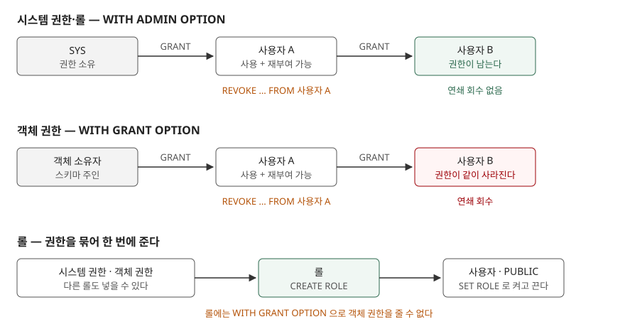

> **실행 검증 없음.** 이 글은 **Tibero 7.2.6 공개 매뉴얼**을 근거로 정리했다.
> 이 회차에 Tibero 인스턴스에 접속할 수 없어 예제를 돌리지 못했으므로 **출력·결과표·
> 측정값을 싣지 않는다.** 문법과 매뉴얼에 적힌 동작만 적었고, 매뉴얼에서 근거를 찾지
> 못한 동작은 쓰지 않았다. 바로 돌릴 수 있는 스크립트를 [`code/`](code/)에 두었다.

## 들어가며

운영 DB 에서 퇴사자 계정의 권한을 정리하다 보면 이상한 일을 겪는다. 퇴사자에게서 `SELECT` 권한을 회수했더니 그 사람이 예전에 넘겨준 리포트 계정까지 조회가 막혔다. 그런데 같은 퇴사자에게서 `CREATE VIEW` 같은 시스템 권한을 회수했을 때는 그가 넘겨준 계정이 멀쩡했다.

이럴 때 보통은 `DBA_*` 뷰를 몇 개 열어 누가 누구에게 무엇을 줬는지 손으로 추적한다. 계정이 수십 개면 한 번의 회수가 어디까지 번질지 미리 알 수 없어서, 회수하고 장애가 나면 다시 부여하는 일을 반복하게 된다. 갈리는 지점은 그 권한이 **어떤 옵션으로 넘어갔는가**다.

## 개념

Tibero 의 권한은 **3가지**로 나뉜다.

| 구분 | 무엇 | 예 |
|---|---|---|
| 시스템 권한 | 데이터베이스 전체에 대한 작업 권한. 기본적으로 SYS 가 소유한다 | `CREATE SESSION`, `CREATE TABLE`, `SELECT ANY TABLE` |
| 객체 권한 | 특정 스키마 객체 하나에 대한 권한 | `SELECT ON orders`, `EXECUTE ON proc` |
| 롤 | 권한과 다른 롤을 묶은 이름. 받은 사용자가 켜고 끌 수 있다 | `CONNECT`, `RESOURCE`, `DBA` |

`GRANT` 의 수혜자는 **3종류**다. 사용자, 롤, 그리고 `PUBLIC` 이다. 매뉴얼은 `PUBLIC` 에 주는 것을 모든 사용자에게 준 것과 같은 효과라고 적는다.

새로 만든 사용자는 아무 권한도 없어서 `CREATE SESSION` 또는 그것을 담은 롤을 받기 전에는 접속도 못 한다.

## 구조



> **출처**: [Tibero 7.2.6 관리자 안내서 — 사용자 관리와 데이터베이스 보안](https://docs.tibero.com/tibero-manuals/7.2.6.manuals/administrator-guide/user-management-and-security.md) · [Tibero 7.2.6 SQL 참조 안내서 — GRANT](https://docs.tibero.com/tibero-manuals/7.2.6.manuals/sql-reference-guide/data-definition-language/grant.md) · [Tibero 7.2.6 SQL 참조 안내서 — REVOKE](https://docs.tibero.com/tibero-manuals/7.2.6.manuals/sql-reference-guide/data-definition-language/revoke.md)

## 동작 원리

**두 옵션은 받는 권한의 종류가 다르다.** `WITH ADMIN OPTION` 은 시스템 권한과 롤에, `WITH GRANT OPTION` 은 객체 권한에 붙는다. 둘 다 받은 사람이 그 권한을 다시 남에게 줄 수 있게 한다는 점은 같다. 관리자 안내서는 ADMIN OPTION 이 "사용 특권"과 "관리 특권"을 함께 준다고 적는다.

**회수할 때 둘이 갈린다.** 관리자 안내서는 ADMIN OPTION 으로 부여된 권한이 GRANT OPTION 과 달리 연속적으로 회수되지 않는다고 적는다. SYS 가 사용자 A 에게서 `SELECT ANY TABLE` 을 회수해도, A 가 그 사이 B 에게 준 같은 권한은 남는다. 반대로 객체 권한은 연쇄로 회수된다. REVOKE 예제에서 u1 이 u2 의 `SELECT` 를 회수하자 u2 가 u3 에게 준 `SELECT` 도 함께 사라진다.

**롤에는 GRANT OPTION 을 줄 수 없다.** GRANT 문서는 수혜자가 롤일 때 `WITH GRANT OPTION` 을 쓸 수 없다고 적는다. 롤을 받은 사람이 객체 권한을 재부여하게 하려면 사용자에게 직접 준다.

**롤은 세션 단위로 켜진다.** 접속하면 그 사용자의 **기본 롤**(default role)이 켜지고, 새로 만든 사용자의 기본 롤은 `ALL` 이다. 접속 중에는 `SET ROLE` 로 받은 롤을 켜고 끈다. 목록에 없는 롤은 꺼진다. `IDENTIFIED BY` 로 암호를 건 롤은 `SET ROLE 롤 IDENTIFIED BY 암호` 로만 켜지고, 암호 없이 켜면 `TBR-7181` 이 난다.

## 실습 예제

전체 소스: [`code/`](code/) — 실행하지 않은 스크립트다. 매뉴얼에 적힌 문장 형태만 옮겼다.

권한을 줄 때 실행자에게 필요한 조건은 종류마다 다르다.

| 주는 것 | 실행자에게 필요한 것 (하나만 있으면 된다) |
|---|---|
| 시스템 권한 | 그 권한을 `WITH ADMIN OPTION` 으로 받았거나 `GRANT ANY PRIVILEGE` |
| 롤 | 그 롤을 `WITH ADMIN OPTION` 으로 받았거나 직접 만들었거나 `GRANT ANY ROLE` |
| 객체 권한 | 객체 소유자이거나 `WITH GRANT OPTION` 으로 받았거나 `GRANT ANY OBJECT PRIVILEGE` |

```sql
GRANT CREATE VIEW TO pv_mid WITH ADMIN OPTION;
GRANT SELECT ON orders TO pv_mid WITH GRANT OPTION;
GRANT SELECT, UPDATE (amount) ON orders TO pv_reader;
GRANT pv_reader TO pv_app;
ALTER USER pv_app DEFAULT ROLE ALL EXCEPT pv_reader;
SET ROLE pv_reader;
REVOKE REFERENCES ON orders FROM pv_mid CASCADE CONSTRAINTS;
```

GRANT 문서의 객체 권한 표는 **11가지**를 싣는다. `SELECT`·`INSERT`·`UPDATE`·`DELETE`·`ALTER`·`INDEX`·`REFERENCES`·`TRUNCATE`·`EXECUTE`·`READ`·`WRITE` 다. 이 중 **컬럼 단위로 줄 수 있는 것은 `INSERT`·`REFERENCES`·`UPDATE` 3가지**다. `TRUNCATE` 는 초기화 파라미터 `USE_TRUNCATE_PRIVILEGE` 가 `Y` 일 때만 권한으로 따로 다뤄진다.

기본 롤은 `ALTER USER … DEFAULT ROLE` 로 정한다. 형태는 롤 목록, `ALL [EXCEPT …]`, `NONE` **3가지**다. 직접 받지 않은 롤을 기본 롤로 지정하면 `TBR-7179` 가 난다.

확인은 정적 뷰로 한다. Tibero 는 객체 권한 뷰 이름에 `TAB` 이 아니라 `TBL` 을 쓴다.

| 뷰 | 담는 것 | 옵션 표시 컬럼 |
|---|---|---|
| `DBA_SYS_PRIVS` | 사용자·롤에 부여된 시스템 권한 | `ADMIN_OPTION` |
| `DBA_ROLE_PRIVS` · `USER_ROLE_PRIVS` | 부여된 롤 | `ADMIN_OPTION`, `DEFAULT_ROLE` |
| `DBA_TBL_PRIVS` · `USER_TBL_PRIVS` | 객체 권한 (`GRANTOR` 로 누가 줬는지 본다) | `GRANTABLE` |
| `ROLE_SYS_PRIVS` · `ROLE_TAB_PRIVS` | 롤에 담긴 시스템·객체 권한 | `ADMIN_OPTION` |
| `SESSION_PRIVS` · `SESSION_ROLES` | 지금 세션에 켜진 권한·롤 | — |

`ROLE_TAB_PRIVS` 만 `TAB` 이다. 매뉴얼의 정적 뷰 목록 그대로다.

## 실무에서 주의할 점

**첫째, 회수 범위를 옵션으로 미리 판단한다.** 객체 권한을 `WITH GRANT OPTION` 으로 받은 사람을 회수하면, 그가 넘긴 권한이 연쇄로 사라진다. 회수 전에 `DBA_TBL_PRIVS` 에서 `GRANTOR` 가 그 사용자인 줄을 먼저 본다. 시스템 권한은 반대로 남으므로, ADMIN OPTION 으로 퍼진 권한은 회수 후에도 따로 찾아 지워야 한다.

**둘째, ADMIN OPTION 만 떼어 낼 수 없다.** 관리자 안내서는 재부여 권한만 회수하는 방법이 없다고 적는다. 권한 전체를 회수하고 옵션 없이 다시 준다. 이 사이에 위 첫째의 규칙이 그대로 적용된다.

**셋째, `REFERENCES` 회수는 제약을 먼저 처리해야 한다.** 그 권한으로 만든 외래키가 있으면 그냥 회수하면 `TBR-17005` 가 나고, `CASCADE CONSTRAINTS` 를 붙이면 그 참조 제약을 지운 뒤 회수한다. 다른 사용자의 표에서 외래키가 사라지므로 영향 범위를 먼저 확인한다.

**넷째, 롤로 받은 권한은 직접 받은 권한 목록에 보이지 않는다.** `REVOKE` 매뉴얼은 롤을 거쳐 받은 권한을 직접 회수하면 실패한다고 적는다. 사용자의 실제 권한을 보려면 `DBA_SYS_PRIVS` 와 함께 `DBA_ROLE_PRIVS` → `ROLE_SYS_PRIVS` 를 따라가거나, 그 사용자로 접속해 `SESSION_PRIVS` 를 본다.

**다섯째, `PUBLIC` 에 객체 권한을 주는 것은 공용 시노님과 짝일 때로 한정한다.** GRANT 문서는 그 외의 용도로 `PUBLIC` 에 객체 권한을 주면 심각한 보안 문제가 생길 수 있다고 경고한다.

**여섯째, 매뉴얼끼리 어긋나는 곳이 있다.** 시스템 권한 표는 GRANT 문서와 관리자 안내서의 항목이 서로 조금씩 다르다. 롤 삭제 권한도 GRANT 문서 표는 `DROP ANY ROLE`, DROP ROLE 문서는 `DROP ROLE` 로 적는다. 어느 쪽이 맞는지는 실행 환경에서 `SESSION_PRIVS` 로 확인한 뒤 판단한다.

## 정리

- 권한은 시스템 권한·객체 권한·롤 **3가지**, 수혜자는 사용자·롤·`PUBLIC` **3종류**다
- `WITH ADMIN OPTION`(시스템 권한·롤)은 회수가 연쇄되지 않고, `WITH GRANT OPTION`(객체 권한)은 연쇄로 회수된다
- 롤에는 `WITH GRANT OPTION` 을 줄 수 없고, ADMIN OPTION 만 떼어 회수할 수도 없다
- 컬럼 단위 권한은 `INSERT`·`REFERENCES`·`UPDATE` **3가지**다
- 객체 권한 뷰는 `DBA_TBL_PRIVS`·`USER_TBL_PRIVS` 처럼 `TBL` 이름을 쓴다

## 참고 자료

- [Tibero 7.2.6 관리자 안내서 — 사용자 관리와 데이터베이스 보안](https://docs.tibero.com/tibero-manuals/7.2.6.manuals/administrator-guide/user-management-and-security.md)
- [Tibero 7.2.6 SQL 참조 안내서 — GRANT](https://docs.tibero.com/tibero-manuals/7.2.6.manuals/sql-reference-guide/data-definition-language/grant.md)
- [Tibero 7.2.6 SQL 참조 안내서 — REVOKE](https://docs.tibero.com/tibero-manuals/7.2.6.manuals/sql-reference-guide/data-definition-language/revoke.md)
- [Tibero 7.2.6 SQL 참조 안내서 — CREATE ROLE](https://docs.tibero.com/tibero-manuals/7.2.6.manuals/sql-reference-guide/data-definition-language/create-role.md)
- [Tibero 7.2.6 SQL 참조 안내서 — DROP ROLE](https://docs.tibero.com/tibero-manuals/7.2.6.manuals/sql-reference-guide/data-definition-language/drop-role.md)
- [Tibero 7.2.6 SQL 참조 안내서 — SET ROLE](https://docs.tibero.com/tibero-manuals/7.2.6.manuals/sql-reference-guide/transaction-control-language/set-role.md)
- [Tibero 7.2.6 SQL 참조 안내서 — ALTER USER](https://docs.tibero.com/tibero-manuals/7.2.6.manuals/sql-reference-guide/data-definition-language/alter-user.md)
- [Tibero 7.2.6 참조 안내서 — DBA_SYS_PRIVS](https://docs.tibero.com/tibero-manuals/7.2.6.manuals/reference-guide/static-views/dba_sys_privs.md)
- [Tibero 7.2.6 참조 안내서 — DBA_ROLE_PRIVS](https://docs.tibero.com/tibero-manuals/7.2.6.manuals/reference-guide/static-views/dba_role_privs.md)
- [Tibero 7.2.6 참조 안내서 — DBA_TBL_PRIVS](https://docs.tibero.com/tibero-manuals/7.2.6.manuals/reference-guide/static-views/dba_tbl_privs.md)
- [Tibero 7.2.6 참조 안내서 — ROLE_TAB_PRIVS](https://docs.tibero.com/tibero-manuals/7.2.6.manuals/reference-guide/static-views/role_tab_privs.md)
- [Tibero 7.2.6 참조 안내서 — SESSION_PRIVS](https://docs.tibero.com/tibero-manuals/7.2.6.manuals/reference-guide/static-views/session_privs.md)
