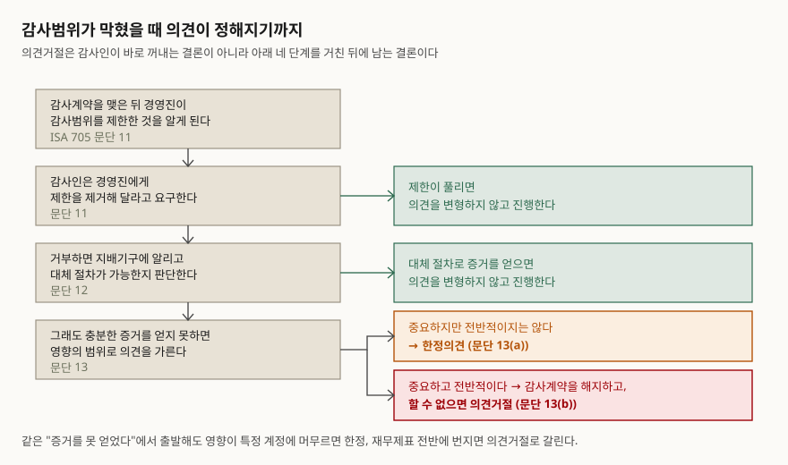
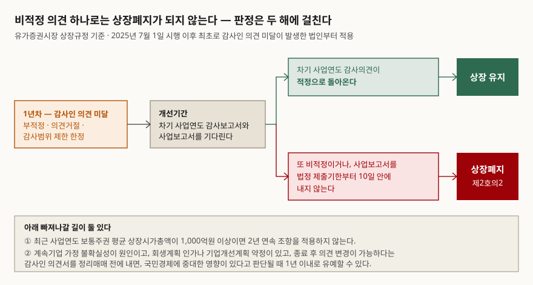

> **실행 검증 없음.** 계산이 없는 제도 글이라 국제감사기준과 거래소 상장규정의 조문을
> 정리했다. 예제의 `가나전자`·`다라물산`·`마바중공업`·`사아리스`와 그 감사 상황은
> 설명을 위해 만든 가상 자료다.

## 들어가며

3월 말이 되면 전자공시에 감사보고서가 쏟아진다. 대부분은 적정의견이고 아무 일도
일어나지 않는데, 어떤 회사는 '의견거절' 네 글자와 함께 다음 날 거래가 멈춘다. 전날까지
그 회사의 재무제표는 바뀐 것이 하나도 없다. 매출도 부채비율도 그대로다. 투자자가 보던
숫자 중에서 변한 것은 없고, 그 숫자를 누가 보증하는지가 변했다. 재무비율을 아무리
정확히 계산해도 이 사건은 계산 밖에 있다.

## 개념 — 변형의견 셋은 두 질문으로 갈린다

국제감사기준 ISA 705는 변형의견을 한정·부적정·의견거절 셋으로 두고, 어느 것을 쓸지는
두 가지로 정해진다고 적는다(문단 2). 하나는 **사안의 성격** — 감사증거를 충분히 얻어
왜곡을 확인한 것인지, 아니면 충분하고 적합한 감사증거를 얻지 못해 왜곡되었을 수도
있는 것인지. 다른 하나는 그 영향이나 가능한 영향이 **전반적인지**에 대한 감사인의 판단이다.

'전반적'의 뜻은 기준에 정의되어 있다(문단 5(a)). 특정 요소·계정·항목에 한정되지 않거나,
한정되더라도 재무제표의 상당 부분을 차지하거나 차지할 수 있거나, 공시라면 이용자가
재무제표를 이해하는 데 근본적인 경우다.

| | 중요하지만 전반적이지는 않다 | 중요하고 전반적이다 |
|---|---|---|
| 왜곡을 확인했다 | 한정의견 (문단 7(a)) | 부적정의견 (문단 8) |
| 증거를 얻지 못했다 | 한정의견 (문단 7(b)) | 의견거절 (문단 9) |

이 표의 구조와 적정의견이 놓이는 자리는 [주석과 감사보고서 — 본문보다 중요한 자리](../../statements/2026-10-01-notes-and-audit-opinion/index.md)에서 다뤘다.
이 글은 그 다음, **그래서 어떤 절차가 따라붙는가**를 본다.

## 구조 — 의견거절은 감사인의 첫 수가 아니다

가장 자주 오해받는 것이 의견거절이다. 감사인이 회사를 믿지 못해 손을 들었다는 식으로
읽히지만, 기준이 정한 순서는 그렇지 않다.

> **출처**: [IAASB, ISA 705 (Revised), Modifications to the Opinion in the Independent Auditor's Report — 문단 11·12·13](https://www.ifac.org/_flysystem/azure-private/publications/files/ISA-705-Revised_0.pdf) (문단 원문은 [남아프리카공화국 IRBA 게재본](https://www.irba.co.za/upload/ISA-705-Revised.pdf)에서 확인, 제3자 전재)

감사계약을 맺은 뒤에 경영진이 감사범위를 제한한 것을 알게 되면, 감사인은 먼저 그 제한을
제거해 달라고 요구해야 한다(문단 11). 경영진이 거부하면 지배기구에 알리고, 다른 절차로
증거를 얻을 수 있는지 판단한다(문단 12). 그래도 충분한 증거를 얻지 못했을 때에야
영향의 범위를 따진다. 중요하지만 전반적이지 않으면 한정의견, 중요하고 전반적이어서
한정으로는 사태의 심각성을 전할 수 없으면 감사계약을 해지하고, 해지할 수 없으면
의견거절이다(문단 13).

의견거절이 나오는 길은 하나 더 있다. 여러 불확실성이 각각으로는 증거가 충분한데도
서로 맞물려 쌓인 효과 때문에 의견을 형성할 수 없는 경우인데, 기준은 이를 "극히 드문
상황"으로 못박는다(문단 10).

## 동작 원리 — 보고서의 생김새가 달라진다

의견이 변형되면 보고서에서 바뀌는 자리가 정해져 있다. 공시를 읽을 때 이 자리들을 알면
'의견' 한 단어만 보는 것보다 훨씬 많은 것이 보인다.

| 보고서의 자리 | 한정의견 | 부적정의견 | 의견거절 |
|---|---|---|---|
| 의견 절 제목 (문단 16) | 한정의견 | 부적정의견 | 의견거절 |
| 의견 문장 (문단 17·18·19) | "~을 제외하고는" 공정하게 표시 | "공정하게 표시하고 있지 않다" | 의견을 표명하지 않는다 |
| 근거 절 제목 (문단 20) | 한정의견 근거 | 부적정의견 근거 | 의견거절 근거 |
| 감사증거가 충분·적합하다는 진술 (문단 25·26) | "한정"을 넣어 수정 | "부적정"을 넣어 수정 | 넣지 않는다 |
| 감사 대상 표현 (문단 19(c)) | 감사하였다 | 감사하였다 | 감사하도록 계약되었다 |

작은 차이 같지만 마지막 줄이 의견거절의 성격을 그대로 드러낸다. 감사를 마치고 의견을
못 냈다가 아니라, **감사하기로 계약했으나 감사를 완결하지 못했다**고 적는 것이다.

근거 절에는 금액이 들어간다. 왜곡이 재무제표의 특정 금액과 관련되면 그 재무적 영향을
기술하고 금액으로 적되, 적기가 실무적으로 불가능하면 그 사실을 적는다(문단 21).
증거를 얻지 못해 변형한 경우에는 왜 얻지 못했는지를 적는다(문단 24). 의견 한 단어가
아니라 이 절을 읽어야 범위를 가늠할 수 있다.

하나 더 있다. 부적정의견이나 의견거절을 내면서 같은 재무보고체계 아래 개별 재무제표나
특정 계정에 대한 적정의견을 같은 보고서에 함께 넣을 수 없다(문단 15). 전체는 믿을 수
없는데 일부는 괜찮다는 식의 보고서가 성립하지 않도록 막아 둔 것이다.

## 받는 쪽 — 상장규정은 두 해에 걸쳐 판정한다

감사의견이 비적정이면 그 다음은 거래소 규정이 받는다. 한국거래소는 관계기관 합동
「상장폐지제도개선방안」(2025년 1월 21일)의 후속 조치로 유가증권시장 상장규정을
개정해 **2년 연속 감사인 의견 미달** 조항을 새로 넣었고, 2025년 7월 1일부터 시행했다.

> **출처**: [한국거래소 KIND, 유가증권시장 상장규정 일부개정규정안 — 제48조제1항제2호의2 신설, 제51조제5항·제6항 신설, 부칙 제1조·제5조](https://kind.krx.co.kr/external/dst/notice/11337/(%EB%B6%99%EC%9E%842)%20%EC%9C%A0%EA%B0%80%EC%A6%9D%EA%B6%8C%EC%8B%9C%EC%9E%A5%20%EC%83%81%EC%9E%A5%EA%B7%9C%EC%A0%95%20%EC%9D%BC%EB%B6%80%EA%B0%9C%EC%A0%95%EA%B7%9C%EC%A0%95%EC%95%88.pdf)

신설된 조항의 문언은 이렇게 읽힌다. 앞선 감사인 의견 미달을 해소하지 못한 상태에서
다음 둘 중 하나에 해당하면 상장폐지다. 하나는 최근 사업연도의 개별 또는 연결재무제표에
대한 감사의견이 **부적정, 의견거절, 또는 감사범위 제한에 따른 한정**인 경우(가목),
다른 하나는 최근 사업연도 사업보고서를 법정 제출기한부터 **10일 이내에 제출하지 않은**
경우(나목)다. 다만 최근 사업연도의 보통주권 평균 상장시가총액이 1,000억원 이상이면
적용하지 않는다.

여기서 눈여겨볼 것은 가목의 세 가지 목록이다. 한정의견은 두 경로에서 나오는데, 이
목록에 들어간 것은 **감사범위 제한에 따른 한정뿐이다.** 회계기준을 벗어난 왜곡 때문에
받은 한정은 목록에 없다. 같은 '한정'이라는 단어를 달고 있어도 2년차 판정에서 가는 길이
다르다는 뜻이다.

유예 조항도 함께 생겼다. 계속기업 가정에 대한 불확실성 때문에 가목에 해당하고,
회생계획을 인가받았거나 기업개선계획 이행 약정이 체결되었고, 그 계획을 끝낸 뒤 감사의견
변경이 가능하다는 감사인의 의견서를 정리매매 시작 전에 제출한 법인에 한해, 국민경제에
중대한 영향이 있다고 판단되면 상장공시위원회 심의를 거쳐 1년 이내로 상장폐지를 유예할
수 있다. 유예된 법인이 해당 사업연도 감사의견을 적정으로 바꾸거나 차기 사업연도에
적정의견을 받으면 사유가 해소된 것으로 본다.

적용 시점도 조문에 적혀 있다. 이 조항들은 시행일 이후에 **최초로** 감사인 의견 미달이
발생한 법인부터 적용한다.

## 가상 회사 넷으로 읽어 보기

같은 비적정이라도 원인과 범위가 다르면 다른 칸에 떨어진다.

| 회사 | 감사인이 마주한 상황 | 성격 | 범위 | 의견 | 2년차 목록(가목) |
|---|---|---|---|---|---|
| 가나전자 | 재고자산 평가가 회계기준을 벗어난 것을 확인. 영향이 재고와 매출원가에 머문다 | 왜곡 확인 | 전반적이지 않음 | 한정 (문단 7(a)) | 해당하지 않음 |
| 마바중공업 | 특수관계자 거래 일부의 증빙을 받지 못했고, 금액이 한 계정에 머문다 | 증거 미입수 | 전반적이지 않음 | 한정 (문단 7(b)) | 해당 |
| 사아리스 | 자산 전반을 과대계상한 것이 확인됐고 금액이 재무제표의 상당 부분을 차지한다 | 왜곡 확인 | 전반적 | 부적정 (문단 8) | 해당 |
| 다라물산 | 연결자산의 대부분을 차지하는 해외 종속기업 장부에 접근하지 못했다 | 증거 미입수 | 전반적 | 의견거절 (문단 9) | 해당 |

가나전자와 마바중공업은 둘 다 한정의견이다. 공시 제목만 보면 똑같이 '한정'인데,
2년차에 상장폐지 조항이 받는 것은 마바중공업 쪽이다. 한정의견을 봤을 때 원인을 먼저
확인해야 하는 이유가 여기 있다.

## 실무에서 주의할 점

**한정의견은 근거 절을 읽어야 구분된다.** 근거 절에 "충분하고 적합한 감사증거를 입수할
수 없었다"는 취지가 적혀 있으면 범위 제한 쪽이고, 회계처리가 기준에 맞지 않는다는 서술이
있으면 왜곡 쪽이다. 상장규정의 2년차 목록이 받는 것은 앞쪽이다.

**의견거절이 곧 분식의 확인은 아니다.** 증거를 얻지 못했다는 진술이지 왜곡을 확인했다는
진술이 아니다. 그래서 부적정의견보다 가벼운 사안이라는 뜻도 아니다. 기준은 한정으로는
심각성을 전할 수 없을 때 의견거절을 쓰라고 정해 두었다(문단 13(b)).

**유예 조항은 좁다.** 계속기업 가정 불확실성이라는 원인, 회생·워크아웃이라는 절차,
감사인의 의견서, 국민경제 영향 판단이 모두 맞아야 한다. 회계부정이나 감사증거 확보
곤란이 원인이면 들어오지 못한다.

**시행·적용 시점을 확인한다.** 2년 연속 조항은 2025년 7월 1일 시행이고, 그 이후 최초로
감사인 의견 미달이 발생한 법인부터 적용한다. 그 전에 이미 의견 미달이 있었던 법인은
종전 절차를 따른다.

**코스닥시장은 별도 규정이다.** 코스닥시장 상장규정은 관리종목 지정과 상장폐지를 따로
정하고 개정 시점도 다르다. 유가증권시장 조문을 그대로 대입하면 틀린다.

## 정리

- 변형의견 셋은 사안의 성격(왜곡 확인인가 증거 미입수인가)과 영향의 범위(전반적인가)
  두 질문으로 갈린다.
- 의견거절은 감사인의 첫 수가 아니다. 제한 제거 요구 → 지배기구 통보와 대체 절차 →
  그래도 증거를 못 얻었을 때의 범위 판단이라는 순서를 거친 뒤 남는 결론이다.
- 보고서에서는 의견 절 제목, 의견 문장, 근거 절 제목, 감사증거 충분성 진술, 감사 대상
  표현이 함께 바뀐다. 근거 절에는 금액이나 금액을 적을 수 없다는 사실이 들어간다.
- 유가증권시장은 2025년 7월부터 2년 연속 감사인 의견 미달을 상장폐지 사유로 둔다.
  2년차 목록에 들어가는 한정은 감사범위 제한에 따른 한정뿐이고, 평균 상장시가총액
  1,000억원 이상이면 적용되지 않는다.

## 참고 자료

- [IAASB, ISA 705 (Revised), Modifications to the Opinion in the Independent Auditor's Report](https://www.ifac.org/_flysystem/azure-private/publications/files/ISA-705-Revised_0.pdf) — 2016년 12월 15일 이후 종료되는 회계기간의 감사부터 적용. 문단 원문은 [IRBA 게재본](https://www.irba.co.za/upload/ISA-705-Revised.pdf)에서 확인했다 (제3자 전재)
- [한국거래소 KIND, 유가증권시장 상장규정 일부개정규정안](https://kind.krx.co.kr/external/dst/notice/11337/(%EB%B6%99%EC%9E%842)%20%EC%9C%A0%EA%B0%80%EC%A6%9D%EA%B6%8C%EC%8B%9C%EC%9E%A5%20%EC%83%81%EC%9E%A5%EA%B7%9C%EC%A0%95%20%EC%9D%BC%EB%B6%80%EA%B0%9C%EC%A0%95%EA%B7%9C%EC%A0%95%EC%95%88.pdf) — 개정이유·신구조문대비표·부칙. 2025년 7월 1일 시행
- [자본시장연구원 『자본시장 제도동향』 2026년 10월 — 한국거래소 규정](https://www.kcmi.re.kr/common/downloadw?fid=29206&fgu=002001&fty=004003) — 유가증권시장 상장규정의 이후 개정 경과
- [주석과 감사보고서 — 본문보다 중요한 자리](../../statements/2026-10-01-notes-and-audit-opinion/index.md) — 감사의견 네 가지의 분류와 주석 읽는 법
