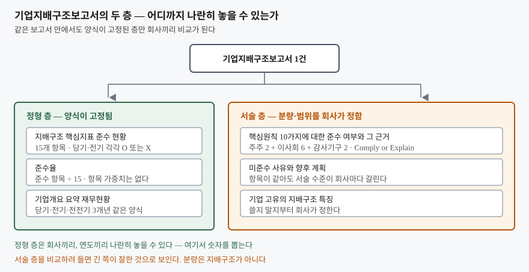
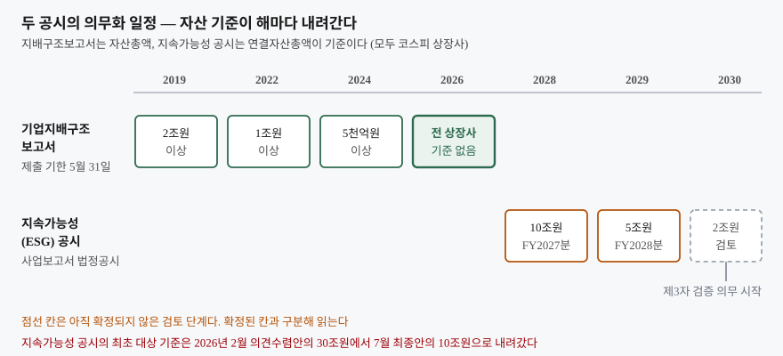

## 들어가며

재무제표를 읽는 법을 익히고 나면 다음으로 눈이 가는 것이 사업보고서 밖의
공시다. 그중 기업지배구조보고서는 매년 5월 말에 한 번에 올라오고, 분량이
수십 쪽이며, 숫자가 거의 없다. 두 회사를 비교해 보려고 나란히 열면 한쪽은
이사회 운영을 열 쪽에 걸쳐 쓰고 한쪽은 두 쪽으로 끝낸다.

이때 흔히 하는 일이 양쪽을 끝까지 읽고 인상을 비교하는 것이다. 보고서 한
건이 40쪽이면 두 건에 80쪽이고, 다 읽고 나서 남는 것은 "이쪽이 더 자세히
썼다"는 느낌뿐이다. 그런데 서술의 분량은 회사가 정하는 것이지 지배구조가
아니다. 같은 보고서 안에 **양식이 고정돼서 애초에 비교하라고 만들어 둔 층**이
따로 있고, 거기만 보면 두 회사를 한 표에 올릴 수 있다.

## 개념

기업지배구조보고서는 한국거래소가 제시한 **지배구조 핵심원칙 10가지**에 대해
회사가 스스로 준수 여부를 밝히고 설명하는 방식으로 쓴다. 준수하면 근거와 개선
계획을, 미준수면 사유와 향후 계획을 쓴다. 이 방식을 Comply or Explain 이라고
부른다. 모든 원칙을 반드시 지켜야 하는 것이 아니고, 가이드라인 자체가 준수
여부에 과도하게 매몰되기보다 현황을 정확히 공시하는 것이 중요하다고 적는다.

이 서술과 별개로 보고서 앞머리에는 **지배구조 핵심지표 준수 현황** 표가 붙는다.
15개 항목에 대해 당기와 직전 공시대상기간의 준수 여부를 O 와 X 로 찍고,
준수율은 15개 중 준수 항목의 비율로 계산한다. 항목도, 판정 기준도, 분모도
가이드라인이 정해 놓았다. 회사가 손댈 여지가 없다는 점이 이 표의 쓸모다.

**지속가능성(ESG) 공시**는 아직 그 단계가 아니다. 공시기준은 한국형
공시기준(KSSB)으로 마련됐지만 의무 적용은 2028년에 시작한다. 지금 할 수 있는
것은 어느 회사가 언제부터 대상이 되는지 확인하는 일까지다.

## 구조



> **출처**: [한국거래소 「기업지배구조 보고서 가이드라인」(2025.12) — 1. 보고서 작성 안내 Ⅰ·Ⅲ·Ⅴ, Ⅰ. 기업 개요 5. 지배구조 핵심지표 준수 현황, 2. 각 핵심원칙 및 세부원칙별 기재사항](https://kind.krx.co.kr/external/dst/reference/11618/%EA%B8%B0%EC%97%85%EC%A7%80%EB%B0%B0%EA%B5%AC%EC%A1%B0%20%EB%B3%B4%EA%B3%A0%EC%84%9C%20%EA%B0%80%EC%9D%B4%EB%93%9C%EB%9D%BC%EC%9D%B8%20%EA%B0%9C%EC%A0%95(%EC%95%88).pdf)

왼쪽만 뽑아내면 회사끼리도, 연도끼리도 한 표에 올라간다.

## 동작 원리

### 준수율은 가중치가 없다

준수율의 분모는 15로 고정이고, 항목마다 가중치가 붙지 않는다. 전자투표를
실시하는 것과 내부감사기구에 회계·재무 전문가를 두는 것이 똑같이 15분의 1 이다.
그래서 준수율 한 숫자는 **몇 개를 채웠는지만** 말하고 **무엇을 채웠는지는**
말하지 않는다.

이 성질 때문에 준수율이 같은 두 회사가 전혀 다른 모양일 수 있다. 지표를 영역별로
쪼개 보면 그 차이가 드러난다. 핵심원칙이 주주 2가지, 이사회 6가지, 감사기구
2가지로 나뉘어 있으므로 지표도 같은 축으로 묶어 볼 수 있다. 다만 가이드라인이
지표마다 영역을 명시해 둔 것은 아니고, 아래 분류는 지표 내용에 맞춰 묶은 것이다.

### 전기 대비 변화는 양이 아니라 자리를 본다

핵심지표 표에는 직전 공시대상기간의 준수 여부가 같이 찍힌다. 그래서 작년과
올해를 바로 대 볼 수 있는데, 여기서도 준수율 변화량만 보면 놓치는 것이 생긴다.
한 항목이 붙고 다른 항목이 빠지면 준수율은 그대로다. 숫자는 가만히 있지만
실제로는 두 군데가 바뀐 해다.

### 지속가능성 공시는 일정부터 흔들린다

지배구조보고서 쪽은 2019년 자산총액 2조원 이상에서 시작해 2022년 1조원,
2024년 5천억원을 거쳐 2026년 코스피 전 상장사로 넓어졌다. 단계가 이미 끝까지
갔다.

지속가능성 공시는 아직 가는 중이고, 심지어 **같은 해에 기준이 바뀌었다.**
2026년 2월 25일 의견수렴안은 최초 대상을 연결자산총액 30조원 이상으로 잡았는데,
7월 8일 최종안은 같은 시작 연도(2028년, FY2027분)에 기준을 10조원 이상으로
내렸다. 시작 시점은 그대로인데 대상 범위만 넓어진 것이다.



> **출처**: [금융위원회 「'26년부터 기업지배구조보고서 공시대상이 전체 유가증권시장 상장기업으로 확대됩니다」(2025.7.9.)](https://www.fsc.go.kr/no010101/84900), [금융위원회 「지속가능성(ESG) 공시 제도화 방안(최종안)」(2026.7.8.)](https://www.fsc.go.kr/no010101/87280), [금융위원회 지속가능성 공시 로드맵 의견수렴안(2026.2.25.)](https://www.fsc.go.kr/no010101/86326)

## 실습 예제

가상 회사 `가나전자`와 `다라물산`의 핵심지표 응답을 세운다. 응답은 비교의
축을 보이려고 만든 값이다.

```text
[2] 준수율 — 한 숫자로 줄이면 두 회사가 같아 보인다
  회사           준수 항목    전체    준수율
  가나전자             9개    15개     60.0%
  다라물산             9개    15개     60.0%
```

여기서 멈추면 두 회사의 지배구조가 비슷하다고 읽게 된다. 영역별로 쪼개면
정반대가 나온다.

```text
[3] 영역별로 쪼개면 — 같은 준수율이 정반대 모양을 덮고 있었다
  회사               주주(5)     이사회(6)   감사기구(4)        합계
  가나전자               5/5           3/6           1/4        9/15
  다라물산               1/5           4/6           4/4        9/15
```

가나전자는 주주 영역이 꽉 차 있고 감사기구가 거의 비어 있다. 주주총회를 4주
전에 공고하고 전자투표를 실시하며 집중일을 피해 열지만, 독립적인 내부감사부서가
없고 경영진 없이 외부감사인과 만나는 절차도 없다. 다라물산은 정확히 반대다.
준수율 60% 라는 같은 숫자가 서로 반대인 두 회사를 가린다.

전기와 대 보면 또 다른 것이 보인다.

```text
[4] 전기 대비 변화 — 올랐는지가 아니라 어디가 바뀌었는지를 본다
  가나전자  46.7% → 60.0% (7/15 → 9/15, +13.3%p)
    + 주주      현금배당 관련 예측가능성 제공
    + 이사회    기업가치 훼손 책임자의 임원 선임 방지 정책
  다라물산  60.0% → 60.0% (9/15 → 9/15, +0.0%p)
    - 주주      배당정책·배당실시 계획 연 1회 이상 통지
    + 감사기구  경영 중요정보에 내부감사기구가 접근하는 절차
```

다라물산의 준수율은 1%p 도 안 움직였는데 지표 두 개가 자리를 바꿨다.
감사기구 쪽 절차가 하나 생기고 배당정책 통지가 하나 빠졌다. 준수율만 추적하면
아무 일도 없었던 해로 기록된다.

지속가능성 공시는 대상 판정까지만 계산된다.

```text
[7] 지속가능성 공시 의무 대상 판정 — 연결자산총액 기준
  회사           연결자산총액        최초 대상  근거
  가나전자           12.4조원   2028년(FY2027)  10조원 기준 충족
  다라물산            6.8조원   2029년(FY2028)  5조원 기준 충족
  마바산업            2.9조원             미정  2030년 2조원 확대가 검토 단계
  사아텍              0.7조원        해당 없음  확정·검토 기준 모두 아래
```

전체 출력과 15개 지표 전체 표는 [code/output.txt](code/output.txt)에 있다.

## 실무에서 주의할 점

**준수율에 적정 수준이라는 것이 없다.** 가이드라인에도 거래소 공표 자료에도
"몇 % 이상이면 양호하다"는 기준선은 없다. 가이드라인은 오히려 준수 여부에
매몰되지 말라고 적는다. 근거 없는 기준선을 세워 두고 회사를 줄 세우면 그
기준선이 분석의 결론을 미리 정해 버린다.

**업종과 규모를 섞어 비교하지 않는다.** 집중투표제 채택이나 사외이사 의장 같은
항목은 소유구조에 따라 채택 여부가 갈린다. 비교는 같은 업종, 비슷한 자산 규모
안에서 해야 차이가 뜻을 갖는다. 2026년부터 코스피 전 상장사가 대상이 되면서
자산 규모 분포가 훨씬 넓어졌으니 더 그렇다.

**미제출과 미준수를 구분한다.** 핵심지표의 X 는 "그 제도를 두지 않았다"는
공시이고, 보고서를 5월 31일까지 내지 않는 것은 불성실공시법인 지정 절차로
이어지는 별개의 문제다. 전자는 지배구조 선택이고 후자는 공시 의무 위반이다.

**제도 일정은 발효일과 문서 시점을 함께 적는다.** 지속가능성 공시의 최초 대상
기준은 2026년 한 해 안에 30조원에서 10조원으로 바뀌었다. 기준서가 확정된 것과
누구에게 언제 적용할지가 정해진 것은 다른 사건이고, 뒤쪽은 더 늦게, 여러 번
움직인다. 일정을 인용할 때 "어느 문서 기준인지"를 빼면 반년 만에 틀린 글이 된다.

**지속가능성 공시의 초기 면책을 공시 품질과 혼동하지 않는다.** 최종안은 도입
초기 3년간 공시 내용에 대한 손해배상·행정제재·형사처벌을 면제하되 고의적
그린워싱은 제외했다. 제3자 검증 의무는 최초 공시 2년 뒤인 2030년부터 붙는다.
초기 몇 해의 공시는 검증을 거치지 않은 자기 보고라는 뜻이다.

## 정리

- 기업지배구조보고서는 서술 층과 정형 층으로 나뉘고, 비교는 정형 층에서만 된다.
  핵심지표 15개와 요약 재무현황 3개년이 그 층이다
- 준수율은 분모 15에 가중치가 없다. 몇 개를 채웠는지만 말하므로 영역별로
  쪼개야 모양이 보인다
- 전기 대비는 변화량이 아니라 붙고 빠진 항목을 본다. 준수율이 그대로여도
  두 군데가 바뀌었을 수 있다
- 준수율의 적정 수준을 정한 공표 자료는 없다. 기준선을 세우려면 그 출처를
  먼저 찾아야 한다
- 지속가능성 공시는 2028년(FY2027분) 연결자산총액 10조원 이상에서 시작한다.
  이 기준은 2026년 2월 의견수렴안의 30조원에서 7월 최종안에 내려온 값이다

## 참고 자료

- [한국거래소 「기업지배구조 보고서 가이드라인」(2025.12)](https://kind.krx.co.kr/external/dst/reference/11618/%EA%B8%B0%EC%97%85%EC%A7%80%EB%B0%B0%EA%B5%AC%EC%A1%B0%20%EB%B3%B4%EA%B3%A0%EC%84%9C%20%EA%B0%80%EC%9D%B4%EB%93%9C%EB%9D%BC%EC%9D%B8%20%EA%B0%9C%EC%A0%95(%EC%95%88).pdf) — Comply or Explain 작성 방식, 핵심원칙 10가지 전문, 핵심지표 15개 항목과 준수율 정의, 5월 31일 제출 기한
- [금융위원회 「'26년부터 기업지배구조보고서 공시대상이 전체 유가증권시장 상장기업으로 확대됩니다」(2025.7.9.)](https://www.fsc.go.kr/no010101/84900) — 2019·2022·2024·2026년 단계적 확대와 대상 기업 수
- [금융위원회 「지속가능성(ESG) 공시 제도화 방안(최종안)」(2026.7.8.)](https://www.fsc.go.kr/no010101/87280) — 2028년(FY2027) 10조원 이상 시작, 2029년 5조원, 2030년 2조원 검토, 초기 3년 면책, 2030년 제3자 검증
- [금융위원회 지속가능성 공시 로드맵 의견수렴안(2026.2.25.)](https://www.fsc.go.kr/no010101/86326) — 최초 대상 30조원 이상 안과 종속회사 제외 요건
- [KIND 기업지배구조보고서 공시](https://kind.krx.co.kr/) — 실제 보고서 조회
