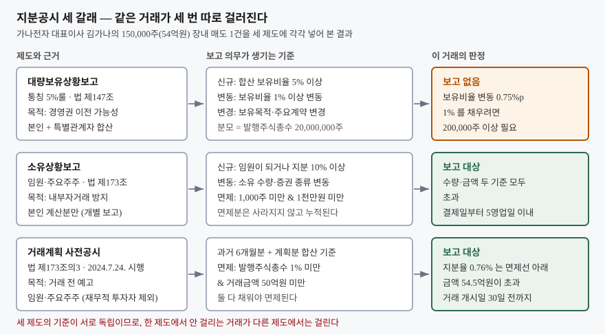
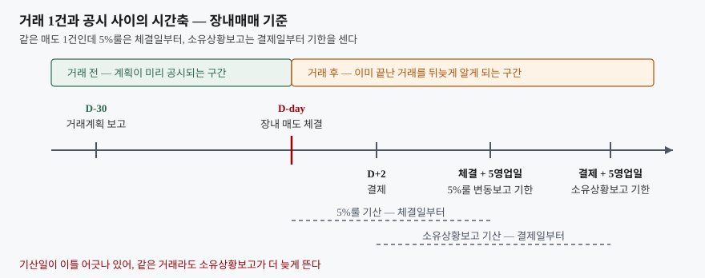

## 들어가며

보유한 종목 이야기를 하다 보면 "대표이사가 지분을 팔았다"는 말을 듣게 된다.
확인하려고 DART 에서 그 회사를 찾으면 이름이 비슷한 보고서가 여럿 뜬다.
「주식등의 대량보유상황보고서」, 「임원·주요주주 특정증권등 소유상황보고서」,
「임원·주요주주 특정증권등 거래계획보고서」. 어느 것을 열어야 그 매도가 보이는지
알 수 없으니, 보통은 세 개를 다 열어 수량이 맞는 줄을 눈으로 찾는다.

그런데 세 보고서를 다 열어도 그 거래가 한 군데에만 나오거나, 어디에도 안 나오는
경우가 있다. 셋이 같은 거래를 세 번 적어 두는 중복 서류가 아니라, 기준이 서로
다른 세 제도이기 때문이다. 기준을 알고 나면 어느 보고서에서 무엇을 찾을 수
있는지, 그리고 **무엇은 애초에 찾을 수 없는지**가 정해진다.

## 개념

세 제도는 목적부터 다르다.

**대량보유상황보고**(자본시장법 제147조, 통칭 5%룰)는 경영권이 넘어갈
가능성을 시장에 알리는 제도다. 그래서 본인뿐 아니라 특수관계인과 공동보유자를
합산한 지분을 센다. 합산이 5% 이상이면 보고 의무가 생기고, 그 뒤 보유비율이
1% 이상 변동하면 다시 보고한다.

**임원·주요주주 특정증권등 소유상황보고**(같은 법 제173조)는 내부자거래를
막으려는 제도다. 누가 경영권을 가졌는지가 아니라 **내부정보에 닿는 사람이
무엇을 사고팔았는지**를 본다. 그래서 합산하지 않고 본인 계산분만 개별로
보고하며, 지분이 아무리 작아도 임원이면 대상이다.

**거래계획 사전공시**(제173조의3)는 2024년 7월 24일 시행된 제도다. 앞의 둘이
거래가 끝난 뒤에 나오는 사후 보고라는 점이 문제였다. 대량 매도가 체결되고
결제까지 끝난 뒤에야 공시가 뜨면, 그 사이에 주식을 산 사람은 손쓸 방법이 없다.
그래서 일정 규모 이상의 거래는 **거래 개시일 30일 전까지** 계획을 먼저 내도록
했다. 지분공시 셋 중 유일하게 거래 전에 나오는 보고다.

## 구조



> **출처**: [금융감독원 기업공시 길라잡이 · 대량 보유상황 보고](https://dart.fss.or.kr/info/main.do?menu=310), [같은 길라잡이 · 임원 소유상황 보고](https://dart.fss.or.kr/info/main.do?menu=320), [금융위원회 「7.24일부터 상장회사 내부자거래 사전공시제도가 시행됩니다」](https://fsc.go.kr/no010101/82635)

같은 거래가 세 갈래로 나뉘어 각각 판정된다. 세 기준이 서로 독립이므로,
한 제도에서 안 걸리는 거래가 다른 제도에서는 걸린다. 반대도 마찬가지다.

## 동작 원리

### 분모가 다르다

5%룰은 **발행주식총수**를 분모로 쓴다. 발행주식이 2,000만 주인 회사에서
1% 는 20만 주다. 그보다 적게 움직이면 보유비율이 1%p 를 못 채우고, 변동보고가
나오지 않는다. 금액이 얼마든 상관없다.

소유상황보고는 비율을 보지 않는다. 소유 **수량**이 바뀌면 보고한다. 다만 너무
잦은 보고를 막으려고 경미한 변동을 면제하는데, 그 기준이 **1,000주 미만이면서
동시에 1천만원 미만**이다. 두 요건을 모두 채워야 면제되므로 한쪽만 넘어도
보고 대상이 된다.

면제된 거래가 없던 일이 되는 것도 아니다. 수량과 금액이 누적되다가 기준을 넘는
순간, 직전 보고 이후의 거래를 전부 묶어 한 번에 보고한다. 소액 거래를 여러 번
쪼개도 결국 드러난다.

### 기산일이 다르다

장내매매에서 5%룰의 보고의무 발생일은 **계약 체결일**이고, 소유상황보고의
발생일은 **결제일**이다. 국내 주식시장의 결제는 체결 이틀 뒤이므로, 같은 거래를
두고 두 보고의 기한이 이틀 어긋난다. 둘 다 발생일부터 5영업일 이내다.



> **출처**: [금융감독원 기업공시 길라잡이 · 임원 소유상황 보고 (보고기한 및 보고의무 발생일)](https://dart.fss.or.kr/info/main.do?menu=320), [같은 길라잡이 · 대량 보유상황 보고 (보고의무 발생일)](https://dart.fss.or.kr/info/main.do?menu=310), [금융위원회 「7.24일부터 상장회사 내부자거래 사전공시제도가 시행됩니다」](https://fsc.go.kr/no010101/82635)

공시에 찍힌 날짜는 거래한 날이 아니라 보고한 날이다. 최대 일주일 넘게 벌어질 수
있으므로, 공시 날짜를 주가 흐름에 그대로 겹쳐 읽으면 안 된다.

### 사전공시는 과거를 합산해 판정한다

거래계획 사전공시의 면제 기준은 **발행주식총수의 1% 미만이면서 동시에 거래금액
50억원 미만**이다. 여기서 세는 거래량은 계획분만이 아니라 **거래 개시일 기준
과거 6개월 거래량을 합산한 값**이다. 쪼개서 여러 번 파는 방법으로 면제선 아래에
머무를 수 없게 만든 장치다.

두 기준이 함께 걸려 있으므로 주가가 높은 회사일수록 금액 쪽이 먼저 걸린다.
지분율로는 1% 에 한참 못 미치는 거래가 금액으로는 50억원을 넘는 일이 흔하다.

## 실습 예제

가상 회사 `가나전자`를 세운다. 발행주식총수 2,000만 주, 주가 36,000원이고,
주주와 거래 내역은 판정 기준을 보이려고 만든 값이다.

먼저 누가 어느 보고서를 내는지부터 갈린다.

```text
[1] 누가 어느 보고서를 내는가
  주주                      5%룰    소유상황보고  사유
  최대주주 가나홀딩스          O               O  합산 30.00% ≥ 5%, 본인 28.00% ≥ 10%
  대표이사 김가나              O               O  합산 9.50% ≥ 5%, 임원
  사외이사 박다라              -               O  임원
  기관 마바자산운용            O               -  합산 6.20% ≥ 5%
```

사외이사 박다라는 0.01% 만 가졌는데도 소유상황보고 대상이고, 6.20% 를 가진
기관은 아니다. 제도가 보는 것이 지분 크기가 아니라 내부정보 접근이라는 뜻이다.

대표이사 김가나의 한 해 거래로 소유상황보고의 누적 판정을 본다.

```text
[2] 대표이사 김가나의 거래 — 소유상황보고 의무가 언제 생기는가
    순번         날짜   구분      수량            금액   누적수량         누적금액  판정
       1   2026-02-03   매수       100       3,000,000        100        3,000,000  면제 (1,000주 미만 & 1천만원 미만)
       2   2026-02-17   매수       120       3,840,000        220        6,840,000  면제 (1,000주 미만 & 1천만원 미만)
       3   2026-03-05   매수       130       4,420,000        350       11,260,000  보고 (누적 1천만원 이상)
       4   2026-05-21   매도       350      13,300,000        350       13,300,000  보고 (누적 1천만원 이상)
       5   2026-06-10   매수       400      16,800,000        400       16,800,000  보고 (누적 1천만원 이상)
       6   2026-07-15   매도       400      15,600,000        400       15,600,000  보고 (누적 1천만원 이상)
       7   2026-10-05   매도   150,000   5,400,000,000    150,000    5,400,000,000  보고 (수량·금액 모두 초과)
```

1·2번은 수량도 금액도 면제선 아래라 그 자리에서는 보고하지 않는다. 그 수량과
금액이 3번에 얹혀 누적 1,126만원이 되고, 그제야 1~3번을 묶어 한 번에 보고한다.

같은 거래를 5%룰로 보면 모양이 완전히 달라진다.

```text
[3] 같은 거래가 5%룰로는 어떻게 보이는가 (대표이사 김가나, 기초 보유 1,900,000주)
    순번   구분      수량    보유주식   보유비율   직전 보고분 대비  판정
       1   매수       100   1,900,100      9.50%             0.00%p  보고 없음 (1% 미만 변동)
       4   매도       350   1,900,000      9.50%             0.00%p  보고 없음 (1% 미만 변동)
       7   매도   150,000   1,750,000      8.75%             0.75%p  보고 없음 (1% 미만 변동)
```

한 해 내내 5%룰 변동보고가 한 번도 나오지 않는다. **54억원짜리 매도 한 건이
있었는데도 그렇다.** 보유비율이 0.75%p 밖에 안 움직였고, 1% 를 채우려면
20만 주 이상을 움직여야 하기 때문이다. 이 매도를 5%룰 공시에서 찾으면 안 나온다.

그 54억원 매도가 사전공시 대상인지 본다.

```text
[4] 7번 매도가 사전공시 대상인가 (과거 6개월분 + 계획분 합산)
  면제 요건                             기준            합산값  판정
  발행주식총수 대비                  1% 미만             0.76%  충족
  거래금액              5,000,000,000원 미만   5,445,700,000원  초과
  → 면제는 두 요건을 모두 채워야 한다. 하나가 넘었으므로 거래 개시일 30일 전까지 거래계획을 보고한다
```

지분율은 면제선 아래인데 금액이 넘어서 걸렸다. 5%룰로는 안 보이는 거래가
사전공시로는 30일 전에 예고되는 셈이다.

마지막으로 단기매매차익이다. 임원·주요주주가 6개월 안에 매수 후 매도하거나
매도 후 매수해 이익을 냈으면, 미공개정보를 썼는지와 **무관하게** 회사가 그 차익의
반환을 청구할 수 있다(법 제172조).

```text
[5] 단기매매차익 — 6개월 안의 매수·매도를 선입선출로 짝지운다
              짝     간격   일치수량   매수단가   매도단가       총차익       비용       반환액
         1번↔4번  3.5개월        100     30,000     38,000      800,000     17,800      782,200
         2번↔4번  3.1개월        120     32,000     38,000      720,000     21,720      698,280
         3번↔4번  2.5개월        130     34,000     38,000      520,000     23,920      496,080
         5번↔6번  1.1개월        400     42,000     39,000   -1,200,000     79,800            0  ← 손실 짝, 상계하지 않는다
   7번 (짝 없음)        -    150,000          -     36,000            -          -            0
       반환 합계                                                                      1,976,560원
```

5번↔6번은 42,000원에 사서 39,000원에 판 짝이라 120만원 손실인데, 그 손실을
4번의 이익에서 빼 주지 않는다. 손실 짝은 없던 거래로 보기 때문이다. 그래서
실제로 번 돈보다 반환액이 클 수 있다.

7번 매도 150,000주는 6개월 안에 사 둔 물량이 남아 있지 않아 산정에서 통째로
빠진다. 가장 큰 거래가 단기매매차익에서는 아무 몫도 하지 않는다.

전체 출력과 계산 과정은 [code/output.txt](code/output.txt)에 있다.

## 실무에서 주의할 점

**공시 날짜를 거래 날짜로 읽지 않는다.** 보고기한이 5영업일이고 기산일도
제도마다 다르므로, 체결과 공시 사이에 일주일 넘게 벌어질 수 있다. 공시가 뜬 날의
주가 움직임을 그 거래의 결과로 보면 인과가 뒤집힌다.

**한 보고서에 없다고 거래가 없었던 것이 아니다.** 위 예제의 54억원 매도는
5%룰 공시 어디에도 나오지 않는다. 지분공시를 볼 때는 세 종류를 모두 봐야 하고,
특히 임원의 거래는 소유상황보고 쪽에서 찾아야 한다.

**보고 사유를 매도 의사로 번역하지 않는다.** 소유상황보고의 변동 사유에는
장내매매뿐 아니라 무상증자 신주 배정, 주식배당, 상속, 전환사채의 전환권 행사가
모두 들어간다. 수량이 줄었다고 전부 판 것도 아니다. 보고서 본문의 변동 사유
항목을 확인하지 않으면 증자로 늘어난 것을 매수로 읽게 된다.

**거래계획은 그대로 실행된다는 보장이 없다.** 보고한 계획과 다르게 거래할 수
있는 범위가 거래금액의 30% 까지 열려 있고, 사망·파산이나 상장폐지·매매거래정지
같은 사유가 생기면 철회할 수도 있다. 계획 공시는 예고이지 확정이 아니다.

**단기매매차익 반환은 제재가 아니다.** 회사가 차익의 반환을 청구하는 민사
절차이고, 내부정보를 실제로 썼는지는 따지지 않는다. 반환 사실이 곧 불공정거래
적발을 뜻하지는 않는다. 반대로 미공개중요정보 이용행위는 별개 조항으로 따로
다뤄진다.

## 정리

- 지분공시 세 제도는 목적이 다르다. 5%룰은 경영권, 소유상황보고는 내부자거래 방지,
  사전공시는 거래 전 예고다
- 분모가 다르다. 5%룰은 특별관계자 합산 지분율, 소유상황보고는 본인 계산 수량이다
- 기산일이 다르다. 장내매매에서 5%룰은 체결일, 소유상황보고는 결제일부터
  5영업일을 센다
- 면제 기준은 모두 "그리고"로 묶여 있다. 소유상황보고는 1,000주 미만 **그리고**
  1천만원 미만, 사전공시는 1% 미만 **그리고** 50억원 미만일 때만 면제된다
- 한 제도에서 안 보이는 거래가 다른 제도에서는 보인다. 세 종류를 함께 봐야
  거래 하나가 복원된다

## 참고 자료

- [금융감독원 기업공시 길라잡이 · 대량 보유상황 보고](https://dart.fss.or.kr/info/main.do?menu=310) — 보고의무자, 주식등의 범위, 신규·변동·변경보고 기준, 보유목적 구분, 냉각기간, 제재
- [금융감독원 기업공시 길라잡이 · 임원 소유상황 보고](https://dart.fss.or.kr/info/main.do?menu=320) — 특정증권등의 범위, 보고의무 발생일, 경미한 변동 면제 기준, 5%보고와의 대비표
- [금융감독원 기업공시 길라잡이 · 단기매매차익 반환](https://dart.fss.or.kr/info/main.do?menu=330) — 반환의무자 범위, 차익 산정식, 이종종목·이종증권 환산, 적용 예외
- [금융위원회 「7.24일부터 상장회사 내부자거래 사전공시제도가 시행됩니다」(2024.7.19.)](https://fsc.go.kr/no010101/82635) — 사전공시 대상자, 보고 시기, 면제 기준, 변경 허용 범위, 철회 사유
- [전자공시시스템(DART) 지분공시 종합정보](https://dart.fss.or.kr/) — 실제 보고서 조회
