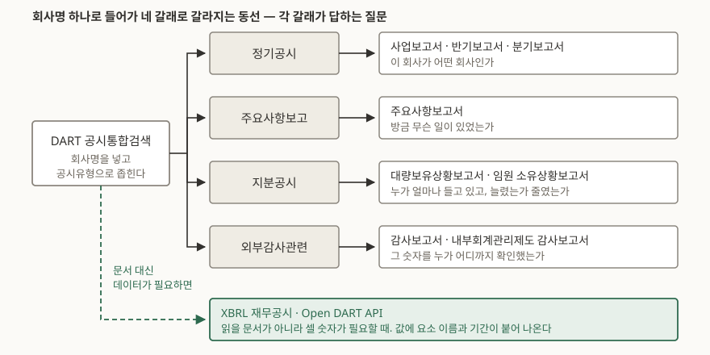

> 예제의 `가나전자`와 그 숫자는 XBRL과 보고서 표의 차이를 보이려고 만든 가상 회사다. 실재하지 않는다.

## 들어가며

어떤 회사가 궁금해져서 DART를 처음 연다. 검색창에 회사명을 넣으면 결과가 수백 건 뜨고, 기본 정렬은 최신순이다. 위에서부터 읽어 내려가면 `[기재정정]`이 붙은 것, 증권발행실적보고서, 임원·주요주주 특정증권등 소유상황보고서가 번갈아 지나간다. 정작 알고 싶었던 "이 회사가 뭘 파는 회사이고 작년에 얼마를 벌었나"는 열 페이지를 넘겨도 안 나온다. 그러다 포털 증권 탭으로 돌아가 요약 숫자만 보고 끝낸다.

이건 검색을 잘못한 게 아니라 **공시를 시간순으로 읽었기 때문**이다. DART의 목록은 일기장이 아니라 서랍장이고, 서랍마다 답하는 질문이 다르다. 서랍을 먼저 고르면 수백 건이 서너 건으로 줄어든다.

## 개념

### 공시유형이 먼저고 날짜는 나중이다

DART의 공시통합검색은 제출된 서류를 열 갈래로 나눈다. 정기공시, 주요사항보고, 발행공시, 지분공시, 기타공시, 외부감사관련, 펀드공시, 자산유동화, 거래소공시, 공정위공시다. 일반 상장사를 들여다볼 때 실제로 쓰는 것은 앞쪽 네댓 갈래이고, 각 갈래는 서로 다른 질문에 답한다.

| 갈래 | 답하는 질문 | 대표 서류 | 주기 또는 시한 |
|---|---|---|---|
| 정기공시 | 이 회사가 어떤 회사인가 | 사업보고서·반기보고서·분기보고서 | 사업연도 경과 후 90일, 반기·분기 각 45일 |
| 주요사항보고 | 방금 무슨 일이 있었는가 | 주요사항보고서 | 사유 발생 다음 날까지 |
| 지분공시 | 누가 얼마나 들고 있는가 | 대량보유상황보고서, 임원·주요주주 특정증권등 소유상황보고서 | 사유 발생일부터 5일 이내 |
| 외부감사관련 | 그 숫자를 누가 확인했는가 | 감사보고서 | 정기보고서에 맞춰 |

시한이 제각각인 것이 중요하다. 정기공시는 몇 달 뒤에 나오고, 주요사항보고는 다음 날 나온다. **같은 사건이 두 서랍에 시차를 두고 들어간다.** 큰 계약이 깨진 날 주요사항보고서가 하루 만에 올라오고, 그게 매출에 얼마를 뚫었는지는 몇 달 뒤 정기보고서에 숫자로 나타난다. 둘을 같은 목록에서 날짜순으로 보면 두 사건처럼 보인다.

### 원문과 XBRL은 서로 다른 쓸모가 있다

DART에는 같은 재무정보가 두 모양으로 들어 있다. 하나는 사람이 읽으라고 만든 보고서 원문이고, 다른 하나는 기계가 읽으라고 태그를 붙인 **XBRL 재무공시**다.

- **원문**: 숫자와 함께 주석, 경영진의 설명, 회계정책 변경 사유가 문장으로 들어 있다. "왜 이렇게 됐는가"는 여기에만 있다.
- **XBRL**: 값마다 어떤 요소인지와 어느 기간인지가 붙어 있다. 여러 회사·여러 기간을 한꺼번에 모아 셀 때 쓴다.

판단 기준은 간단하다. **한 회사를 이해하려면 원문, 여러 회사나 여러 기간을 세려면 XBRL이다.** 한 회사의 3개년 영업이익률 추이를 손으로 적을 생각이면 원문으로 충분하고, 같은 업종 서른 곳을 줄 세울 생각이면 원문을 열기 전에 XBRL이나 Open DART API를 먼저 본다.

## 구조



> **출처**: [공시서류검색 — 공시유형 분류, 금융감독원 전자공시시스템](https://dart.fss.or.kr/dsab007/main.do) · [자본시장과 금융투자업에 관한 법률 제159조·제160조·제161조·제147조·제173조, 법제처 국가법령정보센터](https://www.law.go.kr/%EB%B2%95%EB%A0%B9/%EC%9E%90%EB%B3%B8%EC%8B%9C%EC%9E%A5%EA%B3%BC%20%EA%B8%88%EC%9C%B5%ED%88%AC%EC%9E%90%EC%97%85%EC%97%90%20%EA%B4%80%ED%95%9C%20%EB%B2%95%EB%A5%A0)

## 동작 원리

### 네 갈래를 여는 순서

갈래가 정해져 있다고 아무 데나 먼저 열어도 되는 것은 아니다. 뒤에 여는 서랍이 앞에서 본 것을 해석하는 데 쓰이기 때문이다.

1. **외부감사관련의 감사보고서부터 연다.** 앞으로 볼 숫자가 어느 수준까지 확인된 것인지를 먼저 정해 놓는 일이다. 감사의견이 적정이 아니면 그 뒤의 분석은 전제가 흔들린다. 이 보고서 뒤에는 내부회계관리제도 감사보고서가 한 장 더 붙는다.
2. **정기공시의 사업보고서를 연다.** 회사의 뼈대가 여기 다 있다. 사업의 내용, 재무제표와 주석, 경영진 진단, 주주 현황, 계열회사와의 거래.
3. **주요사항보고를 최근 것부터 훑는다.** 사업보고서는 결산일까지의 이야기다. 그 뒤에 벌어진 일은 여기 있다. 유상증자, 영업양수도, 소송, 회생절차처럼 회사의 모양을 바꾸는 사건이 다음 날 올라온다.
4. **지분공시로 닫는다.** 숫자를 다 보고 난 뒤에 "이 숫자를 아는 사람들이 지분을 어떻게 움직였나"를 본다. 순서를 뒤집으면 지분 변동에 먼저 눈이 가서 숫자를 거기 맞춰 읽게 된다.

지분공시의 시한은 사유 발생일부터 5일 이내다. 보고가 올라온 날이 거래가 일어난 날이 아니라는 뜻이고, 보고서 안의 **변동일자**를 봐야 실제 날짜를 안다.

### XBRL은 아직 전부가 아니다

XBRL 재무공시는 재무제표 본문에서 시작해 **주석**으로 범위를 넓혀 왔고, 그 확대는 자산 규모 순으로 단계가 끊겨 있다. 금융감독원이 2025년 4월 8일에 내놓은 세부계획은 이렇다.

| 자산 규모 | 주석 XBRL 의무화 | 첫 제출 |
|---|---|---|
| 2천억원 이상 5천억원 미만 (약 550여개사) | 2025 사업연도 | 2026-03-31 |
| 1천억원 이상 2천억원 미만 (약 500여개사) | 2026 사업연도 | 2027-03-31 |
| 1천억원 미만 (약 750여개사) | 2027 사업연도 | 2028-03-31 |

주기도 갈린다. 자산 5천억원 이상은 분기별로, 그 미만은 반기별로 주석을 상세하게 태깅한다. 분기보고서는 2028년 말까지 **블록태깅** — 작성기로 주석 목차만 만드는 방식 — 으로 두고 2029년부터 상세태깅으로 넘어간다.

실무에 미치는 영향은 하나다. **지금 XBRL만으로 작은 회사들을 줄 세우면 빈칸이 생긴다.** 그 빈칸은 회사가 공시를 안 한 것이 아니라 아직 태깅 의무가 없어 원문에만 있는 것이다. 빈칸을 0으로 치환하면 숫자가 통째로 틀어진다.

## 실습 예제

같은 숫자를 XBRL과 보고서 표에서 각각 꺼내 보면 둘의 쓸모가 왜 갈리는지가 바로 보인다. 가상 회사 `가나전자`의 3개년 매출액·영업이익을 XBRL 인스턴스로 만들고, 표준 라이브러리로 파싱했다.

```python
def load_facts(path):
    """인스턴스에서 (요소, 기간, 값)을 전부 꺼낸다. 요소 이름을 미리 알 필요가 없다."""
    root = ET.parse(path).getroot()

    periods = {}
    for context in root.findall(f"{XBRLI}context"):
        period = context.find(f"{XBRLI}period")
        start = period.findtext(f"{XBRLI}startDate")
        end = period.findtext(f"{XBRLI}endDate")
        periods[context.get("id")] = (start, end)
    ...
```

전체 소스는 [`code/xbrl_vs_text.py`](code/xbrl_vs_text.py)와 [`code/gana_electronics.xml`](code/gana_electronics.xml)에 있고, 돌린 기록은 [`code/output.txt`](code/output.txt)에 그대로 있다.

```text
[ 1. XBRL 인스턴스에서 꺼낸 사실 ]
요소               기간 시작        기간 종료                     금액(원)
-------------------------------------------------------------
Revenue          2025-01-01   2025-12-31    1,842,300,000,000
Revenue          2024-01-01   2024-12-31    1,710,800,000,000
Revenue          2023-01-01   2023-12-31    1,655,400,000,000
OperatingIncome  2025-01-01   2025-12-31      112,700,000,000
OperatingIncome  2024-01-01   2024-12-31      139,500,000,000
OperatingIncome  2023-01-01   2023-12-31      128,100,000,000

[ 2. 보고서 표에 실린 같은 숫자 ]
                                                  (단위: 백만원)
구  분              제26기          제25기          제24기
매출액           1,842,300       1,710,800       1,655,400
영업이익           112,700         139,500         128,100

[ 3. 두 기간을 골라 증감을 센다 ]
기준 기간      : 2024-12-31 -> 2025-12-31
매출액 증감률  : +7.7%
영업이익 증감률: -19.2%
영업이익률     : 8.2% -> 6.1%
```

같은 여섯 개 숫자인데 1번과 2번이 들고 있는 정보가 다르다. 1번은 값마다 요소 이름과 기간의 시작·끝이 붙어 있어서, 파서가 요소 이름을 미리 몰라도 전부 꺼낼 수 있고 꺼낸 즉시 기간으로 짝을 지을 수 있다. 2번은 `제26기`가 언제부터 언제까지인지, 단위가 백만원인지 천원인지를 **표 바깥**에서 가져와야 한다. 사람이 읽을 때는 머리글 한 줄이면 충분하지만, 회사 서른 곳의 표를 모으면 그 한 줄의 생김새가 서른 가지다.

그리고 이 예제가 보이지 못하는 것이 하나 있다. 매출은 7.7% 늘었는데 영업이익이 19.2% 줄어 영업이익률이 8.2%에서 6.1%로 내려앉은 **이유**는 어느 쪽 데이터에도 없다. 그건 주석과 경영진 진단, 즉 원문에 있다. XBRL은 "무엇이 얼마"까지만 답한다.

## 실무에서 주의할 점

**1. `[기재정정]`이 붙은 것이 최종본이다.** 같은 보고서가 여러 번 올라와 있으면 원본이 아니라 가장 최근 정정본을 본다. 정정 전후를 비교하면 무엇이 고쳐졌는지가 드러나므로, 정정이 잦은 항목 자체가 읽을거리다.

**2. 본문과 첨부문서는 다른 문서다.** 공시 뷰어 왼쪽 목차가 본문이고, 위쪽 선택 상자에 감사보고서·정관·영문 보고서 같은 첨부가 따로 달린다. 감사보고서는 사업보고서 본문이 아니라 첨부로 붙는 경우가 많아서, 본문만 훑으면 감사의견을 못 보고 지나친다.

**3. 연결과 별도를 섞지 않는다.** 재무제표 화면에는 연결과 별도가 나란히 있고 기본 선택이 회사마다 다르다. 지배회사 혼자의 실적과 그룹 전체 실적을 한 표에서 비교하면 증감률이 통째로 틀린다.

**4. 지분공시의 날짜는 두 개다.** 접수일자와 변동일자가 다르고, 시한이 5일이므로 둘이 며칠 벌어진다. "오늘 올라온 공시"는 대개 며칠 전에 일어난 일이다.

**5. Open DART API를 쓸 때 고유번호가 먼저다.** 종목코드나 회사명이 아니라 DART가 부여한 고유번호로 조회한다. 상장폐지되거나 사명이 바뀌어도 고유번호는 유지되므로, 긴 기간을 추적할 때는 이 번호를 키로 잡아 두는 편이 안전하다.

## 정리

- DART 목록은 날짜순이 아니라 공시유형으로 먼저 좁힌다. 네 갈래가 각각 다른 질문에 답한다.
- 여는 순서는 감사보고서 → 사업보고서 → 주요사항보고 → 지분공시다. 숫자의 신뢰도를 먼저 정해 놓고, 결산 이후의 사건을 덧대고, 지분은 맨 뒤에 본다.
- 한 회사를 이해하려면 원문, 여러 회사·여러 기간을 세려면 XBRL이다. "왜"는 원문에만 있다.
- 주석 XBRL은 자산 규모 순으로 2026·2027·2028년에 걸쳐 들어온다. 작은 회사의 빈칸은 미공시가 아니라 아직 태깅 대상이 아닌 것이다.
- 정정본·첨부문서·연결과 별도·두 종류의 날짜. 같은 회사의 같은 항목이라도 어느 쪽을 집었는지에 따라 다른 숫자가 나온다.

## 참고 자료

- [공시서류검색, 금융감독원 전자공시시스템](https://dart.fss.or.kr/dsab007/main.do) — 공시유형 열 갈래와 하위 서류 분류
- [자본시장과 금융투자업에 관한 법률, 법제처 국가법령정보센터](https://www.law.go.kr/%EB%B2%95%EB%A0%B9/%EC%9E%90%EB%B3%B8%EC%8B%9C%EC%9E%A5%EA%B3%BC%20%EA%B8%88%EC%9C%B5%ED%88%AC%EC%9E%90%EC%97%85%EC%97%90%20%EA%B4%80%ED%95%9C%20%EB%B2%95%EB%A5%A0) — 제159조·제160조(정기보고서), 제161조(주요사항보고서), 제147조(대량보유 보고), 제173조(임원 등의 소유상황 보고)
- [사업보고서 등 정기공시, 찾기쉬운 생활법령정보(법제처)](https://easylaw.go.kr/CSP/CnpClsMain.laf?popMenu=ov&csmSeq=1701&ccfNo=1&cciNo=3&cnpClsNo=1) — 정기보고서 제출 기한과 근거 조문
- [중소형 상장사 XBRL 주석 재무공시 제출 주기 및 시행 시기 조정 세부계획(2025-04-08), 금융감독원 기업공시국 전자공시팀](https://dart.fss.or.kr/dsaa003/selectBodoMain.ax?seqno=27244) — 자산 규모별 의무화 시기, 상세태깅과 블록태깅 구분
- [Open DART, 금융감독원](https://opendart.fss.or.kr/) — 공시정보·재무정보 Open API
