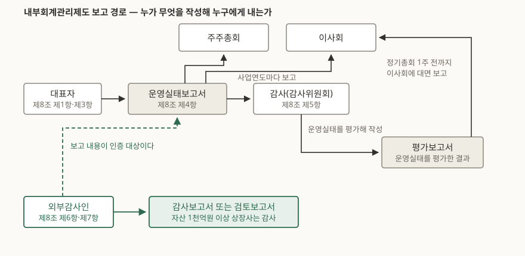

> 예제의 `가나전자`·`다라물산`을 비롯한 여섯 곳은 적용 요건이 어디서 갈리는지 보이려고 만든 가상 회사다. 실재하지 않는다. 판정 규칙만 실제 요건이다.

## 들어가며

관심 가는 회사의 감사보고서를 DART에서 처음 열면 맨 앞에 "독립된 감사인의 감사보고서"가 있고, 거기 적정의견이 적혀 있다. 확인할 건 다 봤다 싶어 창을 닫는다. 그런데 같은 파일을 끝까지 내려 보면 같은 회계법인이 쓴 보고서가 한 장 더 붙어 있다. 제목은 "내부회계관리제도 감사보고서"다.

처음에는 같은 말을 두 번 쓴 줄 알고 넘긴다. 둘 다 적정이면 넘겨도 당장 탈은 없다. 문제는 두 의견이 갈릴 때다. **재무제표는 적정인데 내부회계는 부적정**인 조합이 제도상 충분히 나올 수 있고, 그건 "올해 숫자는 맞지만 그 숫자를 맞게 만드는 장치가 고장 나 있다"는 뜻이다. 앞 장만 세고 뒷장을 버리면 다음 해에 무엇이 틀어질지 알려주는 문장을 버리는 셈이 된다.

## 개념

### 무엇을 운영하라는 제도인가

내부회계관리제도는 신뢰할 수 있는 회계정보를 만들고 공시하기 위해 **회사가 스스로 갖추고 돌리는 내부통제 장치**다. 재무제표라는 결과물이 아니라 그 결과물을 찍어내는 공정 쪽이다. 근거는 「주식회사 등의 외부감사에 관한 법률」(외부감사법) 제8조다.

운영 의무를 지는 회사는 주권상장법인(코넥스 포함)과 대형 비상장회사다. 대형 비상장회사의 기준선은 직전 사업연도말 별도재무제표 기준 자산총액 5천억원이고, 금융회사·사업보고서 제출대상·공시대상기업집단 소속회사는 1천억원으로 내려간다. 다만 유한회사, 유동화전문회사나 투자회사 같은 일부 법인, 그리고 **직전 사업연도말 종업원 수가 6명 미만인 회사**는 적용 예외다. 종업원 요건은 자산 요건보다 먼저 걸린다. 자산이 조 단위라도 6명 미만이면 운영 의무 자체가 생기지 않는다.

### 감사와 검토가 갈리는 선은 자산 1천억원이다

운영 의무가 있는 회사는 운영실태 보고 내용에 대해 감사인의 **감사 또는 검토**를 받는다. 어느 쪽인지는 제8조 제6항·제7항이 자산 규모로 가른다.

| 구분 | 감사 | 검토 |
|---|---|---|
| 상장 | 직전 사업연도말 별도 자산총액 1천억원 이상 | 1천억원 미만 |
| 비상장 | 감사 의무 없음 | 대형 비상장회사 |

감사와 검토는 깊이가 아니라 **절차의 종류**가 다르다. 금융위원회는 둘의 차이를 이렇게 설명한다. 검토는 경영진이 작성한 운영실태보고서를 두고 담당자에게 질문하는 방식이 중심이고, 감사는 감사인이 주요 내부통제를 직접 검증한다 — 통제를 다시 수행해 보거나 관련 문서를 검사하는 식이다. 질문에 돌아온 답을 확인하는 일과, 통제를 잡아 직접 돌려 보는 일은 들이는 품도 결론의 무게도 다르다.

### 제목의 "바뀐 뒤"는 어디까지 갔는가

감사 대상은 한 번에 정해진 것이 아니라 자산 규모가 큰 쪽부터 단계적으로 넓어졌다. 가장 작은 구간인 자산 1천억원 미만 상장사도 원래 2023년부터 감사를 받게 되어 있었는데, 외부감사법 개정으로 그 의무가 면제되어 지금은 검토에 남아 있다. 검토 자체가 없어진 것은 아니다.

반대 방향으로 미뤄진 것도 있다. 연결재무제표를 기준으로 하는 **연결 내부회계관리제도**는 자산 2조원 이상 상장 지배회사만 2022년 12월 31일 이후 개시 사업연도부터 운영하고 있고, 5천억원~2조원 구간은 2029년, 그 아래는 2030년으로 밀렸다. 그리고 자산 5천억원 미만 신규 상장사에 감사를 3년 유예하자는 법안은 2024년 9월에 발의됐지만 2025년 12월 23일 기준으로 아직 통과되지 않았다. 즉 **신규 상장사도 직전 사업연도말 자산이 1천억원 이상이면 감사 대상이다.**

## 구조



> **출처**: [주식회사 등의 외부감사에 관한 법률 제8조(내부회계관리제도의 운영 등), 법제처 국가법령정보센터](https://www.law.go.kr/%EB%B2%95%EB%A0%B9/%EC%A3%BC%EC%8B%9D%ED%9A%8C%EC%82%AC%EB%93%B1%EC%9D%98%EC%99%B8%EB%B6%80%EA%B0%90%EC%82%AC%EC%97%90%EA%B4%80%ED%95%9C%EB%B2%95%EB%A5%A0) · [내부회계관리제도 관련 FAQ(2025.12) 1·3·5·6번, 금융감독원](https://www.samili.com/acc/GamsaFaq.asp) (금융감독원이 발행한 자료의 제3자 전재)

이 그림에서 눈여겨볼 것은 문서가 **두 장**이라는 점이다. 대표자가 쓰는 운영실태보고서와, 감사(감사위원회)가 그것을 점검해 쓰는 평가보고서는 작성자도 성격도 다르다. 앞쪽은 "우리는 이렇게 돌렸다"는 경영진의 진술이고, 뒤쪽은 "그 진술이 맞는지 독립된 위치에서 봤다"는 평가다. 평가보고서는 정기총회 개최 1주 전까지 이사회에 **대면으로** 보고해야 한다.

순서도 고정돼 있다. 감사(감사위원회)의 이사회 보고일은 대표자가 감사(감사위원회)에 보고한 날보다 앞설 수 없다. 점검할 대상을 받기도 전에 점검 결과를 낼 수는 없기 때문이다. 외부감사인이 보는 것도 이 운영실태 보고 내용이다. 회사가 먼저 자기 통제를 평가해 문서로 내놓고, 감사인은 그 문서가 맞는지를 본다.

## 동작 원리

재무제표 감사와 내부회계 감사는 같은 감사인이 같은 시기에 하지만 세 가지가 다르다.

### 보는 대상이 다르다

재무제표 감사는 완성된 숫자가 회계기준에 맞게 표시됐는지를 본다. 내부회계 감사는 그 숫자가 나오기까지 작동한 통제가 유효했는지를 본다. 그래서 **감사인이 직접 실증절차를 돌려 금액의 정확성을 확인했다고 해서 통제 효과성 테스트를 대신할 수는 없다.** 결과가 맞았다는 사실이 과정이 맞았다는 증거는 아니기 때문이다. 결산 막판에 감사인이 짚어줘서 고친 오류는 숫자를 바로잡지만, 그 오류가 회사 통제에 걸리지 않았다는 사실은 그대로 남는다.

### 보는 시점이 다르다

재무제표 감사는 한 사업연도 **전체**를 대상으로 한다. 내부회계 감사는 평가기준일, 보통 사업연도 말 **그 시점**의 통제 상태를 대상으로 한다. 이 차이가 직관에 어긋나는 결과를 만든다.

- 기중에 통제가 망가져 있었어도, 기준일 전에 고치고 고친 통제가 충분히 운영됐다는 증거가 있으면 적정의견이 나올 수 있다.
- 반대로 한 해 내내 잘 돌던 통제라도 기준일에 취약점이 남아 있으면 부적정이다.

### 나올 수 있는 의견이 다르다

재무제표 감사의견은 적정·한정·부적정·의견거절 넷이다. 내부회계 감사에는 **중간 등급이 없다.** 감사기준서 1100 문단 73은 평가기준일 현재 중요한 취약점이 하나라도 — 개별로든 결합해서든 — 존재하면, 업무 범위에 제한이 없는 한 부적정의견을 표명하도록 정한다. 한국공인회계사회가 FAQ 보론에 싣는 감사보고서 사례도 적정·부적정·의견거절 셋뿐이다.

"하나라도"와 "결합해서"가 핵심이다. 같은 문단 A80은 미비점 하나하나는 중요하지 않아도 같은 거래유형·계정잔액·공시나 같은 경영진 주장에 걸리는 미비점들이 뭉치면 중요한 취약점이 될 수 있다고 적는다. 그래서 내부회계 부적정은 "큰 사고 하나"보다 "작은 구멍 여럿이 한 자리에 모인 것"으로 나오는 경우가 많다. 문단 A82는 고위 경영진이 저지른 부정을 중요한 취약점의 지표로 든다. 다만 지표에 해당한다고 해서 곧바로 중요한 취약점으로 확정되는 것은 아니다.

중요한 취약점이 있으면 운영실태보고서에도 그 내용이 들어간다. 취약점을 만든 미비점의 원인, 잠재적 영향을 판단할 정보, 관련 임직원 징계 내용, 그리고 시정조치 계획이다. 직전 사업연도에 보고한 취약점이 있으면 그 계획의 **이행 결과**까지 적어야 한다. 그래서 두 해 치 운영실태보고서를 나란히 놓으면 "고치겠다고 한 것을 고쳤는가"가 그대로 보인다.

## 실습 예제

적용 요건이 어디서 갈리는지는 말로 읽는 것보다 숫자를 넣어 보는 쪽이 빠르다. 가상 회사 여섯 곳의 직전 사업연도말 상태를 넣고 운영 의무·인증 종류·연결 내부회계 개시 시기를 판정했다.

```python
def assurance(company):
    """감사인이 감사를 하는가 검토를 하는가 — 외부감사법 제8조 제6항·제7항."""
    operating, _ = must_operate(company)
    if not operating:
        return "없음"
    if company.listed:
        return "감사" if company.assets >= BILLION_WON else "검토"
    return "검토"
```

전체 소스는 [`code/icfr_scope.py`](code/icfr_scope.py)에 있고, 돌린 기록은 [`code/output.txt`](code/output.txt)에 그대로 있다. 실행 결과는 다음과 같다.

```text
[ 가상 회사 여섯 곳의 직전 사업연도말 상태 ]
회사         상장            별도 자산      종업원 지배회사
--------------------------------------------------
가나전자       상장         32,000억원    4,100 예
다라물산       상장          8,400억원      620 예
마바소재       상장          2,300억원      310 아니오
사아정밀       상장            740억원       95 예
자차개발       비상장         6,100억원      240 예
카타홀딩스      상장         41,000억원        4 예

[ 판정 ]
회사         운영 의무      별도 인증    연결 내부회계 개시             근거
--------------------------------------------------------------------------------------
가나전자       있음         감사       2022-12-31 이후 개시       주권상장법인
다라물산       있음         감사       2029-01-01 이후 개시       주권상장법인
마바소재       있음         감사       해당 없음                  주권상장법인
사아정밀       있음         검토       2030-01-01 이후 개시       주권상장법인
자차개발       있음         검토       해당 없음                  대형 비상장회사 (기준선 5,000억원)
카타홀딩스      없음         없음       해당 없음                  종업원 6명 미만이라 적용 예외
```

세 자리가 눈에 띈다. **다라물산**은 별도 내부회계는 이미 감사를 받고 있지만 연결 내부회계는 2029년에야 시작한다. 같은 회사의 같은 제도가 범위에 따라 7년 차이로 들어온다. **사아정밀**은 상장사인데도 검토만 받는다. 자산이 1천억원에 못 미치기 때문이다. **카타홀딩스**는 자산이 4조원인데 아무 의무도 없다. 종업원이 6명 미만이어서다. 자산만 보고 "이 정도 회사면 당연히 감사 대상"이라고 넘겨짚으면 틀린다.

## 실무에서 주의할 점

**1. 두 의견을 따로 센다.** 재무제표 적정과 내부회계 적정은 다른 질문에 대한 답이다. 재무제표 쪽은 결산 과정에서 감사인이 지적한 것을 회사가 고치면 적정이 될 수 있지만, 고칠 일이 생겼다는 사실 자체가 내부회계 쪽에서는 미비점으로 남는다. **재무제표 적정 + 내부회계 부적정**은 모순이 아니라 제도가 설계대로 작동한 결과다.

**2. 기준선은 전부 "직전 사업연도말"의 "별도재무제표 기준"이다.** 올해 자산이 1천억원을 넘겼다고 올해 감사 대상이 되는 것이 아니고, 연결 자산이 아니라 별도 자산으로 센다. 기중에 분할·신설된 법인은 직전 사업연도말 자산총액이 아예 없어서 그 해에는 감사 의무가 없고, 다음 해에 기준을 넘으면 그때 들어온다.

**3. 종속회사는 지배회사 범위에 들어갔다고 해서 의무가 생기지 않는다.** 지배회사의 연결 내부회계관리제도 범위에 포함된 종속회사라도, 그 회사 자체의 운영 의무는 외부감사법 제8조 제1항으로 따로 판단한다. 자산 9백억원짜리 비상장 종속회사는 연결 범위에 들어가 있어도 자기 운영실태보고서를 낼 의무는 없다.

**4. 평가·보고 기준이 자율규정에서 법규로 넘어왔다.** 상장회사협의회의 자율규정으로 운영되던 평가·보고 지침이 외부감사규정의 「내부회계관리제도 평가 및 보고 기준」으로 규정화되어, 2024년 선택적용을 거쳐 2025년부터 모든 법인에 의무적용된다. 지키지 않으면 자율규정 미준수가 아니라 외부감사 관련 법규 위반이 된다.

**5. 운영실태보고서에 자금 부정 관련 통제 활동이 들어간다.** 횡령 등 자금 관련 부정위험에 대응해 회사가 수행한 내부통제 활동을 운영실태보고서에 적어야 한다. 금융회사를 제외한 검토 대상 회사는 2025년 1월 1일 이후 최초로 시작되는 사업연도 종료일까지 이 항목을 생략할 수 있었으므로, 검토 대상 회사의 보고서는 사업연도에 따라 이 절이 있을 수도 없을 수도 있다.

## 정리

- 내부회계관리제도는 재무제표가 아니라 재무제표를 만드는 통제를 대상으로 한다. 감사보고서 뒤에 붙는 한 장은 앞 장과 다른 질문에 답한다.
- 운영 의무는 상장사와 대형 비상장회사에 있고, 인증 종류는 **상장 + 별도 자산 1천억원**에서 감사와 검토로 갈린다. 종업원 6명 미만은 자산과 무관하게 예외다.
- 재무제표 감사는 사업연도 전체를, 내부회계 감사는 평가기준일 그 시점을 본다. 기중에 고쳤으면 적정이 나올 수 있고, 기준일에 남아 있으면 부적정이다.
- 중요한 취약점이 하나라도 있으면 범위 제한이 없는 한 부적정이다. 중간 등급이 없어서, 부적정은 보통 작은 미비점들이 한 자리에 뭉친 결과로 나온다.
- 연결 내부회계는 자산 2조원 이상만 들어와 있고 나머지는 2029·2030년이다. 같은 회사라도 별도와 연결의 적용 시점이 다르다.

## 참고 자료

- [주식회사 등의 외부감사에 관한 법률 제8조(내부회계관리제도의 운영 등), 법제처 국가법령정보센터](https://www.law.go.kr/%EB%B2%95%EB%A0%B9/%EC%A3%BC%EC%8B%9D%ED%9A%8C%EC%82%AC%EB%93%B1%EC%9D%98%EC%99%B8%EB%B6%80%EA%B0%90%EC%82%AC%EC%97%90%EA%B4%80%ED%95%9C%EB%B2%95%EB%A5%A0)
- [내부회계관리제도 관련 FAQ(2025.12), 금융감독원 회계감독국 금융회계팀](https://www.samili.com/acc/GamsaFaq.asp) — 운영 의무 대상, 감사·검토 대상, 보고 주체, 연결 적용시기, 평가·보고 기준 이관, 중요한 취약점 기재사항 (금융감독원이 발행한 자료의 제3자 전재)
- [소규모 상장회사에 대해서는 내부회계관리제도 외부감사가 면제됩니다(보도참고), 금융위원회](https://www.fsc.go.kr/no010101/79041) — 감사와 검토의 절차 차이, 자산 1천억원 미만 상장사 감사 면제
- [회계제도 보완을 통해 기업의 외부감사 부담을 합리화하겠습니다(보도자료), 금융위원회](https://www.fsc.go.kr/no010101/81242) — 연결 내부회계관리제도 도입 시기 연기
- [감사기준서 1100 「내부회계관리제도의 감사」 문단 73·A80·A82, 한국공인회계사회](https://www.kifrs.com/s/1100/d336ff) — 부적정의견 요건, 미비점의 결합, 중요한 취약점의 지표 (한국공인회계사회가 발행한 기준의 제3자 전재)
- [찾기쉬운 생활법령정보 — 상장법인의 공시사항, 법제처](https://easylaw.go.kr/CSP/CnpClsMain.laf?popMenu=ov&csmSeq=1701&ccfNo=1&cciNo=3&cnpClsNo=1) — 감사보고서가 사업보고서에 붙는 경로
