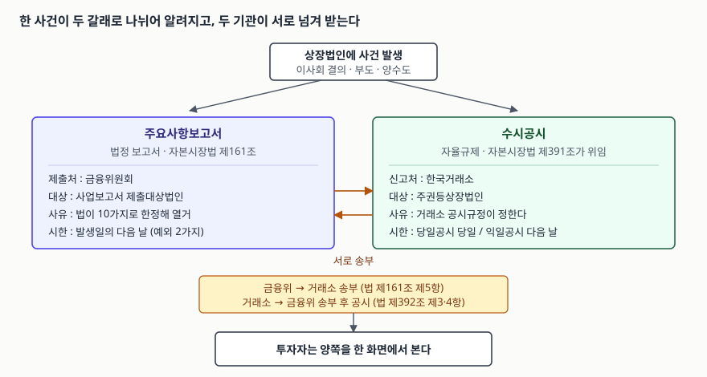

> 예제의 `가나전자`와 거래 네 건은 판정 절차를 보이려고 만든 값이다. 실재하는
> 회사와 관계가 없다.

## 들어가며

전자공시 사이트에서 한 회사를 치면 공시 목록이 날짜순으로 뜬다. 거기에는
`주요사항보고서(유상증자결정)`처럼 괄호가 붙은 긴 제목이 있고, 바로 아래에
`신주발행(유상증자)결정`처럼 짧은 제목이 있다. 며칠 간격으로 비슷한 내용이
두 번 올라온 것처럼 보여서, 처음 보는 사람은 "정정했나" 하고 둘을 비교하기
시작한다.

둘은 정정 관계가 아니다. 같은 사건이 **서로 다른 제도를 타고 두 번 알려진
것**이다. 하나는 법이 금융위원회에 내라고 정한 보고서이고, 다른 하나는 거래소가
공시규정으로 신고하라고 정한 공시다. 제출처가 다르고, 사유를 정하는 주체가
다르고, 시한이 다르다. 이걸 구분하지 않으면 "왜 이 회사는 이 사건을 공시 안
했지" 같은 질문에서 번번이 엉뚱한 곳을 찾게 된다.

## 개념 — 법정 보고서와 자율규제

**주요사항보고서**는 자본시장과 금융투자업에 관한 법률 제161조가 정한다.
사업보고서 제출대상법인에게 특정한 사실이 생기면 그 내용을 적은 보고서를
**금융위원회에** 내라고 한다. 사유는 법이 열 가지로 **열거**한다. 부도,
영업활동 정지, 회생절차개시 신청, 해산사유 발생, 자본·부채 변동, 상법상
주식교환·합병 등, 중요한 영업·자산 양수도 결의, 자기주식 취득·처분 결의,
전환사채 등의 발행 결정, 그리고 대통령령으로 정하는 그 밖의 사실이다.

**수시공시**는 성격이 다르다. 같은 법 제391조는 거래소에게 상장법인의 기업내용
신고·공시와 관리를 위한 **공시규정을 정하라**고 맡긴다. 무엇을 신고할지, 어떤
방법과 절차를 따를지, 어기면 어떻게 할지를 전부 그 규정에 담으라고 한다.
한국거래소는 수시공시를 "증권시장의 정보 형평을 위해 거래소 등 자율규제기관이
담당하는 대표적인 자율규제 기능"으로 설명한다.

여기서 구조가 갈린다.

| | 주요사항보고서 | 수시공시 |
|---|---|---|
| 근거 | 자본시장법 제161조 | 자본시장법 제391조가 위임한 거래소 공시규정 |
| 제출·신고처 | 금융위원회 | 한국거래소 |
| 성격 | 법정 보고서 | 자율규제기관의 신고·공시 |
| 사유를 정하는 주체 | 법률과 시행령이 열거 | 거래소가 공시규정으로 정한다 |
| 대상 | 사업보고서 제출대상법인 | 주권등상장법인 |

**열거냐 위임이냐**가 이 표의 핵심이다. 주요사항보고서는 법에 적힌 열 가지에
해당해야만 제출 대상이 되고, 해당 여부는 시행령이 숫자로 정한다. 수시공시는
거래소가 시장 사정에 맞춰 대상을 넓히고 좁힐 수 있다. 그래서 "새로 생긴 유형의
사건"은 보통 수시공시 쪽이 먼저 받아낸다.

## 구조 — 갈라져 나갔다가 다시 합쳐진다



> **출처**: [자본시장과 금융투자업에 관한 법률 제161조(주요사항보고서의 제출)](https://www.law.go.kr/법령/자본시장과금융투자업에관한법률/제161조), [제391조(공시규정)·제392조(공시의 실효성 확보)](https://www.law.go.kr/법령/자본시장과금융투자업에관한법률/제391조), [한국거래소 규정포털 — 유가증권시장 주요경영사항의 신고·공시](https://regulation.krx.co.kr/contents/RGL/02/02010202/RGL02010202T1.jsp)

두 경로가 끝까지 평행선인 것은 아니다. 법이 양쪽을 다시 이어 붙인다.

- 금융위원회는 주요사항보고서가 제출되면 **이를 거래소에 지체 없이 송부**해야
  한다(제161조 제5항).
- 거래소는 상장법인이 공시규정에 따라 신고를 하면 **이를 지체 없이 금융위원회에
  송부**해야 하고, 금융위원회는 송부받은 것을 인터넷 홈페이지 등으로 **공시**해야
  한다(제392조 제3항·제4항).

그래서 투자자 입장에서는 결국 한 화면에서 둘을 같이 보게 된다. 겉보기에 중복처럼
보이는 이유이기도 하다. 다만 어느 경로로 들어온 것인지에 따라 **그 내용의 범위와
시한이 다르므로**, 제목 앞에 `주요사항보고서`가 붙었는지를 보는 것은 의미가 있다.

## 동작 원리 — 시한이 사유마다 다른 이유

주요사항보고서의 기본 시한은 **사실이 발생한 날의 다음 날**이다. 여기에 예외가
둘 붙는다.

- **제6호** — 상법이 정한 주식교환·주식이전·합병·분할에 관한 사실은 **발생한
  날부터 3일**까지다. 절차가 여러 단계로 엮여 있어 하루 안에 내용을 확정하기
  어렵다는 점이 반영된 것으로 읽힌다.
- **제9호** — 전환사채·교환사채·신주인수권부사채의 발행 결정은 **다음 날과
  납입기일의 1주 전 중 먼저 도래하는 날**까지다. 뒤쪽 조건이 붙어 있는 것이
  중요하다. 결정일과 납입일 사이가 길어도, 돈이 실제로 들어오기 **최소 1주 전**에는
  시장이 알아야 한다는 뜻이다.

수시공시의 시한은 다른 축으로 나뉜다. 거래소는 주요경영사항을 **당일공시사항**과
**익일공시사항**으로 나누고, 앞엣것은 사유 발생 당일까지, 뒤엣것은 다음 날까지
신고하게 한다. 사유마다 예외를 붙이는 대신 항목을 두 묶음으로 미리 갈라 둔 것이다.

수시공시 안에는 성격이 다른 가지가 더 있다.

| 종류 | 누가 시작하는가 | 시한 |
|---|---|---|
| 주요경영사항 신고 | 상장법인 | 당일공시는 당일, 익일공시는 다음 날 |
| 자율공시 | 상장법인이 자율적으로 판단 | 사유 발생 다음 날 |
| 조회공시(풍문 등) | 거래소가 요구 | 오전 요구는 당일 오후, 오후 요구는 다음 날 오전 |
| 조회공시(시황 변동) | 거래소가 요구 | 요구받은 다음 날 |

조회공시만 방향이 반대라는 점을 눈여겨볼 만하다. 나머지는 회사가 먼저 알리는
구조인데, 조회공시는 거래소가 풍문이나 가격·거래량의 뚜렷한 변동을 보고 **회사에
물어서** 답을 끌어낸다. 회사가 침묵하는 동안 시장이 먼저 움직이는 상황을 메우는
장치다.

## 실습 예제 — 이 거래가 제출사유인가

주요사항보고서에서 실무가 가장 자주 걸리는 지점은 "중요한 영업 또는 자산"의
판정이다. 시행령 제171조 제2항이 네 가지 기준을 두고, **하나만 걸려도** 제출사유가
된다. 가상 회사 `가나전자`의 거래 네 건을 그 기준에 걸어 본다. 전체 소스:
[`code/materiality_test.py`](code/materiality_test.py) · 실행 기록:
[`code/output.txt`](code/output.txt)

```python
def asset_value(deal):
    """시행령이 말하는 자산액 — 장부가액과 거래금액 중 큰 금액."""
    return max(deal["book"], deal["deal"])


def judge(deal):
    """해당하는 호를 전부 모은다. 하나만 걸려도 제출사유가 된다."""
    hits = []
    value = asset_value(deal)
    if deal["kind"] == "영업":
        if value >= TOTAL_ASSETS * THRESHOLD:
            hits.append("1호(영업 자산액)")
        if deal["revenue"] >= TOTAL_REVENUE * THRESHOLD:
            hits.append("2호(영업 매출액)")
        if deal["liability"] >= TOTAL_LIABILITIES * THRESHOLD:
            hits.append("3호(인수 부채액)")
    else:
        if deal["routine"]:
            return []          # 5호 단서. 일상적인 상품·원재료 매매는 제외한다
        if value >= TOTAL_ASSETS * THRESHOLD:
            hits.append("5호(자산 자산액)")
    return hits
```

회사 규모와 10% 기준선은 이렇다.

```text
[가나전자 — 최근 사업연도말 연결재무제표 (단위: 억 원)]
  자산총액         8,400    10% 기준     840.0
  매출액          12,000    10% 기준   1,200.0
  부채총액         3,600    10% 기준     360.0
```

네 건의 판정 결과다.

```text
[거래별 판정 — 시행령 제171조제2항]
                거래  장부가액  거래금액    자산액  자산비율  해당 호
  -------------------------------------------------------------------------------------------------
  A사업부 양도             720       910       910    10.83%  1호(영업 자산액), 2호(영업 매출액)
  B사업부 양수             760       760       760     9.05%  3호(인수 부채액)
  보유 토지 매각           610       830       830     9.88%  없음
  원재료 대량 매입       1,100     1,100     1,100    13.10%  없음
```

네 줄이 각각 다른 이야기를 한다.

**A사업부 양도**는 장부가액 720억으로 재면 8.57%라 기준에 못 미친다. 그런데 조문이
말하는 자산액은 **장부가액과 거래금액 중 큰 금액**이므로 910억을 쓰고, 10.83%가
되어 걸린다. 싸게 들고 있던 자산을 비싸게 파는 경우 이 한 줄에서 결론이 뒤집힌다.

**B사업부 양수**는 자산 기준도 매출 기준도 넘지 못한다.

```text
  B사업부 양수 (영업)
    자산액 / 자산총액             760 /   8,400 =   9.05%  기준 미만
    영업부문 매출액 / 매출액      900 /  12,000 =   7.50%  기준 미만
    인수 부채액 / 부채총액        420 /   3,600 =  11.67%  기준 이상
    => 주요사항보고서 제출사유
```

걸린 것은 세 번째, 영업 양수로 **인수할 부채액**이다. 부채총액이 자산총액보다
작으므로 같은 금액이라도 부채 쪽 분모가 작고, 그래서 자산·매출로는 안 걸리는
거래가 부채 하나로 걸린다. 규모가 작아 보이는 양수 건을 넘기다 이 기준에서
놓치는 일이 생긴다.

**보유 토지 매각**은 9.88%로 기준 바로 아래다. 거래금액이 840억을 넘기면
그대로 제출사유가 되므로, 매각가 협상이 10억 움직이는 것으로 공시 의무가
생겼다 없어졌다 한다.

**원재료 대량 매입**은 13.10%로 기준을 넘었는데도 제출사유가 아니다. 제5호 단서가
"일상적인 영업활동으로서 상품·제품·원재료를 매매하는 행위 등"을 금융위원회 고시로
제외하기 때문이다. 비율만 계산하고 단서를 안 읽으면 여기서 틀린다.

## 실무에서 주의할 점

**첫째, 연결인지 별도인지 먼저 확인한다.** 시행령은 한국채택국제회계기준을
적용하는 연결재무제표 작성대상법인이면 **연결 기준의 자산총액·매출액·부채총액**을
쓰라고 적는다. 별도 기준으로 재면 분모가 작아져 같은 거래가 기준을 넘기도 한다.
위 예제도 연결 기준을 가정한 것이다.

**둘째, 비율 계산보다 단서가 먼저다.** 제5호 단서처럼 조문 본문이 아니라 괄호와
단서에 제외 사유가 들어 있는 경우가 많고, 그 제외 범위는 금융위원회 고시로 다시
정해진다. 위 예제는 조문에 적힌 네 기준만 옮긴 것이고, 실제 적용에서는 고시가
더해진다.

**셋째, 수시공시에 없다고 주요사항보고서에도 없는 것이 아니다.** 두 제도는 사유
목록이 따로 있다. 거래소 공시규정에 항목이 없어도 법 제161조의 열 가지 중 하나에
해당하면 보고서는 내야 하고, 반대로 법에 없어도 거래소가 정한 항목이면 신고해야
한다. "한쪽에서 안 보인다"를 근거로 다른 쪽을 건너뛰면 안 된다.

**넷째, 제9호의 뒤쪽 조건을 잊지 않는다.** 전환사채 등의 발행 결정은 다음 날과
납입기일 1주 전 중 **먼저 오는 날**이 시한이다. 결정 직후에 납입일을 가깝게 잡으면
"다음 날"보다 "1주 전"이 먼저 와 버리는 구간이 생긴다. 일정부터 거꾸로 확인하는
편이 안전하다.

## 정리

- 주요사항보고서는 자본시장법 제161조가 정한 **법정 보고서**로 금융위원회에 내고,
  수시공시는 같은 법 제391조가 거래소에 위임한 **자율규제**로 거래소에 신고한다.
- 사유를 정하는 방식이 다르다. 앞은 법이 열 가지로 열거하고, 뒤는 거래소가
  공시규정으로 정한다. 그래서 둘의 대상 목록은 겹치되 일치하지 않는다.
- 두 경로는 끝에서 다시 합쳐진다. 금융위는 받은 보고서를 거래소에, 거래소는 받은
  신고를 금융위에 지체 없이 송부한다(제161조 제5항, 제392조 제3·4항).
- 시한의 축도 다르다. 주요사항보고서는 기본이 다음 날이고 두 가지 예외가 붙고,
  수시공시는 항목을 당일공시와 익일공시로 미리 갈라 둔다.
- 중요한 영업·자산 양수도는 시행령 제171조 제2항의 네 기준 중 **하나만 걸려도**
  제출사유다. 자산액은 장부가액과 거래금액 중 큰 값을 쓰고, 일상적인 상품·원재료
  매매는 제외된다.

## 참고 자료

- [자본시장과 금융투자업에 관한 법률 제161조(주요사항보고서의 제출)](https://www.law.go.kr/법령/자본시장과금융투자업에관한법률/제161조) — 2025-01-21 개정. 제출사유 10가지와 시한
- [자본시장과 금융투자업에 관한 법률 시행령 제171조(주요사항보고서의 제출사유 등)](https://www.law.go.kr/법령/자본시장과금융투자업에관한법률시행령/제171조) — 2025-04-22 개정. 자본·부채 변동과 중요한 양수도의 10% 기준
- [자본시장과 금융투자업에 관한 법률 제391조(공시규정)](https://www.law.go.kr/법령/자본시장과금융투자업에관한법률/제391조) — 거래소 공시규정의 위임 근거와 포함사항 9가지
- [자본시장과 금융투자업에 관한 법률 제392조(공시의 실효성 확보)](https://www.law.go.kr/법령/자본시장과금융투자업에관한법률/제392조) — 거래소와 금융위원회의 상호 송부
- [한국거래소 규정포털 — 유가증권시장 주요경영사항의 신고·공시](https://regulation.krx.co.kr/contents/RGL/02/02010202/RGL02010202T1.jsp) — 수시공시의 성격과 당일·익일공시 구분
- [한국거래소 규정포털 — 유가증권시장 조회공시](https://regulation.krx.co.kr/contents/RGL/02/02010202/RGL02010202T2.jsp) — 요구 사유와 답변 시한
- [한국거래소 규정포털 — 유가증권시장 자율공시](https://regulation.krx.co.kr/contents/RGL/02/02010202/RGL02010202T3.jsp) — 대상과 신고 시한
