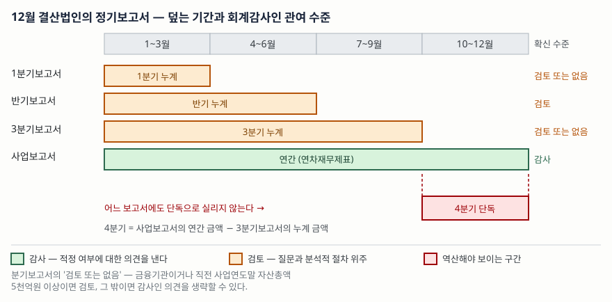

> 예제의 `가나전자`·`다라물산`은 확신 수준과 분기 역산을 보이려고 만든 가상 회사다. 실재하지 않는다.

## 들어가며

실적 시즌에 증권사 앱을 열면 같은 회사의 영업이익이 서로 다른 숫자로 세 번 지나간다. 1월 말에 "영업(잠정)실적"으로 한 번, 3월 말에 사업보고서로 한 번, 그리고 다음 해 어느 공시의 비교 표에서 또 한 번. 처음에는 셋 중 어느 것이 맞는지 몰라 가장 최근 것을 믿고 넘어간다. 그러다 작년 4분기 영업이익을 직접 세어 보려고 DART를 뒤지면 이상한 일이 생긴다. 1분기·반기·3분기 보고서는 다 있는데 **4분기 보고서가 없다.** 그리고 사업보고서에 실린 연간 금액은 아까 본 잠정실적과 다르다.

이 두 가지는 우연이 아니라 제도의 생김새다. 정기보고서는 종류마다 회계감사인이 관여하는 정도가 다르고, 중간보고서는 분기별이 아니라 누계로 적힌다. 이걸 모르면 같은 회사의 숫자를 서로 다른 신뢰도로 섞어 쓰게 된다.

## 개념

### 정기보고서는 셋이고, 확신 수준은 셋 다 다르다

정기공시는 사업보고서·반기보고서·분기보고서 셋이다. 제출 시한은 자본시장법에 있다. 사업보고서는 사업연도 경과 후 90일 이내(제159조 제1항), 반기보고서와 분기보고서는 각 기간 경과 후 45일 이내(제160조)다. 여기까지는 널리 알려져 있다.

덜 알려진 쪽은 **회계감사인이 어디까지 보는가**다. 이건 법이 아니라 시행령이 정한다. 자본시장법 시행령 제170조 제1항은 두 가지를 적는다.

| 보고서 | 시행령 제170조 제1항이 정하는 것 | 결과 |
|---|---|---|
| 반기보고서 | 회계감사인의 **확인 및 의견표시**로 갈음할 수 있다(제1호) | 검토보고서가 붙는다 |
| 분기보고서 | 회계감사인의 **감사의견을 생략**할 수 있다(제2호) | 아무것도 안 붙을 수 있다 |

제2호에는 단서가 있다. 금융기관이거나, 직전 사업연도말 현재 자산총액이 5천억원 이상인 주권상장법인이면 분기보고서도 제1호를 따른다. 즉 **같은 분기보고서라도 회사 규모에 따라 검토를 거친 것과 아무도 안 본 것이 섞여 있다.**

K-IFRS를 적용하는 연결재무제표 작성대상법인은 별도재무제표와 연결재무제표 **각각에** 대해 확인과 의견표시를 받는다. 연결만 검토받고 별도는 안 받는 식이 아니다.

### 검토는 감사의 축소판이 아니다

"검토"라는 말은 감사를 조금 덜 한 것처럼 들리지만 절차의 종류 자체가 다르다. 국제검토기준 ISRE 2410이 이 차이를 또렷하게 적는다.

- 검토의 목적은, 중간재무정보가 해당 재무보고체계에 따라 작성되지 **않았다고 믿게 하는 사항이 발견되었는지**에 대한 결론을 내는 것이다(제7항). 적정하게 표시되었는지에 대한 의견을 낼 근거는 주지 않는다(제8항).
- 검토는 합리적 확신을 얻도록 설계되어 있지 않다. 주로 재무·회계 담당자에 대한 **질문**과 **분석적 절차**로 이루어진다(제9항·제19항).
- 검토는 보통 열람·관찰·조회를 통한 회계기록 테스트를 요구하지 않는다(제20항). 감사에서라면 요구될 증거를 전부 모으지는 않는다.

정리하면 감사는 "이 재무제표가 적정한가"에 답하고, 검토는 "틀렸다고 볼 만한 게 눈에 띄었는가"에 답한다. 질문의 방향이 반대다. 그래서 검토를 거친 숫자는 **아직 확정이 아니고**, 분기보고서의 숫자는 그 검토조차 없을 수 있다.

## 구조



> **출처**: [자본시장법 제159조·제160조](https://korea.legal/wiki/%ec%9e%90%eb%b3%b8%ec%8b%9c%ec%9e%a5%ea%b3%bc-%ea%b8%88%ec%9c%b5%ed%88%ac%ec%9e%90%ec%97%85%ec%97%90-%ea%b4%80%ed%95%9c-%eb%b2%95%eb%a5%a0-%ec%a0%9c160%ec%a1%b0/) · [같은 법 시행령 제170조 제1항](https://korea.legal/wiki/%ec%9e%90%eb%b3%b8%ec%8b%9c%ec%9e%a5%ea%b3%bc-%ea%b8%88%ec%9c%b5%ed%88%ac%ec%9e%90%ec%97%85%ec%97%90-%ea%b4%80%ed%95%9c-%eb%b2%95%eb%a5%a0-%ec%8b%9c%ed%96%89%eb%a0%b9-%ec%a0%9c170/) (법제처 국가법령정보센터가 발행한 법령의 제3자 전재) · [IAS 34 Interim Financial Reporting, IFRS Foundation](https://www.ifrs.org/issued-standards/list-of-standards/ias-34-interim-financial-reporting/)

## 동작 원리

### 중간보고서는 분기가 아니라 누계로 적힌다

중간재무보고를 다루는 기준은 K-IFRS 제1034호이고, 그 원문인 IAS 34는 자산과 부채를 **연초 이후 누계(year-to-date) 기준**으로 인식·측정하도록 한다. 그래서 반기보고서에 실리는 영업이익은 2분기 금액이 아니라 1~2분기를 합한 금액이고, 3분기보고서의 누계는 1~3분기 합계다.

여기서 4분기가 사라진다. 사업보고서에 실리는 것은 연차재무제표, 곧 **연간 전체**다. 3분기보고서는 1~3분기 누계까지만 보여 준다. 둘 다 4분기만 따로 적지 않으므로, 4분기 단독 금액은 뺄셈으로만 나온다.

```text
4분기 = 사업보고서의 연간 금액 − 3분기보고서의 누계 금액
```

### 그래서 수정은 전부 4분기로 몰린다

이 뺄셈에는 부작용이 있다. 1~3분기 누계는 이미 공시된 숫자라 바꾸려면 정정공시를 내야 한다. 반면 연간 금액은 감사를 거치며 바뀔 여지가 남아 있다. 연간이 바뀌고 누계가 그대로면, **차이는 전부 4분기 쪽으로 들어간다.** 연간으로 보면 몇 퍼센트 움직인 일이 4분기 단독으로 보면 훨씬 크게 움직인 것처럼 보이는 이유다.

중간보고서가 연차재무제표보다 더 많은 추정에 기대는 것도 같은 방향으로 작용한다. IAS 34는 둘 다 추정에 기반하지만 중간재무보고가 일반적으로 더 많은 추정 방법을 쓴다고 적는다. 재고자산 평가, 손상, 충당부채처럼 연말에 한 번 제대로 따지는 항목이 중간기간에는 약식으로 잡혀 있다가 감사 때 정리된다.

## 실습 예제

가상 회사 두 곳을 둔다. 연간 영업이익은 500억원으로 같지만, `가나전자`는 자산총액 8,200억원이고 `다라물산`은 2,400억원이다. 전체 코드는 [`code/periodic_reports.py`](code/periodic_reports.py)에 있다.

```python
# 보고서에 실리는 것은 분기별 금액이 아니라 '연초 이후 누계'다. 단위: 억원
CUMULATIVE = {
    "가나전자": {"1분기": 120, "반기": 260, "3분기": 350, "연간": 500},
    "다라물산": {"1분기": 180, "반기": 300, "3분기": 410, "연간": 500},
}


def quarterly_from_cumulative(cum):
    """누계 금액에서 분기 단독 금액을 뽑는다. 4분기는 연간에서 3분기 누계를 뺀 값뿐이다."""
    return {
        "1Q": cum["1분기"],
        "2Q": cum["반기"] - cum["1분기"],
        "3Q": cum["3분기"] - cum["반기"],
        "4Q": cum["연간"] - cum["3분기"],
    }
```

돌린 결과는 [`code/output.txt`](code/output.txt)에 그대로 있다.

```text
[계산 1] 누계에서 뽑아낸 분기 단독 영업이익 (단위: 억원)
회사           1Q     2Q     3Q     4Q      합계
가나전자        120    140     90    150     500
다라물산        180    120    110     90     500
```

연간 500억원은 같은데 흐름은 반대다. 가나전자는 하반기로 갈수록 올라가고 다라물산은 내려간다. 연간 숫자만 보면 둘이 같은 회사처럼 보이지만, 누계를 분해하면 전혀 다른 그림이 나온다.

확신 수준은 자산총액에서 갈린다.

```text
[계산 2] 보고서별 회계감사인 관여 수준
회사             1분기        반기       3분기        사업
가나전자            검토        검토        검토        감사
다라물산         관여 없음        검토     관여 없음        감사

  판정 기준: 금융기관이거나 직전 사업연도말 자산총액 5,000억원 이상
  이면 분기보고서도 반기와 같은 기준을 따른다.
```

다라물산의 1분기·3분기 숫자는 회계감사인이 보지 않은 숫자다. 틀렸다는 뜻이 아니라, **다른 사람이 확인한 적 없는 숫자**라는 뜻이다.

마지막으로 연간 금액이 감사 과정에서 바뀌면 어떻게 되는지 본다.

```text
[계산 3] 가나전자 — 잠정 연간 영업이익이 감사 후 바뀌면 (단위: 억원)
구분               1Q     2Q     3Q     4Q      연간
잠정실적            120    140     90    150     500
사업보고서           120    140     90    122     472
차이                0      0      0    -28     -28

  연간이 28억원 줄었는데 1~3분기 누계는 그대로이므로
  차이 28억원이 전부 4Q 에 들어간다.
  연간은 -5.6% 바뀌었지만 4Q 단독은 150억원 → 122억원 (-18.7%) 로 움직인다.
```

연간으로는 5.6% 조정인데 4분기 단독으로는 18.7%다. "4분기에 실적이 꺾였다"는 말이 실제로는 "연말 결산에서 1년치 조정이 4분기에 반영됐다"인 경우가 생기는 지점이 여기다.

## 실무에서 주의할 점

**분기보고서에 검토보고서가 붙었는지를 직접 확인한다.** 자산총액 5천억원 미만의 비금융 상장법인은 분기보고서에 감사인 의견을 생략할 수 있다. DART에서 분기보고서를 열면 재무제표 앞에 검토보고서가 있는지 없는지가 바로 보인다. 없으면 그 숫자는 회사가 혼자 만든 것이다.

**4분기 수치는 직접 계산한 값이라고 적어 둔다.** 연간에서 3분기 누계를 뺀 값은 어느 공시에도 그대로 실려 있지 않다. 남이 정리한 "4분기 영업이익" 표를 볼 때는 연결 기준과 별도 기준이 섞이지 않았는지, 중단영업이 끼어들지 않았는지를 같이 본다. 기준이 다른 두 숫자를 빼면 결과는 아무 뜻도 없다.

**전기 수치가 재작성됐는지 본다.** 회계정책을 바꾸거나 오류를 수정하면 비교 표시되는 전기 금액이 다시 쓰인다. 작년에 받아 적어 둔 3분기 누계와 올해 보고서에 비교로 실린 작년 3분기 누계가 다르면, 그 둘로 뺄셈을 하면 안 된다. 같은 보고서 안에 나란히 실린 숫자끼리만 뺀다.

**잠정실적과 사업보고서를 같은 무게로 쓰지 않는다.** 영업(잠정)실적은 감사 전 숫자이고, 기업설명회 자료에도 대개 그 사실이 적혀 있다. 같은 회사의 연간 영업이익을 두 자리에서 가져와 한 표에 넣으면 어느 쪽이 확정인지 알 수 없게 된다.

**반기 검토의견에도 변형이 붙는다.** 검토 결과 수정이 필요한 사항이 발견되면 결론이 변형된다. 적정의견만 익숙해서 검토보고서를 안 열어 보는 경우가 많은데, 변형된 검토 결론은 그해 감사의견을 미리 보여 주는 신호가 되는 일이 있다.

## 정리

- 정기보고서는 셋이고 확신 수준은 **감사(사업) > 검토(반기) > 생략 가능(분기)** 순이다. 근거는 자본시장법 시행령 제170조 제1항이다.
- 분기보고서의 검토 여부는 회사마다 다르다. 금융기관이거나 직전 사업연도말 자산총액 5천억원 이상이면 분기도 검토를 받는다.
- 검토는 감사의 축소판이 아니다. 질문과 분석적 절차 위주이고, 적정 여부에 대한 의견을 낼 근거는 주지 않는다(ISRE 2410 제8항·제20항).
- 중간보고서는 연초 이후 누계로 적히므로 4분기 단독 금액은 **연간 − 3분기 누계**로만 나온다.
- 연간이 감사 과정에서 바뀌면 그 차이가 전부 4분기로 몰린다. 4분기 수치의 변동 폭을 그대로 실적 해석으로 쓰면 안 되는 이유다.

## 참고 자료

- [자본시장과 금융투자업에 관한 법률 제159조 — 사업보고서 등의 제출](https://korea.legal/wiki/%ec%9e%90%eb%b3%b8%ec%8b%9c%ec%9e%a5%ea%b3%bc-%ea%b8%88%ec%9c%b5%ed%88%ac%ec%9e%90%ec%97%85%ec%97%90-%ea%b4%80%ed%95%9c-%eb%b2%95%eb%a5%a0-%ec%a0%9c159%ec%a1%b0/) (법제처 국가법령정보센터 발행, 제3자 전재)
- [자본시장과 금융투자업에 관한 법률 제160조 — 반기·분기보고서의 제출](https://korea.legal/wiki/%ec%9e%90%eb%b3%b8%ec%8b%9c%ec%9e%a5%ea%b3%bc-%ea%b8%88%ec%9c%b5%ed%88%ac%ec%9e%90%ec%97%85%ec%97%90-%ea%b4%80%ed%95%9c-%eb%b2%95%eb%a5%a0-%ec%a0%9c160%ec%a1%b0/) (제3자 전재)
- [같은 법 시행령 제170조 — 반기보고서·분기보고서의 기재사항 및 첨부서류](https://korea.legal/wiki/%ec%9e%90%eb%b3%b8%ec%8b%9c%ec%9e%a5%ea%b3%bc-%ea%b8%88%ec%9c%b5%ed%88%ac%ec%9e%90%ec%97%85%ec%97%90-%ea%b4%80%ed%95%9c-%eb%b2%95%eb%a5%a0-%ec%8b%9c%ed%96%89%eb%a0%b9-%ec%a0%9c170/) (제3자 전재. 조문에 표시된 최종 개정일은 2025-12-30이고, 시행일은 이 페이지에 없다)
- [IAS 34 Interim Financial Reporting — IFRS Foundation](https://www.ifrs.org/issued-standards/list-of-standards/ias-34-interim-financial-reporting/). 국내 기준서 제1034호 '중간재무보고'는 [한국회계기준원](https://www.kasb.or.kr/front/board/ingAccountingList.do)이 발행한다
- [ISRE 2410 Review of Interim Financial Information Performed by the Independent Auditor of the Entity — 2012 IAASB Handbook (IFAC)](https://www.ifac.org/system/files/publications/files/B004%202012%20IAASB%20Handbook%20ISRE%202410.pdf). IAASB가 2026년 5월 개정 공개초안을 냈으므로 이후 문단 번호가 달라질 수 있다
- 같은 저장소의 [공시 체계 — 정기·수시·공정공시, 그리고 시한을 세는 두 달력](../2026-10-07-disclosure-deadlines/index.md)에서 제출 시한을 날짜 단위로 계산한다
