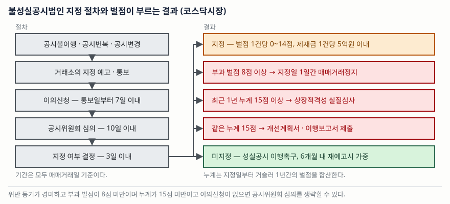

> 예제의 `마바건설`·`사아테크`는 벌점 계산을 보이려고 만든 가상 회사다. 실재하지 않는다. 조문 번호는 코스닥시장 기준이고, 유가증권시장 공시규정은 번호 체계가 다르다.

## 들어가며

같은 "불성실공시법인 지정" 공시를 두 번 봤는데 한 번은 다음 날 주식이 하루 종일 거래되지 않았고, 한 번은 아무 일도 없었다. 공시 제목이 같으니 제목만 보고는 차이를 알 수 없다. 그래서 대개는 "불성실공시가 떴다"는 사실만 기억하고 넘어가거나, 반대로 모든 지정을 똑같이 심각하게 받아들인다.

둘 다 정확하지 않다. 제재의 무게를 정하는 것은 공시 제목이 아니라 그 공시 안에 숫자로 적힌 **부과 벌점**이고, 벌점은 임의로 정해지지 않는다. 거래소는 위반의 동기와 중요성을 격자로 놓은 기준표에서 출발해 가중·감경을 더한다. 격자와 가감 폭이 전부 공개돼 있으므로, 공시 한 건을 보고 그 회사가 어느 문턱에 얼마나 가까운지를 직접 셀 수 있다.

## 개념

### 불성실공시는 세 유형이다

거래소는 위반 행위의 양태에 따라 셋으로 나눈다.

| 유형 | 근거 | 무엇 |
|---|---|---|
| 공시불이행 | 공시규정 제27조 | 신고 기한까지 공시하지 않음. 거짓·잘못 공시하거나 중요사항을 누락함. 유보 기간이 지났는데 공시하지 않음 |
| 공시번복 | 공시규정 제28조 | 이미 공시한 내용을 전면 취소·부인하거나 그에 준하는 내용을 공시함 |
| 공시변경 | 공시규정 제29조 | 이미 공시한 내용의 금액·비율 등 중요한 사항을 바꿔 공시함 |

공시변경에는 문턱이 숫자로 정해져 있다. 금액은 **50% 이상** 변경이 기준이다. 단일판매·공급계약 금액, 전환사채·신주인수권부사채의 발행 금액과 전환가격, 유형자산 취득·처분 금액, 단기차입 금액 등이 여기 걸린다. 비율은 **20% 이상** 변경이 기준이고, 증자·감자 비율, 주식배당 비율, 합병·분할 비율 등이 해당한다. 증자나 사채 발행을 결정해 놓고 납입 기일을 6개월 이상 미루는 것도 공시변경이다.

공시번복에는 기간이 붙는다. 풍문을 부인하는 공시를 내고 **1개월 이내**에 그와 상반되는 내용을 공시하면 번복이다. 현저한 시황 관련 조회공시에 답한 뒤 **15일 이내**에 답변 외의 사항을 공시한 경우도 심사를 거쳐 번복으로 본다. 기한을 피해 가는 것까지 걸러내는 조항이 따로 있어서, 부인 공시 후 1개월이 지난 날부터 15일 안에 뒤집으면 사전에 조정이 가능했다고 보고 역시 번복으로 심사할 수 있다.

### 다만 전부 제재하지는 않는다

공시규정 제31조는 적용 예외를 둔다. 다른 법령·규정 때문에 불가피했거나, 천재지변이나 급격한 경제 사정 변동이 있었거나, 공익·투자자 보호를 위해 필요하다고 인정되거나, 회사가 귀책 사유 없음을 입증하고 주가에 미친 영향이 크지 않다고 거래소가 인정하는 경우다.

## 구조



> **출처**: [한국거래소, 코스닥시장 공시·상장관리 해설(2025.9) — 제3장 Ⅰ.3 불성실공시법인 지정 절차, Ⅰ.4 불성실공시법인에 대한 제재](https://kind.krx.co.kr/external/dst/notice/11498/%28%EA%B3%B5%EC%A7%80%2925%EB%85%84%EC%BD%94%EC%8A%A4%EB%8B%A5%EC%8B%9C%EC%9E%A5%EA%B3%B5%EC%8B%9C%EC%83%81%EC%9E%A5%EA%B4%80%EB%A6%AC%ED%95%B4%EC%84%A4%EC%84%9C.pdf)

절차는 단계마다 기간이 정해져 있다. 거래소가 지정을 예고해 통보하면 회사는 통보일부터 7일 안에 이의신청을 할 수 있고, 거래소는 이의신청 기간이 끝난 날부터 10일 안에 공시위원회 심의를 거쳐 심의일부터 3일 안에 결정한다. 기간은 모두 매매거래일 기준이다.

심의를 생략하는 길도 있다. 위반 동기가 통상·경미한 과실이거나 위반의 중요성이 경미하고, 부과 벌점이 8점 미만이며, 최근 1년 누계가 15점 미만이고, 이의신청이 없으면 심의 없이 처리된다. 작은 건이 조용히 지나가는 이유다.

## 동작 원리

### 벌점은 격자에서 시작해 ±4점 안에서 움직인다

제재심의 기준은 위반의 **동기** 4단계(고의·중대한 과실·통상의 과실·경미한 과실)와 **중요성** 3단계(중대한 위반·통상의 위반·경미한 위반)를 격자로 놓는다. 그 칸의 값이 기준 벌점이고, 여기에 가중·감경을 더한다.

```text
0 ≤ 부과 벌점 ≤ 14
부과 벌점 = 기준표상 벌점 ± min(|감경 사유 + 가중 사유|, 4)
```

조정 폭이 ±4점으로 잘린다는 점이 중요하다. 감경 사유를 아무리 많이 모아도 4점 넘게 깎이지 않는다. 감경은 자진 신고(−1.0), 최근 2년간 지정 사실 없음(−1.0), 법규설명회 4시간 이상 이수(−0.5), 주주총회 분산 개최(−1.0) 같은 항목이고, 가중은 자료 제출 거부(+1.0), 최근 1년간 1회 지정(+1.0), 최근 1년간 2회 이상 또는 최근 1개월 이내 지정(+2.0), 관리종목(+0.5) 같은 항목이다.

가중 항목의 생김새를 보면 제도의 방향이 보인다. **직전 위반 이력이 곧바로 다음 벌점을 올린다.** 한 번 지정된 회사는 다음 건에서 출발점이 높아지고, 그 벌점이 다시 누계에 들어간다.

### 문턱은 둘이고 세는 방식이 다르다

| 문턱 | 세는 단위 | 일어나는 일 |
|---|---|---|
| 부과 벌점 8점 이상 | **건별** | 지정일 하루 동안 매매거래정지 (공시규정 제37조 제1항 제3호) |
| 최근 1년 누계 15점 이상 | **누계** | 상장적격성 실질심사 대상 (상장규정 제56조 제1항 제12호), 공시 위반 개선계획서·이행보고서 제출 (공시규정 제33조) |

앞의 것은 한 건이 얼마나 무거운지를 보고, 뒤의 것은 1년 동안 얼마나 자주 그랬는지를 본다. 누계는 해당 지정일부터 거슬러 1년간의 벌점을 합산한다. 그래서 작은 건이 여러 번 쌓여도, 큰 건 하나가 터져도 같은 문턱에 닿을 수 있다.

벌점 수준은 시세표 표시 기간도 가른다. 2점 이하는 표시하지 않고, 2점 초과 5점 미만은 1주일, 5점 이상 10점 미만은 2주일, 10점 이상은 1개월 동안 "불" 표시가 붙는다. 지정 사실 자체는 전자공시시스템(KIND)에 2년간 게재된다.

### 벌점 대신 돈을 내는 길

벌점 1점은 제재금 400만원으로 환산된다. 일정 요건을 모두 채우면 벌점의 일부 또는 전부를 제재금으로 **대체**할 수 있다. 대체 부과 신청이 있을 것, 관리종목이 아닐 것, 최근 2년간 지정 전력이 없을 것, 부과 벌점이 8점 미만일 것(전부 대체는 5점 미만이어야 하고, 5점 이상이면 5점을 넘는 부분만 대체된다), 최근 2년간 교육 미이수가 없을 것이다.

여기에 함정이 하나 있다. 제재금을 기한 안에 내지 않으면 **가중벌점 = (미납 제재금 ÷ 400만원) × 1.2**가 새로 부과된다. 대체를 신청해 놓고 안 내면 원래 벌점보다 1.2배로 돌아온다.

## 실습 예제

가상 회사 두 곳의 1년치 이력을 기준표에 넣어 본다. 전체 코드는 [`code/penalty_points.py`](code/penalty_points.py)에 있다.

```python
ADJUST_CAP = 4          # 가중·감경 합산의 상한
MAX_POINTS = 14         # 1건당 최대 벌점


def assess(case):
    """한 건의 부과 벌점을 계산한다. 조정 폭은 ±4점으로 잘리고 결과는 0~14로 묶인다."""
    base = BASE_POINTS[(case["중요성"], case["동기"])]
    raw = sum(points for _, points in case["조정"])
    capped = max(-ADJUST_CAP, min(ADJUST_CAP, raw))
    return {
        "기준벌점": base,
        "조정합계": raw,
        "적용조정": capped,
        "부과벌점": max(0, min(MAX_POINTS, base + capped)),
    }
```

돌린 기록은 [`code/output.txt`](code/output.txt)에 있다. 먼저 격자다.

```text
[표 1] 제재심의 기준표 — 위반의 중요성 × 위반의 동기
                      고의      중대한 과실      통상의 과실      경미한 과실
중대한 위반                10           8           6           4
통상의 위반                 8           6           4           2
경미한 위반                 6           4           2           0
```

`마바건설`은 공시변경 한 건으로 시작한다.

```text
  2026-02-13  공시변경  단일판매·공급계약 금액을 50% 이상 변경
      기준벌점 4점  ·  조정 거래소 인지 전 자진 신고 -1.0, 최근 2년간 지정 사실 없음 -1.0
      합계 -2.0 → 상한 적용 -2.0  ⇒ 부과 벌점 2.0점
      누계 2.0점  ·  거래정지 없음  ·  실질심사 문턱까지 13.0점
```

두 번째 건에서 상황이 바뀐다. 이번에는 "최근 2년간 지정 사실 없음" 감경을 더는 쓸 수 없고, 대신 "최근 1년간 1회 지정" 가중이 붙는다.

```text
  2026-06-05  공시번복  유상증자 결정을 전면 취소
      기준벌점 8점  ·  조정 최근 1년간 1회 지정 +1.0, 법규설명회 4시간 이상 이수 -0.5
      합계 +0.5 → 상한 적용 +0.5  ⇒ 부과 벌점 8.5점
      누계 10.5점  ·  매매거래정지 1일  ·  실질심사 문턱까지 4.5점

  2026-09-18  공시불이행  최대주주 변경을 신고 기한까지 공시하지 않음
      기준벌점 10점  ·  조정 최근 1년간 2회 이상 지정 +2.0, 자료 제출 거부 +1.0, 의무교육 미이수 +1.0
      합계 +4.0 → 상한 적용 +4.0  ⇒ 부과 벌점 14.0점
      누계 24.5점  ·  매매거래정지 1일  ·  상장적격성 실질심사 대상
```

세 번째 건의 가중 사유 합계는 +4.0점이고 상한도 4점이라 그대로 적용되어, 기준 벌점 10점이 상한인 14점까지 올라간다. 첫 건과 셋째 건 사이에 달라진 것은 위반의 내용만이 아니다. **앞의 두 건이 셋째 건의 벌점을 밀어 올렸다.**

반대 방향의 예도 있다.

```text
  2026-04-22  공시변경  의무 비율 미만의 자율공시 금액을 변경
      기준벌점 0점  ·  조정 최근 2년간 지정 사실 없음 -1.0
      합계 -1.0 → 상한 적용 -1.0  ⇒ 부과 벌점 0.0점
```

`사아테크`는 지정은 됐지만 벌점이 0점이다. 격자의 오른쪽 아래 칸이 0점이고 하한도 0점이기 때문이다. 같은 "불성실공시법인 지정" 공시라도 이 건은 시세표에 표시조차 되지 않는다.

제재금 대체는 이렇게 계산된다.

```text
  부과 벌점 2.0점 (8점 미만이고 5점 미만이므로 전부 대체 가능)
  대체 제재금 = 2.0점 × 400만원 = 800만원
  납부하면 벌점 0점, 누계에 쌓이지 않는다.
  기한 내 미납하면 가중벌점 = (800만원 / 400만원) × 1.2 = 2.4점
  대체를 신청하지 않았을 때의 2.0점보다 0.4점 많다.
```

## 실무에서 주의할 점

**지정 공시는 제목이 아니라 벌점 숫자를 본다.** 0점짜리 지정과 14점짜리 지정이 같은 제목으로 뜬다. 공시 본문에 부과 벌점과 제재금이 적혀 있고, 그 숫자가 8점을 넘는지, 누계가 15점에 얼마나 가까운지가 실제 제재의 크기다.

**누계는 과거 1년을 거슬러 센다.** 올해 초에 받은 벌점은 연말이 되면 누계에서 빠진다. 같은 15점이라도 세 건이 11개월에 걸쳐 쌓인 경우와 두 달에 몰린 경우는 다음 한 해의 위험이 다르다. 지정 이력은 KIND에 2년간 남아 있으므로 날짜까지 확인할 수 있다.

**공시변경이 반복되는지를 따로 본다.** 한 건의 벌점은 작아도 반복되면 가중 사유가 붙어 다음 건이 비싸진다. 납입 기일을 거듭 미루거나 계약 금액을 거듭 고치는 패턴은 건별 벌점보다 그 반복 자체가 정보다.

**같은 원인의 여러 건은 병합되지만 유리하지만은 않다.** 다수의 위반이 동일·동종의 원인 행위에서 나왔다고 인정되면 한 건으로 처리한다. 다만 병합하면 **감경 사유가 적용되지 않고**, 가장 높은 벌점을 기준으로 병합된 건마다 1점씩 추가된다. 추가분은 기준 벌점의 2분의 1 이내로 제한된다.

**제재금 대체는 벌점을 지우는 수단이지 면제가 아니다.** 납부하면 누계에 쌓이지 않지만, 미납하면 1.2배 가중벌점으로 되돌아오고 그 가중벌점은 새로 부과하는 벌점으로 본다. 대체 신청 사실만 보고 "넘어갔다"고 읽으면 안 된다.

## 정리

- 불성실공시는 **공시불이행(제27조)·공시번복(제28조)·공시변경(제29조)** 세 유형이다. 공시변경은 금액 50%·비율 20%가 문턱이다.
- 벌점은 **동기 4단계 × 중요성 3단계** 격자에서 출발해 가중·감경을 ±4점 안에서 더하고, 0~14점으로 묶인다.
- 문턱은 둘이다. **건별 8점**이면 하루 매매거래정지, **최근 1년 누계 15점**이면 상장적격성 실질심사와 개선계획서 제출이다.
- 직전 1년의 지정 이력이 가중 사유라서, 한 번 지정된 회사는 다음 건의 출발점이 높아진다.
- 벌점은 1점당 400만원으로 대체할 수 있지만, 미납하면 1.2배 가중벌점이 새로 붙는다.

## 참고 자료

- [한국거래소, 코스닥시장 공시·상장관리 해설(2025.9)](https://kind.krx.co.kr/external/dst/notice/11498/%28%EA%B3%B5%EC%A7%80%2925%EB%85%84%EC%BD%94%EC%8A%A4%EB%8B%A5%EC%8B%9C%EC%9E%A5%EA%B3%B5%EC%8B%9C%EC%83%81%EC%9E%A5%EA%B4%80%EB%A6%AC%ED%95%B4%EC%84%A4%EC%84%9C.pdf) — 제3장 Ⅰ. 불성실공시(유형·지정 절차·제재·제재심의 기준·가중 감경 사유·제재금 부과 기준)
- [한국거래소 전자공시시스템 KIND](https://kind.krx.co.kr/) — 불성실공시법인 지정 내역이 2년간 게재된다
- 같은 저장소의 [공시 체계 — 정기·수시·공정공시, 그리고 시한을 세는 두 달력](../2026-10-07-disclosure-deadlines/index.md)에서 어떤 공시가 어느 시한에 걸리는지를 다룬다
- 같은 저장소의 [주요사항보고서와 수시공시 — 한 사건이 두 갈래로 알려지는 이유](../2026-10-29-major-business-report-and-timely-disclosure/index.md)
