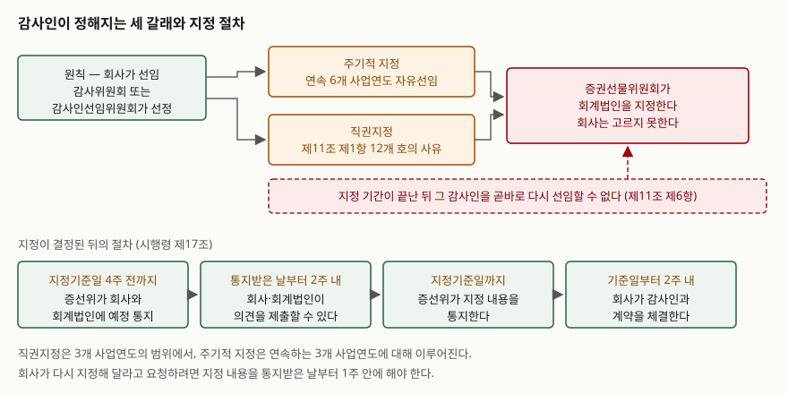

## 들어가며

사업보고서를 열어 '외부감사에 관한 사항'까지 내려가면 감사인 이름과 감사의견이
적혀 있다. 그 옆에 가끔 **"증권선물위원회 지정"** 이라는 짧은 말이 붙는다.
감사보수가 전년의 두 배로 뛴 표가 바로 아래에 있기도 하다.

대부분은 여기서 다음 장으로 넘어간다. 감사인이 누구인지가 투자자에게 무슨 상관인가
싶기 때문이다. 그런데 이 한 줄은 **회사가 감사인을 고를 권한을 잃었다는 뜻**이다.
그리고 그 권한을 잃는 경로는 둘뿐이라서, 어느 쪽인지만 가려내도 회사에 무슨 일이
있었는지가 꽤 좁혀진다. 하나는 시간이 차서 자동으로 오는 것이고, 다른 하나는
사유가 생겨서 오는 것이다.

## 개념

외부감사의 원칙은 **회사가 자기 감사인을 고르는 것**이다. 외부감사법 제10조가
그렇게 정한다. 매 사업연도 개시일부터 45일 이내(감사위원회를 두어야 하는 회사는
개시일 이전)에 선임하고, 주권상장법인·대형비상장주식회사·금융회사는 **연속하는
3개 사업연도**를 같은 감사인으로 선임해야 한다.

여기에 구조적인 문제가 하나 있다. **감사를 받는 쪽이 감사하는 쪽을 고르고 보수를
준다.** 감사인이 회사와 다투면 다음 계약이 없다. 감사 품질이 보수 경쟁에 밀릴 수
있는 자리다.

감사인 지정제는 이 자리를 **증권선물위원회가 대신 고르는 것**으로 끊는다.
2017년 10월 31일 전부개정된 외부감사법(법률 제15022호, 2018년 11월 1일 시행)이
지금의 틀을 만들었다. 경로는 둘이다.

- **직권지정** — 제11조 제1항. 열두 개 호 중 하나에 해당하면 지정한다
- **주기적 지정** — 제11조 제2항. 사유와 무관하게, 연속 6개 사업연도를 자유선임하면
  그다음은 지정이다

## 구조



> **출처**: [주식회사 등의 외부감사에 관한 법률 제10조(감사인의 선임)·제11조(증권선물위원회에 의한 감사인 지정 등)](https://www.law.go.kr/%EB%B2%95%EB%A0%B9/%EC%A3%BC%EC%8B%9D%ED%9A%8C%EC%82%AC%20%EB%93%B1%EC%9D%98%20%EC%99%B8%EB%B6%80%EA%B0%90%EC%82%AC%EC%97%90%20%EA%B4%80%ED%95%9C%20%EB%B2%95%EB%A5%A0), [같은 법 시행령 제15조(주권상장법인 등에 대한 감사인 지정)·제17조(감사인 지정의 절차)](https://www.law.go.kr/%EB%B2%95%EB%A0%B9/%EC%A3%BC%EC%8B%9D%ED%9A%8C%EC%82%AC%20%EB%93%B1%EC%9D%98%20%EC%99%B8%EB%B6%80%EA%B0%90%EC%82%AC%EC%97%90%20%EA%B4%80%ED%95%9C%20%EB%B2%95%EB%A5%A0%20%EC%8B%9C%ED%96%89%EB%A0%B9)

## 동작 원리

### 직권지정 — 사유가 생겨서 온다

제11조 제1항은 열두 개 호를 든다. 성격으로 묶으면 넷이다.

| 묶음 | 호 | 무엇 |
|---|---|---|
| 회사가 절차를 안 지켰다 | 2·3·9호 | 선임기간 내 미선임, 선임 규정 위반, 해지·해임 의무 불이행 |
| 회계에 문제가 드러났다 | 4·5호 | 감리 결과 회계처리기준 위반 확인, 감사인에게 재무제표 작성을 맡김 |
| 재무가 나쁘다 | 6호 | 3개 사업연도 연속 영업이익·영업현금흐름 0 미만, 이자보상배율 1 미만 |
| 그 밖에 공정한 감사가 필요하다 | 1·7·8·10·11·12호 | 회사의 신청, 관리종목, 주채권은행·기관투자자의 요청, 표준감사시간 미달, 최대주주·대표이사 잦은 교체 |

11호가 눈에 띈다. **직전 사업연도를 포함한 과거 3년간 최대주주 변경이 2회 이상
이거나 대표이사 교체가 3회 이상**인 상장법인이다. 재무 숫자가 아니라 지배구조가
흔들리는 것 자체를 사유로 본다.

지정 기간은 **3개 사업연도의 범위**다. 주기적 지정과 달리 3년으로 못박혀 있지 않다.

### 주기적 지정 — 시간이 차서 온다

제11조 제2항은 **연속하는 6개 사업연도에 대하여 감사인을 자유선임한 회사**에
그다음 사업연도부터 **연속하는 3개 사업연도**를 지정한다(시행령 제15조 제1항).
대상은 주권상장법인과, 자산총액이 일정 금액 이상이면서 대주주 측이 발행주식총수의
50% 이상을 가지고 그 대주주 측이 대표이사인 비상장회사다.

6+3이라는 숫자는 제10조 제3항과 맞물린다. 상장법인은 3개 사업연도를 같은 감사인으로
묶어야 하니 **자유선임 6년은 3년 계약 두 번**이다. 세 번째 3년이 지정 기간이 된다.

이 조항은 전부개정법 부칙 제8조에 따라 **시행일부터 1년이 지난 뒤 시작되는
사업연도**부터 적용됐다. 시행일이 2018년 11월 1일이므로 2020 사업연도가 첫 적용
연도다. 같은 부칙은 연속 6개 사업연도를 셀 때 **적용 이전 사업연도도 포함해
계산한다**고 적었다.

예외는 제11조 제3항이다. 기준일로부터 과거 6년 이내에 감리를 받고 회계처리기준
위반이 발견되지 않은 회사는 자유선임을 이어갈 수 있다.

여기에 2025년 5월 20일 개정으로 하나가 더 붙었다(시행령 제15조 제2항부터 제4항,
현행 시행령은 2026년 5월 26일 시행). 감사위원회를 설치하고, 지정감사를 1개
사업연도 이상 받았고, 직전 3개 사업연도에 재무제표 정정공시나 비적정의견이 없는
회사가 신청하면 **회계·감사 지배구조 평가**를 받을 수 있다. 우수로 인정되면
연속 3개 사업연도 동안 주기적 지정이 유예된다. 유예 중에 횡령·배임 공시나 제재가
있으면 취소된다.

### 지정 절차

시행령 제17조가 기간을 넷으로 끊는다.

1. 증선위가 **지정기준일 4주 전까지** 회사와 지정 예정 회계법인에 예정 내용을 문서로 통지
2. 통지받은 회사·회계법인은 **2주 이내**에 의견 제출 가능
3. 증선위가 **지정기준일까지** 지정 내용을 통지
4. 회사는 **지정기준일부터 2주 이내**에 감사계약 체결

회사나 지정감사인이 재지정을 요청하려면 통지받은 날부터 **1주 이내**에 해야 하고
(제17조 제8항), 회사가 요청하려면 사전에 감사 또는 감사위원회의 승인을 받아야
한다(법 제11조 제5항). 사유는 외국투자가 출자조건, 독립성 결격 등으로 좁다.

지정이 끝나도 끝이 아니다. 제11조 제6항은 **지정 사업연도 이후 최초로 도래하는
사업연도의 감사인으로 그 지정감사인을 선임할 수 없다**고 한다. 지정 기간 동안
쌓인 관계가 그대로 자유선임으로 이어지는 것을 막는 조항이다.

## 실습 예제

전체 소스: [`code/`](code/)

제6호 가·나·다목이 **"3개 사업연도 연속"** 을 요건으로 한다는 점이 계산에서 가장
중요하다. 한 해라도 끊기면 그 목은 해당하지 않는다. 가상 회사 셋의 3개년 숫자로
판정한다. 단위는 억 원이고 전부 지어낸 값이다.

```python
def check_clause_6(years: list[Year]) -> dict[str, bool]:
    """제11조 제1항 제6호 가·나·다목. 세 목 모두 '3개 사업연도 연속'이 요건이다."""
    return {
        "가. 영업이익 3년 연속 0 미만": all(y.operating_income < 0 for y in years),
        "나. 영업현금흐름 3년 연속 0 미만": all(y.operating_cash_flow < 0 for y in years),
        "다. 이자보상배율 3년 연속 1 미만": all(y.interest_coverage < 1 for y in years),
    }
```

돌린 기록은 [`code/output.txt`](code/output.txt)에 있다. 세 회사 중 둘이 걸린다.

```text
[다라물산]
    사업연도    영업이익    영업현금흐름    이자비용    이자보상배율
        2023         -45              60          90           -0.50
        2024        -120             -30         105           -1.14
        2025         -80              25         118           -0.68
         해당  가. 영업이익 3년 연속 0 미만
    해당 없음  나. 영업현금흐름 3년 연속 0 미만
         해당  다. 이자보상배율 3년 연속 1 미만
  -> 지정 사유에 걸린다
```

다라물산은 영업현금흐름이 2024년 한 해만 마이너스라서 **나목은 비껴간다.** 그래도
가목과 다목에 걸리므로 결과는 같다. 세 목은 하나만 해당해도 사유가 된다.

더 눈여겨볼 쪽은 마바산업이다.

```text
[마바산업]
    사업연도    영업이익    영업현금흐름    이자비용    이자보상배율
        2023         210             340         290            0.72
        2024         185             310         315            0.59
        2025         240             405         330            0.73
    해당 없음  가. 영업이익 3년 연속 0 미만
    해당 없음  나. 영업현금흐름 3년 연속 0 미만
         해당  다. 이자보상배율 3년 연속 1 미만
  -> 지정 사유에 걸린다
```

영업이익도 흑자고 현금흐름도 매년 300억이 넘는데 지정 사유에 걸린다. **영업이익보다
이자비용이 크기 때문이다.** 이자보상배율이 1 미만이라는 말은 본업으로 번 돈으로
이자도 못 갚는다는 뜻이고, 2025년에는 영업이익 240억에 이자비용 330억이다. 손익계산서
맨 위만 보면 멀쩡해 보이는 회사가 여기서 걸러진다. 제6호 다목이 가목과 따로 있는
이유가 이것이다.

주기적 지정은 날짜 계산이다.

```text
  2020 사업연도   자유선임 1기
  2021 사업연도   자유선임 1기
  2022 사업연도   자유선임 1기
  2023 사업연도   자유선임 2기
  2024 사업연도   자유선임 2기
  2025 사업연도   자유선임 2기
  2026 사업연도   증선위 지정  <-- 회사가 고르지 못한다
  2027 사업연도   증선위 지정  <-- 회사가 고르지 못한다
  2028 사업연도   증선위 지정  <-- 회사가 고르지 못한다
```

## 실무에서 주의할 점

**첫째, 지정 사실 자체를 회사의 부실 신호로 읽지 않는다.** 주기적 지정은 사유 없이
시간이 차서 오는 것이고, 제도 설계상 대상 상장법인이면 언젠가는 온다. 직권지정이라도
제1호는 회사가 스스로 요청한 경우다. **어느 경로로 지정됐는지를 먼저 가른다.**
사업보고서의 '외부감사에 관한 사항'과 감사인 선임 관련 공시에 그 구분이 적힌다.

**둘째, 감사보수와 감사시간의 변화를 함께 본다.** 증선위는 지정 내용을 통지하면서
적정 감사시간이나 적정 감사보수를 정해 권고할 수 있다(시행령 제17조 제5항). 그래서
지정 연도에 감사보수와 감사시간이 함께 뛰는 경우가 있다. 보수만 보면 비용 증가로
읽히지만, 시간이 같이 늘었다면 투입량이 늘어난 것이다. 사업보고서에는 두 숫자가
나란히 실린다.

**셋째, "3개 사업연도 연속"의 끊김에 주의한다.** 위 계산에서 봤듯 한 해만 플러스가
나도 그 목은 해당하지 않는다. 반대로 3년을 채우면 네 번째 해의 숫자가 아무리 좋아도
이미 사유는 성립해 있다. 분기 숫자나 최근 한 해만 보고 판단하면 어긋난다.

**넷째, 지정이 끝나는 해를 따로 센다.** 제11조 제6항 때문에 지정 다음 해에는
감사인이 **반드시** 바뀐다. 감사인 교체 공시가 떴다고 해서 분쟁이 있었던 것은
아니라는 뜻이다. 앞선 3년이 지정 기간이었는지부터 확인한다.

## 정리

- 감사인 선임의 원칙은 회사가 고르는 것이다(제10조). 상장법인 등은 연속 3개
  사업연도를 같은 감사인으로 묶는다
- 지정 경로는 둘이다. **직권지정**은 제11조 제1항 12개 호 중 하나에 해당할 때,
  **주기적 지정**은 연속 6개 사업연도를 자유선임했을 때다
- 주기적 지정은 2020 사업연도부터 적용됐고, 연속 3개 사업연도 동안 간다. 자유선임
  6년이 3년 계약 두 번이라 6+3의 구조가 된다
- 제6호 가·나·다목은 모두 **3개 사업연도 연속**이 요건이다. 이자보상배율 1 미만은
  영업이익이 흑자여도 걸릴 수 있다
- 절차는 지정기준일 **4주 전** 예정 통지 → **2주** 의견 제출 → 지정기준일 본통지 →
  **2주** 내 계약이다. 지정 다음 해에는 그 감사인을 다시 선임할 수 없다(제11조 제6항)

## 참고 자료

- [주식회사 등의 외부감사에 관한 법률](https://www.law.go.kr/%EB%B2%95%EB%A0%B9/%EC%A3%BC%EC%8B%9D%ED%9A%8C%EC%82%AC%20%EB%93%B1%EC%9D%98%20%EC%99%B8%EB%B6%80%EA%B0%90%EC%82%AC%EC%97%90%20%EA%B4%80%ED%95%9C%20%EB%B2%95%EB%A5%A0) — 제10조(감사인의 선임), 제11조(증권선물위원회에 의한 감사인 지정 등), 제12조(감사인 선임 등의 보고). 현행 [시행 2025. 4. 1.] 법률 제20896호
- [같은 법 부칙 제8조(주권상장법인 감사인 지정제에 관한 적용례)](https://www.law.go.kr/%EB%B2%95%EB%A0%B9/%EC%A3%BC%EC%8B%9D%ED%9A%8C%EC%82%AC%20%EB%93%B1%EC%9D%98%20%EC%99%B8%EB%B6%80%EA%B0%90%EC%82%AC%EC%97%90%20%EA%B4%80%ED%95%9C%20%EB%B2%95%EB%A5%A0) — 법률 제15022호(2017. 10. 31. 전부개정), 시행일 2018. 11. 1.
- [주식회사 등의 외부감사에 관한 법률 시행령](https://www.law.go.kr/%EB%B2%95%EB%A0%B9/%EC%A3%BC%EC%8B%9D%ED%9A%8C%EC%82%AC%20%EB%93%B1%EC%9D%98%20%EC%99%B8%EB%B6%80%EA%B0%90%EC%82%AC%EC%97%90%20%EA%B4%80%ED%95%9C%20%EB%B2%95%EB%A5%A0%20%EC%8B%9C%ED%96%89%EB%A0%B9) — 제14조(증권선물위원회의 감사인 지정을 받는 회사), 제15조(주권상장법인 등에 대한 감사인 지정), 제17조(감사인 지정의 절차). 현행 [시행 2026. 5. 26.] 대통령령 제36358호
