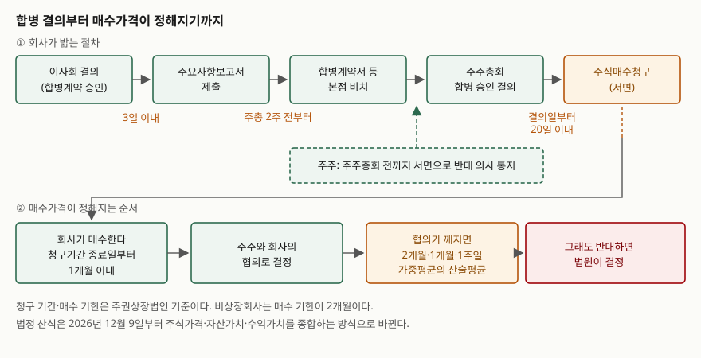

## 들어가며

들고 있던 종목에 합병 결정 공시가 뜬다. 상대 회사 이름은 처음 보고, 합병비율이라는
숫자가 하나 적혀 있다. 게시판에는 "반대하면 회사가 사 준다"는 말이 돌고, 며칠 뒤에는
주주총회 소집 통지서가 날아온다. 거기 어딘가에 주식매수청구권이라는 말이 적혀 있다.

여기서 대부분은 통지서를 덮고 주가만 본다. 그런데 이 권리는 **아무 때나 쓸 수 있는
것이 아니라 기한이 네 번 끊겨 있다.** 한 번 놓치면 그다음 단계는 열리지 않는다.
주주총회가 끝난 뒤에 "반대 의사를 통지했어야 한다"는 것을 알게 되면 이미 늦다.
순서를 모르면 권리가 있어도 못 쓴다.

## 개념

주식매수청구권은 **회사의 근간이 바뀌는 결정에 반대한 주주가, 회사에 자기 주식을
사 가라고 요구할 수 있는 권리**다. 합병·분할합병·영업양도·주식교환처럼 주주총회
특별결의로 넘어가는 사안에 붙는다.

이 권리가 필요한 이유는 다수결의 성질에서 나온다. 합병은 발행주식총수의 3분의 1 이상
이면서 출석주식의 3분의 2 이상이 찬성하면 통과한다(상법 제522조 제3항, 제434조).
반대한 주주도 결과에 묶인다. 묶이는 것 자체는 회사법의 원리지만, 그 결과로 내가 산
회사와 전혀 다른 회사의 주주가 되는 것까지 받아들이라고 할 수는 없다. 그래서 상법은
반대한 주주에게 **현금으로 빠져나갈 길**을 하나 열어 둔다.

비상장회사는 상법이, 주권상장법인은 자본시장법이 따로 정한다. 기간과 가격 산정
방법이 다르므로 둘을 섞어 읽으면 틀린다.

## 구조



> **출처**: [상법 제522조의3(합병반대주주의 주식매수청구권)·제374조의2(반대주주의 주식매수청구권)](https://www.law.go.kr/%EB%B2%95%EB%A0%B9/%EC%83%81%EB%B2%95), [자본시장과 금융투자업에 관한 법률 제161조(주요사항보고서의 제출)·제165조의5(주식매수청구권의 특례)](https://www.law.go.kr/%EB%B2%95%EB%A0%B9/%EC%9E%90%EB%B3%B8%EC%8B%9C%EC%9E%A5%EA%B3%BC%20%EA%B8%88%EC%9C%B5%ED%88%AC%EC%9E%90%EC%97%85%EC%97%90%20%EA%B4%80%ED%95%9C%20%EB%B2%95%EB%A5%A0), [같은 법 시행령 제176조의7(주주의 주식매수청구권)](https://www.law.go.kr/%EB%B2%95%EB%A0%B9/%EC%9E%90%EB%B3%B8%EC%8B%9C%EC%9E%A5%EA%B3%BC%20%EA%B8%88%EC%9C%B5%ED%88%AC%EC%9E%90%EC%97%85%EC%97%90%20%EA%B4%80%ED%95%9C%20%EB%B2%95%EB%A5%A0%20%EC%8B%9C%ED%96%89%EB%A0%B9)

## 동작 원리

### 공시가 먼저 뜬다

합병·분할·주식교환·주식이전은 사업보고서 제출대상법인이 **주요사항보고서**를 내야
하는 사유다(자본시장법 제161조 제1항 제6호). 제출 시한이 다른 사유와 다르다.
일반 사유는 사실이 발생한 날의 **다음 날**까지인데, 이 네 가지만 **사실이 발생한
날부터 3일까지**다. 첨부서류가 많아 하루로는 모자라기 때문이다.

그래서 투자자가 합병 사실을 아는 시점은 보통 이사회 결의 직후다. 이 시점이 중요한
이유는 뒤에 나온다 — 매수가격의 기준이 되는 것도, 청구 자격이 갈리는 것도 모두
**이사회 결의일**이기 때문이다.

### 네 번 끊기는 기한

주권상장법인 기준으로 정리하면 이렇다.

| 단계 | 누가 | 기한 | 근거 |
|---|---|---|---|
| 반대 의사 통지 | 주주 | 주주총회 **전**까지 서면으로 | 자본시장법 제165조의5 제1항 |
| 매수청구 | 주주 | 주주총회 결의일부터 **20일 이내**, 서면으로 | 같은 항 |
| 매수 | 회사 | 매수청구기간 종료일부터 **1개월 이내** | 같은 조 제2항 |
| 법원에 가격 결정 청구 | 주주 또는 회사 | 법정 산식 가격에도 반대할 때 | 같은 조 제3항 |

비상장회사는 상법 제374조의2가 적용돼 회사의 매수 기한이 **2개월**이고, 협의가
안 되면 매수청구기간 종료일부터 **30일 이내**에 법원에 가액 결정을 청구한다.
법정 산식이 따로 없어 바로 법원으로 간다.

### 누구의 주식이 대상인가

상장법인에는 상법에 없는 조건이 하나 더 붙는다. **이사회 결의 사실이 공시되기
전에 취득했음을 증명한 주식**만 청구 대상이다(자본시장법 제165조의5 제1항).
공시를 보고 들어온 주식까지 회사가 사 주게 되면, 매수청구권이 소수주주 보호
장치가 아니라 공시 직후에 걸 수 있는 손실 한정 장치가 되기 때문이다.

예외는 시행령이 좁게 열어 둔다. 공시된 날의 **다음 영업일까지** 매매계약을
체결했거나, 소비대차계약을 해지했거나, 그 밖의 취득에 관한 법률행위가 있었던
주식은 대상에 들어간다(시행령 제176조의7 제2항). 공시 전에 이미 사기로 정해져
있었던 거래를 구제하는 조항이다.

### 분할은 되는 것과 안 되는 것이 나뉜다

여기가 가장 자주 틀리는 곳이다. 상법 제530조의11 제2항은 **분할합병**에만
제522조의3을 준용한다. 즉 **단순분할에는 상법상 매수청구권이 없다.**

주권상장법인에는 자본시장법이 두 가지를 더 얹는다(시행령 제176조의7 제1항).

- 물적분할이 아닌 분할로서 **설립되는 법인의 주권이 상장되지 않는 경우**(상장예비심사에서
  부적합 확인을 받은 경우를 포함한다)
- **물적분할**(분할합병은 제외한다)

두 번째가 2022년 12월 27일 시행령 개정으로 들어왔다. 자회사를 떼어 내는 물적분할에
반대한 주주에게도 나갈 길을 준 것이고, 같은 개정 부칙은 **시행 이후 이사회가 주주총회
승인을 받기로 결의하는 경우부터** 적용한다고 적었다.

### 가격이 정해지는 순서

협의가 먼저다. 깨지면 시행령 제176조의7 제3항 제1호가 정한 세 가격의 **산술평균**으로
간다. 셋은 모두 이사회 결의일 전일을 끝으로 하는 구간의 **거래량 가중산술평균가격**이다.

- 과거 2개월
- 과거 1개월
- 과거 1주일

짧은 구간은 결의 직전의 시세를, 긴 구간은 그 이전의 시세를 반영한다. 셋을 평균하는
것은 어느 한 구간의 쏠림이 가격을 혼자 결정하지 못하게 하려는 것이다.

**이 산식은 2026년 12월 9일부터 바뀐다.** 2026년 9월 8일 개정된 자본시장법
제165조의5 제3항은 협의가 깨졌을 때의 가격을 거래가격 기준 산식이 아니라 **이사회가
대통령령이 정하는 기준에 따라 주식가격·자산가치·수익가치 등을 종합적으로 고려해
산정한 금액**으로 바꿨다. 그 뒤에도 반대하면 법원으로 가는 구조는 그대로다.

## 실습 예제

전체 소스: [`code/`](code/)

가상 회사 **가나전자**(존속)가 **다라물산**(소멸)을 흡수합병한다고 두고 세 가지를
센다. 주가는 시드를 고정한 난수로 만든 값이고 실제 종목의 시세가 아니다.

```python
def statutory_price(sessions: list[Session]) -> tuple[float, dict[str, float]]:
    """시행령 제176조의7 제3항 제1호 가·나·다목을 각각 구하고 산술평균한다."""
    legs = {
        "2개월(40거래일)": weighted_average(sessions[-40:]),
        "1개월(20거래일)": weighted_average(sessions[-20:]),
        "1주일(5거래일)": weighted_average(sessions[-5:]),
    }
    return sum(legs.values()) / len(legs), legs
```

돌린 결과는 [`code/output.txt`](code/output.txt)에 그대로 있다.

```text
1. 협의가 깨졌을 때의 법정 매수가격 — 가나전자
이사회 결의일 전일 종가: 14,048원
  2개월(40거래일)       가중산술평균    13,354.00원
  1개월(20거래일)       가중산술평균    13,710.24원
  1주일(5거래일)        가중산술평균    13,949.84원
  세 가격의 산술평균          13,671.36원  ← 법정 매수가격
```

결의일 전일 종가가 14,048원인데 법정 가격은 13,671원이다. **직전 종가보다 낮다.**
직전 두 달 동안 주가가 올랐기 때문에 2개월 구간의 평균이 가격을 끌어내린 것이다.
반대로 두 달 내내 흘러내린 뒤 결의가 나면 법정 가격이 직전 종가보다 높게 나온다.
산식이 세 구간을 평균하는 한 이 어긋남은 늘 생긴다.

다음은 합병비율이다. 가나전자 1,000만 주, 다라물산 400만 주로 두고 비율만 바꿨다.

```text
  합병비율 1 : 0.3        1 : 0.5        1 : 0.8
    발행 신주      120만 주       200만 주       320만 주
    기존 가나전자 주주  89.29%        83.33%        75.76%
    다라물산 주주      10.71%        16.67%        24.24%
```

합병비율은 소멸회사 주식 1주에 존속회사 주식 몇 주를 줄지를 정하는 숫자다. 비율이
올라가면 신주가 늘고, 늘어난 신주만큼 **기존 주주의 지분율이 희석된다.** 합병비율
0.3과 0.8 사이에서 기존 주주의 몫은 89.29%에서 75.76%로 13.53%포인트 움직인다.
합병 공시에서 합병비율 한 줄이 가장 먼저 읽히는 이유가 이것이다.

마지막으로 매수청구가 몰릴 때를 센다.

```text
         청구 물량           회사가 낼 현금        의결권 주식수       그 주주 지분율
            0주                 0원    12,000,000주         8.333%
      200,000주     2,734,200,000원    11,800,000주         8.475%
      600,000주     8,202,600,000원    11,400,000주         8.772%
    1,200,000주    16,405,200,000원    10,800,000주         9.259%
```

회사가 매수한 주식은 자기주식이 되어 의결권이 없다(상법 제369조 제2항). 분모가
줄어드니 남은 주주의 의결권 지분율은 올라간다. 100만 주를 들고 찬성한 주주의 몫이
8.333%에서 9.259%까지 올라간다. 대신 회사는 164억 원을 현금으로 내놓는다.

## 실무에서 주의할 점

**첫째, 반대 의사 통지와 매수청구는 별개의 행위다.** 주주총회 전에 서면으로 반대
의사를 통지해야 청구 자격이 생기고, 그 뒤 결의일부터 20일 안에 **다시** 서면으로
청구해야 한다. 통지만 하고 청구를 안 하면 권리는 소멸한다. 반대 통지를 해 두고
주주총회에서 찬성표를 던지는 것도 가능하다 — 통지는 자격을 만드는 절차이지 의결권
행사를 묶는 것이 아니다.

**둘째, 매수대금 한도 조항을 합병계약서에서 확인한다.** 위 계산에서 봤듯이 청구가
몰리면 회사가 수백억을 현금으로 내놓게 된다. 그래서 합병계약서에는 매수대금이 일정
금액을 넘으면 계약을 해제하거나 조건을 다시 협의할 수 있다는 조항을 두는 경우가 많다.
합병계약서는 주주총회 **2주 전부터** 본점에 비치되므로(상법 제522조의2 제1항) 그때
읽을 수 있다. 청구가 많으면 합병 자체가 무산될 수 있다는 뜻이다.

**셋째, 단순분할인지 분할합병인지 물적분할인지를 먼저 가른다.** 앞서 본 대로
상법상 매수청구권은 분할합병에만 붙는다. 상장법인의 단순분할은 신설법인의 상장
여부에 따라, 물적분할은 그것만으로 청구권이 생긴다. 공시 제목에 "분할"이 들어
있다고 해서 다 같은 것이 아니다.

**넷째, 2026년 12월 9일을 기준으로 적용 규정이 갈린다.** 개정된 제165조의5 제3항은
시행 이후 합병 등에 관한 이사회 결의를 하는 경우부터 적용된다. 그 전에 결의된 건은
종전의 거래가격 기준 산식으로 간다. 진행 중인 건을 볼 때는 **이사회 결의일이
어느 쪽인지**를 먼저 본다.

## 정리

- 합병·분할·주식교환·주식이전은 주요사항보고서 사유이고, 다른 사유와 달리 **사실
  발생일부터 3일까지**가 시한이다
- 상장법인의 매수청구권은 **주총 전 서면 반대 통지 → 결의일부터 20일 내 청구 →
  회사가 1개월 내 매수**로 기한이 세 번 끊긴다. 비상장은 매수 기한이 2개월이다
- 공시 전에 취득했음을 증명한 주식만 대상이다. 공시 다음 영업일까지의 계약 체결 등은
  예외로 구제된다
- 단순분할에는 상법상 매수청구권이 없다. 분할합병에만 준용되고, 상장법인은 시행령이
  비상장 신설분할과 물적분할을 따로 얹는다
- 협의가 깨지면 2개월·1개월·1주일 가중평균의 산술평균이 가격이 된다. **2026년
  12월 9일부터** 주식가격·자산가치·수익가치를 종합하는 방식으로 바뀐다

## 참고 자료

- [상법](https://www.law.go.kr/%EB%B2%95%EB%A0%B9/%EC%83%81%EB%B2%95) — 제374조의2(반대주주의 주식매수청구권), 제522조(합병계약서와 그 승인결의), 제522조의2(합병계약서 등의 공시), 제522조의3(합병반대주주의 주식매수청구권), 제530조의11(준용규정)
- [자본시장과 금융투자업에 관한 법률](https://www.law.go.kr/%EB%B2%95%EB%A0%B9/%EC%9E%90%EB%B3%B8%EC%8B%9C%EC%9E%A5%EA%B3%BC%20%EA%B8%88%EC%9C%B5%ED%88%AC%EC%9E%90%EC%97%85%EC%97%90%20%EA%B4%80%ED%95%9C%20%EB%B2%95%EB%A5%A0) — 제161조(주요사항보고서의 제출), 제165조의5(주식매수청구권의 특례). 제165조의5 제3항은 2026. 9. 8. 개정, 시행일 2026. 12. 9.
- [자본시장과 금융투자업에 관한 법률 시행령](https://www.law.go.kr/%EB%B2%95%EB%A0%B9/%EC%9E%90%EB%B3%B8%EC%8B%9C%EC%9E%A5%EA%B3%BC%20%EA%B8%88%EC%9C%B5%ED%88%AC%EC%9E%90%EC%97%85%EC%97%90%20%EA%B4%80%ED%95%9C%20%EB%B2%95%EB%A5%A0%20%EC%8B%9C%ED%96%89%EB%A0%B9) — 제176조의7(주주의 주식매수청구권)
- [금융감독원 DART 주요사항보고서 안내](https://dart.fss.or.kr/info/main.do?menu=220) — 제출 사유와 기한
