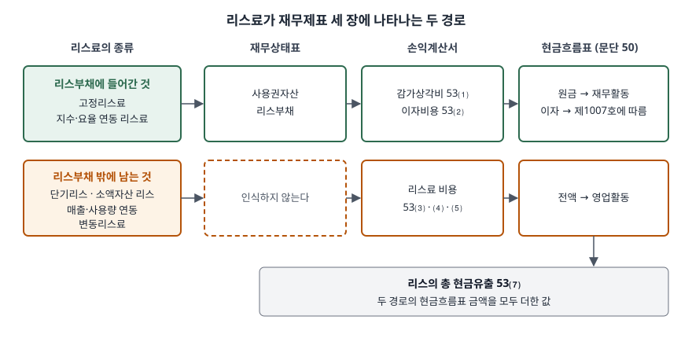

> 예제의 `가나유통`·`다라유통`과 그 숫자는 계산을 보이려고 만든 가상 자료다. 법인세, 전대리스, 리스 인센티브는 없다고 두었다.

## 들어가며

매장을 빌려 영업하는 회사 두 곳을 비교하려고 재무상태표를 펴면, 한쪽은 리스부채가 2,777이고 다른 쪽은 868이다. 이때 흔히 리스부채가 작은 회사가 임차 부담도 작다고 읽고, 확인 삼아 현금흐름표 재무활동의 '리스부채의 상환' 줄을 본다. 그 줄도 325 대 102로 차이가 나니 판단이 굳어진다. 그런데 예제의 두 회사가 한 해에 리스로 낸 현금은 500으로 같다. 리스부채가 작은 회사는 낸 돈의 70%가 처음부터 리스부채에 들어가지 않는 종류의 리스료였고, 그 돈은 재무활동 줄에도 나타나지 않는다. 이 금액은 리스 주석의 표 하나에 모여 있다.

## 개념

### 리스부채에 들어가지 않는 리스료 세 가지

리스이용자는 원칙적으로 모든 리스에 사용권자산과 리스부채를 인식하지만, 세 가지는 부채에 들어가지 않는다. 첫째와 둘째는 회사가 인식 면제를 고른 단기리스와 소액 기초자산 리스다. 면제를 고르면 리스료를 리스기간에 걸쳐 정액 기준 등으로 비용 처리한다(문단 6). 단기리스 면제는 기초자산 유형별로, 소액자산 면제는 리스별로 고른다(문단 8). 셋째는 매출이나 사용량에 연동되는 변동리스료다. 물가지수나 금리 같은 지수·요율에 연동되는 리스료는 리스부채에 들어가지만, 매출 연동 임차료처럼 회사의 실적에 따라 달라지는 금액은 리스부채 측정에서 빠지고 발생한 기간의 비용이 된다. 리스부채 계산은 [리스 회계 기본 글](../../statements/2026-10-10-lease-liability-right-of-use/index.md)에 있다.

### 금액 공시 열 가지

기준서는 리스가 재무상태·재무성과·현금흐름에 미치는 영향을 평가할 수 있게 하는 것을 공시 목적으로 두고(문단 51), 보고기간의 금액 10가지를 공시하게 한다(문단 53). 다른 형식이 더 적절하지 않으면 표로 낸다(문단 54).

| 항목 | 내용 | 읽는 자리 |
|---|---|---|
| ⑴ | 기초자산 유형별 사용권자산 감가상각비 | 부채에 들어간 리스의 비용 |
| ⑵ | 리스부채 이자비용 | 부채에 들어간 리스의 비용 |
| ⑶ | 단기리스 비용 (1개월 이하 리스는 빼도 된다) | 부채 밖 |
| ⑷ | 소액자산 리스 비용 (⑶에 든 것 제외) | 부채 밖 |
| ⑸ | 리스부채 측정에 포함되지 않은 변동리스료 비용 | 부채 밖 |
| ⑹ | 사용권자산 전대리스에서 생긴 수익 | 수익 |
| ⑺ | 리스의 총 현금유출 | 현금 |
| ⑻ | 사용권자산의 추가 | 재무상태표 변동 |
| ⑼ | 판매후리스 거래에서 생긴 차손익 | 손익 |
| ⑽ | 기초자산 유형별 기말 사용권자산 장부금액 | 재무상태표 |

⑼의 판매후리스 차손익이 어떻게 계산되는지는 [판매후리스 글](../../statements/2026-11-26-sale-and-leaseback-retained-right-gain/index.md)에서 다뤘다.

### 만기분석과 추가 정보

리스부채의 만기분석은 다른 금융부채와 따로 낸다(문단 58). 금융상품 공시 기준서(제1107호 문단 39·B11)를 적용하므로 할인하지 않은 계약상 현금흐름을 기간 구간별로 보여 준다. 그 밖에 공시 목적을 채우는 데 필요한 질적·양적 정보를 더 내야 하는데, 기준서는 리스부채에 반영되지 않은 미래 현금유출의 원천으로 변동리스료, 연장·종료선택권, 잔존가치보증, 약정했지만 아직 개시하지 않은 리스 4가지를 든다(문단 59⑵). 단기리스나 소액자산 리스 면제를 썼으면 그 사실도 밝힌다(문단 60).

## 구조



> **출처**: [K-IFRS 제1116호 리스 — 문단 6·8 인식 면제, 49 손익 표시, 50 현금흐름표 분류, 53 금액 공시](https://accountingwiki.co.kr/standards/1116) (제3자 전재, 발행처 한국회계기준원)

위쪽 경로의 리스료는 세 장 모두에 흔적을 남기고, 아래쪽 경로는 재무상태표를 건너뛴다. 재무상태표에서 출발해 리스 부담을 읽으면 아래쪽 경로가 통째로 빠지는 이유다. 두 경로가 한 숫자로 합쳐지는 자리는 주석의 '리스의 총 현금유출'뿐이다.

## 동작 원리

### 현금흐름표는 리스료를 세 줄로 나눈다

리스부채의 원금에 해당하는 지급은 재무활동이다. 이자에 해당하는 지급은 현금흐름표 기준서(제1007호)의 이자지급 요구사항에 따르므로, 회사가 이자지급을 어느 활동으로 분류하는지에 따라 자리가 정해진다. 리스부채에 포함되지 않은 단기리스료·소액자산 리스료·변동리스료는 영업활동이다(문단 50). 같은 임차료라도 부채에 들어간 계약이면 대부분이 재무활동으로 빠져 영업활동 현금흐름이 크게 보이고, 부채 밖 계약이면 전액이 영업활동에서 빠진다.

### 손익계산서에서는 비용의 이름이 갈린다

부채에 들어간 리스는 감가상각비와 이자비용으로 나뉘고, 이자비용은 금융원가로 따로 표시한다(문단 49). 부채 밖 리스료는 임차료 성격의 영업비용 한 줄이다. 그래서 감가상각비와 이자비용을 더해 구하는 EBITDA 같은 지표는 부채 밖 리스료가 많은 회사에서 더 작게 나온다. 리스료 지급액이 같아도 계약의 종류에 따라 지표가 달라진다.

### 만기분석 합계는 장부금액보다 크다

만기분석은 할인하지 않은 금액이므로 합계가 재무상태표의 리스부채보다 크다. 그 차이가 앞으로 인식할 이자비용이다. 만기분석에는 부채에 들어간 리스료만 실린다. 변동리스료와 아직 행사가 확실하지 않은 연장선택권 기간의 리스료는 여기에도 없으므로, 문단 59의 추가 정보에서 따로 찾는다.

## 실습 예제

가나유통과 다라유통은 한 해에 리스로 500씩 낸다. 가나유통은 480이 10년 고정리스료이고, 다라유통은 고정리스료가 150이며 나머지는 단기리스 120, 소액자산 리스 30, 매출의 4%인 변동리스료 200이다. 전체 소스: [`code/`](code/) · 수행 기록: [`code/output.txt`](code/output.txt)

```text
[2] 재무상태표 — 기말
                                  가나유통      다라유통
  사용권자산                          2594.50      810.78
  리스부채                           2777.46      867.96

[3] 문단 53 금액 공시 — 당기
                                  가나유통      다라유통
  ⑴ 사용권자산 감가상각비                   370.64      115.83
  ⑵ 리스부채 이자비용                     155.12       48.47
  ⑶ 단기리스 비용                        10.00      120.00
  ⑷ 소액자산 리스 비용                     10.00       30.00
  ⑸ 변동리스료 비용                        0.00      200.00
     비용 합계                        545.76      514.30
  ⑺ 리스의 총 현금유출                    500.00      500.00
```

리스부채는 3.2배 차이가 나지만 ⑺은 같다. 다라유통의 ⑶·⑷·⑸ 합계 350은 재무상태표 어디에도 없다. 가나유통의 비용 합계가 현금 500보다 큰 것은 리스 초반이라 이자비용이 크기 때문이다.

```text
[5] 재무활동 줄만 보면 빠지는 금액
                                  가나유통      다라유통
  재무활동 리스부채 상환                    324.88      101.53
  리스의 총 현금유출                      500.00      500.00
  상환 ÷ 총 현금유출                      65.0%       20.3%
  부채 밖 리스료 ÷ 총 유출                   4.0%       70.0%
  리스부채 ÷ 총 현금유출                    5.55배       1.74배
```

현금흐름표의 리스부채 상환 줄은 가나유통에서 총 유출의 65.0%, 다라유통에서 20.3%만 보여 준다. 리스부채를 총 현금유출로 나눈 값은 부채가 몇 해치 지급액을 담고 있는지를 나타낸다. 다라유통은 1.74배로, 부채가 실제 지급 규모의 두 해치도 담지 못한다.

```text
[6] 리스부채 만기분석 (문단 58) — 할인하지 않은 계약상 현금흐름
                                  가나유통      다라유통
  1년 이내                           480.00      150.00
  1년 초과 5년 이내                    1920.00      600.00
  5년 초과                           960.00      300.00
  할인 전 합계                        3360.00     1050.00
  리스부채 장부금액                      2777.46      867.96
  차이 = 앞으로 낼 이자                   582.54      182.04
```

다라유통의 '1년 이내' 150은 내년에 낼 리스료 전체가 아니다. 매출이 그대로면 변동리스료 200과 단기·소액 리스료가 더 나간다.

```text
[7] 다라유통 변동리스료의 매출 민감도 (문단 59⑵, B49)
     매출 변화        매출     변동리스료     총 현금유출
       -20%     4000.00       160.00        460.00
       -10%     4500.00       180.00        480.00
        +0%     5000.00       200.00        500.00
       +10%     5500.00       220.00        520.00
       +20%     6000.00       240.00        540.00
  가나유통은 변동리스료가 없어 매출이 바뀌어도 총 현금유출 500.00
```

변동리스료는 매출이 줄면 같이 줄어든다. 고정리스료는 매출과 상관없이 나간다. 적용지침은 변동리스료를 쓰는 이유와 정도, 고정리스료 대비 크기, 리스료를 움직이는 변수를 추가 정보의 예로 든다(문단 B49).

## 실무에서 주의할 점

- **리스부채 크기로 임차 부담을 비교하지 않는다.** 리스부채는 부채에 들어간 리스료만의 현재가치다. 단기리스와 변동리스료 비중이 다른 두 회사는 문단 53⑺의 총 현금유출로 맞춰 본다.
- **재무활동의 리스부채 상환액은 리스료 지급액이 아니다.** 이자 부분과 부채 밖 리스료가 빠져 있다. 예제의 다라유통은 상환액이 총 유출의 20.3%다.
- **단기리스 비용이 해마다 크면 계약 구조를 본다.** 12개월 이하 계약을 반복해 갱신하면 부채는 작게 유지되고 비용은 ⑶에 계속 찍힌다. 기말에 약정된 단기리스 규모가 당기 비용과 다르면 회사가 그 약정 금액을 공시한다(문단 55).
- **변동리스료가 많다는 것은 양면이 있다.** 매출이 줄 때 지급액도 줄어 고정비 부담이 작지만, 리스부채와 만기분석에 나타나지 않아 미래 지급액을 숫자로 알기 어렵다. 문단 59의 추가 정보에 연동 조건이 적혀 있는지 확인한다.
- **이자지급의 분류를 확인하고 영업활동 현금흐름을 비교한다.** 리스 이자를 영업활동에 둔 회사와 재무활동에 둔 회사는 같은 계약이라도 영업활동 현금흐름이 다르다. 분류는 현금흐름표 본문이나 회계정책 주석에 나온다.

## 정리

- 단기리스, 소액자산 리스, 매출·사용량 연동 변동리스료는 리스부채에 들어가지 않고 비용과 영업활동 현금흐름으로만 나타난다.
- 문단 53의 금액 공시 10가지 가운데 ⑶·⑷·⑸가 부채 밖 리스료이고, ⑺ 리스의 총 현금유출이 모든 리스료를 합친 숫자다.
- 현금흐름표는 리스료를 원금(재무활동), 이자(회사의 이자지급 분류), 부채 밖 리스료(영업활동) 세 줄로 나눈다.
- 만기분석은 할인 전 금액이고 부채에 들어간 리스료만 담는다.

## 참고 자료

- [한국회계기준원 — 시행 중인 K-IFRS 기준서 목록](https://www.kasb.or.kr/front/board/ingAccountingList.do) — 기업회계기준서 제1116호 리스 원문 발행처. 아래 전재 사이트는 문단을 바로 열기 위한 편의 링크다
- [IFRS Foundation — IFRS 16 Leases](https://www.ifrs.org/issued-standards/list-of-standards/ifrs-16-leases/) — 국제회계기준 원문 발행처
- [K-IFRS 제1116호 리스 — 문단 6·8 인식 면제, 47~50 표시, 51~60 공시](https://accountingwiki.co.kr/standards/1116) (제3자 전재)
- [K-IFRS 제1116호 리스 적용지침 — 문단 B48~B52 리스이용자 공시 추가 정보](https://accountingwiki.co.kr/standards/1116/b) (제3자 전재)
