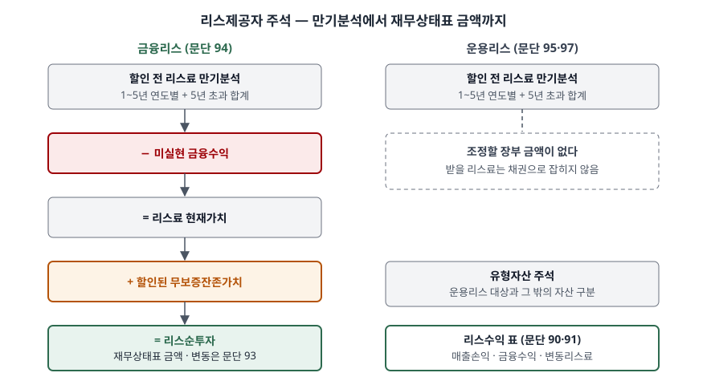

## 들어가며

장비 임대를 주업으로 하는 회사의 사업보고서를 열면 리스 주석에 "향후 받을 리스료"가 연도별로 정리돼 있다. 합계가 200억원인데, 재무상태표의 금융리스채권은 162.79억원이다. 처음 보는 사람은 둘 중 하나가 틀렸거나, 37억원어치 채권이 어디론가 빠졌다고 생각한다.

이 차이를 풀지 않고 넘어가면 두 가지를 잘못 읽는다. 만기분석 합계를 회수할 채권 잔액으로 보면 자산을 부풀려 보고, 반대로 재무상태표 금액만 보면 앞으로 이자로 들어올 몫을 놓친다. 두 숫자를 잇는 줄은 주석 안에 이미 있다.

[리스이용자 주석](../2026-11-26-lessee-lease-disclosure-total-cash-outflow/index.md)에 이어, 이번에는 같은 계약의 반대편인 빌려주는 회사의 주석을 표 하나씩 다시 계산한다.

## 개념

기업회계기준서 제1116호는 리스제공자 공시의 목적을, 리스가 재무상태·재무성과·현금흐름에 주는 영향을 평가할 수 있는 정보를 주석에 담는 것으로 정한다(문단 89). 요구 항목은 다섯 갈래다.

| 문단 | 무엇을 | 금융리스 | 운용리스 |
|---|---|---|---|
| 90·91 | 당기 리스수익 (가능하면 표 형식) | 매출손익, 순투자 금융수익, 순투자에 넣지 않은 변동리스료 수익 | 리스수익, 지수·요율 외 변동리스료 수익은 따로 |
| 92 | 리스제공 활동의 특성과 잔존자산 위험관리 전략 | 공통 | 공통 |
| 93 | 순투자 장부금액의 유의적 변동 설명 | 질적·양적 설명 | — |
| 94·97 | 할인 전 리스료 만기분석 (첫 5년 연도별 + 나머지 합계) | 순투자로 조정, 미실현 금융수익·할인된 무보증잔존가치 식별 | 만기분석만 |
| 95·96 | 기초자산 공시 | — | 유형자산을 운용리스 대상과 그 밖의 자산으로 구분 |

문단 92가 드는 위험관리 수단은 재구매약정, 잔존가치보증, 사용량 한도를 넘으면 붙는 변동리스료 같은 것이다. 리스기간이 끝나면 돌려받는 자산의 가치가 제공자에게 남는 위험이므로, 그 위험을 어떻게 줄였는지를 적게 한다.

## 구조



> **출처**: [K-IFRS 제1116호 리스 — 문단 89~97 리스제공자 공시](https://accountingwiki.co.kr/standards/1116) (제3자 전재, 발행처 한국회계기준원)

금융리스 쪽은 다섯 줄이 위에서 아래로 이어진다. 만기분석의 할인 전 합계에서 미실현 금융수익을 빼면 리스료 현재가치가 되고, 할인된 무보증잔존가치를 더하면 재무상태표의 리스순투자가 된다. 운용리스 쪽은 만기분석만 있고 이어지는 장부 금액이 없다. 받을 리스료가 채권으로 잡히지 않고, 자산은 유형자산 주석에 운용리스 대상으로 따로 나온다.

## 동작 원리

### 만기분석은 왜 할인하지 않은 금액인가

문단 94와 97은 둘 다 **할인되지 않은** 리스료를 연도별로 보이게 한다. 연도별 현금 유입 시점을 그대로 보여야 유동성을 판단할 수 있기 때문이다. 할인된 금액으로 쪼개면 먼 해의 금액이 작아져 실제 들어오는 현금의 크기가 가려진다. 그래서 금융리스는 할인 전 금액을 보인 뒤, 장부의 할인된 금액과 따로 맞춰 보이게 한다.

### 미실현 금융수익은 앞으로 이자로 인식할 몫이다

리스료 합계 중 순투자를 넘는 부분은 아직 기간이 지나지 않은 이자다. 해마다 기초 순투자에 내재이자율을 곱한 금액이 금융수익으로 인식되며 이 잔액이 줄어든다. [사채의 유효이자율법](../../statements/2026-10-12-bonds-effective-interest/index.md)에서 액면 합계와 장부금액의 차이가 남은 이자인 것과 같은 구조다.

### 무보증잔존가치는 만기분석에 들어가지 않는다

무보증잔존가치는 리스료가 아니다. 리스기간이 끝나면 제공자가 자산을 돌려받아 회수하는 가치이므로 리스료 만기분석의 어느 칸에도 넣지 않는다. 대신 순투자에는 할인된 금액으로 들어간다. 문단 94가 조정표에서 이 금액을 **식별**하게 한 이유다. 이것을 빼먹으면 만기분석과 순투자가 맞지 않는다.

### 운용리스 만기분석은 맞춰 볼 장부 금액이 없다

운용리스는 자산을 제공자의 장부에 둔 채 리스료를 기간에 걸쳐 수익으로 인식한다. 앞으로 받을 리스료는 어디에도 채권으로 잡혀 있지 않다. 그래서 만기분석이 **재무상태표 밖의 약정된 미래 수익**을 보여 주는 유일한 표가 된다.

## 실습 예제

가상 회사 **아자리스**는 20X5년 말 현재 금융리스 3건과 운용리스 2건을 가지고 있다. 리스료는 모두 매년 말에 받는다. L3는 20X5년 초에 6년 계약으로 개시해 첫 리스료를 20X5년 말에 받았다.

```text
[0] 계약 조건
  계약           이자율    연 리스료    남은 횟수     잔존가치
  L1 물류 설비      8%    20.00        3     0.00
  L2 의료 장비      7%    10.00        8     5.00
  L3 건설 장비      9%    12.00        5     3.00
  O1 창고         운용     6.00        4        -
  O2 사무동        운용     3.00        7        -
```

전체 소스: [`code/`](code/)

### 리스수익 표

```text
[1] 리스수익 (문단 90)
  금융리스
    매출손익                                  0.00  (제조·판매 리스 없음)
    리스순투자에 대한 금융수익               15.06
    순투자에 넣지 않은 변동리스료 수익        1.20
  운용리스
    리스수익                                  9.80
      고정 리스료 정액 인식                   9.00
      지수·요율 외 변동리스료 수익            0.80  (별도 공시)
```

아자리스는 장비를 사서 빌려주는 회사이므로 매출손익이 없다. 기계를 만들어 리스로 내주는 회사라면 이 줄에 [개시일 매출이익](../../statements/2026-11-28-manufacturer-dealer-lessor-selling-profit/index.md)이 들어간다. 변동리스료 1.20억원과 0.80억원은 순투자나 정액 수익에 넣지 않은 몫이라 줄을 나눠 보인다. 이 줄이 크면 그해 수익이 사용량이나 매출 같은 외부 변수에 따라 흔들렸다는 뜻이다.

### 순투자 변동

```text
[2] 금융리스 순투자 변동 (문단 93의 양적 설명)
    기초 순투자                  134.11
    신규 계약(L3)                 55.62
    금융수익                      15.06
    리스료 수취                 -42.00
    기말 순투자                  162.79
    검산 기초+신규+수익-수취 = 162.79
```

문단 93은 순투자의 유의적인 변동을 설명하라고만 하고 표 모양을 정하지 않는다. 기초에서 기말까지를 이렇게 나누면 늘어난 28.68억원 중 55.62억원이 신규 계약에서 왔고, 기존 계약은 회수가 이자를 넘어 줄고 있다는 것이 보인다.

### 금융리스 만기분석과 순투자 조정

```text
[3] 금융리스 만기분석과 순투자 조정 (문단 94)
    1년 이내          42.00
    1~2년           42.00
    2~3년           42.00
    3~4년           22.00
    4~5년           22.00
    5년 초과          30.00
    --------------------
    할인 전 리스료 합계    200.00
    미실현 금융수익      -42.07
    리스료 현재가치      157.93
    할인된 무보증잔존가치      4.86  (할인 전 8.00)
    리스순투자         162.79
    [2]의 기말 순투자와 차이 0.00
```

들어가며의 200억원과 162.79억원이 여기서 맞춰진다. 200억원에서 앞으로 이자로 인식할 42.07억원을 빼면 157.93억원이고, 돌려받을 장비의 할인된 가치 4.86억원을 더하면 순투자다. 4~5년 칸이 22억원으로 떨어지는 것은 L1이 3년 뒤 끝나기 때문이고, 5년 초과 30억원은 L2의 6~8년 차 리스료다. L2의 잔존가치 5억원은 8년 뒤에 돌아오지만 리스료가 아니어서 5년 초과 칸에 없다.

### 운용리스 만기분석

```text
[4] 운용리스 만기분석 (문단 97)
    1년 이내           9.00
    1~2년            9.00
    2~3년            9.00
    3~4년            9.00
    4~5년            3.00
    5년 초과           6.00
    --------------------
    합계             45.00  (재무상태표에 채권으로 없다)
```

45억원은 계약으로 묶여 있는 미래 수익이지만 재무상태표 어디에도 없다. 창고와 사무동은 유형자산(또는 투자부동산) 주석에 운용리스 대상 자산으로 따로 나온다(문단 95·96).

### 만기분석에서 거꾸로 읽는 숫자

```text
[5] 만기분석에서 거꾸로 읽는 숫자
    미실현 금융수익 / 할인 전 리스료 = 21.0%
    다음 해 받을 금융리스료 42.00 중 이자 몫(기말 순투자 x 계약별 이자율) = 12.88
```

다음 해에 들어올 금융리스료 42억원 중 금융수익으로 인식될 몫은 12.88억원이고 나머지 29.12억원은 원금 회수다. 계약이 새로 들어오지 않으면 금융수익은 15.06억원에서 12.88억원으로 줄어든다. 외부 독자는 계약별 이자율을 모르므로 이 계산을 정확히 할 수 없지만, 미실현 금융수익과 만기분석의 모양으로 방향은 읽을 수 있다.

## 실무에서 주의할 점

- **만기분석 합계를 채권 잔액으로 쓰지 않는다.** 할인 전 금액이므로 미래 이자가 들어 있다. 총자산이나 자산 회전율을 계산할 때는 재무상태표의 순투자를 쓴다. 이 예제에서 둘의 차이는 37.21억원(200.00 − 162.79)이다.

- **무보증잔존가치가 큰 회사는 잔존가치 위험이 크다.** 할인된 무보증잔존가치는 리스이용자가 갚기로 약속한 돈이 아니라 중고 자산 가치에 대한 추정이다. 문단 92의 위험관리 전략 서술과 함께 읽는다. 이 예제는 4.86억원으로 순투자의 3% 수준이지만, 자동차·항공기 리스처럼 잔존가치 비중이 큰 업종에서는 이 줄이 커진다.

- **운용리스 만기분석은 이용자 신용위험을 반영하지 않은 숫자다.** 약정된 리스료를 그대로 보인 것이므로 회수 가능성은 별도로 판단한다. 금융리스 순투자에는 금융자산 손상 요구사항이 적용되지만(문단 77), 운용리스 미래 리스료는 장부에 없으니 손실충당금도 없다.

- **구간 구성이 회사마다 같지 않다.** 기준서는 "적어도" 첫 5년 연도별과 나머지 합계를 요구한다(문단 94·97). 더 잘게 나눠 공시하는 회사도 있으므로 비교할 때는 구간을 맞춰 다시 묶는다.

- **수익 표의 변동리스료가 커지면 다음 해 수익 추정이 어려워진다.** 순투자와 만기분석에는 고정 리스료만 들어가므로, 변동리스료 비중이 큰 회사는 만기분석이 미래 수익을 덜 보여 준다.

## 정리

- 리스제공자 공시는 리스수익 표, 위험관리 서술, 순투자 변동, 만기분석, 기초자산 공시의 다섯 갈래다(문단 89~97).
- 금융리스 만기분석은 할인 전 리스료를 첫 5년 연도별과 나머지 합계로 보이고, 미실현 금융수익과 할인된 무보증잔존가치를 식별해 순투자로 맞춘다(문단 94).
- 아자리스의 할인 전 리스료 200.00억원은 미실현 금융수익 42.07억원을 빼고 무보증잔존가치 4.86억원을 더해 순투자 162.79억원과 맞는다.
- 운용리스 만기분석 45.00억원은 맞춰 볼 장부 금액이 없는, 재무상태표 밖의 약정 수익이다(문단 97).

## 참고 자료

- [한국회계기준원 — 시행 중인 K-IFRS 기준서 목록](https://www.kasb.or.kr/front/board/ingAccountingList.do) — 기업회계기준서 제1116호 리스 원문 발행처. 아래 전재 사이트는 문단을 바로 열기 위한 편의 링크다
- [IFRS Foundation — IFRS 16 Leases](https://www.ifrs.org/issued-standards/list-of-standards/ifrs-16-leases/) — 국제회계기준 원문 발행처
- [K-IFRS 제1116호 리스 — 문단 77 순투자 손상, 문단 89~97 리스제공자 공시](https://accountingwiki.co.kr/standards/1116) (제3자 전재)
- 숫자는 이 글의 [`code/output.txt`](code/output.txt) `[0]`~`[5]`에서 옮겼다
