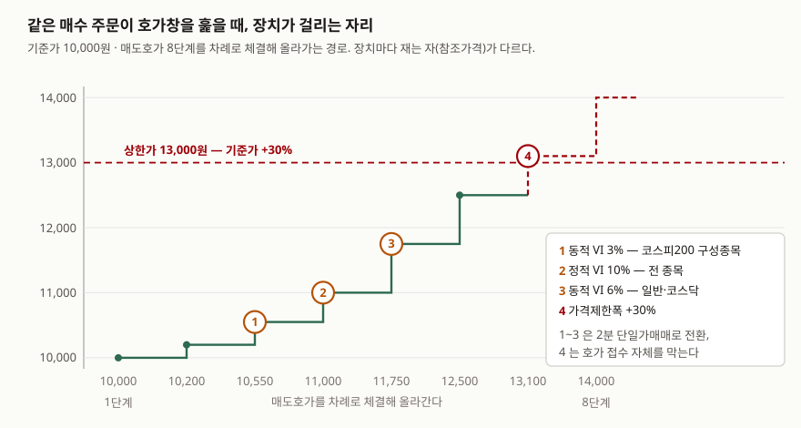

> 예제의 호가창과 주문 수량은 장치의 판정 순서를 보이려고 만든 가상 값이다. 실제 종목의 호가가 아니고, 호가 단계의 간격도 설명을 위해 임의로 벌려 두었다.

## 들어가며

거래가 한산한 종목에 시장가로 주문을 넣어 본 사람은 체결 통보를 보고 놀란 적이
있다. 호가창에 잔량이 몇백 주씩밖에 안 깔려 있어서, 한 번에 들어간 주문이 매도
호가를 네다섯 단계 쓸어 올리고 마지막 체결은 주문을 넣을 때 보던 가격보다 10%
넘게 높은 자리에서 난다. 그러다 "변동성완화장치 발동"이라는 안내가 뜨고 2분간
체결이 멈춘다.

이때 보통은 주문을 취소하고 다시 넣거나, 멈춘 이유를 모른 채 기다린다. 그런데
한국 시장에는 급변을 멈추는 장치가 한 종류가 아니라 여럿 있고, 각각 **다른 가격을
기준으로** 잰다. 어느 자리에서 어느 장치가 걸릴지는 호가창을 보면 미리 셀 수 있다.

## 개념

개별 종목의 급변에 걸리는 장치는 셋이다.

**가격제한폭**은 하루 동안 움직일 수 있는 범위를 당일 기준가격(보통 전일 종가)
대비 비율로 못 박는다. 유가증권시장과 코스닥시장은 ±30%이고 코넥스시장은 ±15%다.
그 밖의 가격은 **호가 접수 자체가 거부된다.** 체결을 멈추는 것이 아니라 주문이
들어오지 못한다.

**변동성완화장치(VI)**는 가격 범위를 하루 단위로 고정하지 않고 그날의 가격 변화에
맞춰 움직인다. 범위를 벗어나면 그 종목만 2분간 단일가매매로 바꿔 체결한다. 재는
자가 둘이라 이름도 둘이다. **동적 VI**는 직전 체결가와 비교해 짧은 순간의 급변을
잡고, **정적 VI**는 직전 단일가격과 비교해 누적된 변동을 잡는다.

가격제한폭만 있던 시절의 문제가 VI를 불러왔다. 자본시장연구원이 제도 개편을 평가한
보고서는 국내외 실증분석 40여 편을 근거로, 가격제한폭이 변동성을 줄이기보다 가격
발견을 늦추고 거래를 다음 날로 넘기며, 상한가에 가까워질수록 거래 수요가 오히려
증폭되는 자석효과(magnet effect)를 낳는다고 정리한다. 그래서 주요 거래소들이 일간
고정 범위 대신 일중 가격 변화에 연동되는 VI를 택해 왔고, 한국도 동적 VI를 2014년
9월 1일에, 정적 VI를 2015년 6월 15일에 도입하면서 같은 날 가격제한폭을 ±15%에서
±30%로 넓혔다.

시장 전체에 걸리는 장치는 따로 있다. **서킷브레이커**는 지수가 전일 종가 대비 8%·
15%·20% 하락한 상태가 1분간 이어지면 단계별로 발동해 모든 종목의 매매를 20분간
멈추고(3단계는 당일 장 종료), **사이드카**는 코스피200 선물이 기준가 대비 5% 이상
움직인 상태가 1분간 이어지면 프로그램매매 호가의 효력을 5분간 정지시킨다. 개별
종목이 아니라 시장이나 매매 방식 전체를 대상으로 한다는 점이 VI와 다르다.

| 장치 | 무엇과 비교하나 | 발동 폭 | 발동 시 | 시행 |
|---|---|---|---|---|
| 가격제한폭 | 당일 기준가격 | ±30%(코넥스 ±15%) | 호가 접수 거부 | 2015-06-15 확대 |
| 동적 VI | 직전 체결가 | 코스피200 3%, 일반·코스닥 6% (종가단일가는 2%·4%) | 2분 단일가매매 | 2014-09-01 |
| 정적 VI | 직전 단일가격 | ±10% | 2분 단일가매매 | 2015-06-15 |
| 서킷브레이커 | 지수 전일 종가 | 8% / 15% / 20% 하락 1분 지속 | 20분 중단, 3단계는 장 종료 | 단계별 발동 2015-06-15 |
| 사이드카 | 코스피200 선물 기준가 | ±5% 1분 지속 | 프로그램매매 호가 효력 5분 정지 | — |

## 구조



> **출처**: [한국거래소 규정·제도 — 유가증권시장 종목별 변동성완화장치](https://regulation.krx.co.kr/contents/RGL/03/03010409/RGL03010409.jsp)(참조가격·발동가격·2분 단일가매매) · [김준석, 「가격제한폭제도 개편의 영향 평가」, 자본시장연구원 『자본시장리뷰』 2015년 가을호, 94쪽](https://www.kcmi.re.kr/kcmifile/webzine_content/wz002001010/3817/webzinepdf_3817.PDF)(발동 비율과 시행일). 호가와 체결 경로는 아래 예제의 가상 값

## 동작 원리

세 장치가 **서로 다른 가격을 기준으로 잰다**는 것이 핵심이다. 같은 한 번의 체결을
두고도 셋이 보는 거리가 전부 다르다.

**동적 VI는 바로 앞 체결가와 비교한다.** 기준이 체결될 때마다 따라 올라가므로,
가격이 꾸준히 오르는 동안에는 한 단계 한 단계의 폭만 본다. 한 번에 멀리 뛰는
주문, 즉 호가 입력 착오나 순간적인 수급 불균형을 잡는 쪽이다.

**정적 VI는 직전 단일가격과 비교한다.** 거래소 안내는 정규장 시가가 정해지기
전에는 당일 기준가격을, 시가가 정해진 뒤에는 직전 단일가격을 참조가격으로 삼는다고
적는다(거래소는 이 기준 가격을 '참조가격'이라 부른다). 한 단계씩 조금씩 올라도
누적 10%를 넘으면 걸리므로, 동적 VI가 놓치는
완만한 상승을 잡는다.

**가격제한폭은 당일 기준가격 하나만 본다.** 그날 내내 자리가 고정되어 있고, 그
밖으로는 호가가 들어오지 못한다.

발동하면 그 종목은 2분간 단일가매매로 바뀐다. 호가 접수와 체결이 이어지되 체결
방식이 바뀌는 것이고, 가격·시간 우선의 원칙은 그대로다. 거래소 안내에 따르면 이미
발동된 VI의 단일가매매 중에는 새 VI를 적용하지 않고, 서킷브레이커가 발동하면 그때까지
발동돼 있던 VI는 취소된다. 정리매매종목과 단기과열종목은 VI 적용 대상이 아니고,
2021년 10월 18일 이후 신규상장 주권·DR은 상장일에 적용하지 않는다.

## 실습 예제

기준가 10,000원인 가상 종목의 매도호가 8단계에, 깔린 잔량 전부보다 많은 13,000주의
시장가 매수 주문 하나가 들어온다. 같은 호가창과 같은 주문을 두고 장치만 바꿔 가며
돌린다.

전체 소스: [`code/`](code/) · 수행 기록: [`code/output.txt`](code/output.txt)

```python
        if limit is not None and abs(price / BASE_PRICE - 1) > limit + EPS:
            ...  # 가격제한폭 — 당일 기준가격과 비교. 호가 접수 거부

        reasons = []
        if dynamic is not None and abs(price / last - 1) >= dynamic - EPS:
            reasons.append("동적VI")      # 직전 체결가와 비교
        if static is not None and abs(price / static_ref - 1) >= static - EPS:
            reasons.append("정적VI")      # 직전 단일가격과 비교
```

장치가 하나도 없으면 주문은 호가창을 끝까지 훑어 올라간다.

```text
[2] 장치가 하나도 없을 때
단계    체결가    체결수량   직전체결가대비   기준가대비
 1     10,000원    3,000주        +0.00%        +0.00%
 ...
 8     14,000원      800주        +6.87%       +40.00%
  → 체결 12,900주 · 미체결 100주 · 마지막 체결가 14,000원(+40.00%) · 평균 체결가 11,061원
```

장치를 하나씩만 켜면 각각 다른 자리에서 멈춘다.

```text
[6] 장치           첫 발동 단계   그때 호가     기준가대비
동적 VI 3%            3단계       10,550원      +5.50%
정적 VI 10%           4단계       11,000원     +10.00%
동적 VI 6%            5단계       11,750원     +17.50%
가격제한폭 30%         7단계       13,100원     +31.00%
```

이 종목이 코스피200 구성종목이라면 3단계에서, 일반 종목이라면 5단계에서 동적 VI가
걸린다. 둘 사이인 4단계에서는 정적 VI가 먼저 걸린다. 같은 호가창인데 종목이 어느
군에 속하느냐에 따라 체결이 5,500주에서 9,000주 사이로 갈린다.

**장치를 전부 켜도 주문이 남아 있으면 같은 길을 나눠서 간다.** 2분이 지나 재개한
뒤로도 다음 단계에서 다시 걸리기 때문이다.

```text
[7] 2분이 지나 재개하면
 4     11,000원   >> 정적VI 발동 — 2분 단일가매매로 전환
 5     11,750원   >> 동적VI 발동 — 2분 단일가매매로 전환
 6     12,500원   >> 동적VI 발동 — 2분 단일가매매로 전환
 7     13,100원   >> 가격제한폭 발동 — 호가 접수 거부
  → 체결 11,200주 · 미체결 1,800주 · 마지막 체결가 12,500원(+25.00%)
  → VI 발동 3회 · 가격제한폭으로 접수 거부 1회
```

VI를 세 번 거쳤는데도 마지막 체결가는 가격제한폭만 켰을 때와 같은 12,500원이다.
2분 동안 매도호가가 보충되지 않는다고 두면, VI가 바꾼 것은 도달점이 아니라 거기까지
가는 길이 몇 번 끊기느냐다. VI의 값어치는 그 2분에 반대쪽 호가가 들어오느냐에 달려
있고, 그래서 제도의 이름도 '중단'이 아니라 '완화'다.

```text
[8] 경우                      체결수량   평균 체결가   마지막 체결가
장치 없음                 12,900주      11,061원      14,000원
가격제한폭만              11,200주      10,688원      12,500원
동적 VI 6% 에서 정지       9,000주      10,344원      11,000원
정적 VI 10% 에서 정지      7,500주      10,213원      10,550원
```

## 실무에서 주의할 점

**첫째, 내 주문이 VI를 부르는 쪽일 수 있다.** 예제의 주문은 호가창에 깔린 잔량
12,900주보다 많은 13,000주였다. 잔량이 얇은 종목에 시장가나 넓은 지정가로 한 번에
넣으면 호가 단계를 건너뛰며 올라가고, 그 폭이 동적 VI의 3%나 6%를 넘는 순간 발동한다.
VI는 가격이 비싸거나 싸서 걸리는 것이 아니라 **한 번에 멀리 뛰어서** 걸린다. 주문을
나눠 넣으면 단계 간 폭이 작아져 같은 수량이라도 발동하지 않을 수 있다. 호가창을
읽는 법은 같은 블로그의
[호가와 체결](../2026-10-06-order-book-matching/index.md) 글에 있다.

**둘째, 종목군과 매매 세션에 따라 숫자가 다르다.** 동적 VI는 코스피200 구성종목이
3%, 유가 일반종목과 코스닥종목이 6%이고, 종가단일가 시간대에는 각각 2%와 4%로
좁아진다. ETF·ETN은 기초지수 유형별로 또 따로 정해져 있다. 거래소 규정·제도 안내는
정규장 밖 세션에도 VI를 두고 그 세션에 체결이 없으면 정규장 종가를 참조가격으로
삼는다고 적는데, 세션별 비율이 따로 있으므로 정규장 숫자를 그대로 가져다 쓰면 안
된다. 매매하는 종목과 시간대의 수치를 거래소 안내에서 확인한다.

**셋째, VI가 안 걸리는 종목과 날이 있다.** 정리매매종목과 단기과열종목은 적용
대상에서 빠지고, 2021년 10월 18일 이후 신규상장한 주권과 DR은 상장일에 적용하지
않는다. 가격 변동이 가장 클 수 있는 자리가 오히려 적용 제외라는 뜻이므로, 그런
종목에 주문을 낼 때는 멈춰 줄 장치가 없다고 보고 지정가를 쓰는 편이 안전하다.

**넷째, 장치가 겹치면 상위 장치가 아래를 지운다.** 서킷브레이커가 발동하면 그때까지
발동돼 있던 VI는 취소된다. 이미 발동된 VI의 단일가매매 중에는 새 VI를 적용하지
않는다. 체결 통보와 호가창만 보고 있으면 멈춘 이유가 어느 장치인지 헷갈리기 쉬운데,
장치마다 멈추는 시간(VI 2분, 서킷브레이커 20분, 사이드카 5분)과 범위(한 종목, 시장
전체, 프로그램매매 호가)가 다르므로 그 셋으로 구분한다.

**다섯째, 멈췄다는 사실이 방향을 말해 주지는 않는다.** VI는 오를 때도 내릴 때도
같은 비율로 걸린다. 발동 횟수가 많다는 것은 그 종목의 호가가 얇고 한 번에 멀리
뛰는 주문이 들어왔다는 뜻이지, 그 이상도 이하도 아니다. 예제에서도 장치를 켜고
끄는 것으로 바뀐 것은 체결 수량과 평균 체결가였고, 주문이 향한 방향은 그대로였다.

## 정리

- 개별 종목에 걸리는 장치는 셋이고, 각각 **다른 가격을 기준으로** 잰다. 동적 VI는
  직전 체결가, 정적 VI는 직전 단일가격, 가격제한폭은 당일 기준가격이다.
- 참조가격이 다르므로 발동 순서가 갈린다. 예제에서는 코스피200 구성종목이면
  동적 VI가 3단계에서, 일반 종목이면 정적 VI가 4단계에서 먼저 걸렸다.
- VI는 2분간 단일가매매로 바꿀 뿐 호가를 막지 않는다. 가격제한폭은 반대로 그 밖의
  호가를 받지 않는다. 예제에서 마지막 체결가를 정한 것은 가격제한폭이었다.
- 2분 동안 반대쪽 호가가 보충되지 않으면 재개 뒤 다시 걸린다. 장치가 바꾼 것은
  도달점이 아니라 거기까지 가는 길이 끊기는 횟수였다.
- 가격제한폭이 가격 발견을 늦추고 자석효과를 낳는다는 실증 결과가 VI 도입의 배경이다.
  두 장치는 대체재가 아니라 다른 구간을 맡는다.

## 참고 자료

- [한국거래소 규정·제도 — 유가증권시장 종목별 변동성완화장치](https://regulation.krx.co.kr/contents/RGL/03/03010409/RGL03010409.jsp) — 참조가격, 발동가격, 2분 단일가매매, 적용 제외 종목, 서킷브레이커 발동 시 VI 취소
- [한국거래소 규정·제도 — 코스닥시장 종목별 변동성완화장치](https://regulation.krx.co.kr/contents/RGL/03/03020407/RGL03020407.jsp) — 코스닥시장 기준
- [김준석, 「가격제한폭제도 개편의 영향 평가」, 자본시장연구원 『자본시장리뷰』 2015년 가을호, 91~95쪽](https://www.kcmi.re.kr/kcmifile/webzine_content/wz002001010/3817/webzinepdf_3817.PDF) — 동적 VI 2014-09-01·정적 VI 2015-06-15 시행, 발동 비율, 가격제한폭 ±15%→±30% 확대, 자석효과·가격발견 지연·변동성 전이에 관한 실증 정리
- [법제처 찾기쉬운 생활법령정보 — 서킷브레이커·매매거래정지 및 시장경보제도](https://www.easylaw.go.kr/CSP/CnpClsMain.laf?popMenu=ov&csmSeq=1701&ccfNo=3&cciNo=1&cnpClsNo=1) — 서킷브레이커 단계별 기준과 사이드카 발동 요건 (2026-09-15 기준)
- [한국거래소 규정·제도 — 유가증권시장 단기과열완화제도](https://regulation.krx.co.kr/contents/RGL/03/03020406/RGL03020406.jsp) — VI 적용 제외 대상인 단기과열종목
