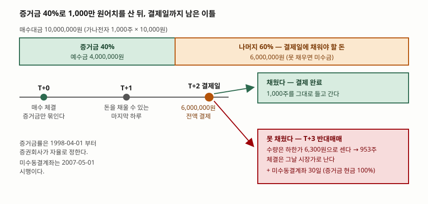

> 예제의 회사 **가나전자**는 실재하지 않는다. 주가·예수금·증거금률·연체이자율은 계산 구조를 보이려고 만든 값이고, 특정 종목이나 특정 증권사의 기준이 아니다.

## 들어가며

증권 계좌에 400만 원을 넣고 한 종목의 매수 주문 화면을 열면, 주문 가능 수량이
400만 원어치가 아니라 1,000만 원어치로 뜨는 경우가 있다. 내 돈은 400만 원인데
그보다 많이 주문이 들어간다. 그대로 1,000주를 사면 체결 통보도 정상으로 온다.

여기서 많은 사람이 "증권사가 한도를 넉넉히 잡아 준 것" 정도로 넘긴다. 그리고
이틀 뒤 "미수금 발생" 문자를 받고, 그 다음 날 아침 사지도 판 적도 없는 주식이
953주 팔려 있는 것을 본다. 주문 화면의 1,000만 원은 한도가 아니라 **이틀 뒤에
600만 원을 채워 넣겠다는 약속**이었다. 그 약속의 이름이 증거금이다.

## 개념

**위탁증거금**은 증권회사가 투자자의 결제 이행을 확보하려고 미리 받아 두는 현금
또는 증권이다. 매수 주문에는 현금이나 대용증권으로, 매도 주문에는 매도하는 증권·
현금·대용증권으로 받을 수 있고, 근거는 「유가증권시장 업무규정」 제87조 제1항과
「코스닥시장 업무규정」 제42조 제1항이다.

중요한 것은 **징수율을 거래소가 정하지 않는다**는 점이다. 1998년 4월 1일부터
증권회사가 자율로 결정하며, 법제처 생활법령정보는 현재 대부분의 증권사가
개인투자자에게 약 40% 수준을 적용한다고 적는다. 그래서 같은 종목이라도 증권사와
고객 등급에 따라 주문 가능 금액이 다르게 나온다.

증거금률이 40%라는 말은 **매수대금의 40%만 지금 묶어 두고 나머지 60%는 결제일에
낸다**는 뜻이다. 주식 매매는 체결된 날 돈과 주식이 오가지 않는다. 보통거래의 결제는
체결일을 포함해 3영업일째 되는 날, 즉 T+2에 이루어진다. 체결일과 결제일 사이의
이틀이 증거금 제도가 들어앉는 자리다.

그 이틀 안에 나머지를 못 채우면 그 금액이 **미수금**이 된다. 증권회사는 약관에
따라 계좌의 재산을 처분해 미수금을 회수하는데, 이것이 **반대매매**다. 내가 낸
주문이 아니라 증권회사가 내 계좌에서 실행하는 매도다.

제도 쪽 장치도 하나 붙는다. **미수동결계좌**는 미수가 발생한 투자자의 계좌를
일정 기간 묶는다. 「유가증권시장 업무규정」 제89조와 「코스닥시장 업무규정」
제42조 개정으로 2007년 5월 1일 시행됐고, 매수로 요건에 해당하면 익영업일(T+3)부터
30일, 매도로 해당하면 90일 동안 위탁증거금을 100% 받으며 **대용증권은 인정되지
않는다.** 그 사람 이름으로 된 모든 계좌가 함께 묶인다.

## 구조



> **출처**: 위탁증거금의 정의와 「유가증권시장 업무규정」 제87조 제1항·1998-04-01 자율화는 [법제처 찾기쉬운 생활법령정보 — 주식거래 방법 이해하기](https://www.easylaw.go.kr/CSP/CnpClsMainBtr.laf?popMenu=ov&csmSeq=1701&ccfNo=2&cciNo=1&cnpClsNo=1), 미수동결계좌의 근거 조문과 2007-05-01 시행·30일 지정은 [금융투자협회 — 증권 미수 동결계좌제도 시행 안내](https://m.kofia.or.kr/brd/m_31/view.do?seq=538&company_cd=&company_nm=&itm_seq_1=0&itm_seq_2=0&multi_itm_seq=0&srchFr=&srchTo=&srchTp=&srchWord=), 반대매매 수량을 하한가로 산정하는 방식은 [금융투자협회 법규정보시스템 — 신용거래(융자·대주) 설명서 예시안](https://law.kofia.or.kr/service/law/lawFullScreenContent.do?seq=281&historySeq=1464). 수량과 금액은 이 글의 [`code/output.txt`](code/output.txt) `[3]`에서 옮겼다.

그림에서 눈여겨볼 것은 **위쪽 막대의 두 칸이 시간 축의 두 갈래와 짝이 된다**는
점이다. 주황 칸 600만 원은 T+2까지 비어 있는 자리고, 그 자리를 채우면 초록 경로,
못 채우면 붉은 경로로 간다. 갈림길은 매수한 순간이 아니라 이틀 뒤에 열린다.

## 동작 원리

### 증거금률이 낮을수록 결제일 부담이 커진다

증거금률을 바꿔 가며 같은 예수금 400만 원의 주문 한도를 세면 이렇게 나온다.

```text
    증거금률         주문 가능액       수량        결제일 부족액
    100%    4,000,000원     400주            0원
     40%   10,000,000원   1,000주    6,000,000원
     30%   13,333,333원   1,333주    9,330,000원
     20%   20,000,000원   2,000주   16,000,000원
```

증거금으로 낸 400만 원도 결제대금의 일부다. 따로 떼어 둔 보증금이 아니라 선금이다.
그래서 결제일에 채워야 할 돈은 **매수대금에서 예수금을 뺀 나머지**가 된다.
증거금률 100%에서만 이 값이 0원이고, 미수가 아예 생기지 않는다.

### 주가 변동은 내 몫에서 증거금률의 역수만큼 커진다

증거금률 40%로 1,000주를 사면 매수대금 1,000만 원 중 600만 원이 빚이다. 주가가
움직여도 빚은 그대로이므로 변동은 전부 내 몫에서 난다.

| 주가 | 평가금액 | 내 몫 | 주가 변동 | 내 몫 변동 |
|---|---|---|---|---|
| 11,000원 | 11,000,000원 | 5,000,000원 | +10% | +25.0% |
| 10,000원 | 10,000,000원 | 4,000,000원 | 0% | 0.0% |
| 9,000원 | 9,000,000원 | 3,000,000원 | −10% | −25.0% |
| 7,000원 | 7,000,000원 | 1,000,000원 | −30% | −75.0% |

배수는 1 ÷ 0.40 = 2.5다. 증거금률 20%면 5배가 된다. 오를 때와 내릴 때의 배수가
같다는 점이 중요하다. 증거금률은 수익률을 높이는 장치가 아니라 **변동 폭을 그만큼
키우는 장치**이고, 방향을 고르지 않는다.

### 반대매매 수량은 하한가로 세고, 체결은 그날 가격으로 난다

여기가 가장 오해가 많은 자리다. 증권사 약관이 흔히 쓰는 방식은 처분 수량을
**전일 종가의 하한가** 기준으로 산정하는 것이다. 금융투자협회의 신용거래 설명서
예시안도 같은 방식을 적는다. 하한가는 가장 나쁜 경우의 체결가이므로, 그 값으로
나눈 수량은 어떤 가격에 팔려도 모자라지 않을 만큼 많다.

T+2 종가가 9,000원이면 하한가는 6,300원이고, 미수금 600만 원을 메우는 데 필요한
수량은 953주로 계산된다. 그런데 실제 체결은 당일 시장가로 난다.

```text
      실제 체결가           처분금액          모자란 돈과의 차
      6,300원    6,003,900원        3,900원
      8,000원    7,624,000원    1,624,000원
      9,000원    8,577,000원    2,577,000원
      9,500원    9,053,500원    3,053,500원
```

하한가까지 빠지지 않으면 처분금액이 미수금을 크게 넘는다. 남는 돈은 계좌로
돌아오지만, 돌아오는 것은 현금이지 주식이 아니다. 9,000원에 팔렸다면 미수금보다
257만 원어치를 더 판 것이고, 그 257만 원어치 주식은 내가 고르지 않은 날 내가
고르지 않은 가격에 정리됐다.

### 동결 기간에는 대용증권이 통하지 않는다

반대매매로 미수금을 정리해도 끝이 아니다. 미수동결계좌로 지정되면 30일 동안
위탁증거금을 현금으로 100% 내야 하고 대용증권은 인정되지 않는다. 남은 주식을
들고 있어도 증거금으로 쓸 수 없으니, 그 기간의 매수 한도는 **보유 현금 그 자체**다.
평소 증거금률 40%에서 300만 원이 750만 원까지 주문할 수 있었다면, 동결 중에는
300만 원이 한도가 된다.

## 실습 예제

전체 소스: [`code/`](code/) · 실행 기록: [`code/output.txt`](code/output.txt)

```python
def buying_power():
    """증거금률별로 예수금 400만 원이 주문할 수 있는 금액과 수량."""
    for rate in MARGIN_RATES:
        limit = CASH / rate
        qty = int(limit // PRICE)
        amount = qty * PRICE
        # 증거금으로 낸 돈도 결제대금의 일부다. 결제일에는 전액이 필요하므로
        # 모자란 돈은 매수대금에서 예수금을 뺀 나머지가 된다.
        short = max(0, amount - CASH)
```

```python
def forced_sale(rate):
    short = qty * PRICE - CASH
    floor_price = round(SETTLE_PRICE * (1 - LOWER_LIMIT) / 10) * 10  # 호가단위 10원
    need_qty = min(math.ceil(short / floor_price), qty)
    for price in (floor_price, 8_000, SETTLE_PRICE, 9_500):
        proceeds = need_qty * price
```

```bash
python margin_deposit.py
```

## 실무에서 주의할 점

**주문 가능 금액은 내 돈이 아니다.** 화면에 뜨는 수치는 증거금률을 역산한 값이고,
그 중 증거금률만큼만 내 예수금이다. 한도까지 주문했다면 그 순간 결제일 부채가
확정된다. 이틀 안에 채우지 못할 금액이면 애초에 주문하지 않는 편이 낫다.

**증거금률은 종목별로, 그리고 수시로 바뀐다.** 증권회사가 자율로 정하므로 같은
계좌에서도 종목에 따라 다르고, 변동성이 커지면 회사가 특정 종목의 증거금률을
100%로 올리기도 한다. 어제 되던 주문이 오늘 안 되는 이유가 대개 이것이다.

**결제일 전에 팔아도 미수는 남을 수 있다.** 금융투자협회 안내는 매수 후 결제 전에
전량 매도해 포지션을 정리했더라도 실제 결제대금이 납입되지 않았다면 동결계좌
요건에 해당한다고 설명한다. "팔았으니 없던 일"이 되지 않는다는 뜻이다.

**반대매매는 가장 나쁜 아침에 걸린다.** 미수금은 주가가 내려서 생기는 것이 아니라
결제일에 돈이 없어서 생기지만, 돈이 모자란 상황과 주가가 내린 상황은 대개 같이
온다. 수량 산정의 기준인 하한가도 전일 종가가 내려간 만큼 함께 내려가므로,
주가가 낮을수록 같은 미수금을 메우는 데 더 많은 주식이 팔린다.

**동결은 사람 단위다.** 금융투자협회 안내에 따르면 요건에 해당하면 해당 고객의
모든 계좌가 묶인다. 다른 증권사에 계좌가 있어도 피해 가지 않는다.

## 정리

- 증거금은 결제 이행을 확보하려고 미리 받는 담보이고, 징수율은 1998-04-01부터
  증권회사가 자율로 정한다 (「유가증권시장 업무규정」 제87조 제1항).
- 증거금률 40%는 매수대금의 60%를 T+2까지 채우겠다는 약속이다. 채우지 못한 금액이
  미수금이다.
- 주가 변동은 내 몫에서 증거금률의 역수(40%면 2.5배)만큼 나타난다. 오를 때와
  내릴 때가 같은 배수다.
- 반대매매 수량은 하한가로 세고 체결은 당일 가격으로 나므로, 처분금액이 미수금을
  넘는 것이 보통이다.
- 미수동결계좌는 2007-05-01 시행이며, 매수 요건이면 T+3부터 30일간 증거금 현금
  100%·대용증권 불인정이 그 사람의 모든 계좌에 걸린다.

## 참고 자료

- [법제처 찾기쉬운 생활법령정보 — 주식거래 방법 이해하기](https://www.easylaw.go.kr/CSP/CnpClsMainBtr.laf?popMenu=ov&csmSeq=1701&ccfNo=2&cciNo=1&cnpClsNo=1) — 위탁증거금의 정의, 「유가증권시장 업무규정」 제87조 제1항·「코스닥시장 업무규정」 제42조 제1항, 1998-04-01 징수율 자율화, 개인투자자 약 40% 수준
- [금융투자협회 — 증권 미수 동결계좌제도 시행 안내](https://m.kofia.or.kr/brd/m_31/view.do?seq=538&company_cd=&company_nm=&itm_seq_1=0&itm_seq_2=0&multi_itm_seq=0&srchFr=&srchTo=&srchTp=&srchWord=) — 「유가증권시장 업무규정」 제89조·「코스닥시장 업무규정」 제42조 개정, 2007-05-01 시행, 매수 30일·매도 90일, 위탁증거금 100%·대용증권 불인정, 전 계좌 적용, 10만 원 이하 등 예외
- [금융투자협회 법규정보시스템 — 신용거래(융자·대주) 설명서 예시안](https://law.kofia.or.kr/service/law/lawFullScreenContent.do?seq=281&historySeq=1464) — 반대매매 수량을 전일 종가의 하한가 기준으로 산정하는 방식, 처분 순서(예탁 현금 → 담보증권 → 그 밖의 증권), 다음 영업일 집행. 신용거래용 표준 예시안이며 미수금 처리의 구체 기준은 증권회사 약관마다 다르다
