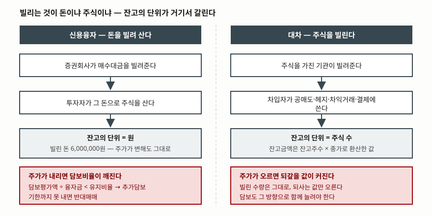

> 예제의 회사 **가나전자**는 실재하지 않는다. 주가·융자금·담보유지비율·공매도 비중은 계산 구조를 보이려고 만든 값이고, 특정 종목이나 특정 증권사의 기준이 아니다.

## 들어가며

시장이 흔들리는 날이면 기사 제목에 숫자 두 개가 나란히 붙는다. "신용융자 잔고
20조 원", "대차 잔고 125조 원". 자리와 단위가 비슷해 보이니 둘을 같은 저울에
올려 비교하게 되고, 대차 잔고가 여섯 배쯤 크니 그쪽이 더 큰 위험이라고 읽는다.

그런데 두 숫자는 **세는 대상부터 다르다.** 하나는 빌린 돈이고 다른 하나는 빌린
주식이다. 단위가 원과 주식 수로 갈리고, 그래서 주가가 움직일 때 보이는 값도
갈린다. 둘을 같은 축에 놓고 비교하면 양쪽 다 잘못 읽는다.

## 개념

**신용융자**는 증권회사가 매수대금을 빌려주는 것이다. 자기 돈 400만 원에 600만
원을 빌려 1,000만 원어치를 사면, 산 주식이 그대로 담보가 되고 빌린 600만 원이
**신용융자 잔고**로 남는다. 단위는 원이다. 증거금만 내고 사서 결제일까지 나머지를
채우는 [미수거래](../2026-10-19-margin-deposit-and-forced-liquidation/index.md)와
달리, 처음부터 대출로 약정하고 이자를 내며 상환기일까지 끌고 간다.

**대차거래**는 주식을 가진 쪽이 수수료를 받고 빌려주는 것이다. 빌린 쪽은 같은
종목·같은 수량으로 돌려준다. 빌려서 아직 갚지 않은 수량이 **대차 잔고**이고,
단위는 주식 수다. 금융위원회가 공공데이터로 내보내는 주식대차거래정보는
**잔고금액을 해당일자의 잔고주수에 종가를 곱해 산출한다**고 밝힌다. 기사에
나오는 "125조 원"은 세어진 값이 아니라 환산된 값이라는 뜻이다.

빌린 주식의 쓰임새는 하나가 아니다. [공매도](../2026-10-06-short-selling-mechanics/index.md)가
가장 알려진 용도지만 차익거래·헤지·결제 목적으로도 쓰인다. 차입공매도를 목적으로
대차거래 계약을 체결한 자는 종목·수량·체결일시·상대방·대차기간·수수료율을
5년간 보관해야 하고(자본시장법 제180조의5), 사후 조작이 불가능한 방법으로만
보관할 수 있다.

**담보**는 양쪽 모두에 붙지만 방향이 반대다. 신용융자는 주가가 **내리면** 담보가
모자라고, 대차는 주가가 **오르면** 되갚을 값이 커진다. 신용공여의 최소 담보비율은
금융투자업규정 제4-25조가 신용공여액의 140%로 정하고 있으며, 금융위원회·금융감독원
법령해석은 이것이 **최소 기준**이고 실제 징수 비율은 약관에서 그 이상으로 정한다고
밝혔다. 금융투자협회의 신용거래 설명서 예시안은 종목군에 따라 140%·145%·150%·160%를
적용하고 한 계좌에 여러 종목군이 섞이면 가중평균으로 계좌 비율을 낸다고 적는다.

## 구조



> **출처**: 담보유지비율 140% 최소 기준은 [금융위원회·금융감독원 법령해석 — 신용공여 관련 담보비율 관련 질의 (2014-12-31, 금융투자업규정 제4-25조)](https://casenote.kr/%EA%B8%88%EC%9C%B5%EC%9C%84%EC%9B%90%ED%9A%8C%C2%B7%EA%B8%88%EC%9C%B5%EA%B0%90%EB%8F%85%EC%9B%90/e35d8aab4c), 종목군별 비율과 추가담보 기한은 [금융투자협회 법규정보시스템 — 신용거래(융자·대주) 설명서 예시안](https://law.kofia.or.kr/service/law/lawFullScreenContent.do?seq=281&historySeq=1464), 잔고금액 = 잔고주수 × 종가는 [금융위원회 — 주식대차거래정보 (공공데이터포털)](https://www.data.go.kr/data/15124865/openapi.do). 금액은 이 글의 [`code/output.txt`](code/output.txt) `[1]`·`[3]`에서 옮겼다.

그림의 두 열은 같은 모양으로 내려오지만 **맨 아래 붉은 칸의 방향이 반대다.**
왼쪽은 주가가 내릴 때, 오른쪽은 주가가 오를 때 쫓긴다. 같은 종목에 두 잔고가
함께 쌓여 있다면, 주가가 어느 쪽으로 가든 한쪽은 밀린다.

## 동작 원리

### 담보비율은 분자만 움직여서 내려간다

신용융자 600만 원으로 1,000주를 들고 있을 때, 담보는 당일 종가로 평가되고
융자금은 주가와 무관하게 그대로다. 그래서 비율은 분자 쪽만 흔들린다.

| 주가 | 담보평가액 | 담보비율 | A군(140%) | D군(160%) |
|---|---|---|---|---|
| 10,000원 | 10,000,000원 | 166.7% | 유지 | 유지 |
| 9,500원 | 9,500,000원 | 158.3% | 유지 | 부족 |
| 9,000원 | 9,000,000원 | 150.0% | 유지 | 부족 |
| 8,400원 | 8,400,000원 | 140.0% | 유지 | 부족 |
| 8,300원 | 8,300,000원 | 138.3% | 부족 | 부족 |
| 7,200원 | 7,200,000원 | 120.0% | 부족 | 부족 |

같은 포지션인데 종목군이 D군이면 5% 하락에서 이미 부족이고 A군이면 17% 하락까지
버틴다. 종목군을 나누는 일이 곧 미달 지점을 앞당기는 일이다. 설명서 예시안은
추가담보 기한도 비율에 따라 나눈다 — 140%~160% 미만이면 요구일로부터 1영업일
이내, 120% 미만이면 **요구일 당일 이내**다.

### 현금으로 메우는 것과 주식으로 메우는 것은 크기가 다르다

부족분을 현금으로 넣으면 담보만 늘고 융자금은 그대로다. 주식을 팔면 처분대금이
융자금을 갚으므로 분자와 분모가 같이 줄어든다. 수식은 달라도 결과를 가르는 것은
**처분가격을 얼마로 잡느냐**다. 증권사는 보수적으로 전일 종가의 하한가를 쓴다.

```text
       주가      담보비율          추가담보 현금        반대매매 수량           처분금액
   8,300원    138.3%         100,000원            67주       469,000원
   8,000원    133.3%         400,000원           223주     1,561,000원
   7,200원    120.0%       1,200,000원           462주     3,234,000원
   6,500원    108.3%       1,900,000원           576주     4,032,000원
```

120%까지 밀린 자리에서 현금은 120만 원이면 되는데 주식으로는 323만 원어치가
팔린다. 산식은 증권사마다 다르므로 수치 자체보다 **방향**을 본다. 늦게 대응할수록
현금과 주식의 간격이 벌어지고, 파는 쪽은 그 간격만큼 더 많이 정리된다.

### 잔고금액은 주가를 안고 있다

같은 포지션을 그대로 둔 채 주가만 움직여 보면 두 잔고가 갈라진다.

| 주가 | 신용융자 잔고 | 대차 잔고(수량) | 대차 잔고(금액) |
|---|---|---|---|
| 10,000원 | 6,000,000원 | 1,000,000주 | 10,000,000,000원 |
| 9,000원 | 6,000,000원 | 1,000,000주 | 9,000,000,000원 |
| 6,500원 | 6,000,000원 | 1,000,000주 | 6,500,000,000원 |

한 주도 더 빌리거나 갚지 않았는데 금액은 35% 움직였다. 반대로 주가가 오르는
구간에서는 대차 잔고 금액이 **저절로 신고가를 쓴다.** "대차 잔고 역대 최고"라는
문장을 읽을 때 수량이 늘어난 것인지 종가가 올라간 것인지를 먼저 갈라야 하는
이유다. 신용융자 잔고에는 이 문제가 없다. 빌린 돈의 액수는 주가와 무관하다.

### 대차 잔고로는 공매도 물량을 셀 수 없다

빌린 주식이 전부 공매도로 나가지는 않는다. 비중을 모르면 같은 대차 잔고가
전혀 다른 매도 물량과 맞물린다.

```text
        공매도 비중(가정)        시장에 나온 매도          남은 용도
                0%               0주     1,000,000주
               30%         300,000주       700,000주
              100%       1,000,000주             0주
```

위 비중은 가정값이고 실제 비중을 뜻하지 않는다. 요점은 **폭이 0주에서 100만
주까지 열려 있다**는 것이다. 공매도 수량을 알고 싶으면 대차 잔고가 아니라 따로
공표되는 공매도 통계를 본다. 두 숫자는 겹치는 부분이 있을 뿐 같은 것이 아니다.

## 실습 예제

전체 소스: [`code/`](code/) · 실행 기록: [`code/output.txt`](code/output.txt)

```python
def fill_the_gap(keep=1.40):
    """담보 부족을 현금으로 메울 때와 반대매매로 메울 때."""
    floor_price = round(PREV_CLOSE * (1 - LOWER_LIMIT) / 10) * 10
    for price in PRICES:
        value = QTY * price
        if value / LOAN >= keep:
            continue
        # 현금을 넣으면 담보만 늘고 융자금은 그대로다.
        cash_needed = keep * LOAN - value
        # 주식을 팔면 처분대금이 융자금을 갚으므로 분모도 함께 줄어든다.
        # (QTY-n)*price >= keep * (LOAN - n*floor_price) 를 n 에 대해 푼다.
        denom = keep * floor_price - price
        qty_needed = math.ceil((keep * LOAN - value) / denom) if denom > 0 else QTY
```

```bash
python borrowed_positions.py
```

## 실무에서 주의할 점

**두 잔고를 같은 축에 올리지 않는다.** 하나는 원, 하나는 주식 수다. 대차 잔고를
금액으로 환산한 값과 신용융자 잔고를 나란히 놓으면 분모가 다른 분수를 더하는
셈이 된다. 굳이 비교하려면 대차 쪽은 수량 추이를, 신용융자 쪽은 금액 추이를
각각 본다.

**잔고금액의 변화는 수량과 종가로 나눠 읽는다.** 잔고금액 = 잔고주수 × 종가이므로,
금액이 늘었다는 사실만으로는 빌린 양이 늘었는지 알 수 없다. 종가가 오른 날의
잔고금액 증가는 대부분 종가 쪽이다.

**대차 잔고를 공매도 예고로 읽지 않는다.** 빌린 주식은 차익거래·헤지·결제에도
쓰인다. 잔고가 늘었다는 것은 빌린 수량이 늘었다는 것까지만 말해 준다.

**담보비율은 계좌 단위로 가중평균된다.** 설명서 예시안은 한 계좌에 여러 종목군이
있으면 가중평균으로 계좌 비율을 계산한다고 적는다. 유지비율이 낮은 종목만 보고
안심하면, 비율 높은 종목이 섞여 있을 때 계좌 전체 기준이 달라진다.

**140%는 바닥이지 기준선이 아니다.** 금융투자업규정이 정한 140%는 금융투자업자가
지켜야 할 최소 담보비율이고, 투자자에게 실제로 적용되는 비율은 약관이 정한다.
내 계좌에 걸린 숫자는 거래하는 증권사의 신용거래 약관에서 확인한다.

## 정리

- 신용융자 잔고는 **빌린 돈**이라 단위가 원이고 주가가 변해도 그대로다.
- 대차 잔고는 **빌린 주식 수**이고, 금액은 잔고주수 × 종가로 환산한 값이라
  주가를 그대로 안고 있다.
- 담보는 신용융자에서 주가 하락이, 대차에서 주가 상승이 압박한다. 방향이 반대다.
- 금융투자업규정의 140%는 최소 담보비율이고, 종목군별 실제 비율과 추가담보 기한은
  증권사 약관이 정한다.
- 대차 잔고로는 공매도 물량을 가릴 수 없다. 공매도 수량은 따로 공표되는 통계를 본다.

## 참고 자료

- [금융위원회·금융감독원 법령해석 — 신용공여 관련 담보비율 관련 질의 (2014-12-31)](https://casenote.kr/%EA%B8%88%EC%9C%B5%EC%9C%84%EC%9B%90%ED%9A%8C%C2%B7%EA%B8%88%EC%9C%B5%EA%B0%90%EB%8F%85%EC%9B%90/e35d8aab4c) — 금융투자업규정 제4-25조의 신용공여액 140%가 최소 담보비율이고 실제 징수 비율은 약관이 정한다는 회신
- [금융투자협회 법규정보시스템 — 신용거래(융자·대주) 설명서 예시안](https://law.kofia.or.kr/service/law/lawFullScreenContent.do?seq=281&historySeq=1464) — 종목군별 담보유지비율 140·145·150·160%, 계좌 가중평균, 추가담보 기한(140~160% 미만 1영업일·120% 미만 당일), 담보 당일 종가 평가, 처분 순서와 다음 영업일 집행
- [금융위원회 — 주식대차거래정보 (공공데이터포털)](https://www.data.go.kr/data/15124865/openapi.do) — 잔고금액은 해당일자의 잔고주수에 종가를 곱해 산출한다는 항목 정의
- [금융위원회 보도자료 — 공매도 관련 자본시장법 시행령 일부개정령안 입법예고 (2021-01-13)](https://fsc.go.kr/no010101/75137) — 자본시장법 제180조의5에 따른 대차거래정보 5년 보관 의무, 보관 대상 항목(종목·수량·체결일시·상대방·대차기간·수수료율)과 조작 불가능한 보관 방법
