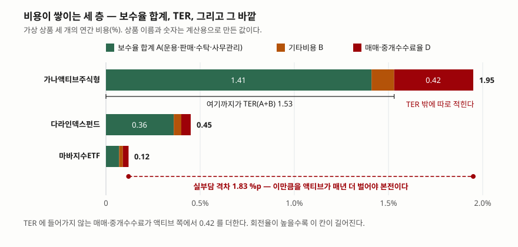
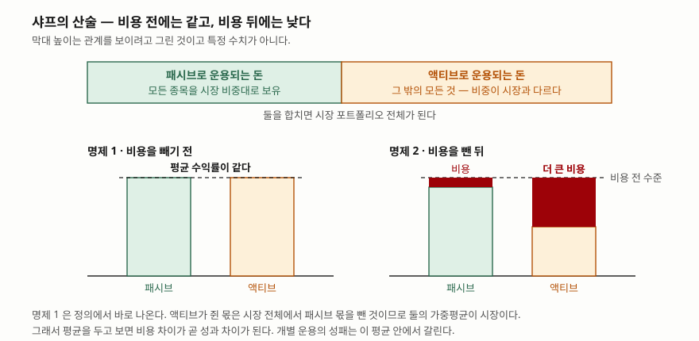

> 예제의 `가나액티브주식형`·`다라인덱스펀드`·`마바지수ETF` 와 그 보수·비용은 계산 원리를 보이려고 만든 가상 값이다. 실재하는 상품과 관계가 없다.

## 들어가며

퇴직연금 계좌에서 상품을 고르는 화면을 연다. 같은 지수를 벤치마크로 두는 상품이 열 개 넘게 뜨고, 목록은 기본값으로 최근 1년 수익률 순으로 정렬돼 있다. 맨 위 상품이 아래쪽보다 2%p 높다. 이때 대부분은 위에서 서너 개를 비교하고 하나를 고른다. 그런데 같은 줄에 적힌 총보수는 0.09%부터 1.5%까지 열 배 넘게 벌어져 있다. 1년 수익률 순위는 해마다 뒤집히지만 보수는 해마다 같은 크기로 빠지고, 그 빠진 자리에서 다시 복리가 돌지 않는다. 30년을 두면 둘 중 어느 쪽이 잔액을 더 많이 움직였는지는 계산해 보면 바로 나온다.

## 개념

**패시브 운용**은 시장에 있는 모든 종목을 시장에서의 비중 그대로 들고 가는 것이다. 어떤 종목이 시장 가치의 3%면 포트폴리오에서도 3%를 그 종목에 둔다. **액티브 운용**은 그렇지 않은 모든 것이다. 비중이 시장과 다르고, 값이 잘못 매겨졌다고 본 자리에서 자주 사고판다. 윌리엄 샤프는 1991년 글에서 이 둘을 이렇게 정의하고 두 명제를 세웠다.

1. **비용을 빼기 전**, 액티브로 운용되는 돈의 평균 수익률은 패시브로 운용되는 돈의 평균 수익률과 같다.
2. **비용을 뺀 뒤**, 액티브의 평균 수익률은 패시브보다 낮다. 리서치와 거래에 돈을 더 쓰기 때문이다.

첫 명제는 정의에서 바로 나온다. 패시브가 쥔 몫은 시장을 축소해 놓은 것이므로 수익률이 시장과 같고, 나머지가 액티브의 몫이니 그 가중평균도 시장과 같을 수밖에 없다. 여기에 비용을 넣으면 두 번째 명제가 된다. **그래서 평균을 두고 볼 때 비용 차이는 성과 차이의 일부가 아니라 전부다.**

비용이 어디에 적혀 있는지도 알아 둬야 한다. 금융투자협회 전자공시의 펀드별 보수비용비교 화면은 보수율을 운용·판매·수탁·사무관리 넷으로 나눠 적고 그 합계를 A, 기타비용을 B로 두며, **TER 을 A+B 로 적는다.** 판매수수료(C)와 매매·중개수수료율(D)은 그 바깥에 따로 열이 있다. 즉 **TER 하나만 보면 매매·중개수수료가 빠진다.**

## 구조



> **출처**: [금융투자협회 전자공시 — 펀드별 보수비용비교(열 구성: 운용·판매·수탁·사무관리, 합계 A, 기타비용 B, TER A+B, 판매수수료 C, 매매·중개수수료율 D)](https://dis.kofia.or.kr/websquare/index.jsp?w2xPath=/wq/fundann/DISFundFeeCMS.xml&divisionId=MDIS01005001000000&serviceId=SDIS01005001000)

세 층을 따로 보는 이유는 층마다 읽는 곳이 다르기 때문이다. 합계 A는 상품을 만들 때 정해지고 잘 바뀌지 않는다. 기타비용 B는 회계감사비 같은 실비라 규모가 작은 펀드에서 비율이 튄다. 매매·중개수수료 D는 **그해 얼마나 사고팔았는지에 따라 달라져서** 같은 상품이라도 해마다 다르다.



> **출처**: [William F. Sharpe, "The Arithmetic of Active Management", Financial Analysts Journal, Vol. 47, No. 1 (January/February 1991), pp. 7–9](https://web.stanford.edu/~wfsharpe/art/active/active.htm)

## 동작 원리

### 비용은 수익률이 아니라 잔액 비율에서 빠진다

보수는 청구서로 날아오지 않는다. 매일 순자산에서 비율로 떼고, 투자자 눈에는 기준가가 조금 덜 오른 모습으로만 보인다. 이 방식에는 결과가 하나 따라온다. **비용이 가져간 돈은 그 뒤로 복리가 돌지 않는다.** 1년이면 비용 차이만큼이 차이의 전부지만, 해가 쌓이면 "깎인 금액"이 아니라 "깎인 뒤 남은 비율"이 거듭제곱으로 벌어진다.

그래서 손익분기에 필요한 초과수익은 비용 격차보다 조금 더 크다. 비용을 (1 − 실부담) 꼴로 곱해 떼므로, 같은 잔액에 닿으려면 비용 전 수익률이 격차 × (1 + 수익률) ÷ (1 − 실부담)만큼 더 높아야 한다. 예제에서 실부담 격차는 1.83%p인데 필요한 초과수익은 2.00%p다.

### 평균이 같다는 말은 승률을 깎는다는 말이다

샤프의 첫 명제는 "액티브가 시장을 못 이긴다"는 뜻이 아니다. **비용 전 알파의 평균이 0이라는 뜻이다.** 누군가 시장을 이기면 다른 누군가가 그만큼 진다. 여기에 비용이 들어가면 분포 전체가 왼쪽으로 밀린다. 평균이 0인 분포에서 0보다 큰 값을 뽑을 확률은 절반이지만, 비용 격차보다 큰 값을 뽑을 확률은 절반보다 작다. 격차가 클수록 작아진다.

그래서 액티브 상품을 고르는 일은 "좋은 운용을 찾는 일"이기 전에 **"비용 격차보다 큰 알파를 미리 알아보는 일"**이 된다. 알파의 흩어짐이 그대로라면 격차가 커질수록 그 일이 어려워진다.

### 회전율은 TER 밖에서 비용을 더한다

매매·중개수수료는 TER 에 들어가지 않는데, 크기는 회전율이 정한다. 회전율은 1년 동안 보유 종목을 얼마나 갈아끼웠는지를 뜻하고, 왕복 거래비용은 수수료와 호가 스프레드와 체결 가격의 밀림으로 이뤄진다. 왕복 비용을 0.30%로 두면 회전율 100%는 연 0.30%p, 200%는 0.60%p다. **자주 사고파는 운용일수록 공시된 TER 과 실제 부담의 거리가 멀어진다.**

## 실습 예제

비용 전 수익률을 연 7%로 세 상품에 똑같이 고정했다. 결과의 차이가 오직 비용에서만 나오게 두려는 것이다. 세금과 선취·후취 판매수수료는 넣지 않았다.

전체 소스: [`code/`](code/) · 수행 기록: [`code/output.txt`](code/output.txt)

```text
[1] 보수·비용의 자리 — 가상 상품 세 개 (단위 %)
  상품                      운용      판매      수탁  사무관리  기타비용     합계A       TER 매매중개D    실부담
  가나액티브주식형          0.75      0.60      0.04      0.02      0.12      1.41      1.53      0.42      1.95
  다라인덱스펀드            0.18      0.14      0.03      0.01      0.04      0.36      0.40      0.05      0.45
  마바지수ETF               0.04      0.00      0.02      0.01      0.02      0.07      0.09      0.03      0.12

[2] 1억원을 굴렸을 때 남는 잔액 — 비용만 다르고 나머지는 같다
  상품                  실부담            1년            5년           10년           20년           30년
  가나액티브주식형        1.95    104,913,500    127,103,315    161,552,527    260,992,191    421,639,482
  다라인덱스펀드          0.45    106,518,500    137,127,706    188,040,077    353,590,706    664,892,236
  마바지수ETF             0.12    106,871,600    139,415,659    194,367,261    377,786,320    734,292,920
  격차(ETF − 액티브)                1,958,100     12,312,344     32,814,733    116,794,128    312,653,439
  10년 뒤 액티브 잔액은 ETF 의 83.1%
  20년 뒤 액티브 잔액은 ETF 의 69.1%
  30년 뒤 액티브 잔액은 ETF 의 57.4%

[3] 손익분기 — 액티브가 ETF 와 같은 잔액이 되려면 비용 전 수익률이 얼마여야 하나
  ETF 의 비용 전 수익률         7.00 %
  액티브에 필요한 비용 전 수익률   9.00 %
  매년 더 벌어야 하는 폭          2.00 %p
  실부담 격차                   1.83 %p

[4] 비용 전 평균이 같을 때, 비용을 뺀 뒤 ETF 를 앞서는 액티브의 비율
  알파가 평균 0 · 표준편차 2.0 %p 인 정규분포라고 두고 10,000 개를 뽑았다
  실부담 격차  0.30 %p → 앞서는 비율 43.65 %
  실부담 격차  0.90 %p → 앞서는 비율 32.74 %
  실부담 격차  1.83 %p → 앞서는 비율 17.90 %

[5] TER 밖에 있는 비용 — 회전율이 만드는 연간 부담
  왕복 거래비용 0.30% 가정. 회전율은 1년 동안 보유 종목을 몇 번 갈아끼웠나를 뜻한다
    회전율   연간 거래비용        30년 뒤 잔액
       20%           0.06%         721,174,391
       50%           0.15%         701,920,460
      100%           0.30%         670,929,656
      200%           0.60%         612,867,209
      400%           1.20%         510,960,767
```

`[0]` 가정과 각 절 끝의 설명 줄은 [`code/output.txt`](code/output.txt)에 있다.

`[2]`에서 1년 차 격차는 196만원이다. 1억원에서 1.83%를 뗀 183만원과 비슷한 크기라 "한 해에 2% 남짓" 정도로 읽힌다. 10년이면 3,281만원, 30년이면 3억 1,265만원이다. 원금보다 큰 금액이 비용 차이로 갈린다. 비율로 보면 액티브 잔액은 10년 뒤 ETF 의 83.1%, 30년 뒤 57.4%다. 이 숫자들이 나온 데에 운용 실력은 한 글자도 들어가지 않았다. **세 상품의 비용 전 수익률을 똑같이 7%로 못 박아 두고 계산한 것이다.**

`[3]`은 그 반대 방향이다. 액티브가 30년 뒤 같은 자리에 서려면 매년 9.00%를 벌어야 한다. 실부담 격차 1.83%p가 아니라 2.00%p인 이유는 비용을 잔액 비율에서 떼기 때문이다. 격차를 (1 − 0.0195)로 나누고 (1 + 0.07)을 곱하면 2.00이 나온다.

`[4]`는 승률을 센 것이다. 알파가 평균 0 · 표준편차 2.0%p인 정규분포라고 두면, 격차가 0일 때는 절반이 이긴다. 격차 0.30%p에서 43.65%, 0.90%p에서 32.74%, 1.83%p에서 17.90%로 내려간다. **분포는 하나도 바뀌지 않았고 비용만 커졌다.** 표준편차 2.0%p는 가정이므로 숫자 자체보다 기울기를 읽는다. 알파가 더 흩어진 시장이면 완만해지고, 덜 흩어진 시장이면 가팔라진다.

`[5]`는 공시된 TER 만 보면 놓치는 자리다. 회전율 200%면 왕복 비용 0.30% 가정에서 연 0.60%p가 더 붙고, 30년 뒤 잔액은 회전율 20%일 때보다 1억 830만원 적다. 회전율은 운용보고서에서 찾을 수 있다.

## 실무에서 주의할 점

- **TER 과 실부담을 구분해 읽는다.** 금융투자협회 공시에서 TER 은 보수율 합계(A)와 기타비용(B)까지다. 매매·중개수수료율(D)은 옆 열에 따로 있다. 액티브 상품에서 이 열이 TER 의 4분의 1을 넘는 경우가 드물지 않다.
- **1년 수익률로 상품을 고르면 보수는 보이지 않는다.** 수익률 순위는 해마다 뒤집히지만 비용은 해마다 같은 방향으로 작용한다. 같은 지수를 벤치마크로 두는 상품끼리는 여러 해의 성과와 함께 실부담을 나란히 본다.
- **"비용이 싼 쪽이 낫다"로 끝내지 않는다.** 샤프의 명제는 **평균**에 관한 것이다. 특정 운용이 비용 격차보다 큰 알파를 낼 수 없다는 말이 아니라, 그런 운용을 미리 골라내는 일이 격차가 커질수록 어려워진다는 말이다.
- **기타비용은 펀드 규모에 따라 튄다.** 회계감사비 같은 실비는 금액이 거의 고정이라, 순자산이 작은 펀드에서는 비율이 크게 잡힌다. 설정액이 작은 신규 펀드의 TER 을 큰 펀드와 같은 잣대로 보지 않는다.
- **퇴직연금·연금저축 계좌는 계좌 수수료가 따로 붙는다.** 상품의 실부담 위에 계좌 운용관리·자산관리 수수료가 더해지므로, 상품만 비교하면 실제 부담을 과소평가한다. 계좌 단위로 더한 뒤 비교한다.

## 정리

- 패시브는 시장을 비중 그대로 들고 가는 운용이고, 액티브는 그렇지 않은 모든 운용이다.
- 비용 전 두 평균은 정의상 같고, 비용을 빼면 액티브가 낮다. 평균을 두고 보면 비용 차이가 성과 차이의 전부다.
- 비용은 잔액 비율에서 빠져 복리가 돌지 않으므로, 손익분기에 필요한 초과수익은 비용 격차보다 조금 더 크다.
- 공시된 TER 은 보수율 합계와 기타비용까지다. 매매·중개수수료는 그 밖에 있고 회전율이 크기를 정한다.
- 가상 상품으로 계산하면 실부담 1.83%p 차이가 30년 뒤 잔액을 57.4% 대 100%로 갈랐다. 운용 실력은 계산에 들어가지 않았다.

## 참고 자료

- [William F. Sharpe — "The Arithmetic of Active Management", Financial Analysts Journal, Vol. 47, No. 1 (1991-01/02), pp. 7–9](https://web.stanford.edu/~wfsharpe/art/active/active.htm) — 패시브·액티브의 정의와 두 명제. 저자 본인이 올린 전문이다
- [금융투자협회 전자공시 — 펀드별 보수비용비교](https://dis.kofia.or.kr/websquare/index.jsp?w2xPath=/wq/fundann/DISFundFeeCMS.xml&divisionId=MDIS01005001000000&serviceId=SDIS01005001000) — 펀드별 보수율과 TER 조회. 운용·판매·수탁·사무관리, 합계(A), 기타비용(B), TER(A+B), 판매수수료(C), 매매·중개수수료율(D)의 열 구성(2026-10-21 조회)
- [ETF — 바구니를 주식처럼 사고파는 구조](../2026-10-07-etf-nav-premium-tracking/index.md) — 보수가 NAV 에서 매일 빠지는 과정과 추적차이·추적오차
- [호가 스프레드 — 체결 비용이 수익률을 깎는 정도](../2026-10-20-spread-and-round-trip-cost/index.md) — 회전율에 곱해지는 왕복 거래비용이 어디서 나오는지
- [주가지수는 어떻게 계산되는가 — 주가 가중과 시가총액 가중](../2026-10-07-index-weighting-methods/index.md) — 패시브 운용이 따라가는 시가총액 비중의 뜻
