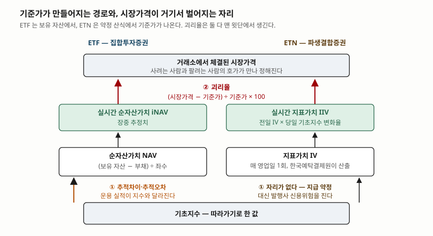
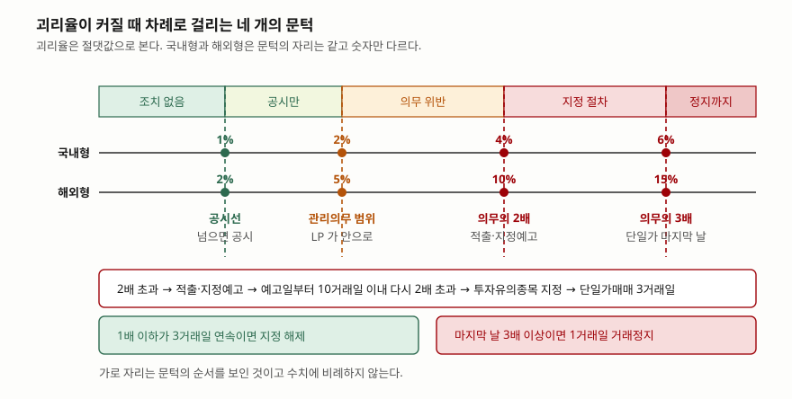

> 예제의 `가나변동성 ETN` 과 숫자, 13 거래일 괴리율 경로는 계산 원리를 보이려고 만든 가상 값이다. 실재하는 종목과 관계가 없다.

## 들어가며

몇 달째 들고 있던 ETN 이 어느 날부터 30분에 한 번씩만 체결된다. 종목 공시를 찾아보니 투자유의종목 지정이고, 그 앞에는 괴리율 초과 발생 공시가 며칠에 걸쳐 쌓여 있다. 기초지수는 그동안 크게 움직이지 않았다. 이때 대부분은 "거래가 없는 종목이라 그렇다"고 넘기고 호가창만 들여다본다. 그런데 괴리율에는 공시, 유동성공급자의 관리의무, 투자유의종목 지정, 거래정지로 이어지는 네 개의 문턱이 숫자로 정해져 있고, 지정까지 가는 데 필요한 거래일 수까지 규정에 적혀 있다. 그 사다리를 모르면 며칠 전부터 올라오던 공시가 무엇을 예고했는지 읽을 수 없다.

## 개념

괴리율은 **거래소에서 체결된 시장가격이 그 상품의 기준가에서 얼마나 벗어났는지**를 비율로 적은 값이다. 산식은 ETF 와 ETN 이 같다.

```text
괴리율(%) = (시장가격 − 기준가) ÷ 기준가 × 100
```

다른 것은 기준가가 어디서 나오느냐다. ETF 의 기준가는 펀드가 실제로 가진 자산에서 부채를 빼 좌수로 나눈 순자산가치이고, 장중에는 그 추정치인 실시간 순자산가치(iNAV)를 쓴다. ETN 의 기준가는 보유 자산이 아니라 약정 산식에서 나온다. 한국거래소의 ETN 시장 설명자료는 지표가치를 "ETF 의 순자산가치(NAV)와 유사한 개념인 ETN 1증권당 실질가치"로 정의하고, 기초자산 가치의 변화율에서 제비용을 차감해 산출한다고 적는다. 매 영업일 1회 한국예탁결제원이 산출하고, 장중에는 전일 지표가치에 당일 기초지수 변화율을 반영한 실시간 지표가치(IIV)가 쓰인다.

이 차이가 간극의 개수를 바꾼다. ETF 는 기초지수와 NAV 사이에 운용 실적의 거리, 즉 추적차이와 추적오차가 한 겹 더 있다. ETN 은 발행사가 산식대로 지급하기로 약정한 증권이라 그 자리가 없고, 대신 증권회사의 무보증·무담보 신용위험을 투자자가 진다. 그래서 **ETN 에서 기준가와 시장가격을 가르는 간극은 사실상 괴리율 하나뿐이다.**

| 구분 | ETF | ETN |
|---|---|---|
| 법적 성격 | 집합투자증권 | 파생결합증권 |
| 발행주체 | 자산운용사 | 증권회사 |
| 기준가 | 순자산가치(NAV) · 장중 iNAV | 지표가치(IV) · 장중 IIV |
| 지수와의 거리 | 추적차이·추적오차가 생긴다 | 약정 산식이라 생기지 않는다 |
| 신용위험 | 없음(신탁재산으로 보관) | 있음 |
| 만기 | 없음 | 1년~20년 |

## 구조



> **출처**: [한국거래소 ETN시장 설명자료(2014-10) — Ⅳ.1 투자지표: 지표가치·실시간 지표가치·괴리율, Ⅰ.2 ETN·ETF 비교](https://www.smallake.kr/wp-content/uploads/2014/11/ETN_141006.pdf) · [한국거래소 KIND — 상장지수증권 괴리율 초과 발생(2026-06-01 기준일)](https://kind.krx.co.kr/external/2026/06/02/000078/20260601002266/68319.htm) · [한국거래소 KIND — ETF 괴리율 초과 발생(2026-05-26 기준일)](https://kind.krx.co.kr/external/2026/05/27/000011/20260527000016/68648.htm)

아래에서 위로 읽는다. ①은 운용의 결과로 생기는 거리라 ETF 에만 있고, 들고 있는 동안 모든 보유자가 함께 겪는다. ②는 체결 가격에서 생기는 거리라 ETF 와 ETN 모두에 있고, 사고판 시점에 따라 겪는 사람과 안 겪는 사람이 갈린다. 괴리율이 가리키는 것은 ②뿐이다.

## 동작 원리

### 기준가는 전날 값에서 오늘 값을 만든다

ETN 의 실시간 지표가치는 그날 자산을 다시 세어 만드는 값이 아니라, **전일 지표가치에 당일 기초지수 변화율을 곱하고 제비용을 일할로 뺀 값**이다. 전일 지표가치 10,250.00원에 기초지수가 1.80% 오르면 10,434.50원이 되고, 연 0.95%인 제비용의 하루치 0.27원을 빼면 10,434.23원이다. 보수는 청구서로 오지 않고 이렇게 기준가에서 매일 조금씩 빠진다.

이 값을 기준으로 시장가격 10,620원은 +1.78%, 10,180원은 −2.44%다. 기초지수가 같은 날에도 체결된 값에 따라 괴리율의 부호와 크기가 달라진다.

### 괴리를 안으로 되돌리는 것은 유동성공급자다

괴리율을 좁히는 1차 장치는 유동성공급자(LP)의 양방향 호가다. 거래소의 ETN 시장 설명자료는 LP 의 기능을 양방향 호가 제출을 통한 유동성 공급과 "시장가격이 지표가치에서 벗어나는 가격괴리 방지" 둘로 적고, 호가를 스프레드 비율과 괴리율 요건을 지켜 내도록 규정한다고 밝힌다.

그런데 LP 가 메울 수 없는 상황이 있다. 같은 자료는 유동성 부족 위험을 **"ETN 발행수량이 투자자에게 전량 매출되거나 추가상장이 신속하게 이루어지지 않는 경우"** 생기는 가격 급등락으로 적는다. 팔 물량이 바닥나면 LP 가 매도호가를 낼 수 없고, 남은 투자자 호가끼리 체결되는 동안 괴리는 그대로 남는다. ETF 의 지정참가회사가 설정·환매로 좌수를 늘렸다 줄였다 할 수 있는 것과 달리, ETN 의 추가 상장은 발행사의 결정과 절차를 거친다. **ETN 의 괴리가 구조적으로 더 크게 벌어질 수 있는 자리가 여기다.**

### 문턱은 네 개이고, 2026년 8월에 두 개가 내려왔다

괴리율이 커질수록 붙는 조치가 늘어난다. 금융위원회는 2026년 8월 12일 한국거래소 유가증권시장 업무규정 개정안을 승인했고, 개정 내용은 **2026년 8월 19일부터 시행됐다.**



> **출처**: [금융위원회 보도자료 「8.19일부터 괴리율 관리가 강화되고 모의거래가 의무화됩니다」(2026-08-12)](https://www.fsc.go.kr/no010101/87512) · [한국거래소 KIND — 상장지수증권 괴리율 초과 발생 공시(국내형 1% · 해외형 2% 기준)](https://kind.krx.co.kr/external/2026/06/02/000078/20260601002266/68319.htm)

바뀐 것은 셋이다. 첫째, LP 의 괴리율 관리의무 범위가 종가 기준으로 국내 3%에서 2%로, 해외 6%에서 5%로 좁아졌다. 둘째, 괴리율이 음수로 산출되면 **절댓값으로 본다.** 셋째, 투자유의종목 지정 절차가 적출→지정예고→지정의 3단계에서 적출 및 지정예고→지정의 2단계로 줄었다.

지정까지의 경로는 이렇다. 괴리율이 의무범위의 2배를 넘으면 적출·지정예고 대상이 되고, 예고일부터 10거래일 이내에 다시 2배를 넘으면 투자유의종목으로 지정된다. 2거래일 연속이면 최단 2거래일 만에 지정될 수 있다. 지정되면 3거래일 동안 단일가매매가 적용되고, 그 기간에 괴리율이 의무범위 이하로 3거래일 연속 유지되면 해제된다. 단일가매매 마지막 날 괴리율이 의무범위의 3배 이상이면 1거래일 거래정지 뒤 단일가매매로 재개된다.

### 절댓값 한 줄이 지정 시점을 바꾼다

괴리율을 양수만 셀 때와 절댓값으로 셀 때, 같은 경로에서 지정 시점이 달라진다. 할인(−)이 깊어지는 쪽은 그대로 두고 할증(+)만 보던 방식의 문제가 여기서 드러난다. 예제가 그 대비를 숫자로 만든 것이다.

## 실습 예제

가상 ETN 의 국내형 기준(공시 1%, 관리의무 2%)으로 계산했다. 판정 규칙은 위 보도자료에 적힌 요건을 그대로 옮긴 것이다.

전체 소스: [`code/`](code/) · 수행 기록: [`code/output.txt`](code/output.txt)

```text
[1] 전일 지표가치에서 당일 실시간 지표가치로 — 가나변동성 ETN
  전일 지표가치(IV)          10,250.00 원
  당일 기초지수 변화율             1.80 %
  지수만 반영한 값            10,434.50 원
  연 제비용 0.95% 의 1일치         -0.27 원
  실시간 지표가치(IIV)       10,434.23 원
  시장가격  10,620원 → 괴리율   +1.78 %
  시장가격  10,450원 → 괴리율   +0.15 %
  시장가격  10,180원 → 괴리율   -2.44 %

[2] 같은 괴리율에 붙는 조치 — 기초지수가 국내 자산인가 아닌가로 갈린다
      괴리율   국내형(공시 1% · 의무 2%)                해외형(공시 2% · 의무 5%)
    +0.8%   해당 없음                             해당 없음
    -1.5%   공시                                해당 없음
    +2.6%   공시, 의무범위 밖                        공시
    -4.3%   공시, 의무범위 밖, 예고 요건                 공시
    +5.5%   공시, 의무범위 밖, 예고 요건                 공시, 의무범위 밖
    -6.4%   공시, 의무범위 밖, 예고 요건, 정지 요건          공시, 의무범위 밖

[3] 13 거래일 괴리율 경로 — 음수를 절댓값으로 세느냐로 판정이 갈린다
    일차       괴리율       절댓값  관리의무 2% · 예고선 4% · 정지선 6%
     1     +1.2%      1.2%  공시
     2     +2.6%      2.6%  공시, 의무범위 밖
     3     -4.3%      4.3%  공시, 의무범위 밖, 2배 초과
     4     -2.1%      2.1%  공시, 의무범위 밖
     5     +0.8%      0.8%  -
     6     -4.6%      4.6%  공시, 의무범위 밖, 2배 초과
     7     +1.1%      1.1%  공시
     8     +4.2%      4.2%  공시, 의무범위 밖, 2배 초과
     9     +0.5%      0.5%  -
    10     -1.0%      1.0%  -
    11     +1.8%      1.8%  공시
    12     +1.5%      1.5%  공시
    13     +6.4%      6.4%  공시, 의무범위 밖, 2배 초과, 3배 이상
  절댓값으로 셀 때    지정예고 3일차    지정 6일차
  양수만 셀 때      지정예고 8일차    지정 13일차
```

`[0]` 산식과 각 절 끝의 설명 줄은 [`code/output.txt`](code/output.txt)에 있다.

`[2]`는 같은 숫자가 상품에 따라 다른 뜻이 되는 것을 보인다. 괴리율 −1.5%는 국내형이면 공시 대상이지만 해외형이면 아무 조치도 붙지 않고, +5.5%는 국내형이면 지정예고 요건까지 닿지만 해외형이면 이제 막 관리의무 범위를 벗어난 정도다. 해외 자산이 섞인 기초지수는 국내 장중에 해외 시장이 닫혀 있는 시간이 있어 기준가 추정 자체가 느슨하고, 문턱도 그만큼 넓게 잡혀 있다.

`[3]`이 절댓값 규정이 바꾼 것을 보인다. 양수만 세면 2배(4%)를 처음 넘은 날이 8일차이고 재초과가 13일차라 지정까지 13거래일이 걸린다. 절댓값으로 세면 3일차 −4.3%에서 이미 예고 요건이 서고 6일차 −4.6%에서 지정된다. **열흘 가까이 빨라진다.** 13거래일 가운데 관리의무 범위 밖인 날이 6일, 공시 대상인 날이 10일인데, 이 가운데 음수인 날을 세지 않으면 그 절반이 눈에 보이지 않게 된다.

단일가매매 3거래일(11~13일차)도 둘을 함께 봐야 읽힌다. 11·12일차는 괴리율이 2% 이하라 해제 쪽으로 가는 듯하지만, 13일차가 6.4%로 3배 선을 넘어 3거래일 연속 요건을 못 채운다. 해제 대신 1거래일 거래정지가 붙는다.

## 실무에서 주의할 점

- **괴리율 공시는 LP 의 관리의무 위반과 다른 사건이다.** 국내형 기준으로 공시선은 1%, 관리의무 범위는 2%다. 공시가 떴다고 LP 가 의무를 어긴 것은 아니고, 공시가 연달아 올라오는 동안 괴리율이 2%를 넘지 않을 수도 있다. 공시 건수가 아니라 공시에 적힌 숫자를 본다.
- **음(−)의 괴리율을 반가운 신호로 읽지 않는다.** 기준가보다 싸게 사는 것처럼 보이지만, 그 상태가 이어지면 지정예고와 단일가매매로 가는 경로에 올라탄 것이기도 하다. 단일가매매가 걸리면 원하는 시점에 팔기가 어려워진다.
- **ETN 은 발행 물량이 바닥났는지를 본다.** 추가 상장 전까지는 LP 도 매도호가를 낼 수 없어 괴리가 메워지지 않는다. 발행사 공시에서 추가 상장 여부와 잔여 발행 한도를 확인하는 것이 호가창을 들여다보는 것보다 먼저다.
- **ETN 에서 괴리율은 기준가와의 거리 전부를 뜻한다.** ETF 와 달리 추적차이·추적오차가 따로 없으므로, 성과가 지수와 달랐다면 원인은 제비용 아니면 사고판 시점의 괴리다. 두 상품의 성과를 나란히 볼 때 같은 잣대를 쓰지 않는다.
- **기초지수에 해외 자산이 섞였는지 먼저 확인한다.** 문턱이 국내형의 두 배 반 가까이 넓어서, 같은 괴리율이라도 규제가 개입하는 시점이 훨씬 늦다. 상품명만으로는 갈리지 않으니 투자설명서의 기초지수 구성을 본다.

## 정리

- 괴리율은 시장가격이 기준가에서 벗어난 비율이고, 기준가는 ETF 가 iNAV, ETN 이 IIV 다.
- ETN 의 기준가는 보유 자산이 아니라 약정 산식에서 나와 추적오차가 생기지 않는다. 대신 발행사 신용위험을 투자자가 진다.
- 괴리를 메우는 것은 LP 의 양방향 호가이고, 발행 물량이 바닥나면 메워지지 않는다.
- 문턱은 공시선·관리의무 범위·그 2배·그 3배 넷이고, 국내형은 1·2·4·6%, 해외형은 2·5·10·15%다.
- 2026-08-19 시행 개정으로 관리의무 범위가 좁아지고 음수 괴리율을 절댓값으로 세게 됐다. 같은 경로에서 지정 시점이 열흘 가까이 당겨진다.

## 참고 자료

- [한국거래소 — ETN시장 설명자료(2014-10, 유가증권시장본부)](https://www.smallake.kr/wp-content/uploads/2014/11/ETN_141006.pdf) — 지표가치·실시간 지표가치·괴리율·호가 스프레드의 정의, LP 의 기능과 호가 제출 요건, ETN·ETF 비교, 유동성 부족 위험. 2014년 자료라 호가 요건 수치는 이후 개정으로 바뀌었다
- [금융위원회 — 「8.19일부터 괴리율 관리가 강화되고 모의거래가 의무화됩니다」(2026-08-12 보도자료, 2026-08-19 시행)](https://www.fsc.go.kr/no010101/87512) — 관리의무 범위 국내 2%·해외 5%, 절댓값 산정, 투자유의종목 2단계 지정 절차와 단일가매매·거래정지 요건
- [한국거래소 KIND — 상장지수증권 괴리율 초과 발생(2026-06-01 기준일)](https://kind.krx.co.kr/external/2026/06/02/000078/20260601002266/68319.htm) — ETN 괴리율 산식과 IIV 기준, 국내형 1%·해외형 2% 공시 기준, LP 호가와 이론가 산출기관의 판단 차이
- [한국거래소 KIND — ETF 괴리율 초과 발생(2026-05-26 기준일)](https://kind.krx.co.kr/external/2026/05/27/000011/20260527000016/68648.htm) — ETF 괴리율 산식과 iNAV 기준, 해외 자산 ETF 에서 LP 헤지 비용이 호가에 실리는 경로
- [ETF — 바구니를 주식처럼 사고파는 구조](../2026-10-07-etf-nav-premium-tracking/index.md) — NAV 계산, 지정참가회사의 설정·환매 차익거래, 추적차이와 추적오차의 구분
- [호가 스프레드 — 체결 비용이 수익률을 깎는 정도](../2026-10-20-spread-and-round-trip-cost/index.md) — 괴리율 안쪽에 남는 호가 스프레드가 왕복 비용으로 쌓이는 과정
