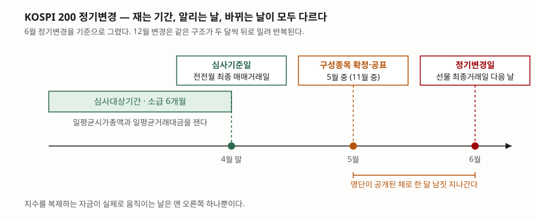
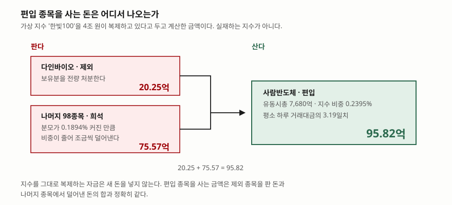

> 계산에 쓰는 지수·종목·자금 규모는 전부 가상 값이다. 실재하는 지수나 종목의 수치가 아니다. 이 글은 기계적으로 발생하는 수급의 **크기를 세는 방법**까지만 다룬다. 그 수급이 가격을 어느 방향으로 얼마나 움직이는지는 다루지 않는다.

## 들어가며

평소 하루 거래대금이 수십억 원인 종목의 거래량이 어느 날 갑자기 몇 배로 뛴다.
공시도 없고 뉴스도 없는데 장 마감 무렵에 대량 체결이 몰린다. 다음 날이 되면
거래량은 원래대로 돌아간다.

이런 날을 보면 대개 "누가 사들였다"는 설명을 찾는다. 하지만 거래소 달력을 펴
보면 그날이 지수 정기변경일인 경우가 있다. 그렇다면 산 쪽은 종목을 고른 것이
아니다. 지수를 그대로 복제하는 펀드는 편입된 종목을 **사야만 한다.** 안 사면
지수와 수익률이 벌어지고, 그것이 그 펀드가 피해야 하는 유일한 실패다.
그래서 이 수급은 미리 계산할 수 있다. 필요한 것은 유동주식 시가총액과 나눗셈
하나뿐이다.

## 개념

시가총액 가중 지수는 각 종목의 시가총액을 전체 시가총액으로 나눈 값을 비중으로
쓴다. 다만 상장주식수를 그대로 쓰지는 않는다. 대주주 지분처럼 시장에 돌지 않는
주식까지 세면, 복제하는 자금이 실제로 살 수 없는 물량까지 비중에 들어가기
때문이다. 그래서 상장주식수에 **유동주식비율**을 곱한 유동주식수로 가중한다.
KOSPI 200은 2007년 6월 15일에 비유동주식의 절반을 빼는 방식으로 넘어갔고,
같은 해 12월 14일에 비유동주식을 전부 빼는 지금 방식이 됐다.

구성종목은 정해진 절차로 바뀐다. KOSPI 200의 **심사대상종목**은 심사기준일 현재
유가증권시장 상장 보통주 중에서 관리종목·정리매매종목, 집합투자기구·외국주권,
부동산투자회사·기업인수목적회사 등, **유동주식비율이 10% 미만인 종목**,
신규상장 후 6개월이 지나지 않은 종목을 뺀 것이다. 남은 종목을 GICS를 참고한
10개 산업군으로 나누고, 심사기준일로부터 소급한 6개월의 **일평균시가총액과
일평균거래대금**으로 고른다.

선정은 두 단계다. 1차로 산업군별 누적시가총액이 그 산업군 전체의 85%에 이를
때까지 시가총액 순으로 뽑되, 일평균거래대금 순위가 그 산업군 심사대상종목 수의
85% 안에 들지 못하면 뺀다. 2차에서는 기존 구성종목이면 시가총액 순위가 기존
구성종목 수의 110% 안이면 남기고, 새로 들어오려면 90% 안에 들어야 한다. 들고
나는 기준을 다르게 둬서 경계에 있는 종목이 해마다 들락거리지 않게 한 것이다.

## 구조



> **출처**: 한국거래소, 「KOSPI 200 지수 방법론」(2020년 12월) 중 [구성종목 선정방법(6)과 정기변경(7)](https://securities.miraeasset.com/public/hks4000/1638250165724.pdf) (제3자 전재 PDF)



> **출처**: 한국거래소, 「KOSPI 200 지수 방법론」(2020년 12월) 중 [지수 산출(9) — 유동주식수 가중](https://securities.miraeasset.com/public/hks4000/1638250165724.pdf) (제3자 전재 PDF)

## 동작 원리

지수를 복제하는 자금이 한 종목에 담는 금액은 간단한 비례식이다.

```text
보유금액 = 복제 자금 × (그 종목 유동시총 ÷ 지수 전체 유동시총)
```

구성종목이 바뀌면 분자만 바뀌는 것이 아니라 **분모도 바뀐다.** 제외 종목의
유동시총이 빠지고 편입 종목의 유동시총이 들어오므로, 둘의 크기가 다르면 전체가
늘거나 준다. 분모가 늘면 건드리지 않은 나머지 종목의 비중이 함께 내려간다.
그래서 복제 자금은 세 묶음을 동시에 조정한다. 제외 종목을 전량 팔고, 편입
종목을 새로 사고, 나머지 종목을 비중이 내려간 만큼씩 조금 판다.

여기서 중요한 것은 이 펀드에 **새 돈이 들어오지 않는다**는 점이다. 들어온 돈이
없으므로 편입 종목을 사는 금액은 다른 데서 나와야 하고, 그 출처는 제외 종목을
판 돈과 나머지 종목에서 덜어낸 돈뿐이다. 둘의 합은 편입 금액과 **정확히** 같아야
한다. 예제에서 이 등식이 맞는지를 검산하는 이유다.

이 금액이 시장에서 얼마나 큰지는 종목의 평소 거래대금과 견줘야 보인다. 같은
100억 원이라도 하루에 1,000억씩 거래되는 종목에서는 10분의 1일치지만, 30억씩
거래되는 종목에서는 사흘치다. 지수 편입이 수급 이야기로 다뤄지는 쪽은 언제나
후자다.

## 실습 예제

가상 지수 **한빛100**을 세운다. 유동주식수로 가중하고, 변경 전 지수 전체 유동시총은
320조 원, 이 지수를 복제하는 펀드·ETF 자금의 합계는 4조 원이라고 둔다. 정기변경에서
**다인바이오**가 빠지고 **사람반도체**가 들어온다.

```python
buy_incoming = PASSIVE_ASSETS * incoming.float_cap / float_cap_after
sell_outgoing = PASSIVE_ASSETS * outgoing.float_cap / FLOAT_CAP_BEFORE
others_before = PASSIVE_ASSETS * others / FLOAT_CAP_BEFORE
others_after = PASSIVE_ASSETS * others / float_cap_after
sell_others = others_before - others_after
```

전체 소스: [`code/`](code/) · 수행 기록: [`code/output.txt`](code/output.txt)

두 종목의 유동시총과 분모의 변화는 이렇다.

```text
  종목                 상장주식수        주가              시가총액     유동비율              유동시총
  사람반도체         40,000,000    32,000      1조 2,800.00억      60%         7,680.00억
  다인바이오         20,000,000    18,000         3,600.00억      45%         1,620.00억

  변경 전                                320조
  - 다인바이오 제외                  -1,620.00억
  + 사람반도체 편입                   7,680.00억
  변경 후                      320조 6,060.00억
  분모 증가율                         0.1894%
```

분모가 0.1894% 커졌으므로 손대지 않은 98종목의 비중이 그만큼 내려간다. 세 묶음의
조정 금액과 검산은 다음과 같다.

```text
  묶음                                변경 전            변경 후              매매
  사람반도체 (편입)                       0.00억          95.82억         +95.82억
  다인바이오 (제외)                      20.25억           0.00억         -20.25억
  나머지 98종목                  3조 9,979.75억    3조 9,904.18억         -75.57억

  검산: 제외 매도 + 나머지 희석 매도 = 95.82억
        편입 매수                  = 95.82억
        차이                      = -0.000185원
```

편입 종목을 사는 95.82억 원 중 제외 종목에서 나온 돈은 20.25억 원뿐이다. 나머지
75.57억 원은 **지수에 그대로 남아 있는 98종목에서** 조금씩 덜어낸 것이다. 어느
종목도 지수에서 빠지지 않았는데 매도 물량이 생긴다.

이 금액이 평소 거래대금의 몇 배인지, 그리고 유동주식비율이 바뀌면 어떻게 달라지는지를
보면 수급의 크기가 어디서 결정되는지가 분명해진다.

```text
  종목                    기계적 매매         일평균거래대금       며칠치
  사람반도체                 95.82억          30.00억     3.19일
  다인바이오                 20.25억          12.00억     1.69일

       유동비율              유동시총       지수 비중          패시브 매수       거래대금 대비
        30%         3,840.00억     0.1199%          47.97억         1.60일
        45%         5,760.00억     0.1798%          71.91억         2.40일
        60%         7,680.00억     0.2395%          95.82억         3.19일
        75%         9,600.00억     0.2993%         119.70억         3.99일
        90%      1조 1,520.00억     0.3589%         143.56억         4.79일
```

시가총액은 1조 2,800억 원으로 고정해 둔 채 유동주식비율만 바꿨다. 30%일 때와
90%일 때의 기계적 매수 금액이 47.97억 원과 143.56억 원으로 세 배 차이가 난다.
시가총액이 같아도 대주주가 쥐고 있는 지분이 많으면 지수에서 차지하는 자리가 작다.

## 실무에서 주의할 점

**유동주식비율이 시가총액만큼 중요하다.** 지수 비중을 가늠할 때 시가총액 순위만
보면 틀린다. 위 표에서 보듯 같은 시가총액에서 비율 하나로 수급 규모가 세 배까지
갈린다. KOSPI 200은 유동주식비율이 10% 미만이면 아예 심사대상에서 뺀다.

**공표일과 적용일이 다른 날이다.** KOSPI 200의 구성종목은 주가지수운영위원회
심의를 거쳐 매년 5월과 11월 중에 확정·공표되고, 실제 변경은 6월·12월 선물
최종거래일의 다음 매매거래일에 일어난다. 명단이 공개된 채로 한 달 남짓이
지나간다는 뜻이다. 그래서 변경일 하루의 거래량만 세면 그 종목에 생긴 수급을
제대로 잰 것이 아니다.

**정기변경만 있는 것이 아니다.** 상장폐지가 결정되거나 관리종목으로 지정되면
정기변경을 기다리지 않고 수시로 빠지고, 그 자리에 같은 산업군의 예비종목 1순위가
들어온다. 큰 종목이 새로 상장되면 정기변경일 전에 특례로 편입되기도 한다.
달력만 보고 있으면 이런 변경은 놓친다.

**복제 자금 규모는 공표되지 않는다.** 위 계산에서 가장 불확실한 값은 유동시총이
아니라 4조 원이라는 가정이다. 어떤 지수를 얼마가 추종하는지는 상품마다 흩어져
있고 추정치만 돈다. "거래대금 며칠치"라는 말에는 언제나 이 가정이 깔려 있으므로,
그 숫자를 인용할 때는 어떤 자금 규모를 가정했는지까지 함께 봐야 한다.

**지수마다 방법론이 다르다.** 같은 거래소의 지수라도 정기변경 시기와 비중 규칙이
다르다. KOSPI 200은 2019년 6월 14일에 개별 종목 비중 30% 상한을 도입했다가
2020년 4월 27일에 폐지했고, 정기변경 주기도 2019년 12월 11일부터 연 1회에서
연 2회로 바뀌었다. 지수 이름만 같으면 규칙도 같으리라 보고 계산하면 어긋난다.

## 정리

- 유동주식수 가중 지수에서 한 종목의 비중은 그 종목 유동시총을 지수 전체 유동시총으로
  나눈 값이다. 구성종목이 바뀌면 분자뿐 아니라 분모도 바뀐다.
- 그래서 복제 자금은 세 묶음을 동시에 조정한다. 제외 종목 전량 매도, 편입 종목
  신규 매수, 그리고 남은 종목의 희석분 매도다.
- 예제에서 편입 매수 95.82억 원 중 제외 종목에서 나온 돈은 20.25억 원이고, 나머지
  75.57억 원은 지수에 그대로 남은 98종목에서 덜어낸 것이다. 두 금액의 합은 편입
  금액과 정확히 같다.
- 같은 시가총액이라도 유동주식비율이 30%일 때와 90%일 때 기계적 매수 금액이
  47.97억 원과 143.56억 원으로 갈린다.
- KOSPI 200의 심사기준일·공표일·정기변경일은 모두 다른 날이다. 수급을 잴 때는
  변경일 하루가 아니라 공표부터 적용까지의 구간을 본다.

## 참고 자료

- 한국거래소, 「KOSPI 200 지수 방법론」(2020년 12월) — 심사대상종목, 산업군 분류,
  1·2차 선정, 정기변경일과 공표 시기, 수시변경, 유동주식수 가중 산출.
  발행처 자료실은 [KRX 인덱스](https://index.krx.co.kr)이고, 본문 확인에 쓴 사본은
  [이 PDF](https://securities.miraeasset.com/public/hks4000/1638250165724.pdf)다 (제3자 전재).
- [한국거래소 정보데이터시스템](https://data.krx.co.kr) — 지수별 구성종목과 산출 자료
