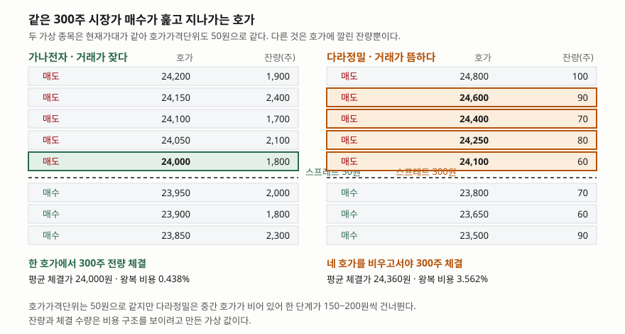
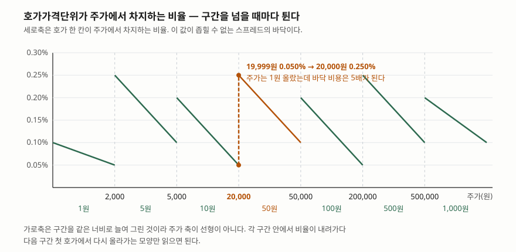

> 예제의 호가창·잔량·체결 수량은 비용 구조를 보이려고 만든 가상 값이다. 실재하는 종목의 호가가 아니다. 위탁수수료율은 증권사마다 달라 가정값 하나를 골라 양쪽에 똑같이 적용했다.

## 들어가며

증권 계좌를 만들 때 비교하는 숫자는 대개 수수료율이다. 어느 증권사가 0.015%이고
어느 곳이 0.0036%인지를 따지고, 평생 무료 이벤트를 찾아 계좌를 옮긴다. 그런데
막상 주문을 넣고 체결 통보를 보면, 아끼려던 수수료보다 큰 금액이 이미 빠져
있는 경우가 있다. 사자마자 되팔면 손익이 0이 아니라 몇 퍼센트 마이너스에서
시작한다.

이때 많은 사람이 그 차이를 "주가가 그새 떨어져서"라고 넘긴다. 하지만 주가가
한 틱도 움직이지 않아도 같은 일이 일어난다. 거래가 뜸한 종목이면 수수료의 200배가
넘는 금액이 체결 한 번에 사라진다. 수수료율 소수점 넷째 자리를 비교하는 동안
소수점 둘째 자리짜리 비용을 안 보고 있는 것이다.

## 개념

주식 호가창에는 사겠다는 가격과 팔겠다는 가격이 따로 쌓인다. 가장 비싸게 사겠다는
가격을 **최우선 매수호가**, 가장 싸게 팔겠다는 가격을 **최우선 매도호가**라 하고,
둘의 차이가 **호가 스프레드**다. 지금 당장 사려면 최우선 매도호가를 받아들여야
하고, 지금 당장 팔려면 최우선 매수호가를 받아들여야 하므로, 사자마자 되파는
사람은 이 차이를 그대로 손실로 확정한다.

스프레드가 0이 될 수 없는 이유는 둘이다. 하나는 제도다. 한국거래소는 가격대별로
**호가가격단위**를 정해 두었고, 그 단위의 배수가 아닌 가격으로는 호가를 낼 수
없다. 주가 24,000원짜리 종목의 호가가격단위는 50원이므로, 매수호가와 매도호가가
아무리 붙어도 50원 아래로는 좁혀지지 않는다. 24,000원에서 50원은 0.21%다.

| 주가 | 호가가격단위 |
|---|---|
| 2,000원 미만 | 1원 |
| 2,000원 이상 5,000원 미만 | 5원 |
| 5,000원 이상 20,000원 미만 | 10원 |
| 20,000원 이상 50,000원 미만 | 50원 |
| 50,000원 이상 200,000원 미만 | 100원 |
| 200,000원 이상 500,000원 미만 | 500원 |
| 500,000원 이상 | 1,000원 |

다른 하나는 수요와 공급이다. 거래가 뜸한 종목은 호가가격단위가 허용하는 자리
대부분이 비어 있다. 단위는 50원인데 실제로 호가가 놓인 자리는 150원, 200원씩
떨어져 있고, 그래서 체감 스프레드는 제도가 정한 바닥보다 훨씬 넓어진다.
스프레드는 제도가 바닥을 깔고 유동성이 그 위를 결정한다.

## 구조



> **출처**: [KRX, Basic Facts about Trading System — Tick (KOSDAQ Market)](https://global.krx.co.kr/contents/GLB/06/0602/0602020201/GLB0602020201.jsp)



> **출처**: [KRX, Basic Facts about Trading System — Tick (KOSDAQ Market)](https://global.krx.co.kr/contents/GLB/06/0602/0602020201/GLB0602020201.jsp)

## 동작 원리

시장가 주문은 가격을 지정하지 않고 "지금 있는 호가로 체결해 달라"는 주문이다.
체결은 좋은 가격부터 한 호가씩 소진하며 올라간다. 최우선 매도호가의 잔량이
주문 수량보다 많으면 거기서 끝나지만, 모자라면 그 위 호가로 넘어가고 또 모자라면
그 위로 넘어간다. 그래서 **체결 단가는 호가창에서 보던 가격이 아니라 훑고 지나간
호가들의 가중평균**이 된다. 호가창에서 본 가격과 평균 체결가의 차이를 슬리피지라
부른다.

여기서 비용이 두 겹으로 붙는다. 첫 겹은 스프레드 자체다. 살 때는 중간가보다
비싸게, 팔 때는 중간가보다 싸게 체결되므로 왕복 한 번에 스프레드 하나를 꼬박
문다. 둘째 겹이 슬리피지다. 주문 수량이 최우선호가 잔량을 넘는 순간부터 붙기
시작하고, 호가가 얇을수록 가파르게 커진다. 같은 종목이라도 10주를 살 때와
1,000주를 살 때의 비용률이 다른 이유가 여기 있다.

여기에 거래 때마다 붙는 고정 비용이 더해진다. 위탁수수료는 매수·매도 양쪽에
붙고, 증권거래세는 **매도 대금에만** 붙는다. 코스닥시장 상장주식의 증권거래세율은
2026년 1월 1일 이후 양도분부터 0.20%다(종전 0.15%). 이 둘은 종목의 유동성과
무관하게 같은 비율로 걷히므로, 종목 사이의 비용 차이를 만드는 것은 결국
스프레드와 슬리피지다.

마지막으로 회전이 이 비용을 곱한다. 왕복 비용률이 `c`일 때 한 해에 `n`번 사고팔면
원금에 남는 비율은 `(1 - c)^n`이다. `c`가 작으면 `n`이 커도 완만하지만, `c`가
퍼센트 단위로 올라가면 `n`이 조금만 커져도 가파르게 깎인다.

## 실습 예제

현재가대가 같아 호가가격단위까지 같은 두 가상 종목을 세운다. **가나전자**는 호가마다
잔량이 1,700~2,400주씩 깔려 있고, **다라정밀**은 같은 자리에 60~100주뿐이며 중간
호가가 비어 있다. 두 종목에서 300주씩 시장가로 사고 그 자리에서 되판다.

```python
def walk(book, quantity):
    """호가를 좋은 가격부터 훑어 체결 단가와 대금을 구한다."""
    filled, amount, steps = 0, 0, []
    for price, resting in book:
        take = min(resting, quantity - filled)
        if take <= 0:
            break
        filled += take
        amount += take * price
        steps.append((price, take, take * price))
    return filled, amount, steps
```

전체 소스: [`code/`](code/) · 수행 기록: [`code/output.txt`](code/output.txt)

체결 과정은 이렇게 갈린다.

```text
[가나전자]
  매수 체결
        24,000원 ×   300주 =    7,200,000원
    매수 대금 7,200,000원 · 평균 단가 24,000.00원
  매도 체결
        23,950원 ×   300주 =    7,185,000원
    매도 대금 7,185,000원 · 평균 단가 23,950.00원

[다라정밀]
  매수 체결
        24,100원 ×    60주 =    1,446,000원
        24,250원 ×    80주 =    1,940,000원
        24,400원 ×    70주 =    1,708,000원
        24,600원 ×    90주 =    2,214,000원
    매수 대금 7,308,000원 · 평균 단가 24,360.00원
  매도 체결
        23,800원 ×    70주 =    1,666,000원
        23,650원 ×    60주 =    1,419,000원
        23,500원 ×    90주 =    2,115,000원
        23,300원 ×    80주 =    1,864,000원
    매도 대금 7,064,000원 · 평균 단가 23,546.67원
```

비용을 항목별로 갈라 놓으면 어디서 차이가 나는지가 분명해진다.

```text
  항목                        가나전자          다라정밀
  스프레드·슬리피지              15,000원      244,000원
  위탁수수료(가정)               2,158원        2,156원
  증권거래세                  14,370원       14,128원
  합계                     31,528원      260,284원
  매수대금 대비                 0.438%        3.562%
```

수수료는 2원, 세금은 242원 차이다. 사실상 같다. 그런데 합계는 8.3배 벌어진다.
벌어진 전부가 스프레드와 슬리피지다. 수수료율을 0으로 깎아도 다라정밀의 왕복
비용은 3.53%로, 가나전자의 수수료 포함 비용 0.438%보다 여덟 배 크다.

이 비용률을 한 해에 몇 번 무느냐가 원금을 결정한다.

```text
       왕복 횟수          가나전자          다라정밀
           1        -0.44%        -3.56%
           2        -0.87%        -7.00%
           4        -1.74%       -13.50%
          12        -5.13%       -35.29%
          24       -10.00%       -58.12%
```

한 달에 두 번씩 사고파는 사람(연 24회)은 가나전자에서 10%, 다라정밀에서 58%를
체결 비용만으로 잃는다. 주가가 제자리여도 그렇다.

## 실무에서 주의할 점

**호가가격단위 구간 경계에서 바닥 비용이 튄다.** 주가 19,999원짜리 종목의 호가
한 칸은 10원이라 0.050%지만, 20,000원이 되는 순간 50원이 되어 0.250%다. 주가는
1원 올랐는데 좁힐 수 없는 스프레드의 바닥은 다섯 배가 된다. 비슷한 종목을 견줄
때 한쪽이 구간 바로 아래, 다른 쪽이 바로 위에 있으면 체결 비용 구조가 꽤 다르다.

**지정가 주문은 스프레드를 피하는 대신 기회비용을 진다.** 최우선 매수호가에
지정가를 걸어 두면 스프레드를 물지 않고 살 수 있지만, 체결될지는 다른 사람이
그 가격에 팔아 주느냐에 달려 있다. 체결되지 않은 채 가격이 움직이면 그 자체가
비용이다. 스프레드가 좁은 종목에서는 아껴지는 금액이 작아 지정가를 고집할 이유가
약하고, 넓은 종목에서는 아껴지는 금액이 크지만 체결이 안 될 확률도 함께 크다.

**호가창의 잔량은 약속이 아니다.** 지정가 호가는 체결 전까지 취소할 수 있으므로,
주문을 넣는 순간 보이던 잔량이 체결 시점에는 없을 수 있다. 특히 큰 주문이
들어오는 것이 보이면 앞선 호가가 빠지기도 한다. 호가창으로 계산한 평균 체결가는
상한이 아니라 추정치다.

**주문을 쪼개면 호가가 다시 채워질 시간을 벌 수 있다.** 300주를 한 번에 넣으면
네 호가를 비우지만, 나눠서 넣으면 그 사이에 새 매도호가가 들어와 더 낮은 가격에
체결될 수 있다. 다만 쪼갠 주문이 체결되는 동안 가격이 움직일 위험이 함께
커지므로, 호가가 얇은 종목에서 비용을 줄이는 확실한 방법은 따로 없다.

## 정리

- 스프레드는 제도가 바닥을 깔고 유동성이 그 위를 정한다. 바닥은 호가가격단위이고,
  20,000원 종목이면 50원, 즉 0.21%다.
- 시장가 주문은 호가를 훑어 올라가므로 체결 단가는 호가창에서 본 가격이 아니라
  훑은 호가들의 가중평균이다. 주문이 클수록 차이가 커진다.
- 수수료와 증권거래세는 종목의 유동성과 무관하게 같은 비율로 걷힌다. 종목 사이의
  비용 차이를 만드는 것은 스프레드와 슬리피지다.
- 예제의 두 종목은 수수료 2원, 세금 242원 차이인데 왕복 비용이 0.438%와 3.562%로
  갈렸다.
- 같은 비용률도 회전 횟수가 곱한다. 연 24회 왕복이면 각각 10%와 58%가 깎인다.

## 참고 자료

- [KRX, Basic Facts about Trading System — Tick (KOSDAQ Market)](https://global.krx.co.kr/contents/GLB/06/0602/0602020201/GLB0602020201.jsp) — 가격대별 호가가격단위 표
- [KB증권, 2026년 증권거래세율 변경 안내 (2025-12-18)](https://www.kbsec.com/go.able?linkcd=s060901010000&seq=10009325&idt=20251218) — 시장별 세율과 시행 시점 (2차 자료)
- [한국세정신문, 내년 1월부터 증권거래세율 코스피 0.05%, 코스닥 0.20%로 상향 (2025-12-01)](https://taxtimes.co.kr/news/article.html?no=272624) — 기획재정부 발표 내용 (2차 자료)
- [법제처 국가법령정보센터, 증권거래세법 시행령](https://www.law.go.kr/%EB%B2%95%EB%A0%B9/%EC%A6%9D%EA%B6%8C%EA%B1%B0%EB%9E%98%EC%84%B8%EB%B2%95%EC%8B%9C%ED%96%89%EB%A0%B9) — 탄력세율 조문 원문
