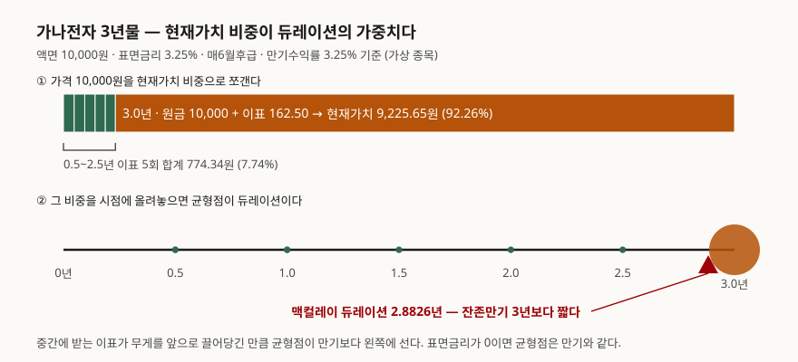
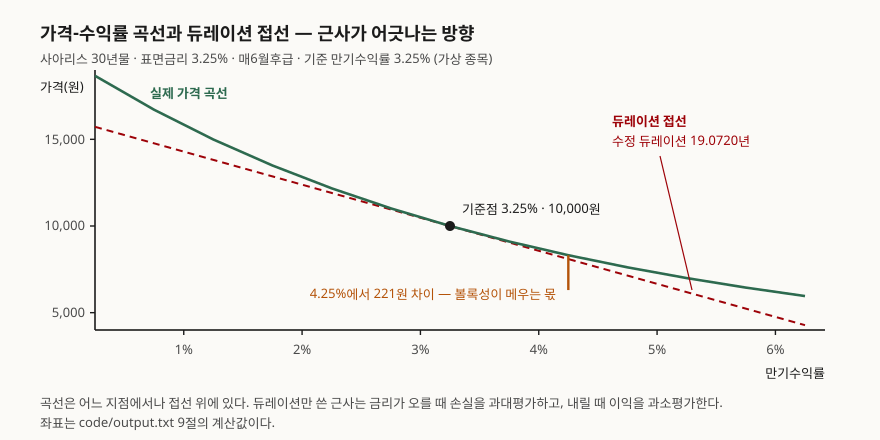

> 예제의 `가나전자 3년물`·`다라물산 3년물`·`마바중공업 10년물`·`사아리스 30년물`은 계산 원리를 보이려고 만든 가상 종목이다. 실재하는 채권과 관계가 없다. 이표 조건만 국고채를 본떴다.

## 들어가며

예금 금리가 성에 차지 않아 증권사 앱의 채권 탭을 처음 열어 본다. 종목 목록에 숫자가 두 개씩 붙어 있다. 하나는 3.25%고 하나는 4.69%다. 둘 다 같은 종목인데 값이 다르고, 어느 쪽이 내가 받을 돈인지 화면은 알려주지 않는다. 가격 칸에는 10,000원이 아니라 9,600원이 적혀 있다. 이때 대부분은 큰 숫자를 수익률로 받아들이고 만기만 확인한 뒤 산다. 그런데 이 세 숫자는 따로 정해진 것이 아니라 하나가 정해지면 나머지가 따라 나오는 관계다. 셋 중 둘만 알면 나머지는 계산으로 나오고, 그 계산은 나눗셈 여섯 번이면 끝난다.

## 개념

채권은 "언제 얼마를 주겠다"는 약속을 적어 둔 종이다. 약속의 내용이 셋이면 채권 하나가 완성된다.

- **액면가**: 만기에 돌려줄 원금. 국고채는 10,000원이다
- **표면금리**: 액면가에 대해 해마다 줄 이자의 비율. 이자를 실제로 지급하는 기준이자 과세 기준이 된다
- **만기와 이표 주기**: 언제까지, 얼마 간격으로 이자를 줄지

표면금리가 붙어 중간중간 이자를 주는 채권을 **이표채**라 한다. 한국은행은 이표채를 "권면에 이표(쿠폰)가 붙어 있어 이자지급일에 이를 떼어 제시함으로써 이자를 지급받는 채권"으로 정의하고, 이자를 아예 주지 않고 할인 발행하는 **할인채**(무이표채), 만기에 원리금을 한꺼번에 주는 **복리채**와 구분한다. 국고채는 이표채이고 2·3·5·10·20·30·50년 만기로 발행되며 이자는 **매6월후급**, 즉 6개월에 한 번 뒤로 준다.

여기까지는 발행할 때 정해져서 바뀌지 않는다. 바뀌는 것은 **가격**이다. 발행 뒤 시장금리가 오르면 이 채권을 사겠다는 사람이 줄고 가격이 내린다. 그 가격에서 역산되는 수익률이 **만기수익률(YTM)**이다. 한국은행은 이것을 "채권에 투자한 후부터 만기 상환일까지 기간 동안에 그 채권으로부터 유입되는 모든 현금흐름의 현재가치와 그 채권을 매입하는 시점의 매입가격을 일치시키는 할인율"로 정의한다. 앱에 뜬 3.25%는 표면금리, 4.69%는 만기수익률이었던 것이다.

**둘이 갈리는 폭이 곧 가격이 액면에서 떨어진 폭이다.** 표면금리보다 만기수익률이 높으면 그 채권은 액면보다 싸게(할인) 거래되고 있고, 낮으면 비싸게(할증) 거래되고 있다. 같으면 가격이 정확히 액면가다.

## 구조



> **출처**: 한국은행 발간 「2020 경제금융용어 700선」(2020-08) 96쪽 '듀레이션' — "채권에서 발생하는 현금흐름의 가중평균만기로 투자자금의 평균회수기간", 가중치는 "각 시점 현금흐름의 현재가치가 채권가격에서 차지하는 비중". 발행처 게시판은 [한국은행 경제교육 발간자료](https://www.bok.or.kr/portal/bbs/B0000216/list.do?menuNo=200765), 본문 PDF는 [여기](https://files-scs.pstatic.net/2023/01/14/9Fo5VoHBh7/2020_%EA%B2%BD%EC%A0%9C%EA%B8%88%EC%9C%B5%EC%9A%A9%EC%96%B4%20700%EC%84%A0.pdf)(제3자 전재)

막대를 쪼갠 비중이 바로 듀레이션의 가중치다. 3년물인데도 마지막 한 칸이 92.26%를 가져간다. 중간에 받는 이표가 162.50원씩 다섯 번뿐이라 전체에서 7.74%밖에 안 되기 때문이다. 그래서 균형점이 만기 3년에서 겨우 0.1174년 앞으로 당겨진 2.8826년에 선다.



> **출처**: 한국은행 발간 「2020 경제금융용어 700선」(2020-08) 96쪽 '듀레이션' — 듀레이션(D)·채권가격(p)·만기수익률(r) 사이의 관계식 (dp/p) = −〔dr/(1+r)〕× D. 발행처 게시판은 [한국은행 경제교육 발간자료](https://www.bok.or.kr/portal/bbs/B0000216/list.do?menuNo=200765), 본문 PDF는 [여기](https://files-scs.pstatic.net/2023/01/14/9Fo5VoHBh7/2020_%EA%B2%BD%EC%A0%9C%EA%B8%88%EC%9C%B5%EC%9A%A9%EC%96%B4%20700%EC%84%A0.pdf)(제3자 전재)

접선은 이 관계식을 그대로 그은 직선이다. 곡선이 직선 위에 떠 있는 폭만큼 듀레이션 근사가 틀린다.

## 동작 원리

### 가격은 나눗셈의 합이다

채권 가격을 구하는 데 필요한 것은 할인 한 줄뿐이다. 각 시점의 현금흐름을 그 시점까지의 할인율로 나누고 전부 더한다. 할인율이 분모에 있으니 할인율을 올리면 모든 항이 작아지고 합도 작아진다. **가격과 수익률이 반대로 움직이는 이유는 여기서 끝난다.** 수급이나 심리 같은 설명이 따로 필요하지 않다.

```text
     만기수익률         가격(원)       액면 대비
     1.25%    10,587.09    105.87% 할증
     2.25%    10,288.53    102.89% 할증
     3.25%    10,000.00    100.00% 액면
     4.25%     9,721.11     97.21% 할인
     5.25%     9,451.48     94.51% 할인
```

표면금리 3.25%인 가나전자 3년물이다. 만기수익률이 표면금리와 같은 3.25%일 때만 가격이 정확히 액면가가 된다.

### 수익률은 거꾸로 찾는다

반대 방향, 즉 가격에서 수익률을 구하는 일에는 닫힌 해가 없다. 6차 방정식을 풀어야 하기 때문이다. 그래서 실무에서도 수치로 찾는다. 가격이 수익률에 대해 단조감소한다는 성질만 있으면 이분법이 항상 수렴한다.

```text
가격  9,600.00원 → 만기수익률  4.695%  (검산: 그 수익률로 다시 할인하면 9,600.00원)
가격 10,000.00원 → 만기수익률  3.250%  (검산: 그 수익률로 다시 할인하면 10,000.00원)
가격 10,400.00원 → 만기수익률  1.873%  (검산: 그 수익률로 다시 할인하면 10,400.00원)
```

앱에 뜬 두 숫자의 정체가 이것이다. 9,600원에 사면 표면금리는 그대로 3.25%지만 싸게 산 만큼이 만기에 원금으로 돌아오므로 연 환산 수익률이 4.695%가 된다.

### 듀레이션은 민감도이기 전에 무게중심이다

듀레이션을 "금리가 1%p 움직일 때 가격이 몇 % 움직이는가"로만 외우면 왜 그 값이 나오는지가 빈다. 정의부터 보면 금리 민감도는 결과지 출발점이 아니다.

```text
    시점(년)       현금흐름(원)       현재가치(원)       비중      시점×비중
      0.5       162.50        159.90    1.60%     0.0080
      1.0       162.50        157.34    1.57%     0.0157
      1.5       162.50        154.83    1.55%     0.0232
      2.0       162.50        152.35    1.52%     0.0305
      2.5       162.50        149.92    1.50%     0.0375
      3.0    10,162.50      9,225.65   92.26%     2.7677
       합계                  10,000.00  100.00%     2.8826
```

마지막 열의 합 2.8826이 맥컬레이 듀레이션이다. **시점을 현재가치 비중으로 가중평균한 값, 즉 투자금이 평균적으로 회수되는 시점이다.** 이표채는 만기 전에 돈이 들어오므로 듀레이션이 항상 만기보다 짧고, 할인채는 현금흐름이 만기에 한 번뿐이라 둘이 같아진다.

여기서 금리 민감도가 따라 나온다. 가격이 할인율의 거듭제곱 분모로 이루어져 있으므로, 할인율을 조금 흔들었을 때의 가격 변화율이 시점의 가중평균에 비례한다. 한국은행이 적은 (dp/p) = −〔dr/(1+r)〕× D가 그 관계다. 맥컬레이 듀레이션을 (1 + 수익률/이표횟수)로 한 번 나눠 둔 것을 **수정 듀레이션**이라 하고, 이것이 "수익률 1%p당 가격 변화율"로 바로 읽히는 값이다.

### 무엇이 듀레이션을 늘리고 줄이는가

```text
종목                   표면금리     잔존만기       맥컬레이        수정       볼록성
가나전자 3년물            3.25%       3년    2.8826년   2.8365      9.64
다라물산 3년물            1.00%       3년    2.9614년   2.9141      9.99
마바중공업 10년물          3.25%      10년    8.6173년   8.4795     83.15
사아리스 30년물           3.25%      30년   19.3819년  19.0720    483.05
```

세 가지가 듀레이션을 정한다.

- **만기**: 길수록 길어진다. 무게가 걸릴 수 있는 시점 자체가 멀어진다
- **표면금리**: 낮을수록 길어진다. 중간에 돌려받는 돈이 적어 무게가 뒤로 쏠린다. 같은 3년물인데 표면금리가 3.25%에서 1.00%로 내려가자 듀레이션이 2.8826년에서 2.9614년으로 늘었다
- **만기수익률**: 높을수록 짧아진다. 할인이 세게 먹을수록 먼 시점의 현재가치가 더 많이 깎여 가중치를 잃는다

마지막 항목이 실감 나는 곳은 저금리 구간이다. 같은 마바중공업 10년물인데 기준 수익률이 1.00%일 때 수정 듀레이션은 8.7277년이고 9.00%일 때는 7.8011년이다. **금리가 낮을 때 금리가 오르면 타격이 더 크다.**

### 듀레이션 근사는 한쪽으로만 틀린다

```text
종목                     기준가격       실제가격      실제변동       듀레이션근사       오차
가나전자 3년물         10,000.00   9,721.11   -2.789%      -2.837%   0.048%p
다라물산 3년물          9,361.79   9,093.59   -2.865%      -2.914%   0.049%p
마바중공업 10년물       10,000.00   9,192.21   -8.078%      -8.479%   0.402%p
사아리스 30년물        10,000.00   8,313.39  -16.866%     -19.072%   2.206%p
```

수익률을 1%p 올렸을 때다. 오차 부호가 네 종목 모두 양수다. 근사가 늘 실제보다 더 많이 떨어진다고 말한다는 뜻이다. 가격-수익률 관계가 직선이 아니라 아래로 볼록한 곡선이라, 접선을 그으면 어느 방향으로 가든 곡선 아래를 지나기 때문이다. 이 휘어짐의 크기를 **볼록성**이라 하고, 2차 항까지 넣으면 오차가 크게 준다.

```text
     변동폭       실제변동       듀레이션만       +볼록성       남은오차
   -3.0%p    86.656%     57.216%    78.953%     7.702%p
   -1.0%p    21.730%     19.072%    21.487%     0.243%p
   -0.5%p    10.169%      9.536%    10.140%     0.029%p
   +0.5%p    -8.959%     -9.536%    -8.932%    -0.027%p
   +1.0%p   -16.866%    -19.072%   -16.657%    -0.209%p
   +3.0%p   -40.425%    -57.216%   -35.479%    -4.946%p
```

30년물에서 ±0.5%p면 듀레이션만으로도 오차가 0.03%p다. ±1%p까지는 볼록성을 넣으면 0.2%p 안이다. 그러나 ±3%p를 움직이면 듀레이션만 쓴 값은 실제와 17%p 넘게 벌어진다. **듀레이션은 작은 변동에 쓰는 자다.**

## 실습 예제

위 출력은 전부 아래 스크립트를 돌린 결과다. 외부 라이브러리 없이 현재가치 정의만으로 가격·수익률·듀레이션·볼록성을 전부 계산한다.

```python
def price(flows, ytm):
    """만기수익률로 할인한 현재가치의 합. 연 2회 복리로 센다."""
    return sum(cf / (1 + ytm / FREQ) ** (t * FREQ) for t, cf in flows)


def ytm_from_price(flows, target, lo=-0.5, hi=1.0, tol=1e-12):
    """가격을 주고 할인율을 거꾸로 찾는다.

    가격은 수익률에 대해 단조감소하므로 이분법이 항상 수렴한다.
    닫힌 해가 없어서 실무에서도 이렇게 수치로 푼다.
    """
    for _ in range(300):
        mid = (lo + hi) / 2
        if price(flows, mid) > target:
            lo = mid
        else:
            hi = mid
        if hi - lo < tol:
            break
    return (lo + hi) / 2


def macaulay_duration(flows, ytm):
    """현금흐름의 가중평균 회수기간. 가중치는 현재가치 비중이다."""
    p = price(flows, ytm)
    weighted = sum(t * cf / (1 + ytm / FREQ) ** (t * FREQ) for t, cf in flows)
    return weighted / p
```

전체 소스: [`code/`](code/) · 실행 기록: [`code/output.txt`](code/output.txt)

> 같은 듀레이션 개념을 주식 쪽에 그대로 적용한 글: [금리가 바뀌면 무엇이 먼저 움직이는가](../2026-10-21-interest-rate-to-valuation/index.md)

## 실무에서 주의할 점

**1. 만기수익률은 재투자를 가정한 수익률이다.** 한국은행 정의는 "만기 이전 중간에 받는 이자를 재투자한다고 가정하고" 계산한 예상수익률이라고 명시한다. 중간에 받은 이표를 같은 수익률로 다시 굴려야 그 수익률이 실현된다. 금리가 내려간 상황에서 이표를 받으면 더 낮은 금리로 재투자하게 되므로 실현 수익률이 만기수익률에 못 미친다. 이표가 없는 할인채만 이 문제에서 자유롭다.

**2. 세금은 표면금리에 붙는다.** 표면이율이 이자 지급과 과세의 기준이다. 같은 만기수익률이라도 표면금리가 낮고 가격이 싼 채권은 과세 대상 이자가 적고, 할인된 만큼의 수익은 만기 상환 차익으로 돌아온다. 한국은행도 "표면이율이 낮은 채권일수록 매매수익률 대비 높은 세후수익률을 얻을 수 있는 게 보통"이라고 적는다. 세후로 비교하지 않으면 두 채권을 잘못 줄 세운다.

**3. 듀레이션은 수익률 곡선이 평행하게 움직인다고 가정한다.** 수정 듀레이션으로 재는 가격 변동은 모든 만기의 금리가 같은 폭으로 움직일 때의 값이다. 실제로는 단기만 움직이고 장기는 가만히 있거나, 방향이 반대인 일이 흔하다. 그런 변화에서는 듀레이션이 예상한 대로 움직이지 않는다.

**4. 값이 바뀌면 듀레이션도 바뀐다.** 듀레이션은 상수가 아니라 현재 수익률 수준에서 잰 기울기다. 금리가 움직이면 듀레이션 자체가 움직인다. 위에서 10년물의 수정 듀레이션이 수익률 1%에서 8.7277년, 9%에서 7.8011년으로 달라진 그대로다. 한 번 재 둔 값을 계속 쓰면 변동이 클수록 어긋난다.

**5. 중도상환이 있는 채권에는 그대로 못 쓴다.** 조기상환권이 붙은 채권이나 주택저당증권(MBS)은 금리가 내려가면 차입자가 앞당겨 갚아 현금흐름 시점 자체가 바뀐다. 한국은행도 MBS의 조기상환위험을 "자산 듀레이션이 당초 예상보다 줄어드는" 문제로 설명한다. 현금흐름이 고정이라는 전제가 깨지면 위 계산도 같이 깨진다.

## 정리

- 표면금리는 발행 때 정해져 안 바뀌고, 만기수익률은 지금 가격에서 역산되는 할인율이다. 둘이 갈린 폭이 가격이 액면에서 떨어진 폭이다
- 가격은 현금흐름을 할인율로 나눈 합이다. 할인율이 분모에 있으므로 가격과 수익률은 반드시 반대로 움직인다
- 듀레이션은 현금흐름 회수의 무게중심이다. 만기가 길수록, 표면금리가 낮을수록, 수익률이 낮을수록 길어지고, 길수록 금리 변동에 크게 흔들린다
- 수정 듀레이션으로 재는 가격 변동은 1%p 안쪽에서 잘 맞는다. 그보다 크게 움직이면 볼록성을 같이 넣어야 하고, 그래도 3%p에서는 몇 %p가 남는다
- 만기수익률은 재투자를 가정하고, 듀레이션은 수익률 곡선이 평행 이동한다고 가정한다. 두 가정이 어긋나는 자리가 실제로 틀리는 자리다

## 참고 자료

- 한국은행 발간 「2020 경제금융용어 700선」(2020-08) — '듀레이션'(96쪽), '만기수익률'(106~107쪽), '이표채'(222쪽), 'MBS'(264쪽). 발행처 게시판 [한국은행 경제교육 발간자료](https://www.bok.or.kr/portal/bbs/B0000216/list.do?menuNo=200765) · 본문 [PDF](https://files-scs.pstatic.net/2023/01/14/9Fo5VoHBh7/2020_%EA%B2%BD%EC%A0%9C%EA%B8%88%EC%9C%B5%EC%9A%A9%EC%96%B4%20700%EC%84%A0.pdf)(제3자 전재)
- [기획재정부 국채시장 — 국채종류 (국고채권 이자지급: 매6월후급)](https://ktb.moef.go.kr/ntndbtKnd.do)
- [기획재정부 국채시장 — 국고채권 (고정금리부 2·3·5·10·20·30·50년 만기 발행)](https://ktb.moef.go.kr/ntpbnd.do)
- [Frederick R. Macaulay, *Some Theoretical Problems Suggested by the Movements of Interest Rates, Bond Yields and Stock Prices in the United States since 1856*, NBER, 1938 — 듀레이션 개념이 처음 제시된 문헌](https://www.nber.org/books-and-chapters/some-theoretical-problems-suggested-movements-interest-rates-bond-yields-and-stock-prices-united)
