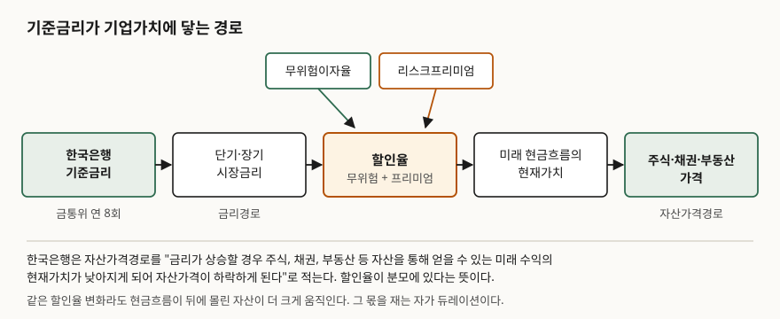
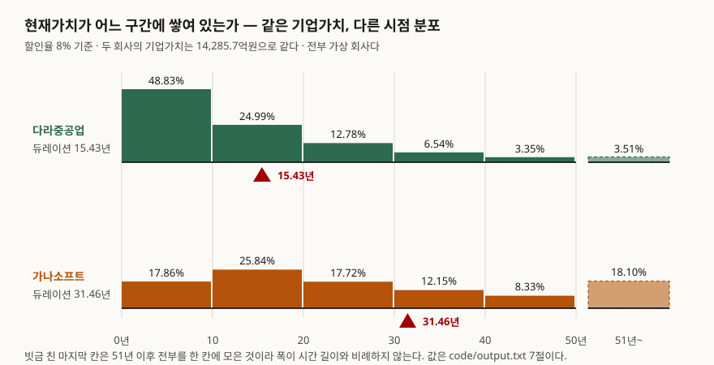

> 예제의 `가나소프트`·`다라중공업`은 계산 원리를 보이려고 만든 가상 회사다. 실재하는 기업과 관계가 없다. 특정 종목이나 업종의 전망을 말하는 글이 아니다.

## 들어가며

금리 인상 발표가 난 날 장을 보면 지수는 1% 빠졌는데 보유 종목은 5% 빠져 있다. 반대로 인하 소식에 지수가 1% 올랐을 때 그 종목은 7% 오른다. 같은 뉴스에 같은 시장인데 폭이 다섯 배 넘게 갈린다. 이때 흔히 나오는 설명이 "성장주는 금리에 민감하다"인데, 이건 설명이 아니라 현상을 다시 말한 것이다. 왜 민감한지를 숫자로 보려면 할인율이 가치에 닿는 과정을 한 번 따라가 보면 된다. 길이도 짧다. 기준금리에서 기업가치까지 상자 다섯 개면 끝난다.

## 개념

한국은행은 기준금리 변경이 실물경제에 닿는 길을 다섯 갈래로 나눠 설명한다. 금리경로, 자산가격경로, 신용경로, 환율경로, 기대경로다. 주가와 직접 닿는 것은 앞의 둘이다.

**금리경로**는 정책금리가 시장금리로 옮겨 가는 구간이다. 한국은행은 "기준금리 변경은 단기시장금리, 장기시장금리, 은행 예금 및 대출 금리 등 금융시장의 금리 전반에 영향을 미친다"고 적는다. 기준금리 자체는 한국은행이 금융기관과 환매조건부증권(RP) 매매, 자금조정 예금·대출을 할 때 쓰는 금리이고, 금융통화위원회가 **연 8회** 정한다. 7일물 RP 매각의 고정입찰금리이자 7일물 RP 매입의 최저입찰금리이므로, 처음 닿는 곳은 초단기 자금시장이다.

**자산가격경로**가 그다음이다. 한국은행의 설명은 이렇다. "금리가 상승할 경우 주식, 채권, 부동산 등 자산을 통해 얻을 수 있는 미래 수익의 현재가치가 낮아지게 되어 자산가격이 하락하게 된다." 이 한 문장에 계산이 다 들어 있다. **미래 수익을 현재가치로 바꾸는 나눗셈에서 금리가 분모에 있다는 뜻이다.**

그러니 "금리가 오르면 주가가 내린다"는 수급이나 심리 이야기가 아니다. 가치를 계산하는 식의 분모가 커진 것이다. 그리고 분모가 커질 때 얼마나 깎이는지는 **분자가 언제 들어오느냐**에 달려 있다. 먼 미래의 돈일수록 분모의 거듭제곱이 커지므로 더 많이 깎인다.

## 구조



> **출처**: [한국은행 — 통화정책 효과의 파급 (금리경로: "기준금리 변경은 단기시장금리, 장기시장금리, 은행 예금 및 대출 금리 등 금융시장의 금리 전반에 영향을 미친다" / 자산가격경로: "금리가 상승할 경우 주식, 채권, 부동산 등 자산을 통해 얻을 수 있는 미래 수익의 현재가치가 낮아지게 되어 자산가격이 하락하게 된다")](https://www.bok.or.kr/portal/main/contents.do?menuNo=200289), [한국은행 — 기준금리 (금융통화위원회 연 8회 결정, 7일물 RP 매각 고정입찰금리·매입 최저입찰금리)](https://www.bok.or.kr/portal/singl/baseRate/progress.do?dataSeCd=01&menuNo=200656)

체인 가운데 할인율 칸만 두 조각으로 되어 있다. 이 구조가 나중에 중요해진다. 기준금리가 움직여도 리스크프리미엄이 반대로 움직이면 할인율은 그만큼 안 움직인다.



> **출처**: 값은 이 글의 [`code/output.txt`](code/output.txt) 7절 계산 결과다. 듀레이션의 정의는 한국은행 발간 「2020 경제금융용어 700선」(2020-08) 96쪽 '듀레이션' — "채권에서 발생하는 현금흐름의 가중평균만기로 투자자금의 평균회수기간". 발행처 게시판은 [한국은행 경제교육 발간자료](https://www.bok.or.kr/portal/bbs/B0000216/list.do?menuNo=200765), 본문 PDF는 [여기](https://files-scs.pstatic.net/2023/01/14/9Fo5VoHBh7/2020_%EA%B2%BD%EC%A0%9C%EA%B8%88%EC%9C%B5%EC%9A%A9%EC%96%B4%20700%EC%84%A0.pdf)(제3자 전재)

두 회사의 기업가치는 지금 14,285.7억원으로 같다. 그런데 받침점이 15.43년과 31.46년에 선다. 이 차이가 전부다.

## 동작 원리

### 비교하려면 가치를 먼저 같게 맞춰야 한다

가상 회사 둘을 세웠다. **다라중공업**은 잉여현금흐름이 1년 차에 1,000억이고 해마다 1%씩 커진다. **가나소프트**는 1년 차가 작은 대신 10년 차까지 해마다 25%씩 커지고, 그 뒤로는 4%씩 커진다.

```text
회사                1년차 FCF      고성장률      고성장 햇수      영구성장률
다라중공업            1,000.0억      1.0%         10년       1.0%
가나소프트              130.9억     25.0%         10년       4.0%

할인율 8% 기준 기업가치
  다라중공업: 14,285.7억원
  가나소프트: 14,285.7억원
```

가나소프트의 1년 차 현금흐름 130.9억은 손으로 고른 숫자가 아니다. 두 회사의 현재 기업가치가 정확히 같아지도록 역산한 값이다. 가치가 1년 차 현금흐름에 비례하므로 배수 하나로 맞출 수 있다. **가치가 다르면 변동률 비교가 지저분해지기 때문에 먼저 같게 맞췄다.**

영구히 이어지는 현금흐름은 200년까지 펼쳐서 더했다. 잘라낸 꼬리가 무시할 만한지는 영구성장모형으로 닫은 값과 맞대 보면 안다.

```text
  다라중공업: 펼침 14,285.69억 / 모형 14,285.71억 / 차이 -0.0002%
  가나소프트: 펼침 14,285.69억 / 모형 14,294.72억 / 차이 -0.0632%
```

가나소프트 쪽 오차가 300배쯤 크다. 성장률이 높아 뒤쪽 현금흐름이 두꺼운 만큼 잘라낸 꼬리도 두껍기 때문이다. 그래도 0.07% 이하라 아래 비교를 흔들지는 않는다.

### 무게가 어디에 있는지가 민감도를 정한다

```text
회사                  듀레이션      앞 10년 비중      앞 20년 비중
다라중공업             15.43년        48.83%        73.82%
가나소프트             31.46년        17.86%        43.70%
```

다라중공업은 지금 가치의 절반을 앞으로 10년 안에 회수한다. 가나소프트는 20년이 지나도 절반을 못 채운다. 듀레이션은 채권에서 쓰던 정의 그대로다 — **현재가치로 가중한 평균 회수 시점.** 가나소프트의 31.46년은 "투자금이 평균적으로 31년 뒤에 돌아온다"는 말이고, 31년 뒤의 1억은 할인율이 1%p만 올라도 현재가치가 꽤 깎인다.

### 같은 1%p가 두 배로 때린다

```text
     할인율          다라중공업 가치        변동          가나소프트 가치        변동
      6%         19,998.7억    39.99%         30,448.8억   113.14%
      7%         16,666.5억    16.67%         19,822.4억    38.76%
      8%         14,285.7억     0.00%         14,285.7억     0.00%
      9%         12,500.0억   -12.50%         10,966.5억   -23.23%
     10%         11,111.1억   -22.22%          8,776.8억   -38.56%
     11%         10,000.0억   -30.00%          7,233.7억   -49.36%
```

8%에서 9%로 1%p 올렸을 때 다라중공업은 12.50%, 가나소프트는 23.23% 빠진다. 거의 두 배다. 반대로 8%에서 6%로 2%p 내리면 다라는 39.99%, 가나는 113.14% 오른다. 이번엔 세 배 가까이 벌어진다.

**성장주가 금리에 민감한 이유는 성장률이 높아서가 아니라 현금흐름이 뒤에 있어서다.** 성장률이 높으면 현금흐름이 뒤로 밀리고, 뒤로 밀리면 할인율의 거듭제곱을 더 많이 통과한다. 성장률은 원인이 아니라 경유지다.

듀레이션으로 근사해 보면 채권에서 본 것과 똑같은 현상이 나온다.

```text
  다라중공업: -12.50%  (듀레이션 근사 -14.29%)
  가나소프트: -23.23%  (듀레이션 근사 -29.13%)
```

근사가 둘 다 실제보다 더 많이 떨어진다고 말한다. 가치-할인율 관계도 아래로 볼록한 곡선이라 접선을 그으면 곡선 아래를 지나기 때문이다. 듀레이션이 긴 가나소프트 쪽에서 어긋나는 폭이 더 크다.

### 분모가 좁아지면 민감도가 터진다

현금흐름이 영구히 g씩 커진다고 보면 가치는 FCF ÷ (r − g)로 닫힌다. 분모가 할인율과 성장률의 **차이**라는 것이 핵심이다.

```text
     r     g    r-g        가치(억)      r +1%p 가치        변동
 12.0%  1.0%  11.0%       909.1         833.3    -8.33%
 10.0%  2.0%   8.0%     1,250.0       1,111.1   -11.11%
  8.0%  3.0%   5.0%     2,000.0       1,666.7   -16.67%
  7.0%  5.0%   2.0%     5,000.0       3,333.3   -33.33%
  6.5%  5.5%   1.0%    10,000.0       5,000.0   -50.00%
```

1년 차 현금흐름은 100억으로 고정했다. r − g가 11%p일 때 할인율 1%p는 가치의 8.33%를 가져간다. 1%p까지 좁혀지면 **절반**을 가져간다. 금리가 낮고 성장 기대가 높을수록 분모가 얇아지고, 얇아진 분모에서는 같은 1%p가 훨씬 크게 작용한다.

그래서 저금리 구간에서 성장주 밸류에이션이 크게 흔들린다. 분모가 이미 얇아져 있던 상태에서 금리가 움직였기 때문이다. 이건 앞 글에서 본 채권 쪽 현상과 같은 성질이다. 수익률이 낮을수록 듀레이션이 길어지고, 길어진 듀레이션에서 같은 1%p가 더 크게 때린다.

### 기준금리가 1%p 오른다고 할인율이 1%p 오르지는 않는다

할인율은 무위험이자율에 리스크프리미엄을 얹어 만든다. 기준금리가 닿는 곳은 앞쪽이고, 뒤쪽은 경기 전망과 위험 선호가 정한다. 둘이 따로 움직이면 결과가 갈린다.

```text
시나리오                             무위험      프리미엄     할인율        가나소프트        다라중공업
출발점                             3.5%      4.5%    8.0%        0.00%        0.00%
금리만 +1%p                        4.5%      4.5%    9.0%      -23.23%      -12.50%
금리 +1%p, 프리미엄 -0.5%p            4.5%      4.0%    8.5%      -12.93%       -6.67%
금리 +1%p, 프리미엄 +1%p              4.5%      5.5%   10.0%      -38.56%      -22.22%
```

가운데 줄이 "금리는 올랐는데 주가는 덜 빠지는" 경우다. 인상이 경기가 좋다는 신호로 읽혀 프리미엄이 내려가면 할인율은 0.5%p만 오른다. 맨 아래 줄은 반대다. 인상이 긴축 공포로 읽혀 프리미엄까지 오르면 할인율이 2%p 오르고 타격이 배가 된다. **금리 발표 뒤 시장 반응이 예상과 어긋나는 일은 대개 이 두 번째 칸에서 벌어진다.**

## 실습 예제

위 숫자는 전부 아래 스크립트를 돌린 결과다. 외부 라이브러리 없이 현재가치 정의만 쓴다.

```python
def flows(self, years=HORIZON):
    """연도별 잉여현금흐름. 고성장 구간이 끝나면 영구 성장률로 넘어간다."""
    out = []
    cf = self.fcf1
    for t in range(1, years + 1):
        out.append((t, cf))
        g = self.high_growth if t < self.high_years else self.terminal_growth
        cf *= 1 + g
    return out


def value(self, r, years=HORIZON):
    return sum(cf / (1 + r) ** t for t, cf in self.flows(years))


def duration(self, r, years=HORIZON):
    """현재가치로 가중한 평균 회수 시점. 채권 듀레이션과 같은 정의다."""
    v = self.value(r, years)
    return sum(t * cf / (1 + r) ** t for t, cf in self.flows(years)) / v
```

전체 소스: [`code/`](code/) · 실행 기록: [`code/output.txt`](code/output.txt)

> 듀레이션의 정의와 채권에서의 쓰임은 [채권 기초 — 표면금리·만기수익률·듀레이션](../2026-10-21-bond-coupon-ytm-duration/index.md)에 정리해 두었다.

## 실무에서 주의할 점

**1. 할인율 가정 하나가 결론을 뒤집는다.** 위 표에서 할인율 6%와 11% 사이에 가나소프트의 가치가 30,448억에서 7,234억으로 벌어진다. 네 배가 넘는다. DCF로 계산한 적정가치를 볼 때 숫자보다 먼저 봐야 할 것이 어떤 할인율을 썼는가다. 할인율이 적혀 있지 않은 적정가치는 읽을 수 없는 숫자다.

**2. r − g가 좁으면 모형 밖으로 나간 것이다.** 영구성장률 g가 할인율 r에 가까워지면 가치가 발산한다. g가 r을 넘으면 식 자체가 음수를 뱉는다. 어떤 회사도 경제 전체보다 영구히 빠르게 자라지 못하므로, g는 장기 명목성장률 아래로 두는 것이 보통이다. 위 표의 마지막 두 줄은 "이렇게 두면 민감도가 어떻게 되는가"를 보인 것이지 쓸 만한 가정이 아니다.

**3. 기준금리와 장기금리는 같은 방향으로 가지 않을 수 있다.** 한국은행의 설명도 기준금리가 단기시장금리, 장기시장금리, 여수신금리에 "영향을 미친다"까지다. 같은 폭으로 움직인다고는 적혀 있지 않다. 기업가치 할인에 쓰는 것은 주로 장기금리 쪽이므로, 기준금리 인상만 보고 할인율이 그만큼 올랐다고 셈하면 어긋난다.

**4. 성장률과 할인율은 따로 정해지지 않는다.** 위 계산은 할인율만 흔들고 현금흐름은 고정했다. 실제로는 금리가 오르면 기업의 이자비용이 늘고 수요가 줄어 현금흐름 자체가 바뀐다. 분모만 움직이는 계산은 분자가 그대로일 때의 몫을 떼어 본 것이다. 전체 효과는 여기에 분자 변화가 더해진다.

**5. 듀레이션이 길다는 것은 불확실성이 크다는 뜻이기도 하다.** 31년 뒤 현금흐름을 예측한 숫자와 3년 뒤 현금흐름을 예측한 숫자는 같은 신뢰도를 갖지 않는다. 가나소프트의 가치 중 51년 이후가 18.10%를 차지한다. 그 몫은 계산으로는 정확하지만 가정에 가장 많이 기대고 있는 부분이다.

## 정리

- 기준금리는 시장금리를 거쳐 할인율에 닿고, 할인율은 미래 현금흐름을 현재가치로 바꾸는 나눗셈의 분모에 들어간다. 한국은행이 자산가격경로로 설명하는 길이다
- 같은 할인율 변화라도 현금흐름이 뒤에 몰린 자산이 더 크게 움직인다. 무게가 어디에 있는지를 재는 자가 듀레이션이고, 채권에서 쓰던 정의 그대로 쓴다
- 현재 가치가 똑같은 두 회사도 듀레이션이 15.43년과 31.46년으로 갈리면 할인율 1%p에 12.50%와 23.23%로 갈린다. 성장률은 원인이 아니라 현금흐름을 뒤로 미는 경유지다
- 영구성장모형에서 민감도를 정하는 것은 r − g다. 이 차이가 좁을수록 같은 1%p가 크게 작용하고, 1%p까지 좁아지면 가치의 절반을 가져간다
- 기준금리 1%p가 할인율 1%p는 아니다. 리스크프리미엄이 같이 움직이면 할인율은 더 오르거나 덜 오른다

## 참고 자료

- [한국은행 — 통화정책 효과의 파급 (금리경로·자산가격경로·신용경로·환율경로·기대경로)](https://www.bok.or.kr/portal/main/contents.do?menuNo=200289)
- [한국은행 — 한국은행 기준금리 (금융통화위원회 연 8회 결정, 적용 거래와 가산·차감 폭)](https://www.bok.or.kr/portal/singl/baseRate/progress.do?dataSeCd=01&menuNo=200656)
- 한국은행 발간 「2020 경제금융용어 700선」(2020-08) — '듀레이션'(96쪽). 발행처 게시판 [한국은행 경제교육 발간자료](https://www.bok.or.kr/portal/bbs/B0000216/list.do?menuNo=200765) · 본문 [PDF](https://files-scs.pstatic.net/2023/01/14/9Fo5VoHBh7/2020_%EA%B2%BD%EC%A0%9C%EA%B8%88%EC%9C%B5%EC%9A%A9%EC%96%B4%20700%EC%84%A0.pdf)(제3자 전재)
- [Myron J. Gordon, "Dividends, Earnings, and Stock Prices", *The Review of Economics and Statistics*, Vol. 41, No. 2 (May 1959), pp. 99–105 — 영구성장모형의 원 논문](https://www.jstor.org/stable/1927792)
