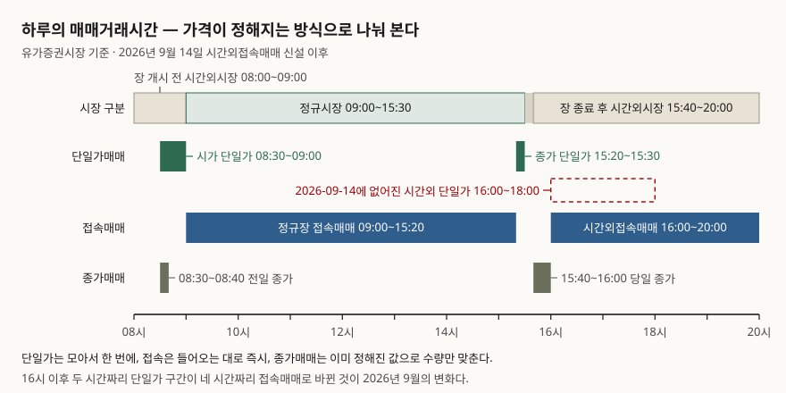
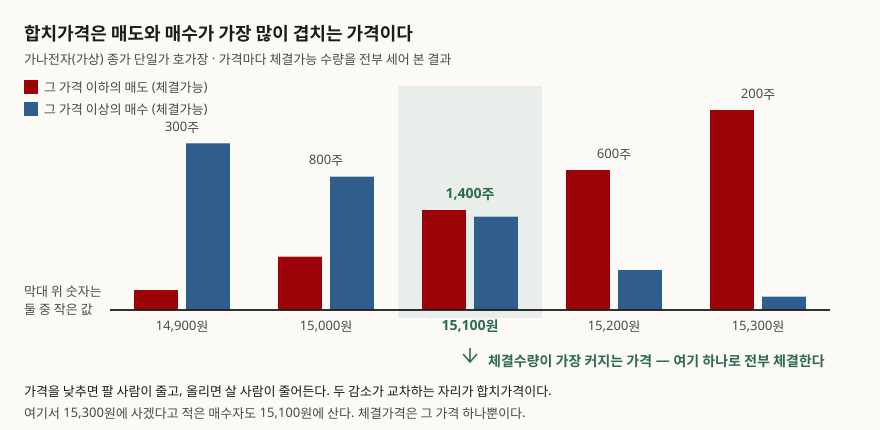

> 예제의 `가나전자`와 호가·수량·접수시각은 계산 원리를 보이려고 만든 값이다. 실재하는
> 종목과 관계가 없다.

## 들어가며

오후 3시 29분, 호가창에 15,000원이 찍혀 있는 것을 보고 매도 주문을 넣는다. 장이 끝나고
확인해 보면 체결가는 15,100원이다. 그 1분 사이에 누가 더 비싸게 사 간 것도 아니다.
체결 내역을 열어 보면 그 1분 동안 체결은 **한 건도 없었다.** 대부분은 이걸 운이 좋았다고
넘기는데, 그 10분은 애초에 체결이 일어나지 않는 구간이다. 가격을 정하는 방식이 그 앞
여섯 시간과 다르다.

## 개념 — 가격을 정하는 두 가지 방식

거래소의 매매체결은 크게 두 갈래다. 유가증권시장 업무규정의 매매계약 체결방법
조항(제22조제1항)은 개별경쟁매매를 **단일가격에 의한 방식**과 **복수가격에 의한 방식**으로
나눈다. 앞의 것이 단일가매매, 뒤의 것이 접속매매다.

접속매매는 호가가 들어올 때마다 장부에 있는 반대편 호가와 바로 맞춘다. 체결될 때마다
가격이 새로 찍히므로 하루에 수만 개의 체결가가 생긴다. 반대로 단일가매매는 정해진
시간 동안 호가를 받기만 하고 체결하지 않는다. 그 시간이 끝나면 쌓인 호가 전부를 한
번에 맞춰 **하나의 가격**을 뽑는다. 한국거래소는 이 방식을 "수요와 공급을 집중시켜
균형가격형성의 필요성이 큰 경우"에 쓴다고 설명한다.

필요성이 큰 경우란 거래가 끊겼다가 다시 시작하는 자리다. 밤사이 뉴스가 쌓인 뒤의 첫
가격(시가), 그날을 대표하는 마지막 가격(종가), 변동성완화장치가 걸렸다가 풀린 뒤의 첫
가격이 전부 그렇다. 이때 접속매매로 열면 가장 먼저 도착한 주문 몇 개가 가격을 만들고
나머지는 그 가격을 보고 따라붙는다.

호가끼리의 순위는 네 가지로 정해진다. **가격우선**(매도는 싼 쪽, 매수는 비싼 쪽이 먼저),
**시간우선**(같은 가격이면 먼저 접수된 쪽), **수량우선배분**(시가나 재개 후 첫 가격이
상·하한가로 정해질 때만 적용), **위탁자우선**(일부 종목에서 위탁매매가 자기매매에 우선).
단일가매매에서 가격을 **정할 때는** 이 중 아무것도 쓰지 않는다. 가격이 정해진 **뒤**
누구에게 배분할지에만 쓴다. 이 구분이 이 글의 핵심이다.

## 구조 — 하루는 네 토막이다



> **출처**: [법제처 찾기쉬운 생활법령정보 — 주식투자자 > 매매거래일·거래시간 및 거래 원칙 등](https://www.easylaw.go.kr/CSP/CnpClsMain.laf?csmSeq=1701&ccfNo=2&cciNo=1&cnpClsNo=2) (2026-09-15 기준, 유가증권시장 업무규정 제4조제3항·제10조제1항 인용) 및 [자본시장연구원 『자본시장 제도동향』 2026년 10월 — 한국거래소 규정](https://www.kcmi.re.kr/common/downloadw?fid=29206&fgu=002001&fty=004003)

| 구분 | 시간 | 가격이 정해지는 방식 |
|---|---|---|
| 장 개시 전 시간외시장 | 08:00~09:00 | 시간외종가매매(08:30~08:40)는 전일 종가 고정 |
| 시가 단일가 호가접수 | 08:30~09:00 | 09:00에 단일가 한 번 |
| 정규시장 접속매매 | 09:00~15:20 | 체결될 때마다 |
| 종가 단일가 호가접수 | 15:20~15:30 | 15:30에 단일가 한 번 |
| 장 종료 후 시간외시장 | 15:40~20:00 | 시간외종가매매(15:40~16:00)는 당일 종가 고정 |
| 시간외접속매매 | 16:00~20:00 | 체결될 때마다 |

이 표의 마지막 줄이 2026년에 바뀐 자리다. 한국거래소는 2026년 9월 9일 유가증권시장
업무규정을 개정해 **장 종료 후 시간외접속매매**를 신설하고 9월 14일부터 시행했다.
개정 이유로는 세계 주요 시장의 24시간 거래체계 전환을 들었다. 같은 개정에서 16시부터
18시까지 10분 단위로 돌던 **시간외 단일가매매는 없어졌다**(관련 조항 제34조의2 삭제).
시간외대량매매와 시간외바스켓매매의 종료시각도 18시에서 20시로 늦춰졌다.

바뀐 것은 시간대가 아니라 방식이다. 전에는 16시 이후에 주문을 넣어도 10분을 기다려야
했고 그 10분치가 하나의 가격으로 체결됐다. 지금은 정규장과 같은 복수가격 방식이라
반대편 호가와 맞으면 바로 체결된다.

## 동작 원리 — 합치가격은 어떻게 하나로 좁혀지는가

단일가 구간이 끝나면 거래소는 가격을 하나 정해야 한다. 기준은 간단하다. **어떤 가격
`p`로 체결한다고 가정하면, `p` 이하로 팔겠다는 호가와 `p` 이상으로 사겠다는 호가가
체결 대상이 된다.** 둘 중 작은 쪽이 그 가격에서 실제로 체결될 수 있는 수량이다.

`p`를 올리면 팔겠다는 쪽은 늘고 사겠다는 쪽은 준다. 내리면 반대다. 두 값이 반대 방향으로
움직이므로 작은 쪽의 값은 어딘가에서 가장 커진다. 그 자리가 합치가격이다.



> **출처**: 아래 실습 예제의 계산 결과(`code/output.txt` 2절). 체결방법의 근거는
> [한국거래소 법규/제도 — 단일가매매시 체결방법](https://regulation.krx.co.kr/contents/RGL/03/03010201/RGL03010201.jsp)

가격이 정해진 다음에야 배분이 시작된다. 매도는 싼 호가부터, 매수는 비싼 호가부터
차례로 채우고, 같은 가격대 안에서는 먼저 접수된 호가가 앞선다. 그래서 **합치가격 자리에
걸친 호가만 일부 체결되고 나머지는 잔량으로 남는다.** 14,900원에 팔겠다고 적은 사람도
15,100원을 받고, 15,300원에 사겠다고 적은 사람도 15,100원에 산다. 체결가격이 하나뿐이기
때문이다.

마감 시각에는 장치가 하나 더 있다. 모든 단일가매매는 "마감시점으로부터 불공정거래
예방 등을 위해 30초이내에서 거래소가 정하는 임의의 시간에 종료"된다. 15시 30분
00초에 끝나지 않고 30초 안의 어느 시점에 끝난다는 뜻이다. 마지막 순간에 호가를 던져
가격을 움직이려는 시도를 막기 위한 것이다.

수량우선배분은 예외적으로만 쓴다. 한국거래소는 원칙적으로 같은 가격대 호가끼리
수량을 나누지 않고, "시가(정규장 최초의가격) 또는 장중단 재개 후 첫 가격이 단일가매매
방식을 통해 상·하한가로 형성되는 때에 한하여" 배분한다고 적는다. 종가 단일가는 여기
해당하지 않으므로 이 글의 예제도 시간우선으로 배분한다.

## 실습 예제

가상 종목 `가나전자`의 종가 단일가 호가장을 만들어 전 과정을 돌렸다. 전체 소스:
[`code/`](code/)

```python
def matched_at(orders: list[Order], price: int) -> tuple[int, int, int]:
    """price 로 체결한다고 할 때 (체결가능 매도, 체결가능 매수, 체결수량)."""
    sell = sum(o.qty for o in orders if o.side == "매도" and o.price <= price)
    buy = sum(o.qty for o in orders if o.side == "매수" and o.price >= price)
    return sell, buy, min(sell, buy)
```

호가장은 매수 2,500주·매도 3,000주다. 가격 다섯 자리를 전부 세어 보면 이렇다.

```text
      후보가격       체결가능 매도       체결가능 매수        체결수량
    14,900           300         2,500         300
    15,000           800         2,000         800
    15,100         1,500         1,400       1,400  <= 최대
    15,200         2,100           600         600
    15,300         3,000           200         200
```

15,100원에서 1,400주가 체결된다. 이 가격으로 배분하면 이렇게 갈린다.

```text
번호   구분           호가      수량      체결      잔량  비고
S1   매도       14,900     300     300       0  200원 비싸게 팔았다
S2   매도       15,000     500     500       0  100원 비싸게 팔았다
S3   매도       15,100     400     400       0  
S6   매도       15,100     300     200     100  같은 가격대에서 시간우선에 밀려 일부만
B5   매수       15,300     200     200       0  200원 싸게 샀다
B4   매수       15,200     400     400       0  100원 싸게 샀다
B2   매수       15,100     800     800       0  
```

`S3`와 `S6`은 둘 다 15,100원 매도인데 `S3`가 15:23:05에, `S6`이 15:28:20에 들어왔다.
한계 가격에 남은 600주를 `S3`가 400주 먼저 가져가고 `S6`은 200주만 받는다. 같은 가격에
같은 뜻을 적었어도 5분 차이가 100주를 갈랐다.

여기까지는 접속매매도 마찬가지로 보인다. 차이는 **같은 호가 묶음을 접수 순서만 바꿔
접속매매로 돌려 보면** 드러난다.

```text
[순서 A] 접수 순서 B1 → S1 → S2 → B2 → S3 → S4 → B3 → S5 → B4 → S6 → B5
  체결 8건 · 총 2,000주 · 가격 15,000~15,200원 · 마지막 체결가 15,200원

[순서 B] 접수 순서 B5 → S1 → B4 → S6 → B1 → S5 → B2 → S2 → B3 → S3 → S4
  체결 5건 · 총 1,400주 · 가격 14,900~15,300원 · 마지막 체결가 15,100원
```

같은 사람들이 같은 가격에 같은 수량을 적었는데 마지막 체결가가 15,200원과 15,100원으로
갈린다. 마지막 체결가가 그날 종가가 된다면, 종가를 정한 것은 호가가 아니라 **도착 순서**다.
단일가는 같은 호가를 어떤 순서로 넣어도 15,100원·1,400주로 같다. 계산에 접수 순서를
쓰지 않으니 당연한 결과이고, 그 당연함이 단일가를 쓰는 이유다.

## 실무에서 주의할 점

**시간외접속매매에서 낼 수 있는 호가가 다르다.** 업무규정 시행세칙은 지정가·최우선지정가·
최유리지정가만 허용하고 시장가는 두지 않았다. 대신 IOC(접수 시점에 체결 가능한 수량만
체결하고 나머지는 취소)와 FOK(전량 체결이 안 되면 전부 취소) 조건을 붙일 수 있다.
그리고 **시간외종가매매에 낸 호가는 시간외접속매매에서 효력이 없다.** 15시 40분대에
넣어 둔 주문이 16시에 자동으로 넘어가지 않는다는 뜻이다.

**모든 종목이 16시 이후에 거래되지는 않는다.** 시행세칙은 당일 정규장 미거래종목,
투자경고종목, 투자위험종목, 이상급등종목, 관리종목, 초저유동종목, ETF·ETN을 시간외
접속매매에서 제외했다. 정규장에서 매매되던 종목이라도 이 중 하나에 걸리면 16시 이후
호가를 낼 수 없다.

**안전장치의 구성이 정규장과 다르다.** 사이드카는 시간외접속매매에 도입하지 않았고,
변동성완화장치(VI)는 도입했다. 시간외접속매매에서 아직 체결가가 없으면 VI는 정규장
종가를 기준으로 삼는다. 공매도도 허용되며, 직전 가격 이하로 호가할 수 없다는 업틱룰이
같게 적용되고 직전 가격이 없으면 역시 정규장 종가를 참조한다.

**단일가 구간이 끝나는 시각은 고정이 아니다.** 랜덤엔드 때문에 15시 30분 정각을 노려
호가를 던지면 이미 마감된 뒤일 수 있다.

**체결수량이 같은 가격이 둘 이상일 수 있다.** 예제의 마지막 절이 그런 호가장이다.
매도 500주가 15,000원에, 500주가 15,100원에 있고 매수도 대칭으로 쌓이면 두 가격 모두
500주가 체결된다. 체결수량만으로는 하나를 고를 수 없으므로 거래소 업무규정이 이 경우의
선택 기준을 따로 둔다. 드문 일 같지만 호가가 얇은 종목에서는 흔하다.

## 정리

- 단일가매매는 일정 시간 호가를 모아 한 번에 체결한다. 시가(08:30~09:00 접수),
  종가(15:20~15:30 접수), 거래 재개 후 첫 가격이 이 방식이다.
- 합치가격은 체결가능 매도와 체결가능 매수 중 작은 쪽이 가장 커지는 가격이다.
  가격을 정할 때는 접수 순서를 쓰지 않고, 정해진 뒤 배분할 때만 쓴다.
- 접속매매는 같은 호가라도 도착 순서가 결과를 바꾼다. 그래서 거래가 끊겼던 자리에는
  단일가를 쓴다.
- 2026년 9월 14일부터 16시~18시 시간외 단일가매매가 없어지고 16시~20시 시간외접속
  매매가 들어섰다. 호가 종류·대상 종목·안전장치가 정규장과 조금씩 다르다.

## 참고 자료

- [법제처 찾기쉬운 생활법령정보 — 주식투자자 > 매매거래일·거래시간 및 거래 원칙 등](https://www.easylaw.go.kr/CSP/CnpClsMain.laf?csmSeq=1701&ccfNo=2&cciNo=1&cnpClsNo=2) (2026-09-15 기준)
- [한국거래소 법규/제도 — 유가증권시장 단일가매매시 체결방법](https://regulation.krx.co.kr/contents/RGL/03/03010201/RGL03010201.jsp)
- [자본시장연구원 『자본시장 제도동향』 2026년 10월 — 한국거래소 규정](https://www.kcmi.re.kr/common/downloadw?fid=29206&fgu=002001&fty=004003) (유가증권시장 업무규정 2026-09-09 개정·2026-09-14 시행, 같은 업무규정 시행세칙 2026-09-11 개정·2026-09-14 시행)
- [금융위원회 보도자료 — 장개시전 시간외시장 및 시가단일가 시간 단축](https://www.fsc.go.kr/po010103/73613?curPage=166) (2019-04-03 발표, 2019-04-29 시행)
