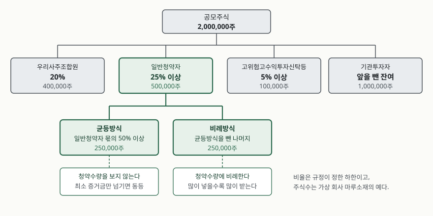
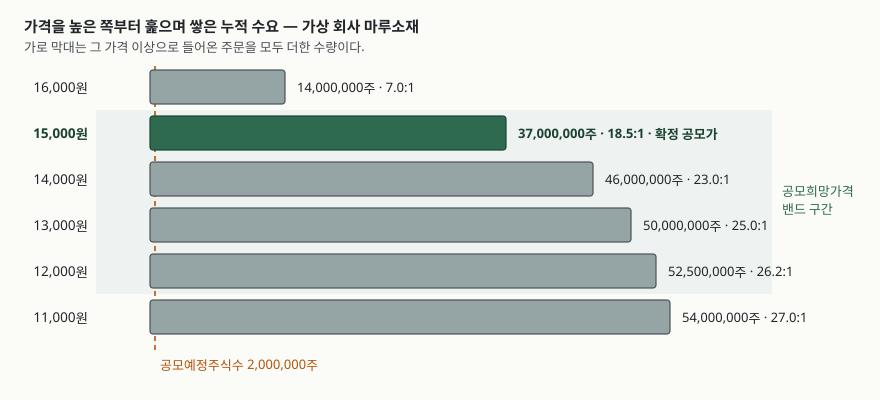

> 예제의 `마루소재`와 주식수·가격·주문·청약자는 계산 절차를 보이려고 만든 값이다.
> 실재하는 회사와 관계가 없다.

## 들어가며

증권사 앱에 공모주 일정이 뜬다. 공모희망가격이 12,000~15,000원이라고 적혀 있고,
며칠 뒤 다시 보면 확정 공모가가 15,000원으로 바뀌어 있다. 그 사이에 무슨 일이
있었는지는 어디에도 적혀 있지 않다.

청약 창에는 수량을 넣는 칸 하나와 증거금 금액이 뜬다. 여기서 대부분은 **넣을 수
있는 한도까지 넣으면 그만큼 더 받는다**고 생각하고 수량을 올린다. 그런데 배정
결과를 보면 20,000주를 청약한 사람이 101주를 받고, 10주를 청약한 사람이 1주를
받는다. 2,000배를 넣었는데 100배를 받은 것이다. 증거금 7,500만 원이 1주당
75,000원으로 묶인 쪽과 1,485,148원으로 묶인 쪽이 갈린다.

이 차이는 운이 아니다. 배정 방식이 두 갈래로 나뉘어 있고, 그 둘이 서로 다른
기준으로 셈을 하기 때문이다.

## 개념 — 공모가는 계산되지 않고 협의된다

기업공개(IPO)에서 공모가격을 정하는 절차의 출발점은 **수요예측**이다. 금융투자협회
「증권 인수업무 등에 관한 규정」의 용어 정의(제2조제7호)는 수요예측을 대표주관회사가
공모예정기업의 공모희망가격을 제시하고 그에 대한 수요상황을 파악하는 것으로 정한다.
여기서 파악하는 수요상황은 가격과 수량 둘 다다. 기관투자자가 "얼마에 몇 주를
받겠다"를 적어 내고, 그것을 가격대별로 쌓는다.

중요한 것은 그다음이다. 같은 규정의 공모가격 결정 조항(제5조제1항)은 기업공개
주식의 공모가격을 **수요예측 결과를 감안하여 인수회사와 발행회사가 협의하여**
정하도록 한다. 수요예측 결과를 넣으면 가격이 튀어나오는 공식이 규정에 없다.
경쟁률이 몇 대 몇이면 밴드 상단이라는 기준선도 없다. 그래서 같은 경쟁률에
같은 밴드라도 결론이 갈릴 수 있고, 증권신고서에 적힌 공모가 산정 경위를 읽어야
어느 쪽 논리를 썼는지 알 수 있다.

공모희망가격 자체도 규정이 정하는 값이 아니다. 같은 조 제2항은 공모예정금액을
협의된 공모희망가격의 **최고가격**에 공모예정주식수를 곱한 금액으로 정의할 뿐이다.
밴드 상단을 어디에 두느냐가 이후 모든 숫자의 크기를 정한다.

## 구조 — 공모주식이 네 갈래로 나뉜다

공모가가 정해지면 다음 문제는 **누구에게 몇 주를 주느냐**다. 이 비율은 협의
사항이 아니라 규정이 하한을 못 박아 둔 항목이다.



> **출처**: 금융투자협회 「증권 인수업무 등에 관한 규정」 [제9조(주식의 배정)](https://law.kofia.or.kr/service/law/detailArticlePrint.do?seq=140&historySeq=1596&contentSeq=267321) 제1항·제11항 (2023-12-19 개정)

규정의 주식 배정 조항(제9조제1항)은 대표주관회사가 청약자 유형군별로 배정하도록
하고 각 유형군의 몫을 정한다. 유가증권시장 상장을 위한 기업공개라면 우리사주조합원에게
공모주식의 20%를 배정하고(외국법인등은 제외), 일반청약자에게 25% 이상, 고위험고수익
투자신탁등에 5% 이상을 배정한다. 코스닥시장이나 코넥스시장 상장이면 우리사주조합원
배정이 의무가 아니라 **할 수 있는** 항목이 되고, 고위험고수익투자신탁등 몫은 10%
이상으로 올라가며 벤처기업투자신탁 25% 이상이 따로 붙는다. 이 유형군들을 다 떼고
남은 주식이 기관투자자에게 간다.

우리사주조합원 몫이 남을 수도 있다. 조합원 청약이 20%에 못 미치면 같은 조 제1항
제6호가 그 잔여분 중 공모주식의 5% 이내를 발행인과 협의해 일반청약자에게 배정할 수
있게 한다. 일반청약자 몫이 25%에서 30%까지 늘어나는 경로가 여기다. 조합원이
그 비율까지 청약하기 어려운 사유가 있고 조합이 조합원총회 의결로 더 낮은 비율을
원한다는 뜻을 서면으로 밝히면, 자본시장법 시행령의 우리사주조합원 배정 특례
조항(제176조의9, 2026-10-13 시행)이 20% 의무에 예외를 둔다.

## 동작 원리 — 균등과 비례는 다른 것을 센다

일반청약자 몫은 한 번 더 쪼개진다. 같은 조 제11항은 인수회사가 일반청약자에게
배정하는 전체 수량의 **50% 이상**을 균등방식으로 배정하고 나머지를 청약수량에
비례해 배정하도록 한다. 규정이 말하는 균등방식은 최소 청약증거금 이상을 납입한
모든 일반청약자에게 **동등한 배정기회**를 주는 방식이다.

이 한 문장이 청약 전략을 통째로 바꾼다. 균등방식 쪽에서는 청약수량이 셈에
들어가지 않는다. 최소 단위만 넘기면 10주를 넣은 사람과 20,000주를 넣은 사람이
같은 줄에 선다. 비례방식 쪽에서만 수량이 비중을 갖는다.

균등방식을 어떤 방법으로 구현할지는 규정이 정하지 않는다. 제13항이 그 방법과
수량을 **준법감시인의 사전승인**을 받아 정하도록 하고, 인수회사가 여럿이면
대표주관회사가 인수회사 간 방법을 동일하게 맞추도록 할 뿐이다. 그래서 배정물량을
청약 건수로 나눈 몫만큼 모두에게 주고 남는 주식을 추첨으로 돌리는 방식이 흔히
쓰이지만, 그 자체는 규정에 적힌 것이 아니라 주관사가 정한 방법이다. 청약 전에
투자설명서에서 그 방법을 확인해야 하는 이유가 여기 있다.

한쪽이 미달할 때의 처리도 정해져 있다. 제12항은 균등방식과 비례방식 중 한쪽
청약이 배정수량에 못 미치고 다른 쪽이 넘치면 미달한 쪽의 잔여주식을 넘친 쪽에
배정하도록 하고, 양쪽 모두 미달하면 각 청약수량까지만 배정한 뒤 잔여주식을 다른
청약자 유형군에 배정하거나 인수회사가 가져가도록 한다. 인수회사가 가져간다는
마지막 경로가 **인수**라는 말의 실제 내용이다.

## 실습 예제 — 가상 회사 마루소재

공모예정주식수 2,000,000주, 공모희망가격 12,000~15,000원짜리 기업공개를 만들어
수요예측부터 배정까지 세어 본다. 전체 코드는 [`code/ipo_allocation.py`](code/ipo_allocation.py)에 있다.

### 1단계 — 가격을 높은 쪽부터 누적한다

수요예측 주문을 가격 내림차순으로 훑으며 누적 수요량을 쌓는다. 어느 가격까지
내려가야 공모예정주식수가 차는지를 보려는 것이다.



> **출처**: 도식의 구조는 금융투자협회 「증권 인수업무 등에 관한 규정」 [제2조제7호(수요예측의 정의)·제5조(주식의 공모가격 결정 등)](https://law.kofia.or.kr/service/law/detailArticlePrint.do?seq=140&historySeq=1596&contentSeq=267321)를 따랐고, 막대의 수치는 가상 회사 마루소재의 예제 계산 결과다.

```text
[1단계] 수요예측 — 가격별 누적 수요
        가격       해당 가격 주문          누적 수요       누적 경쟁률     물량
  ------------------------------------------------------------
    16,000     14,000,000     14,000,000         7.0:1     충족  <- 밴드 밖
    15,000     23,000,000     37,000,000        18.5:1     충족
    14,000      9,000,000     46,000,000        23.0:1     충족
    13,000      4,000,000     50,000,000        25.0:1     충족
    12,000      2,500,000     52,500,000        26.2:1     충족
    11,000      1,500,000     54,000,000        27.0:1     충족  <- 밴드 밖
```

맨 윗줄에서 이미 공모예정주식수의 7배가 쌓였다. 밴드 상단인 15,000원까지만 세어도
37,000,000주, 18.5배다. 아래로 내려가며 더해지는 수량은 계속 줄어든다 —
14,000원에서 900만 주, 13,000원에서 400만 주, 12,000원에서 250만 주.

여기서 보이는 것은 **가격을 내려도 수요가 크게 늘지 않는다**는 사실이다. 밴드
상단에 이미 23,000,000주가 몰려 있고, 밴드를 넘어선 16,000원에도 14,000,000주가
들어왔다. 확정 공모가가 상단으로 붙는 협의에서 근거로 쓰이는 모양이 이것이다.
다만 앞서 적었듯 규정에 공식이 없으므로, 이 모양이 곧 15,000원을 뜻하지는 않는다.
예제에서는 상단으로 정해졌다고 두고 이후를 센다.

### 2단계 — 네 갈래로 나누고, 한 갈래를 다시 둘로 나눈다

유가증권시장 상장을 가정하고 규정의 하한을 그대로 적용한다.

```text
[3단계] 유형군별 배정 (유가증권시장 상장 가정)
  우리사주조합원                  20%      400,000 주
  일반청약자                    25%      500,000 주
  고위험고수익투자신탁등               5%      100,000 주
  기관투자자(잔여)                50%    1,000,000 주
  합계                              2,000,000 주

[4단계] 일반청약자 몫을 균등과 비례로 나눈다
  일반청약자 배정       500,000 주
  균등방식 (50%)        250,000 주
  비례방식              250,000 주
```

공모주식 2,000,000주 가운데 개인이 일반청약자로 가져갈 수 있는 몫은 500,000주,
전체의 4분의 1이다. 그중 절반인 250,000주가 청약수량과 무관하게 나뉜다.

### 3단계 — 균등방식에서는 건수만 센다

균등 청약이 180,000건 들어왔다고 두면 셈은 간단하다.

```text
[5단계] 균등방식 — 청약수량을 보지 않는다
  균등 배정물량         250,000 주
  균등 청약 건수        180,000 건
  1건당 기본 배정             1 주
  추첨에 돌릴 잔여       70,000 주 (= 180,000건 중 70,000건이 1주를 더 받는다)
  추첨에 걸릴 확률        38.9%
```

250,000을 180,000으로 나누면 1.39다. 주식은 쪼갤 수 없으므로 모두에게 1주씩 주고
남은 70,000주를 추첨으로 돌린다. 배정물량보다 청약 건수가 많으면 1주조차 못 받는
사람이 생긴다 — 건수가 300,000건이었다면 1건당 기본 배정이 0주가 되고, 250,000명만
1주를 받는다. 균등방식에서 경쟁률은 수량이 아니라 **사람 수**로 매겨진다.

### 4단계 — 비례방식과 합산

비례 청약이 50,000,000주 들어왔다고 두면 200주당 1주꼴이다.

```text
[6단계] 비례방식 — 청약수량에 비례
  비례 배정물량         250,000 주
  비례 청약수량      50,000,000 주
  비례 경쟁률            200.0:1  (청약 200주당 1주)

  청약자                청약수량            증거금     균등     비례     배정          납입금            환불금
  ---------------------------------------------------------------------------------------
  소액 청약자               10         75,000      1      0      1       15,000         60,000
  중간 청약자            1,000      7,500,000      1      5      6       90,000      7,410,000
  대량 청약자           20,000    150,000,000      1    100    101    1,515,000    148,485,000
```

소액 청약자가 받은 1주는 전부 균등방식에서 나왔다. 10주를 200으로 나누면 0.05주라
비례 몫은 0주다. 대량 청약자의 101주 가운데 100주는 비례에서, 1주는 균등에서 왔다.

증거금은 확정 공모가의 50%로 두었다. 증거금률은 규정에 비율이 정해져 있지 않고
주관사가 정하므로, 같은 수량을 청약해도 회사마다 묶이는 금액이 다를 수 있다.
배정받지 못한 몫은 환불된다 — 대량 청약자는 1억 5천만 원을 넣고 151만 5천 원을
납입한 뒤 1억 4,848만 5천 원을 돌려받는다.

### 5단계 — 증거금 한 주당 얼마가 묶였나

```text
[7단계] 증거금 대비 배정 — 균등방식이 바꾸는 자리
  청약자                     증거금     배정         1주당 묶인 증거금
  --------------------------------------------------------
  소액 청약자               75,000      1             75,000
  중간 청약자            7,500,000      6          1,250,000
  대량 청약자          150,000,000    101          1,485,148
```

증거금은 2,000배 차이가 나는데 배정은 101배에 그친다. 균등방식 1주가 소액 청약자
쪽에서만 비중을 갖기 때문이다. 대량 청약자의 1주당 묶인 증거금은 소액 청약자의
19.8배다.

이 수치를 "소액 청약이 유리하다"로 읽으면 절반만 읽은 것이다. 균등방식 1주는
청약 건수가 늘수록 얇아지고, 건수가 배정물량을 넘기면 0이 될 수 있다. 어느 쪽이
몇 주를 받는지는 그 공모에 몇 명이 들어왔는지에 달려 있고, 그 숫자는 청약이
끝나야 나온다.

## 실무에서 주의할 점

**첫째, 경쟁률이 두 개다.** 공모주 기사에 뜨는 경쟁률은 보통 수요예측 경쟁률
아니면 전체 청약 경쟁률이다. 그런데 내가 몇 주를 받을지를 정하는 것은 균등
경쟁률(청약 **건수** 기준)과 비례 경쟁률(청약 **수량** 기준) 둘이고, 이 둘은
서로 다른 방향으로 움직인다. 소액 청약이 몰리면 균등 경쟁률만 올라가고 비례
경쟁률은 그대로일 수 있다.

**둘째, 균등방식의 세부 방법은 주관사마다 다르다.** 규정은 "동등한 배정기회"와
준법감시인 사전승인만 정하고 방법은 열어 두었다. 예제에서 쓴 "1주씩 주고 나머지는
추첨"은 가정이지 규정이 아니다. 인수회사가 여럿인 공모에서는 대표주관회사가 방법을
통일하게 되어 있으므로(제13항) 증권사 간 방법 차이는 생기지 않지만, 공모마다
다를 수는 있다. 투자설명서의 배정 방법을 보고 들어가야 한다.

**셋째, 상장시장에 따라 유형군 구성이 달라진다.** 유가증권시장이면 우리사주조합원
20%가 의무이고 고위험고수익투자신탁등이 5% 이상이지만, 코스닥시장이면 우리사주
배정이 임의가 되고 고위험고수익투자신탁등이 10% 이상, 벤처기업투자신탁 25% 이상이
붙는다. 일반청약자 25% 이상은 같아도 남는 몫의 구성이 달라지므로 기관 배정분이
크게 움직인다.

**넷째, 증거금은 묶이는 돈이다.** 환불일까지 그 금액을 쓸 수 없고, 환불이 되어야
다른 공모에 넣을 수 있다. 일정이 겹치는 공모가 여럿이면 어느 쪽에 넣을지가 먼저
정해져야 한다. 증거금률 자체도 공모마다 다를 수 있으므로 50%를 상수로 두고 계산하면
안 된다.

**다섯째, 확정 공모가가 밴드 안에만 있는 것은 아니다.** 밴드는 협의로 제시한
희망가격일 뿐이다. 공모예정금액이 50억 원 미만이면 수요예측 없이 협의한 단일가격이나
경매 방식으로 정하는 길도 규정 제5조제1항에 따로 열려 있다.

## 정리

- 수요예측은 가격과 수량을 함께 받아 가격대별 수요를 쌓는 절차이고, 확정 공모가는
  그 결과를 **감안해 협의**로 정해진다. 규정에 공식이 없다
- 공모주식은 우리사주조합원·일반청약자·고위험고수익투자신탁등·기관투자자로 나뉘고,
  유가증권시장 기업공개에서 일반청약자 몫은 25% 이상이다
- 일반청약자 몫의 50% 이상은 균등방식으로, 나머지는 청약수량에 비례해 배정된다.
  균등방식은 최소 증거금만 넘기면 수량을 보지 않는다
- 그래서 증거금이 2,000배 차이 나도 배정은 101배에 그치는 모양이 나온다. 균등방식
  1주의 비중이 소액 쪽에서 크기 때문이다
- 균등방식의 구체적 방법은 규정이 정하지 않고 주관사가 준법감시인 승인을 받아
  정한다. 투자설명서를 보고 들어가야 하는 자리다

## 참고 자료

- 금융투자협회, [「증권 인수업무 등에 관한 규정」 제9조(주식의 배정)](https://law.kofia.or.kr/service/law/detailArticlePrint.do?seq=140&historySeq=1596&contentSeq=267321) (2023-12-19 개정) — 유형군별 배정 비율, 균등방식 50% 이상, 미달 시 처리, 준법감시인 사전승인
- 금융투자협회, [「증권 인수업무 등에 관한 규정」 전문](https://law.kofia.or.kr/service/law/lawFullScreenContent.do?seq=140) — 제2조제7호 수요예측의 정의, 제5조 주식의 공모가격 결정 등
- 법제처 국가법령정보센터, [「자본시장과 금융투자업에 관한 법률 시행령」 제176조의9(우리사주조합원에 대한 주식의 배정 등에 관한 특례의 예외 등)](https://www.law.go.kr/LSW/lsLawLinkInfo.do?lsJoLnkSeq=900411800&chrClsCd=010202) (2026-10-13 시행)
- 예제 전체 코드: [`code/ipo_allocation.py`](code/ipo_allocation.py) · 실행 기록: [`code/output.txt`](code/output.txt)
