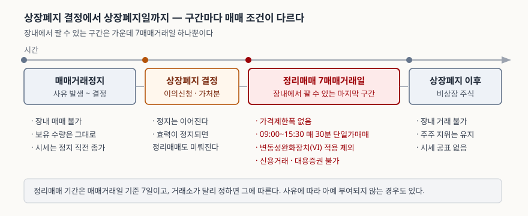
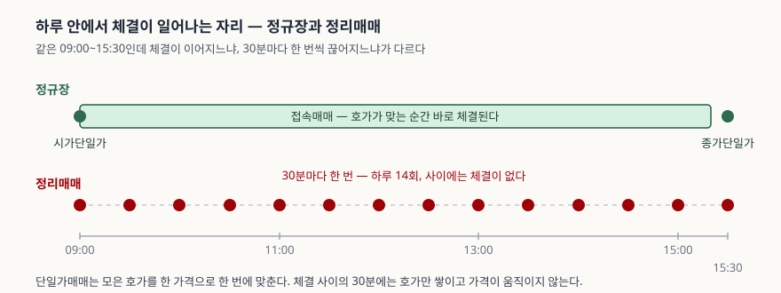

> 예제의 종가·보유 수량·체결가는 제도의 작용을 보이려고 만든 가상 회사의 값이다. 실재하는 종목의 수치가 아니다.

## 들어가며

보유 종목이 어느 날 갑자기 거래정지된다. 며칠 뒤 "상장폐지 결정"이라는 공시가
뜨고, 다시 며칠 뒤에는 거래정지가 풀렸다는 안내가 온다. 이때 처음 드는 생각은
보통 "일단 거래가 되니 다행"이다.

그런데 호가창을 열어 보면 평소와 다르다. 매도호가가 수십만 주씩 쌓여 있는데
체결은 일어나지 않고, 갑자기 한꺼번에 체결되고 다시 멈춘다. 주가는 하루 만에
80% 넘게 빠져 있다. 상·하한가는 어디에도 보이지 않는다.

이 구간이 **정리매매**다. 거래가 재개된 것이 아니라, 상장폐지 전에 마지막으로
한 번 팔 기회를 주는 별도 구간이고 매매 규칙 자체가 다르다. 규칙을 모르고
평소처럼 주문을 내면 체결 시각도, 체결 가격도 예상과 어긋난다.

## 개념

**정리매매는 상장폐지가 확정된 증권에 거래소가 일정 기간 매매를 허용하는 제도다.**
법제처 생활법령정보는 상장폐지되는 증권에 대해 해당 증권의 매매거래일을 기준으로
최대 7일 동안 매매가 허용된다고 안내하고, 근거로 「유가증권시장 상장규정」 제9조와
「코스닥시장 상장규정」 제23조를 든다.

제도의 목적은 가격을 지키는 것이 아니라 **출구를 하나 열어 두는 것**이다. 상장폐지
이후에는 장내에서 팔 상대를 찾을 수 없으므로, 그 전에 거래소라는 공동의 자리에서
매수자를 만날 기회를 준다. 그래서 이 구간에는 평소 가격을 붙들어 두던 장치들이
오히려 빠진다. 가격을 묶어 두면 팔려는 사람과 사려는 사람이 만날 수 있는 가격대가
7일 안에 열리지 않을 수 있기 때문이다.

빠지는 장치는 셋이다. **가격제한폭**이 적용되지 않고, **변동성완화장치(VI)** 적용
대상에서도 제외되며, 체결 방식이 접속매매에서 **30분 단위 단일가매매**로 바뀐다.
여기에 신용거래와 대용증권 사용이 막힌다. 빌린 돈으로 사거나 담보로 잡을 수 없다는
뜻이다.

| | 정규장 | 정리매매 |
|---|---|---|
| 체결 방식 | 접속매매(시가·종가만 단일가) | 09:00~15:30 매 30분 단일가매매 |
| 가격제한폭 | ±30%(코넥스 ±15%) | 적용하지 않는다 |
| 변동성완화장치 | 적용 | 적용 제외 |
| 신용거래·대용증권 | 가능 | 불가 |
| 기간 | 상장되어 있는 동안 | 매매거래일 기준 7일 |

## 구조



> **출처**: [법제처 찾기쉬운 생활법령정보 — 주식의 상장 이해하기](https://easylaw.go.kr/CSP/CnpClsMainBtr.laf?ccfNo=1&cciNo=2&cnpClsNo=2&csmSeq=1701&popMenu=ov)(정리매매 기간 7일, 유가증권시장 상장규정 제9조·코스닥시장 상장규정 제23조) · [한국거래소 KIND — 상장폐지(정정) 공시](https://kind.krx.co.kr/external/2025/12/01/000796/20251201001738/70769.htm)(가격제한폭 없이 09:00~15:30 매 30분 단일가매매, 코스닥시장 업무규정 제23조, 효력정지 가처분으로 일정이 미뤄진 사례)

## 동작 원리

**체결이 일어나는 자리가 하루 14개로 줄어든다.** 정규장에서는 09:00 시가단일가와
15:30 종가단일가 사이가 전부 접속매매라, 매수호가와 매도호가가 겹치는 순간 바로
체결된다. 정리매매에서는 09:00부터 15:30까지 30분마다 모인 호가를 한 가격으로
한 번에 맞춘다. 시각을 세어 보면 하루 14회, 7거래일이면 98회다.



> **출처**: [한국거래소 KIND — 상장폐지(정정) 공시](https://kind.krx.co.kr/external/2025/12/01/000796/20251201001738/70769.htm)(09:00~15:30 매 30분 단일가격에 의한 개별경쟁매매). 체결 시각은 그 조건에서 직접 센 값이고, 1일 체결 횟수를 13회로 적은 2차 자료도 있다

그 30분 동안에는 호가만 쌓이고 가격이 움직이지 않는다. 단일가매매의 체결 원리는
같은 블로그의 [단일가매매와 시간외거래](../2026-10-21-single-price-auction-and-after-hours/index.md)
글에 있다. 중요한 것은 **중간 가격이 없다**는 점이다. 접속매매라면 호가 단계를
하나씩 밟으며 올라가거나 내려가는데, 단일가매매는 모은 호가 전체를 한 가격으로
맞추므로 직전 체결가와 다음 체결가 사이가 비어 있다.

**가격제한폭이 없다는 것이 7거래일에 무엇을 허용하는지**는 숫자로 보면 분명하다.
제한이 걸려 있다면 매일 하한가로 떨어져도 7거래일 뒤에 원래 값의 8.2%가 남는다.
제한이 없으면 첫날 한 번의 단일가로 그 아래에 닿을 수 있다. 가격제한폭과 VI가
각각 무엇을 재는지는 [상·하한가와 변동성완화장치](../2026-10-16-price-limit-volatility-interruption/index.md)
글에서 다뤘고, 그 글에서 정리매매종목이 VI 적용 제외라고 적은 자리가 여기다.

**바닥은 제도가 아니라 호가가격단위가 정한다.** 한국거래소의 호가가격단위는
2,000원 미만 구간에서 1원이다. 주가가 100원이면 한 호가가 1%지만 10원이면 10%,
1원이면 100%다. 주가가 내려갈수록 한 칸이 차지하는 비율이 커지고, 1원에서는 한
칸 아래가 0원이라 더 내려갈 자리가 없다. 정리매매 종목의 주가가 마지막에 한 자릿수
원에서 요동치는 것은 이 때문이다.

## 실습 예제

가상 회사 **가나전자**의 거래정지 직전 종가를 2,000원, 보유 수량을 1,000주로 둔다.
평가금액은 200만 원이다.

전체 소스: [`code/`](code/) · 수행 기록: [`code/output.txt`](code/output.txt)

```python
def auction_times(start="09:00", end="15:30", step_minutes=30):
    """정규장 안에서 단일가 체결이 이뤄지는 시각을 나열한다."""
    ...

def tick_size(price):
    """한국거래소 호가가격단위 — 2,000원 미만 구간만 쓴다."""
    return Decimal("1") if price < 2000 else Decimal("5")
```

가격제한폭이 걸려 있다고 **가정하면** 7거래일로 갈 수 있는 바닥은 이렇다.

```text
[2] 가격제한폭이 있다면 7거래일로 어디까지 내려가는가 (가정)
     거래일           하한가        직전 종가 대비          누적
       1      1,400.0원         -30.0%    -30.00%
       4        480.2원         -30.0%    -75.99%
       7        164.7원         -30.0%    -91.76%
  → 매일 하한가로 떨어져도 7거래일 뒤 8.2354%가 남는다
```

정리매매에는 이 바닥이 없다. 제한을 두면 7일 안에 가격이 수요와 만나지 못한 채
기간이 끝나고, 그러면 팔 기회를 주려던 제도가 팔지 못하게 하는 제도가 된다.

주가가 내려갈수록 한 호가가 차지하는 비율은 이렇게 커진다.

```text
[3] 가격이 내려갈수록 한 호가가 차지하는 비율
          주가        호가가격단위        한 호가의 비율
        100원            1원          1.00%
         20원            1원          5.00%
          5원            1원         20.00%
          1원            1원        100.00%
```

전량 매도했을 때 손에 쥐는 돈은 평균 체결가에 비례하지만, 그 위에 **증권거래세가
매도대금 전체에 붙는다.** 이익이 아니라 판 금액에 매기므로 손실이 확정된 거래에도
떼인다.

```text
[4] 정리매매로 전량 매도했을 때 손에 쥐는 돈
        평균 체결가          매도대금       증권거래세           실수령       평가금액 대비
          200원      200,000원        400원      199,600원        9.98%
           50원       50,000원        100원       49,900원        2.50%
            5원        5,000원         10원        4,990원        0.25%
```

## 실무에서 주의할 점

**첫째, 시장가 주문의 뜻이 달라진다.** 접속매매에서 시장가는 "지금 호가창에 있는
가격으로 즉시"지만, 단일가매매에서는 "30분 뒤에 정해질 가격으로"다. 주문을 넣는
시점에는 그 가격이 무엇일지 알 수 없고, 가격제한폭도 없어 범위가 열려 있다. 정리매매
구간에서 시장가는 가격을 포기하는 주문에 가깝다. 어느 가격 아래로는 안 팔겠다는
선이 있으면 지정가를 쓴다.

**둘째, 호가가 쌓여 있다고 팔리는 것이 아니다.** 단일가매매는 모은 호가를 한 가격에
맞추므로, 그 가격보다 비싸게 내놓은 매도 호가는 그 회차에 전량 남는다. 매도 잔량이
수십만 주인데 체결이 수천 주에 그치는 일이 흔하다. 7거래일 × 14회라는 숫자는 기회의
횟수이지 체결의 보장이 아니다.

**셋째, 정리매매가 반드시 열리는 것은 아니고 일정도 고정이 아니다.** 생활법령정보는
거래소가 일정 기간을 정해 매매를 허용할 수 있다고 적지, 반드시 허용한다고 적지
않는다. 실제로 거래소 공시 중에는 상장폐지결정 효력정지 가처분이 신청되면서 정리매매
기간과 상장폐지일이 모두 "-"로 정정된 사례가 있다. 공시된 날짜를 보고 계획을 세웠다가
그 날짜가 바뀔 수 있다.

**넷째, 팔지 않고 넘겨도 주식이 사라지지는 않는다.** 상장폐지는 거래소에서 거래할
자격을 잃는 것이지 주식 자체가 소멸하는 것이 아니다. 주주 지위도 의결권도 남는다.
다만 장내에서 거래할 수 없고 시세가 공표되지 않으므로, 팔려면 상대를 직접 찾아야
하고 값을 매길 기준도 없다. 재상장은 별도의 심사 절차이고 자동으로 되돌아오지 않는다.

**다섯째, 상장폐지에 이르는 경로가 2026년에 넓어졌다.** 관계기관 합동으로 2026년
2월 12일 발표된 '부실기업 신속·엄정 퇴출을 위한 상장폐지 개혁방안'에 따라 유가증권시장
상장규정이 2026년 5월 13일 개정돼 **2026년 7월 1일 시행**됐다. 시가총액 요건 상향
조정이 반기 단위로 앞당겨졌고, 보통주 종가가 30거래일 연속 1,000원 미만이면 관리종목으로
지정한 뒤 90일 이내에 연속 45일을 넘기지 못하면 상장폐지하는 요건이 신설됐다. 주식병합이나
감자로 종가를 끌어올린 경우에도 직전 1년 이내에 같은 조치가 있었거나 총 비율이 10대 1을
넘으면 상장폐지 대상이다. 주식병합과 감자가 주가에 무엇을 하는지는
[주식병합과 감자](../2026-10-27-share-consolidation-and-capital-reduction/index.md)
글에 있다.

## 정리

- 정리매매는 상장폐지가 확정된 증권에 **매매거래일 기준 7일** 동안 매매를 허용하는
  제도다. 가격을 지키는 제도가 아니라 출구를 여는 제도다.
- 그래서 가격을 붙들던 장치가 빠진다. 가격제한폭이 적용되지 않고, VI 적용 대상에서도
  제외되며, 체결은 09:00~15:30 매 30분 단일가매매로 바뀐다.
- 체결 자리는 하루 14개, 7거래일이면 98개다. 그 사이 30분에는 호가만 쌓이고 가격이
  움직이지 않는다. 시장가 주문은 30분 뒤의 미정 가격을 받아들이는 주문이 된다.
- 가격제한폭이 있었다면 7거래일로 갈 수 있는 바닥은 원래 값의 8.2%다. 제한이 없으니
  첫 회차에 그 아래로 간다. 마지막 바닥은 호가가격단위 1원이 정한다.
- 팔지 않고 넘기면 주식은 비상장 주식으로 남는다. 주주 지위는 유지되지만 장내 거래와
  시세 공표가 사라진다.

## 참고 자료

- [법제처 찾기쉬운 생활법령정보 — 주식의 상장 이해하기](https://easylaw.go.kr/CSP/CnpClsMainBtr.laf?ccfNo=1&cciNo=2&cnpClsNo=2&csmSeq=1701&popMenu=ov) — 정리매매 기간 7일(매매거래일 기준), 근거 조문으로 유가증권시장 상장규정 제9조·코스닥시장 상장규정 제23조
- [한국거래소 KIND — 상장폐지(정정) 공시](https://kind.krx.co.kr/external/2025/12/01/000796/20251201001738/70769.htm) — 가격제한폭 없이 09:00~15:30 매 30분 단일가격에 의한 개별경쟁매매, 매매 방식 근거로 코스닥시장 업무규정 제23조, 효력정지 가처분으로 정리매매 기간이 정정된 사례
- [신경희, 「한국거래소 규정 — 유가증권시장 상장규정(부실기업 퇴출제도 개선)」, 자본시장연구원 『자본시장포커스』 2026년 6월, 10~11쪽](http://www.kcmi.re.kr/common/downloadw?fid=28975&fgu=002001&fty=004003) — 2026-05-13 개정·2026-07-01 시행, 2026-02-12 '부실기업 신속·엄정 퇴출을 위한 상장폐지 개혁방안', 시가총액 요건 상향 조기화와 동전주 상장폐지 요건 신설
- [KRX, Basic Facts about Trading System — Tick (KOSDAQ Market)](https://global.krx.co.kr/contents/GLB/06/0602/0602020201/GLB0602020201.jsp) — 가격대별 호가가격단위(2,000원 미만 1원)
- [한국거래소 규정·제도 — 유가증권시장 종목별 변동성완화장치](https://regulation.krx.co.kr/contents/RGL/03/03010409/RGL03010409.jsp) — 정리매매종목이 VI 적용 제외 대상이라는 기재
