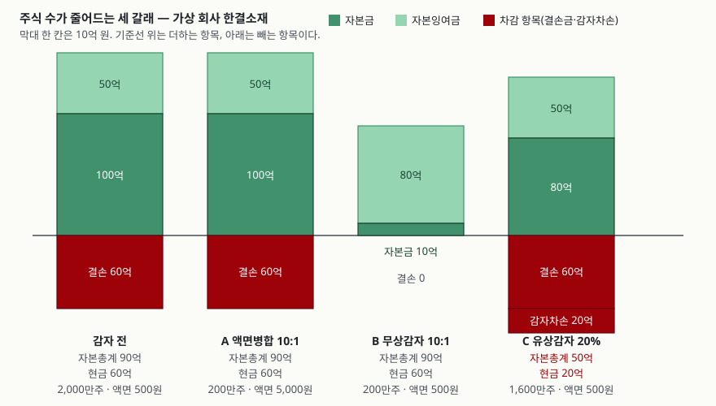
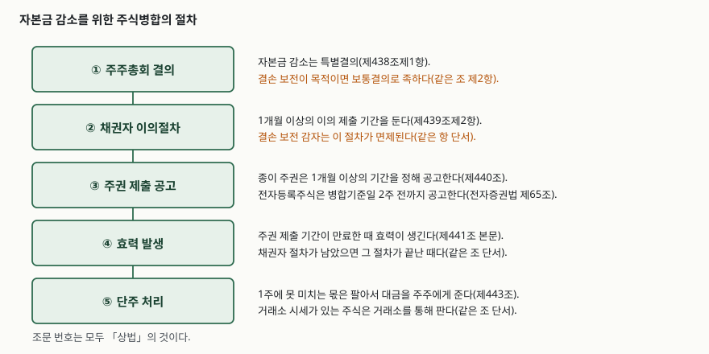

> 예제의 `한결소재`와 자본 항목·주가·보유 주식수는 계산을 보이려고 만든 값이다.
> 실재하는 회사와 관계가 없다.

## 들어가며

증권 계좌를 열었더니 1,005주이던 보유 수량이 100주로 바뀌어 있고, 현금 5,000원이
따로 들어와 있다. 평가금액은 거의 그대로다. 공시를 찾아보면 10대 1로 주식을
합쳤다는 한 줄이 나온다.

여기서 두 갈래로 반응이 갈린다. 한쪽은 "숫자만 바뀌었을 뿐 내 몫은 그대로"라고
넘기고, 다른 쪽은 "감자를 했으니 회사가 어려운 것"이라고 읽는다. 두 해석 모두
맞을 때가 있고 둘 다 틀릴 때가 있다. **같은 10대 1이라도 액면금액을 같이 올렸는지가
자본 항목을 완전히 다른 모양으로 남기기** 때문이다.

이 글은 한 회사의 자본 항목 하나를 놓고 세 갈래를 돌려 그 차이를 센다.

## 개념 — 자본금은 주식 수에 묶여 있다

출발점은 자본금의 정의다. 상법의 자본금 조항(제451조제1항)은 액면주식을 발행한
회사의 자본금을 **발행주식의 액면총액**으로 정한다. 액면금액에 발행주식총수를
곱한 값이 곧 자본금이라는 뜻이다.

```text
자본금 = 액면금액 × 발행주식총수
```

이 식이 왜 중요한가. 주식 수를 10분의 1로 줄이면 오른쪽 항이 10분의 1이 된다.
자본금을 그대로 두려면 액면금액을 10배로 올려야 한다. 올리지 않으면 자본금이
10분의 1로 줄고, 그것이 바로 **감자**다.

그래서 "주식병합"과 "감자"는 같은 말이 아니다. 주식병합은 여러 주식을 합쳐 적은
수의 주식으로 만드는 **수단**이고, 감자는 자본금이 줄어든 **결과**다. 액면금액을
같이 올리는 병합(흔히 액면병합이라 부른다)은 주식 수를 줄이면서도 자본금을
건드리지 않는다.

무액면주식을 발행한 회사는 사정이 다르다. 같은 조 제2항은 무액면주식 회사의
자본금을 발행가액의 2분의 1 이상에서 이사회가 자본금으로 계상하기로 한 금액의
총액으로 정한다. 주식 수와 자본금이 연동되지 않으므로, 발행주식총수에 액면가를
곱해 자본금을 역산하는 셈이 성립하지 않는다.

## 구조 — 세 갈래가 남기는 자국



> **출처**: 도식의 자본금 정의는 법제처 국가법령정보센터가 발행하는 「상법」 [제451조(자본금)](https://korea.legal/wiki/%ec%83%81%eb%b2%95-%ec%a0%9c451%ec%a1%b0/) (제3자 전재), 감자차익·감자차손의 분류는 한국회계기준원이 발행하는 [일반기업회계기준 제15장 「자본」 15.11](https://www.kasb.or.kr/front/board/ingAccountingList.do)에 따랐다. 수치는 가상 회사 한결소재의 예제 계산 결과다.

세 갈래가 전부 발행주식총수를 줄인다. 그런데 막대의 모양은 전부 다르다.

- **A 액면병합**은 자본 항목이 한 칸도 움직이지 않는다. 액면금액이 10배가 되면서
  액면총액이 그대로이기 때문이다
- **B 무상감자**는 자본금이 90억 줄어드는데 자본총계는 그대로다. 줄어든 자본금이
  밖으로 나간 것이 아니라 결손을 메우고 자본잉여금으로 옮겨갔기 때문이다
- **C 유상감자**만 자본총계와 현금이 같이 줄어든다. 이것만 돈이 회사 밖으로 나간다

막대를 보지 않고 "감자"라는 말만 들으면 B와 C를 구분할 수 없다. 그런데 주주에게
현금이 들어오느냐 마느냐가 여기서 갈린다.

## 동작 원리 — 절차가 목적에 따라 달라진다



> **출처**: 법제처 국가법령정보센터가 발행하는 「상법」 [제440조(주식병합의 절차)](https://korea.legal/wiki/%ec%83%81%eb%b2%95-%ec%a0%9c440%ec%a1%b0/)·[제441조(동전)](https://korea.legal/wiki/%ec%83%81%eb%b2%95-%ec%a0%9c441%ec%a1%b0/) (제3자 전재) 및 「주식·사채 등의 전자등록에 관한 법률」 [제65조(주식의 병합에 관한 특례)](https://korea.legal/wiki/%ec%a0%84%ec%9e%90%ec%a6%9d%ea%b6%8c%eb%b2%95-%ec%a0%9c65%ec%a1%b0/) (제3자 전재)

눈여겨볼 자리는 두 곳이다.

**결의 요건이 목적에 따라 갈린다.** 자본금 감소는 주주총회 특별결의가 원칙인데
(제438조제1항), 결손 보전을 위한 감소는 보통결의로 족하다(같은 조 제2항). 결손을
메우는 감자는 주주의 몫을 빼앗아 밖으로 내보내는 것이 아니라 장부 안에서 숫자를
옮기는 것이기 때문이다.

**채권자 이의절차도 같은 이유로 갈린다.** 자본금 감소에는 1개월 이상의 채권자 이의
제출 기간이 따르는데(제439조제2항), 결손 보전 목적의 감소는 그 절차가 면제된다
(같은 항 단서). 회사 재산이 밖으로 나가지 않으므로 채권자가 손해를 입지 않는다는
판단이다. 뒤집어 말하면 **유상감자에는 이 절차가 반드시 붙는다.**

효력이 생기는 시점도 주권의 형태에 따라 다르다. 종이 주권이면 제출 기간이 만료한
때이고(제441조 본문), 채권자 이의절차가 그때까지 안 끝났으면 그 절차가 끝난 때다
(같은 조 단서). 전자등록주식은 전자증권법의 주식병합 특례(제65조)가 병합기준일에
효력이 생기도록 하고, 공고도 기준일 2주 전까지로 줄여 둔다. 상장주식은 전자등록이
원칙이므로 실제로 보게 되는 일정은 뒤쪽이다.

줄어든 자본금이 어디로 가는지는 회계기준이 정한다. 일반기업회계기준 제15장은
소각하는 주식의 취득원가가 액면금액보다 작으면 그 차액을 **감자차익**으로 자본잉여금에
넣고, 취득원가가 액면금액보다 크면 감자차익 범위에서 먼저 상계한 뒤 남는 금액을
자본조정의 **감자차손**으로 처리하도록 한다(15.11). 결손 보전에 쓰고 남은 몫이
감자차익으로 가는 경로가 여기다.

## 실습 예제 — 가상 회사 한결소재

자본금 100억(액면 500원 × 2,000만 주), 자본잉여금 50억, 결손금 60억인 회사를 놓고
세 갈래를 돌린다. 전체 코드는 [`code/capital_reduction.py`](code/capital_reduction.py)에 있다.

### A — 액면병합 10:1

```text
[A. 액면병합 10:1 — 액면금액을 10배로 올린다]
  자본금                          10,000,000,000 원
  자본잉여금(주식발행초과금)                5,000,000,000 원
  자본조정(감자차손)                                0 원
  이익잉여금(결손금)                   -6,000,000,000 원
  ------------------------ ------------------
  자본총계                          9,000,000,000 원
  현금및현금성자산                      6,000,000,000 원
  발행주식총수                            2,000,000 주
  액면금액                                  5,000 원
  액면총액(= 액면 x 주식수)             10,000,000,000 원
```

주식 수가 2,000만에서 200만으로 줄었는데 자본 항목은 네 줄 모두 그대로다. 액면금액이
500원에서 5,000원이 되면서 액면총액이 100억으로 유지되기 때문이다. 자본금이 줄지
않으므로 자본금 감소를 전제로 한 채권자 이의절차도 문제되지 않는다. 결손은 그대로
남아 있다 — 이 경로는 결손을 건드리지 않는다.

### B — 무상감자 10:1

```text
[B. 무상감자 10:1 — 액면금액을 두고 주식수만 줄인다]
  자본금                           1,000,000,000 원
  자본잉여금(주식발행초과금)                8,000,000,000 원
  자본조정(감자차손)                                0 원
  이익잉여금(결손금)                                0 원
  ------------------------ ------------------
  자본총계                          9,000,000,000 원
  현금및현금성자산                      6,000,000,000 원

  자본금 감소액          9,000,000,000 원
  결손 보전에 충당       6,000,000,000 원
  감자차익(자본잉여금 증가) 3,000,000,000 원
  자본총계 변동                      0 원
  현금 변동                          0 원
```

자본금이 100억에서 10억으로 90억 줄었다. 그 90억 중 60억이 결손을 메워 결손금이
0이 되고, 남은 30억이 감자차익으로 자본잉여금에 붙어 50억이 80억이 됐다. **자본총계는
90억 그대로이고 현금도 60억 그대로다.**

결손금이 0이 되면 배당 가능한 상태로 가는 길이 열리고, 자본잉여금이 늘면 이후
결손이 생겼을 때 메울 여지가 생긴다. 무상감자를 하는 회사가 노리는 곳이 보통 이쪽이다.
다만 결손이 사라진 것은 **메웠기 때문이지 벌었기 때문이 아니다.** 벌어들이는 구조가
달라진 것은 없다.

### C — 유상감자 20%

```text
[C. 유상감자 20% — 소각하고 주당 1,000원을 환급한다]
  자본금                           8,000,000,000 원
  자본조정(감자차손)                   -2,000,000,000 원
  이익잉여금(결손금)                   -6,000,000,000 원
  ------------------------ ------------------
  자본총계                          5,000,000,000 원
  현금및현금성자산                      2,000,000,000 원

  소각 주식수                4,000,000 주
  자본금 감소액          2,000,000,000 원
  주주 환급 총액         4,000,000,000 원
  감자차손               2,000,000,000 원
```

400만 주를 주당 1,000원에 사들여 소각했다. 자본금은 액면 500원 × 400만 주 = 20억만
줄었는데 나간 현금은 40억이다. 그 차액 20억이 감자차손으로 자본에서 빠진다.
자본총계는 90억에서 50억으로, 현금은 60억에서 20억으로 줄었다.

**주주 쪽에서 보면 이 경로만 현금이 들어온다.** 대신 회사에 남은 재산이 그만큼 줄었다.

### 주주 한 사람의 장부

1,005주를 가진 주주가 각 경로에서 어떻게 되는지 센다.

```text
[주주 한 사람의 장부] 감자 전 1,005주 · 주가 1,000원 · 평가금액 1,005,000원
  경로                   보유주식       단주        지분율          받는 현금        이론 주가          평가금액+현금
  ------------------------------------------------------------------------------------------
  A 액면병합                100      0.5  0.00500%          5,000       10,000        1,005,000
  B 무상감자                100      0.5  0.00500%          5,000       10,000        1,005,000
  C 유상감자                804      0.0  0.00502%        201,000        1,000        1,005,000

  감자 전 지분율 0.00502%
```

세 경로 모두 "평가금액 + 받는 현금"이 1,005,000원으로 같다. 병합이나 감자 자체는
주주의 몫을 늘리거나 줄이는 행위가 아니기 때문이다. 바뀌는 것은 그 몫이 주식과
현금으로 어떻게 나뉘어 있느냐다.

다만 지분율 칸을 보면 A와 B에서 0.00502%가 0.00500%로 아주 조금 줄었다. 1,005주를
10으로 나누면 100.5주인데 0.5주는 주식으로 남지 못하고 팔려서 현금 5,000원으로
들어왔기 때문이다. 상법의 단주 처리 조항(제443조)이 1주에 못 미치는 몫을 팔아
대금을 주주에게 주도록 하고, 거래소 시세가 있는 주식은 거래소를 통해 팔도록 한다.

## 실무에서 주의할 점

**첫째, 공시 제목만으로 B와 C를 구분할 수 없다.** 둘 다 "감자"로 불리는데 하나는
현금이 들어오고 하나는 들어오지 않는다. 공시에서 볼 것은 감자 비율이 아니라
**감자 방법**과 **주주에게 지급하는 금액**이다. 지급 금액이 없으면 무상감자다.

**둘째, 액면금액이 같이 바뀌는지를 본다.** 10대 1 병합에서 액면금액이 500원에서
5,000원이 되면 자본금은 그대로이고 결손도 그대로다. 액면금액이 그대로면 자본금이
10분의 1로 줄어든다. 공시의 액면가 항목 한 칸이 이 둘을 가른다.

**셋째, 자본잉여금이 늘어도 쓸 수 있는 돈이 생긴 것은 아니다.** 무상감자로 늘어난
감자차익은 장부상 분류가 바뀐 것이고 현금은 1원도 움직이지 않았다. 예제의 현금
60억이 세 경로 중 C에서만 줄어든 이유가 그것이다.

**넷째, 단주는 주식이 아니라 현금으로 돌아온다.** 병합 비율로 나누어떨어지지 않는
몫은 매각 대금으로 들어오므로 보유 주식 수와 지분율이 아주 조금 줄어든다.
병합 비율이 클수록 단주로 빠지는 비중도 커진다.

**다섯째, 전자등록주식은 일정이 다르다.** 종이 주권 기준의 1개월 주권 제출 기간을
생각하고 있으면 실제 일정과 어긋난다. 상장주식은 전자증권법 특례에 따라 병합기준일
2주 전 공고로 진행되고 그 기준일에 효력이 생긴다.

## 정리

- 자본금은 액면금액에 발행주식총수를 곱한 값이므로(상법 제451조제1항), 주식 수를
  줄이면서 액면금액을 같이 올리면 자본금이 그대로다
- 액면병합은 자본 항목을 한 칸도 바꾸지 않는다. 무상감자는 자본금을 줄여 결손을
  메우고 남으면 감자차익으로 자본잉여금에 넣되 자본총계는 그대로 둔다
- 유상감자만 회사 밖으로 현금이 나간다. 환급액이 자본금 감소액보다 크면 그 차액이
  감자차손으로 자본에서 빠진다
- 결의 요건과 채권자 이의절차는 **재산이 밖으로 나가느냐**로 갈린다. 결손 보전
  감자는 보통결의로 족하고 채권자 이의절차가 면제된다
- 주주가 가진 몫의 총액은 세 경로 모두 바뀌지 않는다. 다만 단주로 빠지는 몫만큼
  보유 주식과 지분율이 아주 조금 줄어든다

## 참고 자료

- 법제처 국가법령정보센터, 「상법」 [제451조(자본금)](https://korea.legal/wiki/%ec%83%81%eb%b2%95-%ec%a0%9c451%ec%a1%b0/) · [제440조(주식병합의 절차)](https://korea.legal/wiki/%ec%83%81%eb%b2%95-%ec%a0%9c440%ec%a1%b0/) · [제441조(동전)](https://korea.legal/wiki/%ec%83%81%eb%b2%95-%ec%a0%9c441%ec%a1%b0/) (링크는 제3자 전재)
- 법제처 국가법령정보센터, 「주식·사채 등의 전자등록에 관한 법률」 [제65조(주식의 병합에 관한 특례)](https://korea.legal/wiki/%ec%a0%84%ec%9e%90%ec%a6%9d%ea%b6%8c%eb%b2%95-%ec%a0%9c65%ec%a1%b0/) (링크는 제3자 전재)
- 한국회계기준원, [일반기업회계기준](https://www.kasb.or.kr/front/board/ingAccountingList.do) 제15장 「자본」 15.11 — 감자차익은 자본잉여금, 감자차손은 자본조정으로 분류한다
- 예제 전체 코드: [`code/capital_reduction.py`](code/capital_reduction.py) · 실행 기록: [`code/output.txt`](code/output.txt)
