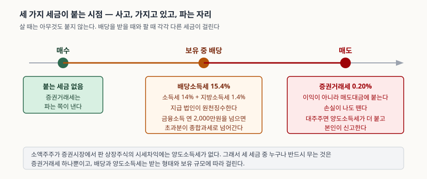
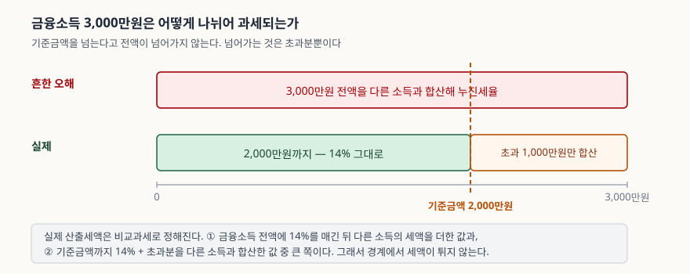

> 예제의 투자 금액·수익률·배당액은 세금의 작용을 보이려고 만든 가상 회사의 값이다. 실재하는 종목의 수치가 아니다. 세율은 2026년 10월 27일 현재 기준이고, 개별 사안의 세액은 국세청이나 세무 전문가에게 확인할 일이다.

## 들어가며

증권사 앱에서 수익률을 보면 보통 매수 평균가와 현재가만 가지고 계산한 숫자가 뜬다.
10% 올랐다고 찍혀 있어서 팔았는데, 계좌에 들어온 돈을 원금과 비교하면 10%가 아니다.
배당을 받았을 때도 마찬가지다. 공시에는 주당 1,000원이라고 적혀 있었는데 입금된
금액은 846원이다.

차이를 만드는 것은 세금인데, 국내 주식에 붙는 세금은 **하나가 아니라 셋이고 걸리는
시점도 다르다.** 어떤 것은 이익에 붙고 어떤 것은 이익과 상관없이 거래 금액에 붙으며,
어떤 것은 대부분의 개인에게는 아예 걸리지 않는다. 셋을 뭉뚱그려 "세금 떼였다"고
넘기면 세전 수익률과 세후 수익률이 왜 그만큼 벌어졌는지 설명할 수 없다.

## 개념

**증권거래세**는 주식을 판 금액 전체에 붙는다. 이익이 났는지는 보지 않는다. 법제처
생활법령정보는 유가증권시장 0.05%, 코스닥시장과 금융투자협회를 통한 장외 양도 0.2%,
코넥스시장 0.1%로 안내한다. 여기에 유가증권시장에는 **농어촌특별세 0.15%가 따로**
붙으므로 매도대금 대비 총 부담은 0.20%가 된다. 이 세율은 금융투자소득세 도입을
전제로 내려 두었던 탄력세율을 되돌린 것으로, **2026년 1월 1일 이후 양도하는 분부터**
적용된다. 그 결과 유가증권시장과 코스닥시장의 합계 부담률이 같아졌다.

**배당소득세**는 배당을 받을 때 붙는다. 소득세법이 정한 배당소득 원천징수세율은
14%이고 여기에 지방소득세가 그 10%만큼 더해져 실제로 떼이는 비율은 **15.4%**다.
받는 사람이 신고할 일이 없다. 배당을 지급하는 법인이 떼고 나머지를 보내는 원천징수
방식이기 때문이다. 배당락과 배당기준일의 관계는 같은 블로그의
[배당락과 권리락](../2026-10-10-ex-dividend-ex-rights/index.md) 글에 있다.

**양도소득세**는 판 가격에서 산 가격을 뺀 차익에 붙는다. 다만 **상장주식을 증권시장
안에서 판 소액주주에게는 걸리지 않는다.** 과세 대상은 주권상장법인의 대주주가 양도한
주식과, 대주주가 아니더라도 증권시장 밖에서 양도한 주식이다. 상장법인 대주주는 지분
1% 이상을 가진 주주 1인이거나 보유 주식 시가총액이 50억원 이상인 주주 1인 등이고,
판정은 직전 사업연도 종료일 현재 보유분을 기준으로 한다.

| 세금 | 걸리는 시점 | 무엇에 | 누가 떼나 |
|---|---|---|---|
| 증권거래세 | 팔 때 | 매도대금 전체 | 증권사·예탁결제원이 징수 |
| 배당소득세 | 배당받을 때 | 배당금 | 지급 법인이 원천징수 |
| 양도소득세 | 팔 때(대주주 등) | 양도차익 | 본인이 신고·납부 |

## 구조



> **출처**: [법제처 찾기쉬운 생활법령정보 — 양도소득세·증권거래세 및 배당소득세](https://easylaw.go.kr/CSP/CnpClsMain.laf?popMenu=ov&csmSeq=1701&ccfNo=2&cciNo=3&cnpClsNo=1)(2026-09-15 기준: 시장별 증권거래세율, 납세의무자, 배당소득 원천징수세율 14%, 대주주 범위와 양도소득세율)

## 동작 원리

**증권거래세가 이익이 아니라 거래 금액에 붙는다는 점이 세 세금 중 가장 성질이 다르다.**
손실을 확정하는 매도에도 똑같이 떼이고, 같은 돈을 여러 번 돌리면 돌릴 때마다 다시
붙는다. 0.20%는 한 번만 보면 작지만 회전 횟수에 곱해진다. 수수료와 스프레드까지 합친
왕복 비용은 [스프레드와 왕복 비용](../2026-10-20-spread-and-round-trip-cost/index.md)
글에서 다뤘다.

**배당소득세는 원천징수로 끝나는 경우와 그렇지 않은 경우가 갈린다.** 배당·이자를
합친 금융소득이 한 해 2,000만원 이하면 15.4%를 떼는 것으로 과세가 종결된다. 넘으면
종합과세 대상이 되는데, 여기서 흔한 오해가 "2,000만원을 넘으면 전액이 누진세율로
합산된다"는 것이다. 실제로는 **기준금액까지는 원천징수세율이 보장되고 초과분만 다른
소득과 합쳐진다.**



> **출처**: [법제처 찾기쉬운 생활법령정보 — 양도소득세·증권거래세 및 배당소득세](https://easylaw.go.kr/CSP/CnpClsMain.laf?popMenu=ov&csmSeq=1701&ccfNo=2&cciNo=3&cnpClsNo=1)(배당소득 원천징수세율 14%) · 비교과세의 두 산출 방식은 소득세법의 금융소득 종합과세 규정(제14조·제62조)에 따른 것이고, 아래 예제는 그 구조를 누진세율표로 계산한 것이다

구조를 정확히 쓰면 이렇다. 산출세액은 두 가지로 계산해 **큰 쪽**을 쓴다. ① 금융소득
전액에 14%를 매긴 뒤 다른 소득의 세액을 더한 값과, ② 기준금액까지는 14%를 매기고
초과분만 다른 소득과 합산해 누진세율을 적용한 값이다. 둘 중 큰 쪽이므로 기준금액
바로 아래와 바로 위에서 세액이 갑자기 튀지 않는다.

**양도소득세는 과세 대상에 들어가는 순간 규모가 달라진다.** 기본공제 연 250만원을
뺀 과세표준에 3억원 이하는 20%, 초과분은 6,000만원에 초과액의 25%를 더해 매긴다.
여기에도 지방소득세가 10%만큼 붙는다. 소액주주에게는 0인 항목이 대주주에게는 차익의
20%대로 걸리므로, 대주주 판정 기준일 직전에 보유 규모가 어디에 있느냐가 세액 전체를
가른다.

## 실습 예제

가상 회사 **가나전자**에 1,000만원을 넣고 한 해 동안 세전 100만원을 벌었다고 둔다.
번 금액은 같고 **받는 형태만** 바꾼다.

전체 소스: [`code/`](code/) · 수행 기록: [`code/output.txt`](code/output.txt)

```python
def comprehensive_tax(financial_income, other_base):
    """금융소득 종합과세의 비교과세 — 두 방식 중 큰 쪽이 산출세액이다."""
    if financial_income <= FINANCIAL_THRESHOLD:
        separate = financial_income * DIVIDEND_RATE
        return separate + progressive_tax(other_base), "분리과세(원천징수로 종결)"
    plan_a = financial_income * DIVIDEND_RATE + progressive_tax(other_base)
    excess = financial_income - FINANCIAL_THRESHOLD
    plan_b = (FINANCIAL_THRESHOLD * DIVIDEND_RATE
              + progressive_tax(other_base + excess))
    ...
```

같은 100만원인데 실효세율이 2.20%에서 17.40%로 벌어진다.

```text
[2] 같은 세전 수익 100만원, 받는 형태만 다르면 — 가나전자 1,000만원 투자
  형태                           배당소득세       증권거래세        세후 수익      실효세율
  시세차익 100%                       0원     22,000원     978,000원    2.20%
  배당 50% + 차익 50%            77,000원     21,000원     902,000원    9.80%
  배당 100%                   154,000원     20,000원     826,000원   17.40%
```

세전 수익률이 똑같아도 **몇 번에 나눠 벌었느냐**로도 갈린다. 연 10%를 n번으로 나눠
벌고 그때마다 판다고 두면, 한 회전의 순배수는 `(1 + 0.10/n) × (1 - 0.0020)`이다.

```text
[3] 세전 수익률이 같아도 매매 횟수가 다르면 — 연 10%, 10년
       연 매매 횟수        1회전 순배수         10년 뒤 잔액        거래세 없을 때 대비
             1       1.097800      25,423,320원          -514,104원
             4       1.022950      24,784,277원        -1,153,146원
            12       1.006317      21,289,225원        -4,648,198원
            52       0.999919       9,588,681원       -16,348,743원
  거래세가 없다면 10년 뒤 25,937,424원
```

주 단위로 돌리는 맨 아래 줄은 한 회전의 순배수가 1보다 작다. 연 10%를 52로 나눈
0.192%보다 거래세 0.20%가 크기 때문이다. 이것은 매매 방식에 대한 판단이 아니라
**0.20%가 어디에 곱해지는지에 대한 산술**이다. 수익률에 곱해지는 것이 아니라 회전할
때마다 원금에 곱해진다.

금융소득 기준금액 근처에서는 세액이 어떻게 움직이는지 보자. 다른 종합소득 과세표준이
5,000만원인 사람을 가정한다.

```text
[4] 금융소득 2,000만원 경계에서 무슨 일이 일어나는가
        금융소득         산출세액         지방소득세 포함 적용 방식
      1,900만   8,900,000원       9,790,000원 분리과세(원천징수로 종결)
      2,000만   9,040,000원       9,944,000원 분리과세(원천징수로 종결)
      2,100만   9,280,000원      10,208,000원 비교과세 ② (초과분 합산)

  '2,000만원을 넘으면 전액이 누진세율로 합산된다'는 말과 비교하면
    전액 합산이라고 보면     11,280,000원
    실제 비교과세 결과        9,280,000원
    차이                     2,000,000원
```

금융소득이 1,900만원에서 2,100만원으로 200만원 늘 때 세액은 38만원 늘었다. 경계를
넘었다고 계단이 생기지 않는다.

## 실무에서 주의할 점

**첫째, 증권거래세는 손실 거래에도 붙는다.** 이익에 매기는 세금이 아니라 거래 금액에
매기는 세금이기 때문이다. 손절매도 예외가 아니고, [정리매매](../2026-10-27-liquidation-trading-after-delisting/index.md)
처럼 사실상 전액 손실이 확정된 구간의 매도에도 매도대금의 0.20%가 떼인다.

**둘째, 시장별 세율이 2026년에 바뀌었고 앞으로도 바뀐다.** 기본세율은 법률에 있지만
실제로 적용되는 세율은 시행령의 탄력세율이고, 이것은 개정으로 움직인다. 2026년 1월
1일 이후 양도분부터 유가증권시장과 코스닥시장의 합계 부담률이 0.20%로 같아졌다.
오래된 글이나 계산기에서 가져온 세율을 그대로 쓰면 맞지 않는다.

**셋째, 배당의 실효세율은 다른 소득에 따라 달라진다.** 금융소득이 기준금액 이하면
15.4%로 끝나지만, 넘으면 초과분이 **내 다른 소득의 누진 구간 위에** 얹힌다. 같은
배당 1,000만원이라도 다른 소득이 적은 사람과 많은 사람의 추가 세액이 다르다. 배당
수익률만 보고 세후를 가늠하면 어긋난다.

**넷째, 대주주 판정은 파는 날이 아니라 직전 사업연도 종료일 기준이다.** 그 시점의
보유 상태로 그해 전체의 과세 여부가 정해진다. 또 요건이 "지분 1% 이상"과 "시가총액
50억원 이상" 둘 중 하나만 걸려도 되므로, 지분율이 낮아도 금액으로 걸릴 수 있다.

**다섯째, 제도가 더 붙는 중이다.** 고배당 상장기업의 배당소득에 대한 분리과세 특례가
조세특례제한법 제104조의27로 신설돼 **2026년 1월 1일 시행**됐다. 금융위원회는 특례
요건 충족 사실을 기업가치 제고계획 공시로 알리도록 시행령을 정비했다고 밝혔다. 세율
구간과 대상 요건은 보도마다 설명이 달라 이 글에서는 적지 않는다. 해당되는지 따질
일이 생기면 법령 원문과 국세청 안내로 확인한다.

## 정리

- 국내 상장주식에 붙는 세금은 셋이고 걸리는 시점이 다르다. **살 때는 붙지 않는다.**
  배당받을 때 배당소득세, 팔 때 증권거래세, 대주주면 양도소득세가 더 붙는다.
- 증권거래세는 이익이 아니라 매도대금에 붙는다. 2026년 1월 1일 이후 양도분부터
  유가증권시장 0.05% + 농어촌특별세 0.15%, 코스닥시장 0.20%, 코넥스시장 0.10%다.
- 같은 세전 수익 100만원도 전액 시세차익이면 실효세율 2.20%, 전액 배당이면 17.40%다.
  소액주주의 장내 시세차익에는 양도소득세가 없기 때문이다.
- 금융소득 2,000만원은 계단이 아니다. 비교과세로 기준금액까지는 14%가 보장되고
  초과분만 다른 소득과 합쳐진다. 예제에서 금융소득 200만원 증가에 세액은 38만원 늘었다.
- 대주주 양도소득세는 기본공제 250만원을 뺀 과세표준에 3억원 이하 20%, 초과분은
  6,000만원 + 초과액의 25%다. 판정 기준일은 직전 사업연도 종료일이다.

## 참고 자료

- [법제처 찾기쉬운 생활법령정보 — 양도소득세·증권거래세 및 배당소득세](https://easylaw.go.kr/CSP/CnpClsMain.laf?popMenu=ov&csmSeq=1701&ccfNo=2&cciNo=3&cnpClsNo=1) — 2026-09-15 기준. 시장별 증권거래세율(유가증권 0.05%·코스닥 및 장외 0.2%·코넥스 0.1%), 납세의무자, 배당소득 원천징수세율 14%, 대주주 범위(지분 1% 또는 시가총액 50억원), 양도소득세율과 기본공제 250만원
- [조세일보, 「내년 1월부터 증권거래세율 코스피 0.05%, 코스닥 0.20%로 상향」(2025-12-01)](https://www.taxtimes.co.kr/mobile/article.html?no=272624) — 기획재정부 시행령 개정안 보도. 증권거래세법 시행령 제5조, 2026-01-01 이후 양도분부터 적용, 유가증권시장 농어촌특별세 0.15% 유지
- [금융위원회, 「배당소득 과세특례 대상기업의 기업가치 제고계획 공시 관련 시행령 개정」](https://www.fsc.go.kr/no010101/86322) — 조세특례제한법 제104조의27, 2025-12-23 개정·2026-01-01 시행, 특례 요건 충족 사실의 공시 방법
- [국세청 — 국세법령정보시스템](https://taxlaw.nts.go.kr/) — 소득세법 제14조(종합소득), 제62조(비교과세), 제103조(양도소득 기본공제), 제104조(양도소득세율), 제129조(원천징수세율)와 증권거래세법 시행령 제5조(탄력세율)의 원문 확인처
